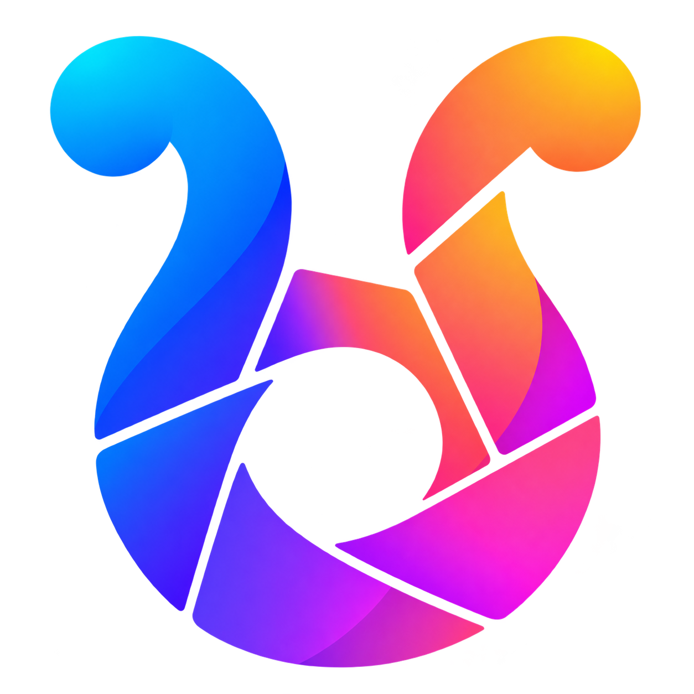
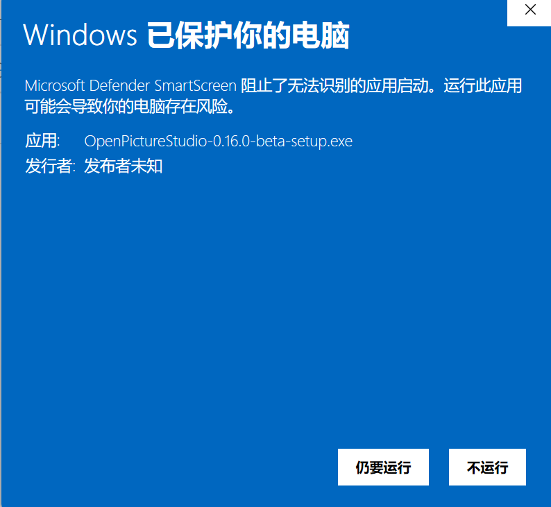
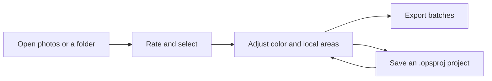
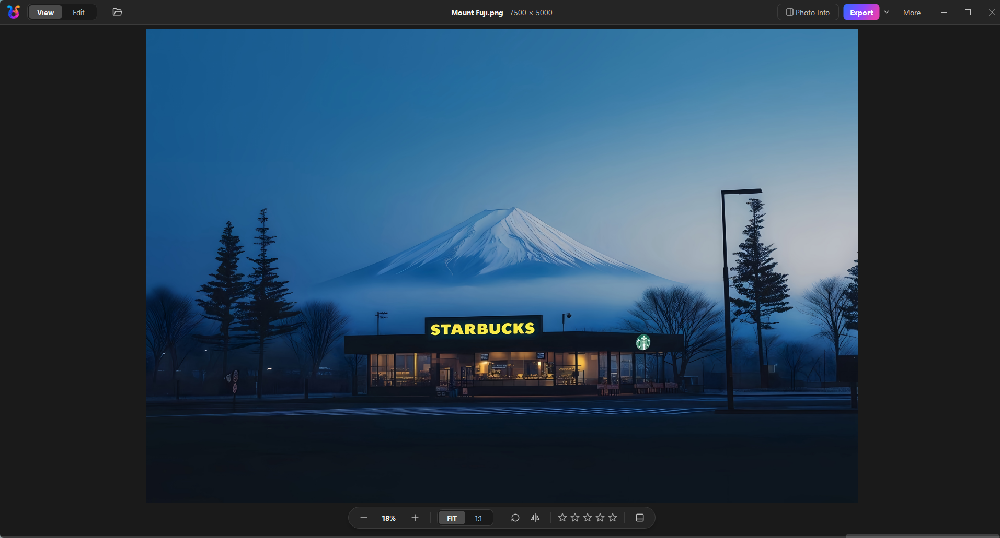
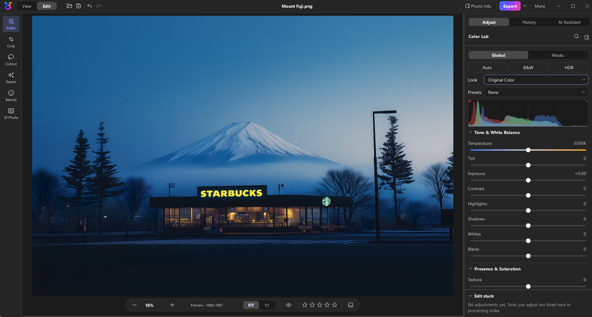
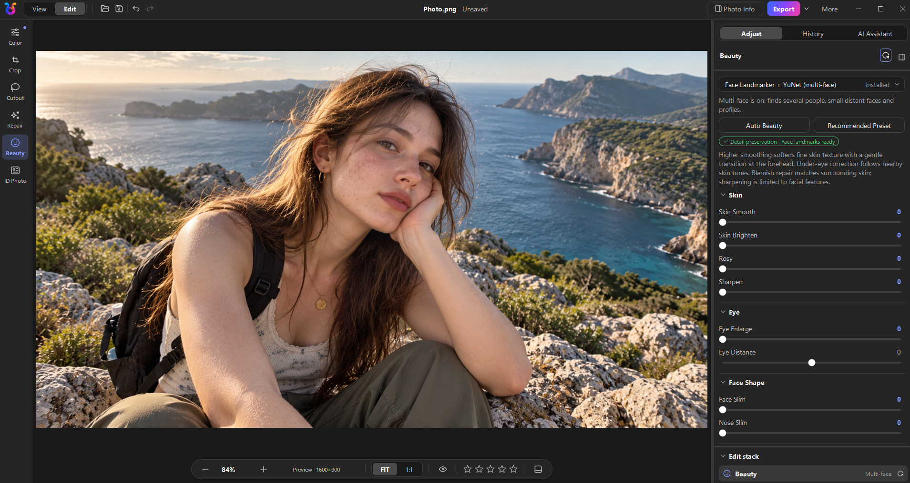
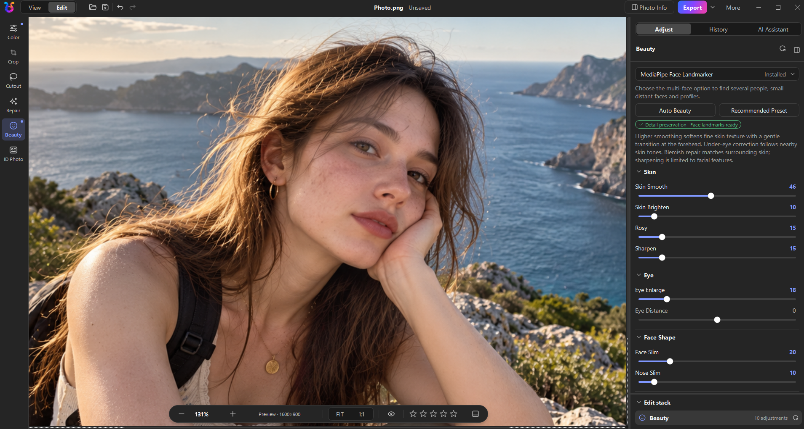

# OpenPictureStudio (OPS)

[简体中文](README.md) | [English](README.en.md) | [Français](README.fr.md)

<p align="center">
  
</p>

<p align="center">
  <a href="https://github.com/KpTanl/OpenPictureStudio/releases/latest"></a>
  
  <a href="https://github.com/KpTanl/OpenPictureStudio/actions/workflows/ci.yml"></a>
  <a href="LICENSE"></a>
</p>

**Cull, develop RAW photos, and export batches in one window.**

OpenPictureStudio is an open-source photo workspace for Windows, bringing photo browsing and selection, color editing, local adjustments, and batch export together. Save edits as projects and use AI tools and the photo assistant when needed. The interface supports 简体中文, English, and Français.

**[Download for Windows](https://github.com/KpTanl/OpenPictureStudio/releases/latest)** · [Installation](#installation-and-running) · [Quick Start](#quick-start) · [Features](#features) · [FAQ](#frequently-asked-questions) · [Report an Issue](https://github.com/KpTanl/OpenPictureStudio/issues)

> Beta · Windows 10/11 (64-bit) · 8 GB of RAM or more recommended. Core viewing and editing work offline.

## Installation and Running

### Download the Windows Installer

1. Open the [latest release](https://github.com/KpTanl/OpenPictureStudio/releases/latest). Under **Assets**, download `OpenPictureStudio-<version>-beta-setup.exe` and its matching `.exe.sha256` file.
2. Verify the installer's SHA256, run the EXE, and follow the installation wizard.
3. Launch OpenPictureStudio and open a photo or folder. The installer requires no separate Python or Rust installation; download AI models as needed.

<details>
<summary>How do I verify SHA256?</summary>

Open PowerShell in the download folder and run these commands, replacing `<version>` with the downloaded version:

```powershell
Get-FileHash -LiteralPath '.\OpenPictureStudio-<version>-beta-setup.exe' -Algorithm SHA256
Get-Content -LiteralPath '.\OpenPictureStudio-<version>-beta-setup.exe.sha256'
```

The hash from the first command should match the 64-character value at the start of the second command's output. The checksum verifies that the download is intact and matches the release asset. Get both files from this repository's Release.

</details>

### “Windows protected your PC” on First Launch

The Windows installer is currently unsigned. When you first run it by double-clicking, Windows SmartScreen may display “Windows protected your PC” and “Unknown publisher.”

Confirm that the file came from [this repository's Release](https://github.com/KpTanl/OpenPictureStudio/releases/latest) and verify its matching SHA256. Then select **More info → Run anyway** to continue installation.

<details>
<summary>View an example of the Windows prompt (Chinese)</summary>



This example shows the 0.16.0 installer with More info already expanded. The filename changes with each release. If Run anyway is unavailable, follow your device's security guidance or organization policy.

</details>

### Download and Install with PowerShell

Open a regular PowerShell window, expand the commands below, and **copy and run the entire block**. It supports Windows PowerShell 5.1 and PowerShell 7, downloads the latest regular release from this repository, verifies SHA256, and opens the installation wizard directly.

Exit OPS normally before upgrading. Downloads stay in the temporary folder printed by the command; installation does not restart your computer automatically. Windows protection and organization policies remain active.

<details>
<summary>Show PowerShell installation commands</summary>

```powershell
& {
    $ErrorActionPreference = 'Stop'
    $releasePage = 'https://github.com/KpTanl/OpenPictureStudio/releases/latest'
    try {
        $release = Invoke-RestMethod -Uri 'https://api.github.com/repos/KpTanl/OpenPictureStudio/releases/latest' -Headers @{ 'User-Agent' = 'OpenPictureStudio-Install' } -TimeoutSec 30
        $name = 'OpenPictureStudio-{0}-beta-setup.exe' -f ($release.tag_name -replace '^v', '')
        $installer = @($release.assets | Where-Object { $_.name -ceq $name })
        $checksum = @($release.assets | Where-Object { $_.name -ceq "$name.sha256" })
        if ($installer.Count -ne 1 -or $checksum.Count -ne 1) { throw 'The release does not contain one matching installer and checksum.' }

        $folder = Join-Path ([IO.Path]::GetTempPath()) ('OpenPictureStudio-' + [Guid]::NewGuid().ToString('N'))
        New-Item -ItemType Directory -Path $folder | Out-Null
        Write-Host ('Download folder: ' + $folder)
        $exe = Join-Path $folder $name
        $sha = Join-Path $folder "$name.sha256"
        Invoke-WebRequest -UseBasicParsing -Uri $installer[0].browser_download_url -OutFile $exe -TimeoutSec 600
        Invoke-WebRequest -UseBasicParsing -Uri $checksum[0].browser_download_url -OutFile $sha -TimeoutSec 30

        $line = (Get-Content -LiteralPath $sha -Raw).Trim()
        if ($line -notmatch '^(?<hash>[a-fA-F0-9]{64})[ \t]+\*?(?<file>[^\r\n]+)$') { throw 'The checksum file is invalid or names a different installer.' }
        $expected = $Matches['hash']
        if ($Matches['file'] -cne $name) { throw 'The checksum file is invalid or names a different installer.' }
        if ((Get-FileHash -LiteralPath $exe -Algorithm SHA256).Hash -ine $expected) { throw 'SHA256 mismatch. The installer has not been started.' }

        Write-Host 'SHA256 verified. Opening the installation wizard...'
        $start = New-Object System.Diagnostics.ProcessStartInfo
        $start.FileName = $exe
        $start.WorkingDirectory = $folder
        $start.UseShellExecute = $false
        $start.Arguments = '/NORESTART'
        $process = [System.Diagnostics.Process]::Start($start)
        $process.WaitForExit()
        switch ($process.ExitCode) {
            0 { Write-Host 'Installation completed.' }
            { $_ -in 2, 5 } { Write-Host 'Installation canceled or aborted.' }
            default { throw ('Installation did not complete. Exit code: ' + $process.ExitCode) }
        }
    } catch {
        throw ("Unable to complete installation. Releases: $releasePage`n" + $_.Exception.Message)
    }
}
```

</details>

### Upgrading and Version Checks

By default, the installed application checks GitHub for the latest regular release, with at least 24 hours between automatic checks for each user. Disable automatic checks in Settings → General, or check manually on the About page. Requests include the application version and necessary HTTP information; GitHub can see the network IP address and request time. The application opens a fixed download page for you to download and run the installer. Running from source does not trigger automatic checks; update the source with git.

<details>
<summary>Upgrades, repairs, and early test builds</summary>

Exit all running instances normally before upgrading, then close the installer before launching the application. The installer checks program files against its file manifest and preserves settings, custom data directories, models, and projects. If unknown files, user-replaced components, or directory conflicts are found, follow the prompts to back up and move the conflicting content. After an interrupted installation, rerun the full installer for the same version. Back up and resolve any truncated or modified files before continuing the repair.

Early test builds may not have an installation manifest. If their program files remain, back up your data and uninstall the old build first. If the original installation directory has been removed or is completely empty, rerun the installer directly. When replacement is blocked, the installer shows the original directory.

</details>

## Quick Start

1. **Open and select**: Open a photo or folder, browse the filmstrip or grid, and filter using ratings and Keep/Reject flags.
2. **Edit**: Enter the editing workspace to adjust exposure, color, and composition. Add local masks when needed. History lets you undo, redo, and compare with the original.
3. **Save and deliver**: Save a copy or queue selected photos for batch export. Save an `.opsproj` project to keep the processing steps and history for later editing.



## Features

| Workflow | Features |
| --- | --- |
| Browse and select | Common images and camera RAW, filmstrip/grid views, ratings and flags, linked comparison, keywords and smart collections |
| RAW and color | Camera preview, Original Color and OPS Look; exposure and white balance, curves, eight-channel color mixing, and 11 built-in presets |
| Local editing | Gradient, brush, eraser, subject and facial-region masks; cropping, rotation, and shape crops |
| AI tools | Super-resolution, denoising and deblurring, background removal, portrait retouching, ID photos, and an assistant whose adjustments enter edit history |
| Group processing | Sync selected adjustments, shift exposure across a group, suggest groups from capture details, match exposure, and align RAW white balance |
| Projects and export | Automatic drafts, `.opsproj` projects, batch queues, format and size conversion, transparent PNG/16-bit TIFF, and multi-image PDF |

### Viewing and Editing

**View**: Browse photos, adjust the zoom, and assign star ratings.

[](.github/assets/readme/viewer.png)

**Edit**: Switch to the editing workspace in the same window to adjust exposure, white balance, and color.

[](.github/assets/readme/workspace.png)

### Portrait Retouching

Adjust skin, eye, and face-shape settings, then zoom in to inspect the details.

**Initial settings · 84% zoom**

[](.github/assets/readme/beauty-default.png)

**After adjustments · 131% zoom**

[](.github/assets/readme/beauty-adjusted.png)

<details>
<summary>Complete feature list</summary>

### Browsing and Culling

- **Common formats and camera RAW**: Open JPEG, PNG, BMP, GIF, WebP, TIFF, ICO, and PPM/PGM/PBM directly. Camera RAW support includes CR2, CR3, NEF, NRW, ARW, RAF, DNG, ORF, PEF, and RW2 from Canon, Nikon, Sony, Fujifilm, Olympus, Pentax, Panasonic, and other brands.
- **RAW previews first**: Opening a RAW file shows its embedded camera preview before replacing it with the decoded image. RAW display modes include Camera preview, Original Color, and OPS Look. Other formats offer Original Color and OPS Look, with preferences saved separately for RAW and other formats.
- **Filtering and comparison**: Browse in a filmstrip or grid. Add star ratings and Keep/Reject flags; filter by rating, flag, file type, editing status, and delivery status. Compare two photos side by side at their original resolution with linked navigation.
- **Photo library**: Add keywords and organize photos into regular collections or smart collections that update automatically based on rules.
- **Photo information**: View shooting settings, camera and lens details, source file information, and histograms, including for RAW files.
- **Everyday tools**: Rotate, flip, set wallpapers, and associate file types. Choose Dark, Light, or Beige themes and switch the interface between 简体中文, English, and Français.

### Editing

- **Color adjustments**:
  - Temperature, tint, exposure, contrast, highlights, shadows, whites, and blacks.
  - Texture, clarity, dehaze, vibrance, and saturation.
  - RGB and individual channel tone curves, an eight-channel color mixer with an on-image eyedropper, a live histogram, and one-click auto adjustment.
  - 11 built-in presets: Monochrome, Retro, Fresh, Warm, Cool, Soft Light, Vivid, Dramatic, HDR, Film, and Skin Beauty.
- **Local masks**: Linear and radial gradients, brush and eraser, subject selection, facial skin, eyes, lips, background, and the whole photo. Combine multiple regions by adding or subtracting them within a mask, with separate adjustments for each mask.
- **OPS Look**: Choose Original Color or OPS Look for RAW, JPG, PNG, and other formats.
- **Composition**: Free cropping and rotation, grid cropping, shape cropping, and lasso selection.
- **History and projects**: Multi-step undo and redo, a history panel for returning to any step, and an edit stack showing the current processing steps. Press and hold to compare with the original. Save edits as `.opsproj` projects.

### Groups of Photos

- **Group adjustments**: Use one photo as a reference and sync selected adjustments to selected photos or all filtered results, or increase or decrease exposure across the group. Undo or redo each batch, or retry photos that did not complete successfully.
- **Photo groups and calibration**: Get grouping suggestions based on capture time, camera, and lens, along with exposure-matching and RAW white-balance alignment suggestions for each group. Preview the changes before applying them together.

### AI Tools

- **Image enhancement**: Real-ESRGAN super-resolution (2×, 4×, and 4K), NAFNet denoising and deblurring, and restoration at the original dimensions. Adjust luminance and color noise separately.
- **Background removal**: U2Net subject detection, color-based removal, and lasso cutouts. Refine edges and export with a transparent or solid-color background.
- **Portrait retouching**: Facial landmarks drive four groups of adjustments: skin (smoothing, brightening, rosy tone, and sharpening), face shape (face and nose slimming), eyes (enlargement and spacing), and detail retouching (teeth whitening, blemish removal, and under-eye bag reduction).
- **ID photos**: Presets for Chinese one-inch and two-inch ID photos, passports, visas, social security documents, and custom dimensions. Change the background color, frame automatically based on face position, and arrange photos on a print sheet.
- **AI photo assistant**: Multiple chats with Chat, Plan, Adjust, and Agent modes. Adjustments enter the same editing history as manual edits, so you can undo, redo, or refine them. Request two alternatives to generate A/B candidates, compare them in the assistant panel, and add one to history by clicking Apply. Attach a reference image or save named styles and preferences for future use.
- **Models and GPU**: Models are downloaded separately from the installer. Download, import, uninstall, and set defaults in Settings → Tools and Models. If you have a dedicated GPU, install the GPU runtime (DirectML) in Settings → Runtimes and restart the application to activate it.

</details>

<details>
<summary>Projects, drafts, and output details</summary>

- **Projects and drafts**: Edits are saved automatically as drafts so you can continue when you reopen the same photo. Saving an `.opsproj` project preserves processing steps and history.
- **Saving results**: Choose whether to overwrite the original or save a copy. Output is written to a temporary file and validated before replacing the destination, preserving existing files if saving fails or is canceled.
- **Batch export**: Select photos and an output preset, then add them to the export queue. Edits are frozen when queued, so later changes to a photo do not affect queued items. Pause or cancel the queue, retry failed items, and review completion records.
- **Format handling**: Convert between JPG, PNG, WebP, BMP, and TIFF. Set a target file size in KB for JPG. Resize with aspect-ratio preservation, crop-to-fill, padded fit, or stretching.
- **High bit depth and PDF**: Export 16-bit TIFF with transparency, or combine multiple images into a single PDF in order.

</details>

## Frequently Asked Questions

### Do I need a dedicated GPU?

Viewing and basic editing can run on the CPU. For GPU inference, install the DirectML runtime in Settings → Runtimes and restart the application. Models and runtimes are managed separately.

### Why do some AI tools ask for a model?

Download or import the models you need in Settings → Tools and Models, then select them in the relevant tool panel. AI background removal and AI background replacement for ID photos use U2Net. Keeping the original background, cropping, resizing, and arranging ID photos require no model. The installed application stores models in `%APPDATA%\OpenPictureStudio\OpenPictureStudio\models` by default. Saved projects restore the exact model versions they reference.

### Can I continue editing after closing the app?

Edits are automatically saved as drafts for each photo. Reopen the same photo to continue. Save an `.opsproj` project to explicitly preserve processing steps and history; create finished images with Save or Export.

### Does the AI assistant send my photos?

After you configure a service, the first message includes a preview by default. Select No photo below the input box to disable photo sharing. See AI Services and Privacy below for the full rules. Local AI tools use models downloaded to your computer.

### Does a version check install updates automatically?

A version check offers a link to the download page. You download and install the update. The PowerShell commands above also run only when you choose to execute them.

## AI Services and Privacy

The AI photo assistant uses services you configure yourself. Add connections and models in Settings → AI Services. The assistant sends no requests until a service is configured. API keys are encrypted with Windows DPAPI and stored locally.

Content sent to the service:

- **Text and parameters**: Your messages, current adjustment parameters, and locally computed photo analysis describing brightness, color casts, and faces in text, without image pixels.
- **Photos**: By default, the first message includes a preview of the current image with edits applied, with a maximum long edge of 1536 pixels. The photo selector below the input box can switch to the original image without edits, with a maximum long edge of 2048 pixels, or No photo. Smaller photos are sent at their original dimensions without upscaling. When photo sharing is enabled, the assistant can also request original, task-start, and current previews, plus high-resolution crops allowed by the model settings. All images are JPEGs without shooting metadata. Selecting No photo prevents photos from being sent in any request; photos are also omitted when image input is disabled for the model.
- **Reference images**: Sent only when you attach one.

The top of the assistant panel shows what will be sent for the current request. Chats, attachments, and styles are stored locally.

## Reporting Issues

Include the app version, Windows version, steps to reproduce, and relevant screenshots or logs in [GitHub Issues](https://github.com/KpTanl/OpenPictureStudio/issues). Check attachments for personal information and service keys before posting publicly.

Both the installed application and source runs write logs to `%APPDATA%\OpenPictureStudio\OpenPictureStudio\logs\openpicturestudio.log` by default. Change the location, size per log file (about 2 MB by default), and number of rotated files to keep (3 by default) in Settings → Storage. You can also open the log folder there. Attach the log when reporting an issue to help with diagnosis.

## Documentation

| Document | Links |
| --- | --- |
| User guide | [简体中文](README.md) · [English](README.en.md) · [Français](README.fr.md) |
| Installation | [简体中文](README.md#安装与运行) · [English](#installation-and-running) · [Français](README.fr.md#installation-et-exécution) |
| Run from source | [简体中文](README.md#源码运行) · [English](#run-from-source) · [Français](README.fr.md#exécution-depuis-les-sources) |
| Installer builds | [简体中文](README.md#构建) · [English](#building) · [Français](README.fr.md#compilation) |
| Tests | [简体中文](tests/README.md) · [English](tests/README.en.md) |
| CI and release workflows | [CI](.github/workflows/ci.yml) · [Release](.github/workflows/release.yml) · [Shared environment](.github/actions/setup-build/action.yml) |
| Project license | [MIT License](LICENSE) |

<details>
<summary>Resources, dependencies, and third-party licenses</summary>

- Model catalog: [catalog.json](resources/models/catalog.json).
- Runtime catalog: [catalog.json](resources/runtimes/catalog.json).
- License supplements and corresponding source: [manifest.json](packaging/licenses/manifest.json).
- Bundled notices: [FlatBuffers](packaging/licenses/flatbuffers/LICENSE) · [MediaPipe](packaging/licenses/mediapipe/MEDIAPIPE_THIRD_PARTY_NOTICES.txt) · [Qt](packaging/licenses/qt/QT_THIRD_PARTY_NOTICES.txt) · [MSVC runtime](packaging/licenses/msvc-runtime/NOTICE.txt).
- Model licenses: [MediaPipe](resources/models/licenses/MEDIAPIPE.txt) · [NAFNet](resources/models/licenses/NAFNET.txt) · [Real-ESRGAN](resources/models/licenses/REAL_ESRGAN.txt) · [U2Net](resources/models/licenses/U2NET.txt) · [YuNet](resources/models/licenses/YUNET.txt).
- Interface icons: [Source](resources/icons/ui/SOURCE.txt) · [License](resources/icons/ui/LICENSE.txt).
- Dependency lists: [requirements.txt](requirements.txt) · [requirements-ai.txt](requirements-ai.txt) · [requirements-beauty.txt](requirements-beauty.txt) · [requirements-dev.txt](requirements-dev.txt) · [requirements-build.txt](requirements-build.txt) · [requirements-build.lock.txt](requirements-build.lock.txt).

</details>

### Run from Source

<details>
<summary>Python environment, optional dependencies, and Rust acceleration</summary>

Requires Python 3.12 or later; development and release builds use 3.13. Dependencies are grouped by feature, so you can install only what you need.

```powershell
# 1. Get the source
git clone https://github.com/KpTanl/OpenPictureStudio.git
cd OpenPictureStudio
python -m venv .venv
.\.venv\Scripts\activate

# 2. Install the base dependencies (viewing, color editing, format handling, and output)
pip install -r requirements.txt

# 3. (Optional) Install AI and portrait retouching dependencies
pip install -r requirements-ai.txt
pip install -r requirements-beauty.txt

# 4. Launch the application
python main.py
```

The Rust acceleration module is optional. To use it, install the Rust toolchain, build the module, and copy the result to the repository root:

```powershell
cd native\ops_accel
cargo build --release
copy target\release\ops_accel.dll ..\..\ops_accel.pyd
cd ..\..
```

</details>

## Building

<details>
<summary>Installer builds, CI/releases, tests, and code structure</summary>

### Build the Installer

Requires Inno Setup, the Rust toolchain, and the full application, AI, portrait retouching, and packaging dependencies. `requirements-build.lock.txt` pins tested versions for release builds; `requirements-build.txt` is its source. Before building, the script checks the Python version, required dependencies, and that exactly one OpenCV distribution is installed.

```powershell
pip install -r requirements-build.lock.txt
powershell -ExecutionPolicy Bypass -File build.ps1
```

### CI and Releases

CI runs code checks and Python compilation, builds the native module, runs the test suite, and packages the installer as separate jobs. Pull requests run through testing; pushes to `dev`/`main` and manual runs also package the installer.

Release tags run the same stages, verify that the commit belongs to `main` and that the tag matches `APP_VERSION`, then create a draft Release. A maintainer publishes the Release manually.

The native build uploads `ops_accel.pyd`. Testing and packaging download the same artifact; packaging uses `build.ps1 -SkipNativeBuild` and prepares Cargo dependency sources for license collection. Each downstream job selects the producer's artifact ID.

### Run Tests

See the [test instructions](tests/README.en.md).

### Code Structure

The application follows a one-way dependency structure: UI → application → core → native acceleration. Each layer depends only on the public contracts of the layer below it.

- **`src/ui`**: Interface and interactions, including browsing and editing workspaces, tool panels, themes, and localization.
- **`src/application`**: Workflow coordination, including task scheduling, caches, model and runtime management, output, and persistence.
- **`src/core`**: Algorithms and data models, including the imaging engine, tool contracts, workflows, and `.opsproj` projects.
- **`native/ops_accel`**: Native acceleration module written in Rust.
- **`resources`**: Themes, translations, and model and runtime catalogs.

</details>

## License and Third-Party Dependencies

The original code of OpenPictureStudio is released under the [MIT License](LICENSE). Third-party dependencies, models, and assets follow their own licenses. Interface icons come from [Tabler Icons](https://github.com/tabler/tabler-icons) under the MIT License, with the license text stored alongside them in [resources/icons/ui/LICENSE.txt](resources/icons/ui/LICENSE.txt).

Installer and portable distributions include the following materials in the program directory, generated from the actual bundle contents by [tools/collect_licenses.py](tools/collect_licenses.py) during the build:

- `THIRD_PARTY_NOTICES.txt`: Component names, versions, licenses, and homepages, including models and runtimes available for download;
- `licenses/`: License texts and copyright notices for each component;
- `SOURCE.txt`: The application commit and source URL, plus corresponding source URLs and checksums for GPL, LGPL, and MPL components;
- `components.json`: The mapping between components and distributed files;
- `LICENSE` (MIT) and `GPL-3.0.txt`.

License texts missing from upstream packages and components requiring corresponding source are registered in [packaging/licenses](packaging/licenses). The build stops if a distributed file cannot be assigned to a component, a component is missing its license text, or a GPL, LGPL, or MPL component has no corresponding source registration.

This project uses PyQt6, whose open-source edition is licensed under GPLv3; commercial licensing is also available. A combined application built and distributed with GPL-licensed PyQt6 must be distributed under GPLv3. The MIT license for the project's original code remains in effect: MIT applies when reusing that code on its own, while reusing and distributing the combined application with GPL-licensed PyQt6 also requires compliance with GPLv3.

When distributing such installers or portable packages, retain the applicable copyright notices and license texts, and provide the complete corresponding source for the release, including source for GPL-covered dependencies and the necessary build scripts. Access to the corresponding source should be provided alongside the binary download.

For detailed terms, see the [official PyQt licensing information](https://www.riverbankcomputing.com/software/pyqt/intro), [PyQt licensing FAQ](https://www.riverbankcomputing.com/commercial/license-faq), and [GPLv3 terms](https://www.gnu.org/licenses/gpl-3.0.html). Distributions using a commercial PyQt license follow its commercial terms and the licenses of other dependencies.

For logo, screenshot, diagram, and icon credits used in this README, see [Asset Sources](.github/assets/readme/SOURCES.en.md).
