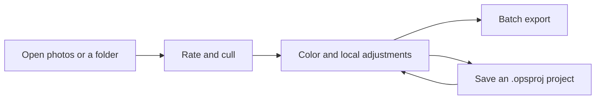

# OpenPictureStudio (OPS)

[简体中文](README.md) | [English](README.en.md) | [Français](README.fr.md)

  

  
  
  
  

**Begin with light. Give every inspiration a chance to become a finished work.**

OpenPictureStudio (OPS) is an open-source AI image creation platform built on professional image processing. It connects the reality a camera records with the picture in the creator's mind. RAW color grading, local masks, non-destructive editing, an AI retouching assistant, and batch processing come together in one creative workflow. The platform keeps growing toward automated workflows, generative editing, and an open plugin ecosystem.

**For everyday users, creating starts with an easy first step.** From adjusting the exposure and color of everyday photos to exploring a look with the AI assistant, OPS aims to make it easier to turn what you have in mind into concrete actions. Fixing one photo can also be the start of learning about light and finding your own voice.

**For professional creators, every detail deserves care.** Draw out color and tonal depth from RAW files, shape light with local masks, refine your decisions through non-destructive editing and history, then apply a finished look to a whole series. OPS values controllable parameters, a traceable process, and consistent results, so that technique carries your judgment and the tool follows your creative lead.

**For developers, being open means being able to extend the tools yourself.** Following the long-term direction of "Everything is Plugin", OPS will gradually refine the extension contracts for image operations, workflows, and the project model, so that algorithms, models, and creative tools can plug into one platform. A solution to one specific need of your own, or a new creative method you share, can become someone else's starting point.

**For AI agents, image creation needs tools that can be called, orchestrated, and inspected.** The existing AI retouching assistant is where this collaboration begins. Later work will connect tool calls, workflow execution, and project context. An external agent will be able to organize processing, previews, and exports around a creative goal without opening the desktop interface, and hand the results back to the creator for review. Human intent, professional tools, and AI execution will meet in the same work.

**[Download the Windows installer](https://github.com/KpTanl/OpenPictureStudio/releases/latest)** · [Quick Start](#quick-start) · [Key Features](#key-features) · [Benchmarks](#system-requirements-and-performance-benchmarks) · [Roadmap](#roadmap) · [Documentation](open-docs/README.en.md)

> Beta · Windows 10/11 (64-bit) · The interface supports Simplified Chinese, English, and French. Core viewing and editing work offline.
> 
> For the features and installers of each version, see the [release notes](https://github.com/KpTanl/OpenPictureStudio/releases/latest).

## Key Features

| Workflow | Features |
| --- | --- |
| Viewing and culling | Common image formats and camera RAW, filmstrip/grid, star ratings and flags, linked comparison, keywords and smart collections |
| RAW and color | Camera preview / Original Color / OPS Look, exposure and white balance, curves, 8-channel color mixer, 11 built-in presets |
| Local editing | Gradient, brush, and eraser masks, plus subject and face-region masks; cropping, rotation, and shape crop |
| AI tools | Super resolution, denoise and deblur, cutout, portrait retouching, ID photos, and a retouching assistant whose adjustments are written to history |
| Group processing | Sync selected adjustments, shift exposure across a group, suggested groups from shooting details, exposure matching and RAW white balance alignment |
| Projects and export | Automatic drafts, `.opsproj` projects, batch queue, format and size conversion, transparent PNG / 16-bit TIFF, multi-image PDF |

### Viewing and Editing

**Viewing**: Browse photos, adjust the zoom, and give star ratings.

**Editing**: Switch to the editing workspace in the same window and adjust exposure, white balance, and color.

### Portrait Retouching

Adjust skin, eye, and face-shape settings, and zoom in to check the details.

**Initial settings · 84% zoom**

**After adjusting · 131% zoom**

Complete feature list

### Viewing and Culling

- **Common formats and camera RAW**: JPEG, PNG, BMP, GIF, WebP, TIFF, ICO, and PPM/PGM/PBM open directly. Camera RAW support covers CR2, CR3, NEF, NRW, ARW, RAF, DNG, ORF, PEF, and RW2, from Canon, Nikon, Sony, Fujifilm, Olympus, Pentax, Panasonic, and other brands.
- **RAW previews first**: When you open a RAW file, the embedded camera preview shows first and is replaced once decoding finishes. For RAW you can display Camera preview, Original Color, or OPS Look. Other formats offer Original Color or OPS Look. The two settings are saved separately.
- **Filtering and comparison**: Two ways to browse, filmstrip and grid. Star ratings and Keep/Reject flags. Filter by rating, flag, file type, editing status, and delivery status. Two photos can be compared side by side at original size with linked navigation.
- **Library**: Add keywords to photos, and organize them with regular collections and smart collections that update automatically by rules.
- **Photo information**: Shooting settings, camera, source file details, and a histogram. This works for RAW too.
- **Everyday tools**: Rotate and flip, set as wallpaper, file association. Dark, Light, and Beige themes. The interface supports Simplified Chinese, English, and French.

### Editing

- **Color panel**:
  - Temperature, tint, exposure, contrast, highlights, shadows, whites, and blacks.
  - Texture, clarity, dehaze, vibrance, and saturation.
  - RGB and single-channel tone curves, an 8-channel color mixer (pick colors on the image with the eyedropper), a live histogram, and one-click auto adjustment.
  - 11 built-in presets: Monochrome, Retro, Fresh, Warm, Cool, Soft Light, Vivid, Dramatic, HDR, Film, and Skin Beauty.
- **Local masks**: Linear gradient, radial gradient, brush and eraser, select subject, facial skin, eyes, lips, background, and the entire photo. A single mask can combine several regions by adding or subtracting them, and each mask has its own adjustments.
- **OPS Look**: A look defined by OPS itself. It reflects an aesthetic taste for color, light and shadow, and tonal depth, and gives RAW, JPG, PNG, and other photos a starting point with the OPS style. You can switch back to Original Color, or keep adjusting exposure, curves, and local masks.
- **Composition**: Free crop and rotation, grid crop, shape crop, and lasso.
- **History and projects**: Multi-level undo and redo. The history panel can return to any step, and the edit stack lists the current processing steps. Press and hold to compare with the original. Edits can be saved as `.opsproj` projects.

### Photo Groups

- **Group adjustments**: Use one photo as the sample and sync selected adjustments to the selected photos or to all filtered results. You can also shift exposure across the group. Every batch can be undone, redone, or retried for the photos that did not succeed.
- **Photo groups and calibration**: Groups are suggested by capture time, camera model, and lens. For photos in the same group, OPS suggests exposure matching and RAW white balance alignment, which you preview and then apply together.

### AI Tools

- **Image enhancement**: Real-ESRGAN super resolution (2×, 4×, 4K) and NAFNet denoise and deblur, which can also restore at the original size. Luminance noise and color noise are adjusted separately.
- **Cutout**: U2Net finds the subject. There are also cutout by color and lasso cutout. You can refine edges and output a transparent or solid-color background.
- **Portrait retouching**: Based on face landmarks, with four groups of adjustments: skin (smoothing, brightening, rosy tone, sharpening), face shape (face slim, nose slim), eyes (eye enlarge, eye distance), and detail retouching (teeth whiten, spot remove, eye bag remove).
- **ID photos**: Size presets for one-inch, two-inch, passport, visa, and social security photos, plus custom sizes. You can change the background color, compose automatically around the face position, and lay out sheets.
- **AI retouching assistant**: Multiple chats, with Chat, Plan, Adjust, and Agent modes. The assistant's adjustments are written straight into the edit history, so like manual adjustments you can undo, redo, or keep refining them. When you want two options, it generates A/B candidates that you compare in the assistant panel, and nothing is written until you click Adopt. You can attach a reference image, and you can save named styles and preferences for later use.
- **Models and GPU**: Models are not shipped with the installer. In Settings → Tools and Models you can download, import, uninstall, and set defaults as needed. With a dedicated GPU, you can install the GPU runtime (DirectML) in Settings → Runtimes, which takes effect after a restart.

Projects, drafts, and output details

- **Projects and drafts**: Edits are saved automatically as drafts, and you continue from them the next time you open the same photo. Saving as an `.opsproj` project also saves the processing steps and history.
- **Saving results**: You decide whether to overwrite the original or save a copy. Output is first written to a temporary file and verified before it replaces the target. A failure or cancellation never damages an existing file.
- **Batch export**: Choose photos and an output preset, then add them to the export queue. The edits are fixed at the moment of queuing, so later changes to a photo do not affect items already queued. The queue can be paused and canceled, failed items can be retried, and completed records can be searched.
- **Format handling**: Convert between JPG, PNG, WebP, BMP, and TIFF. JPG can target a file size (KB). Resizing supports keeping proportions, crop to fill, fit with padding, and stretching directly.
- **High bit depth and PDF**: 16-bit TIFF with transparency is supported. Multiple images can be merged into one PDF in order.

## Installation and Running

### Download the Windows Installer

1. Open the [latest release](https://github.com/KpTanl/OpenPictureStudio/releases/latest). Under **Assets**, download `OpenPictureStudio-<version>-beta-setup.exe` and the `.exe.sha256` file with the same name.
2. Verify the installer's SHA256, then double-click the EXE and follow the setup wizard.
3. Start OpenPictureStudio and open a photo or folder. The installed version needs no separate Python or Rust. AI models are downloaded as needed.

The installed version includes its runtime dependencies, and AI models are downloaded as needed. The current installer is not code-signed. If SmartScreen shows a warning, check the source and the SHA256, then follow the system prompts. The [installation and upgrade guide](open-docs/installation.en.md) covers the verification commands, first-run prompts, the PowerShell download and install method, and upgrade notes.

### Upgrades and Version Checks

By default, the installed version checks for a stable release automatically, at most once every 24 hours. You can turn this off in Settings → General, or check manually in About. The app opens the download page, and you download and install the update yourself. The check sends the app version and the necessary HTTP information, and GitHub can see the IP address and request time.

Before upgrading, quit OpenPictureStudio, then run the new installer over the existing installation. Your existing settings, custom data folder, models, and projects are kept. If there is a folder conflict or a repair is needed, follow the installer's prompts. See [Installation and Upgrades](open-docs/installation.en.md) for details.

### Quick Start

1. **Open and cull**: Open a photo or a folder, browse with the filmstrip or grid, and filter by star rating and Keep/Reject.
2. **Edit**: Go to the editing workspace and adjust exposure, color, and composition. Add local masks when needed. The processing steps stay in history, so you can undo, redo, and compare with the original.
3. **Save and deliver**: Save a finished copy, or add the selected photos to the batch export queue. Saving an `.opsproj` project keeps the processing steps and history, so you can keep editing later.

## Editing Workflow and AI Agents

Non-destructive color grading, local masks, history, and `.opsproj` projects together preserve the editing process. Finished images are produced by saving or exporting. The built-in assistant supports Chat, Plan, Adjust, and Agent modes. Adjustments from applicable tools go into the same edit history, and A/B candidates are written only after you click Adopt.

The assistant already covers color grading, retouching, culling, group processing, and export. For broader tool coverage, an external agent interface, and complete offscreen workflows, see the [roadmap](open-docs/roadmap.en.md). Professional pixel layers, destructive editing, and generative editing are later directions.

### AI Services and Privacy

The AI retouching assistant uses the connections and models you configure in Settings → AI Services. It sends no requests until they are configured. API keys are encrypted with Windows DPAPI and stored on your computer.

By default, the first message includes a preview of the current photo. You can change this to the original image or to "Don't send the photo". Text, parameters, and photo analysis are sent according to the context you choose. Chats, attachments, and styles are stored on your computer. For setup steps, the complete sending rules, and common connection problems, see the [AI Services and Privacy guide](open-docs/ai-services.en.md).

## Architecture and Native Acceleration

The desktop interface uses **Python/PySide6**. Application services coordinate the core tools, projects, and workflows. Image computation is shared between Python/NumPy and a **Rust native module**.

- **Rust + Rayon**: Covers hotspots in global and local color grading, filtering, RAW matrix conversion, and display output, and coordinates multithreaded execution.
- **AVX2 SIMD**: Seven kernel groups are wired in: color grading, color conversion, curves, local adjustments, RAW, filtering, and display. The CPU is detected automatically. If it supports AVX2 the acceleration is enabled, and otherwise portable Rust is used.
- **Fast RAW preview**: The embedded JPEG preview is implemented for NEF and other suitable RAW formats. Full decoding and post-processing keep being optimized.
- **GPU**: DirectML is currently used for optional AI inference. General GPU image computation is planned, and wgpu is a candidate.

The Image Engine, Workflow Engine, and Project Model carry image operations, flow orchestration, and project state respectively. The CPU backend and the planned GPU backend develop along one image-operation contract, and tool extension follows the long-term direction of Everything is Plugin. See [Architecture and Native Acceleration](open-docs/architecture.en.md) for details.

## System Requirements and Performance Benchmarks

| Item | Suggested for basic use | Recommended | Better |
| --- | --- | --- | --- |
| OS | Windows 10/11, 64-bit | Windows 10/11, 64-bit | Windows 10/11, 64-bit |
| CPU | x64, modern multicore CPU | 7th-gen Intel i5 or 1st-gen Ryzen, or better | 12th-gen Intel or 5th-gen Ryzen, or better |
| RAM | 8 GB, for browsing and light editing | 16 GB, for RAW and multi-tool editing | 32 GB or more, for high-resolution photos, many masks, and batch jobs |
| GPU | Integrated graphics | GTX 950 or better | RTX 2060 or better |
| Storage | 3 GB free | 6 GB free, SSD recommended | 12 GB free, SSD recommended |

Use these specs as a reference when choosing a computer. See [System Requirements and Performance](open-docs/performance.en.md) for configuration suggestions and measured image processing results.

## Roadmap

Starting from professional photo processing, OPS will gradually bring together AI collaboration, automated workflows, and multi-mode image editing, to build an open AI image creation platform that creators control and developers extend together.

| Stage | Main direction |
| --- | --- |
| 1 · Deepen AI creative collaboration | Expand the assistant's tool abilities, reference image analysis, and style memory, to support a fuller and more controllable editing process |
| 2 · Build automated workflows | Save processing steps and creative experience as reusable flows, and connect batch tasks and external AI agents |
| 3 · Broaden all-round image creation | On top of non-destructive editing, gradually add layers, professional selections, pixel-level editing, and generative editing |
| 4 · Build an open extension ecosystem | Provide a public API and plugin SDK, with support for third-party tools and models, and for sharing styles and workflows |

Performance, stability, and compatibility continue through every stage. See the [full roadmap](open-docs/roadmap.en.md) for the project vision, the stages, and the technical evolution.

<strong>FAQ</strong>

<strong>Do I still need to install Python or Rust after installing?</strong>

The Windows installer includes the dependencies needed to run, so you can use the app right after installation. AI models and the optional GPU runtime are installed in Settings as needed.

<strong>Can I use it offline?</strong>

Photo browsing, color grading, cropping, project saving, and export work offline. Local AI tools also work offline once their models and runtimes are ready. Downloading models, checking for updates, and using the online AI retouching assistant need a network connection.

<strong>Do I need a dedicated GPU?</strong>

Viewing and basic editing can use the CPU. When you need GPU inference, you can install the DirectML runtime in Settings → Runtimes, and it takes effect after a restart. Models and runtimes are managed separately.

<strong>Why do the colors or brightness change right after a RAW file opens?</strong>

When you open a RAW file, the embedded camera preview shows first. After full decoding, the image updates according to the display mode you chose. In Settings → Image display, you can choose Camera preview, Original Color, or OPS Look for RAW. The display mode for other formats is set separately.

<strong>What is the OPS style?</strong>

The OPS style is called "OPS Look" in the interface. It is a look that OPS defines itself, with an aesthetic taste for color, light and shadow, contrast, and tonal depth. Choose it to start from the overall OPS style, then add your own creative judgment.

OPS Look works with RAW, JPG, PNG, and other formats.

| Option | What it does |
| --- | --- |
| Original Color | Starts from the colors as the file is decoded, and keeps the color settings you already made |
| OPS Look | Uses the color and tonal look that OPS defines itself, giving an overall result with the OPS aesthetic |
| Color presets | Apply a set of parameters such as Retro, Film, or HDR, which can be used together with the chosen look |

In the Color panel of the editing workspace, choose Original Color or OPS Look under Look. In Settings → Image display, you can set the display mode for RAW and for other formats separately. The look you pick while editing is saved with the project and applied to exported results. This processing runs on your computer and needs no AI model download.

<strong>Does adjusting a photo overwrite the original?</strong>

Browsing, adjusting parameters, and saving edit drafts never overwrite the original. When you produce a finished image, you can save a copy or save to the original path. To keep the original file, save under a new file name or to a different output folder.

<strong>Can I keep editing after I close it?</strong>

Edits are saved automatically as a draft for that photo, and you can continue by reopening the same photo. Saving as an `.opsproj` project explicitly keeps the processing steps and history. To share or deliver a finished image, save or export it as JPG, PNG, TIFF, or another image format.

<strong>Why do some AI tools say a model is missing?</strong>

In Settings → Tools and Models, download or import the model you need, then choose it in the tool panel. AI cutout and the AI background replacement for ID photos use U2Net. For ID photos, keeping the original background, cropping, resizing, and layout need no model. In the installed version, models are saved to `%APPDATA%\OpenPictureStudio\OpenPictureStudio\models` by default. A saved project is restored with the exact model version it used.

<strong>How do I set up the AI retouching assistant?</strong>

In Settings → AI Services, add a connection, fill in the service address, the API key if one is needed, and the model, then choose the configured model in the assistant. Reference image analysis needs a model that supports image input, and Agent tools need tool calling to be turned on. Local tools such as super resolution, denoise, and cutout use separately downloaded models. For detailed steps, see the [AI Services and Privacy guide](open-docs/ai-services.en.md).

<strong>Does the AI assistant send my photos?</strong>

Once a service is configured, the first message includes a preview of the current photo by default. You can choose "Don't send the photo" below the input box. For the complete sending rules, see [AI Services and Privacy](open-docs/ai-services.en.md). Local AI tools use models downloaded to your computer.

<strong>What if editing a large image is slow or I get an out-of-memory message?</strong>

In Settings → Performance & memory, you can set the canvas preview mode to "Always 1600 preview", reduce the preload range, and pause other batch tasks. The preview mode affects what you see while editing. The size of the finished image is set by the export settings. Full-size decoding, AI processing, and export still need memory in proportion to the image size. For configuration suggestions, see [System Requirements and Performance](open-docs/performance.en.md).

<strong>Models and caches take up space. Can I clear them or move them?</strong>

In Settings → Storage, you can see usage, clear caches, and change the data location. Cleanup and migration run at the next startup, following the prompts. Uninstall models in Settings → Tools and Models. If a project uses that model again, the matching version has to be installed.

<strong>Will a new version be installed automatically?</strong>

The version check shows a prompt and opens the download page, and you download and install the update yourself. The PowerShell commands in the [installation guide](open-docs/installation.en.md) also download the installer only when you run them yourself.

## Contributing, Licensing, and Third-Party Notices

### Reporting Issues

Please open an issue in [GitHub Issues](https://github.com/KpTanl/OpenPictureStudio/issues) and include the app version, the Windows version, the steps to reproduce, and relevant screenshots or logs. Before posting publicly, check attachments for personal information and service keys.

By default, logs are written to `%APPDATA%\OpenPictureStudio\OpenPictureStudio\logs\openpicturestudio.log`, for both the installed version and source runs. You can change the log location, the size of each log (about 2 MB by default), and the number of old logs to keep (3 by default) in Settings → Storage, where you can also open the log folder directly. Attach the log when you report a problem, so it is easier to track down.

### License and Third-Party Dependencies

Original code uses the [MIT License](LICENSE). Third-party dependencies, models, and assets follow their own licenses. The current build uses PySide6 Essentials, Shiboken, and Qt. Releases include `THIRD_PARTY_NOTICES.txt`, `licenses/`, `SOURCE.txt`, `components.json`, and the applicable license texts.

Starting with 0.17.0, the UI components changed from PyQt6 to PySide6, and the installer is no longer distributed as a whole under GPLv3. For 0.16.1 and earlier, the license follows the files shipped with that version. See [Licensing and Third-Party Components](open-docs/licensing.en.md#migrating-from-pyqt6-to-pyside6) for details. The sources of the logo and the real product screenshots are listed in [Asset sources](.github/assets/readme/SOURCES.en.md).

### Documentation

| Document | Contents |
| --- | --- |
| [Installation and Upgrades](open-docs/installation.en.md) | Verification, SmartScreen, upgrading in place, and repair |
| [AI Services and Privacy](open-docs/ai-services.en.md) | Connection and model setup, using the assistant, photo sending, and data storage |
| [Development and Building](open-docs/building.en.md) | Running from source, the native module, installer, and CI |
| [Architecture and Native Acceleration](open-docs/architecture.en.md) | Current layers, CPU compatibility, and GPU direction |
| [System Requirements and Performance](open-docs/performance.en.md) | Configuration suggestions and image processing performance |
| [Roadmap](open-docs/roadmap.en.md) | Product vision, stages, and technical evolution |
| [Licensing and Third-Party Components](open-docs/licensing.en.md) | MIT, Qt, models, and corresponding sources |
