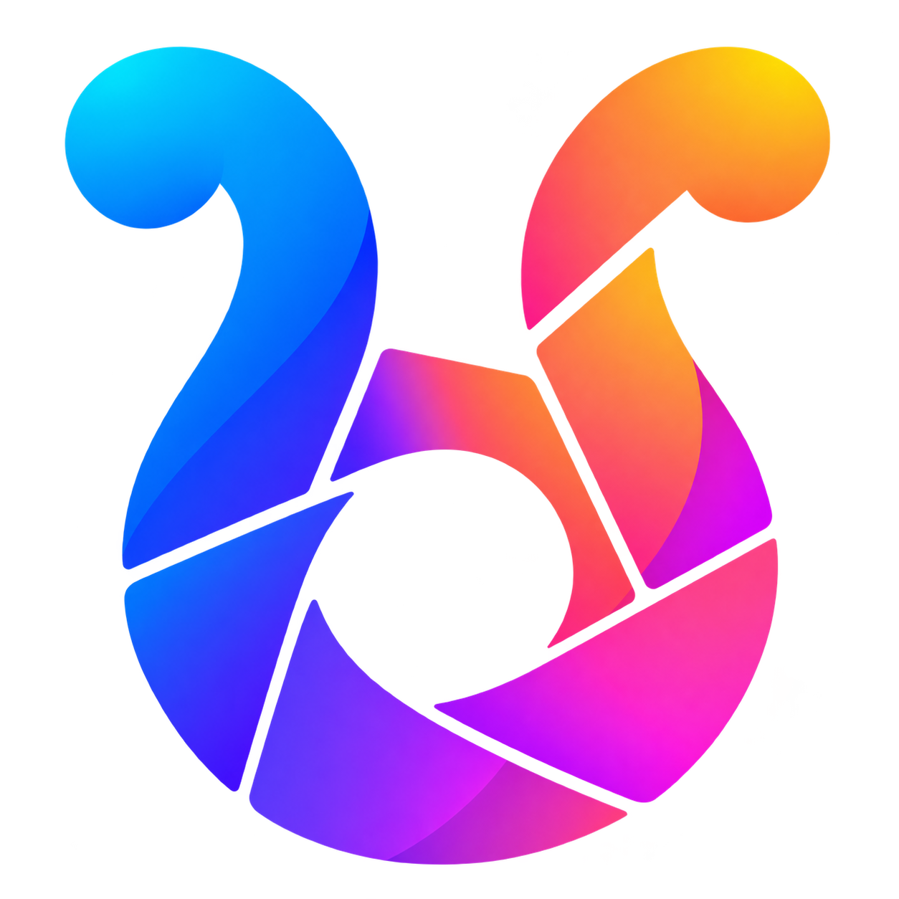
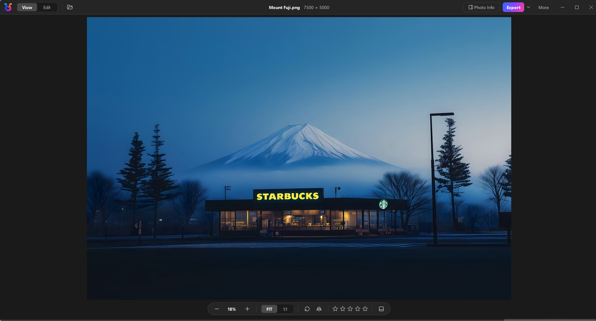
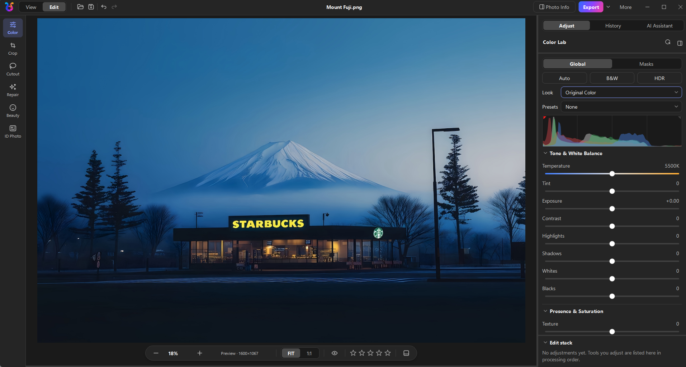
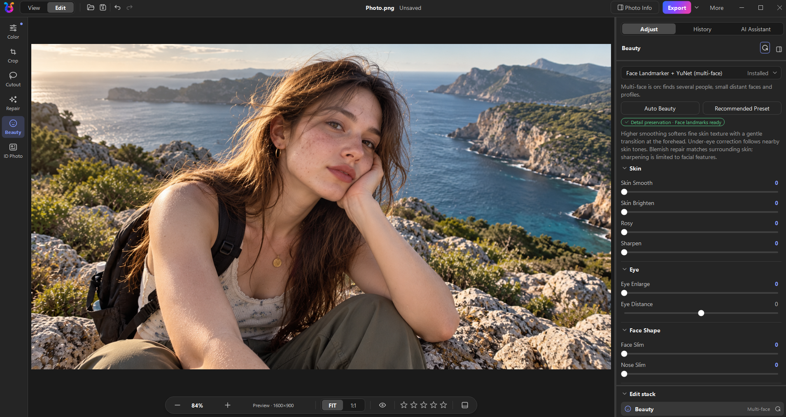
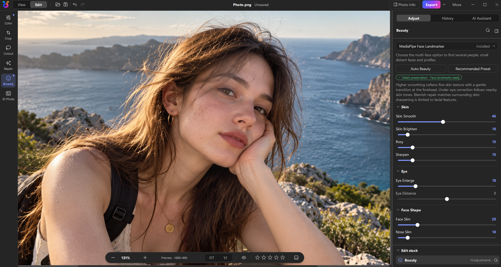
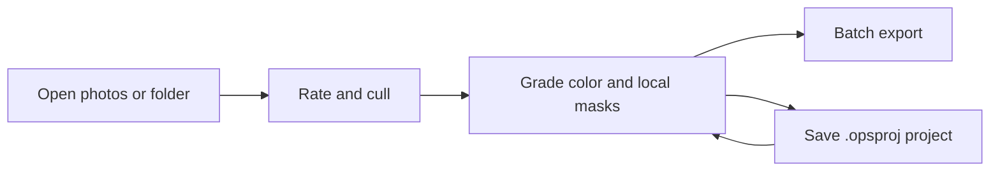
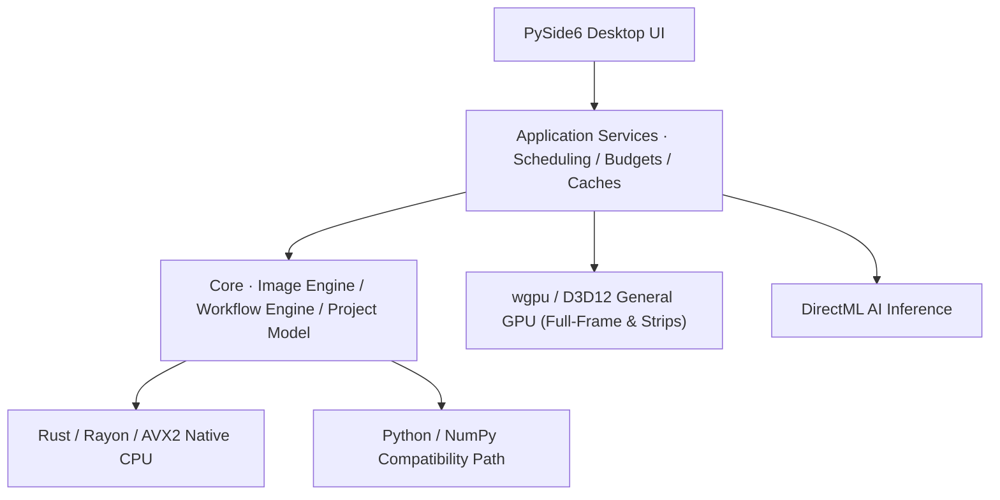

# OpenPictureStudio (OPS)

[简体中文](README.md) | [English](README.en.md) | [Français](README.fr.md)

  

  
  
  
  

**Begin with light. Give every inspiration a chance to become a finished work.**

OpenPictureStudio (OPS) is an open-source AI image creation platform built on professional image processing. It connects the reality a camera records with the picture in the creator's mind. RAW color grading, local masks, non-destructive editing, an AI retouching assistant, and batch processing come together in one creative workflow, growing toward AI agent collaboration, automated shoot processing, layers and compositing, generative creation, and an open plugin ecosystem.

**For everyday users, creating starts with an easy first step.** From adjusting the exposure and color of everyday photos to exploring a look with the AI assistant, OPS makes it easier to turn creative intent into concrete edits—and a single edited photo can become the first step toward understanding light and developing a personal visual style.

**For professional creators, every detail deserves care.** Draw out color and tonal depth from RAW files, shape light with local masks, refine your work through non-destructive edits and history, and synchronize mature looks across an entire shoot. OPS prioritizes controllable parameters, traceable steps, and consistent output so tools follow your creative judgment.

**For developers, openness means extending the platform yourself.** Following the long-term direction of "Everything is Plugin," OPS provides structured extension contracts across image operations, workflows, and the project model so custom algorithms, models, and tools plug into the same platform.

**For AI agents, image creation needs tools that can be called, orchestrated, and inspected.** The built-in AI retouching assistant is the starting point for this collaboration, building toward tool execution, workflow orchestration, and project context so external agents can organize processing, previews, and exports around creative goals and hand results back for human review.

**[Download the Windows Installer](https://github.com/KpTanl/OpenPictureStudio/releases/latest)** · [Screenshots](#screenshots) · [Key Highlights](#key-highlights) · [Key Features](#key-features) · [Quick Start](#quick-start) · [Technical Architecture](#technical-architecture) · [System Requirements](#system-requirements) · [Roadmap](#roadmap) · [Documentation](open-docs/README.en.md)

> Windows 10/11 (64-bit) · Both the interface and installer support Simplified Chinese, English, and French · Core viewing, editing, and local AI run offline.
>
> See the [release notes](https://github.com/KpTanl/OpenPictureStudio/releases/latest) for per-version updates and installer downloads.

## Screenshots

| Viewer · Browsing, zooming, and star ratings | Editing Workspace · Color grading, masks, and history |
| :---: | :---: |
|  |  |

| Portrait Retouching · Initial settings (84% zoom) | Portrait Retouching · Adjusted details (131% zoom) |
| :---: | :---: |
|  |  |

## Key Highlights

- **GPU acceleration with automatic CPU fallback:** On Windows, wgpu/D3D12 accelerates color grading, masks, cropping, portrait retouching, and classic denoise once the GPU passes startup self-checks. When no qualified GPU is available or VRAM is limited, computation falls back seamlessly to multithreaded Rust with AVX2 on the CPU.
- **Smooth editing even on ultra-high-resolution images:** Canvas previews render at display resolution, and zooming to 100% reads back only the visible viewport region. Images exceeding VRAM automatically execute in GPU strips across color grading, local masks, crop and rotation, portrait retouching, and classic denoise—rendering a 133 MP screen-fit frame in 0.1–0.3 s and exporting PNG in 3–4 s on the test machine.
- **Non-destructive editing and group workflows:** Every adjustment supports full undo/redo and saves into `.opsproj` projects. Sync edits across photo groups or queue batch exports safely.
- **Local AI tools and retouching assistant:** Super resolution, AI denoise, deblurring, cutout, portrait retouching, and ID photos run locally offline once models are downloaded. Assistant adjustments enter the same edit history for undo, refinement, or A/B candidate comparison.
- **Trilingual setup and smooth upgrades:** The installer supports Simplified Chinese, English, and French, and lets you gracefully close running instances right from the wizard when upgrading.

## Key Features

| Workflow | Features |
| --- | --- |
| Viewing and culling | Standard formats and camera RAW, filmstrip/grid, star ratings and flags, linked comparison, keywords and smart collections |
| RAW and color | Camera preview / Original Color / OPS Look, exposure and white balance, curves, 8-channel color mixer, 11 built-in presets |
| Local editing | Gradient, brush, and eraser masks; subject and face-region masks; crop, rotation, shape crop, and lasso |
| AI tools | Super resolution, denoise and deblur, cutout, portrait retouching, ID photos, and a history-integrated retouching assistant |
| Group processing | Sync selected adjustments, shift exposure across selections, smart group suggestions, exposure matching, and RAW white balance alignment |
| Projects and export | Auto drafts, `.opsproj` projects, batch export queue, format/size conversion, transparent PNG / 16-bit TIFF, multi-image PDF |

Complete feature list

### Viewing and Culling

- **Standard formats and camera RAW:** Direct support for JPEG, PNG, BMP, GIF, WebP, TIFF, ICO, and PPM/PGM/PBM, plus camera RAW formats CR2, CR3, NEF, NRW, ARW, RAF, DNG, ORF, PEF, and RW2 across Canon, Nikon, Sony, Fujifilm, Olympus, Pentax, Panasonic, and more.
- **Fast RAW & ultra-large previews:** RAW files show their embedded camera preview immediately while full decoding completes; ultra-large standard photos display a screen-fitted preview first, then upgrade seamlessly without flicker. RAW supports Camera preview, Original Color, or OPS Look; other formats offer Original Color or OPS Look, saved independently.
- **Filtering and comparison:** Filmstrip and grid layouts, star ratings, Keep/Reject flags, filtering by rating/flag/type/edit/export status, and side-by-side 1:1 linked comparison.
- **Library:** Keyword tagging, manual collections, and rule-based smart collections.
- **Photo metadata:** EXIF shooting settings, camera info, source details, and live histograms including RAW.
- **Everyday utilities:** Rotate and flip, set as wallpaper, Windows file associations, Dark/Light/Beige themes, and Simplified Chinese, English, and French UI.

### Editing

- **Color panel:**
  - Temperature, tint, exposure, contrast, highlights, shadows, whites, and blacks.
  - Texture, clarity, dehaze, vibrance, and saturation.
  - RGB and single-channel tone curves, 8-channel color mixer with canvas eyedropper, live histogram, and one-click auto adjustments.
  - 11 built-in presets: Monochrome, Retro, Fresh, Warm, Cool, Soft Light, Vivid, Dramatic, HDR, Film, and Skin Beauty.
- **Local masks:** Linear and radial gradients, brush and eraser, select subject, facial skin, eyes, lips, background, and full photo—combinable via add/subtract operations with per-mask parameters.
- **OPS Look:** An OPS-defined tonal and color flavor for RAW, JPG, PNG, and other formats, switchable back to Original Color anytime and stackable with further edits.
- **Composition:** Free crop and rotation, grid crop, shape crop, and lasso.
- **History and projects:** Multi-level undo/redo, visual history stack, hold-to-compare original (preserving active crop and rotation), and `.opsproj` saving.

### Photo Groups

- **Group adjustments:** Sync chosen adjustments from a reference photo to selected or filtered photos, shift exposure uniformly, and undo, redo, or retry failed items per batch.
- **Photo groups and calibration:** Automatic group suggestions by capture time, camera, and lens, plus previewable exposure matching and RAW white balance alignment.

### AI Tools

- **Image enhancement:** Real-ESRGAN super resolution (2×, 4×, 4K) and NAFNet denoise/deblur (with optional original-size restoration and separate luminance/color noise controls).
- **Cutout:** U2Net subject segmentation alongside color-based and lasso cutout, edge refinement, and transparent or solid backgrounds.
- **Portrait retouching:** Landmark-driven adjustments across skin (smoothing, brightening, rosy tone, sharpening), face shape (face slim, nose slim), eyes (eye enlarge, eye distance), and detail (teeth whitening, spot removal, eye-bag removal), with one-click Auto and presets.
- **ID photos:** Standard size presets (1-inch, 2-inch, passport, visa, social security) and custom dimensions, background replacement, face-aligned auto framing, and printable sheet layouts.
- **AI retouching assistant:** Multi-session workspace with Chat, Plan, Adjust, and Agent modes. Edits enter the unified history; A/B candidates stay preview-only until you click Adopt. Supports reference images, named styles, and saved preferences.
- **Models and GPU compute:** Built-in GPU compute automatically accelerates grading, masks, cropping, and retouching once qualified. Toggle **Prefer GPU / CPU only**, configure the VRAM cache, and inspect GPU/CPU/VRAM status in **Settings → Performance & memory**. Manage local AI models in **Settings → Tools and Models**, and optionally install the DirectML inference runtime in **Settings → Runtimes** (takes effect on restart).

Projects, drafts, and output details

- **Projects and drafts:** Automatic per-photo edit drafts let you resume seamlessly; `.opsproj` projects also store full processing steps and history.
- **Safe saving:** Choose to save a copy or overwrite the original; writes go through temporary files and verification so cancellations or errors never corrupt existing files.
- **Batch export:** Queue photos with output presets; queued edits are frozen at submission time, and queues support pause, cancel, retry, and completion logs.
- **Format conversion:** Convert across JPG, PNG, WebP, BMP, and TIFF, target specific JPG KB sizes, and resize by aspect fit, crop-to-fill, padding, or stretch.
- **High bit depth & PDF:** Supports 16-bit TIFF with alpha transparency and ordered multi-image PDF export.

## Installation and Running

### Download the Windows Installer

1. Open the [latest release](https://github.com/KpTanl/OpenPictureStudio/releases/latest) and download `OpenPictureStudio-<version>-setup.exe` and the matching `.exe.sha256` file under **Assets**.
2. Verify the SHA256 checksum, double-click the EXE, choose **简体中文**, **English**, or **Français**, and complete the wizard.
3. Launch OPS and open any photo or folder. No Python or Rust installation is required; AI models and optional GPU runtimes download on demand in Settings.

The installer is currently unsigned; if Windows SmartScreen prompts, verify the repository source and SHA256 before continuing. See [Installation and Upgrades](open-docs/installation.en.md) for verification commands, SmartScreen guidance, a one-step PowerShell installer script, and upgrade details.

### Upgrades and Version Checks

Run the new installer directly over your existing installation to upgrade in place. If OPS is running, the wizard pauses on the close page—click **Close program and continue** to trigger normal exit and save prompts while preserving settings, custom folders, models, and projects. See [Installation and Upgrades](open-docs/installation.en.md) for the difference between **Standard update** and **Repair**.

Installed builds automatically check for releases at most once every 24 hours (configurable in **Settings → General** or **About**), opening the download page for manual download. Checks transmit the app version and standard HTTP metadata to GitHub.

### Quick Start

1. **Open and cull:** Open photos or a folder, browse via filmstrip or grid, and filter using star ratings and Keep/Reject flags.
2. **Edit:** Switch to the editing workspace to adjust exposure, color, framing, local masks, or retouching—with full history and hold-to-compare original.
3. **Save and deliver:** Export finished copies, queue batch exports, or save an `.opsproj` project to continue later.

## Editing Workflow and AI Agents

Non-destructive color grading, local masks, history, and `.opsproj` projects preserve every creative step while saving and exporting produce deliverables. The built-in assistant supports Chat, Plan, Adjust, and Agent modes, writing approved adjustments into the same undoable history and letting you inspect A/B candidates before clicking Adopt.

Assistant capabilities already cover color grading, portrait retouching, culling, group workflows, and export; broader tool coverage, external agent endpoints, and headless workflows are outlined in the [Roadmap](open-docs/roadmap.en.md), alongside future pixel layers and generative editing.

### AI Services and Privacy

The assistant connects only to services and models you explicitly configure in **Settings → AI Services**; API keys are encrypted locally with Windows DPAPI.

By default, the first turn attaches a preview of the current photo, switchable to the original image or **Don't send the photo**. Chats, attachments, and styles stay local. See [AI Services and Privacy](open-docs/ai-services.en.md) for full sending rules, setup steps, and troubleshooting.

## Technical Architecture

- **Host and core engines:** Built on **Python / PySide6**, uniting Image Engine, Workflow Engine, and Project Model so CPU and GPU share identical color, alpha, and coordinate semantics.
- **GPU compute (wgpu / D3D12):** Selects and qualifies the graphics adapter in the background at launch, caching qualification state locally for fast subsequent starts, sharing VRAM budgets with DirectML, and switching large out-of-VRAM images to GPU strips.
- **CPU compute (Rust + Rayon + AVX2):** Multithreaded Rust handles color, transforms, curves, RAW matrices, filtering, resampling, and display encoding, enabling AVX2 automatically when supported or falling back to portable Rust.
- **Avoiding redundant work:** Workflow checkpoints, proxy previews, viewport-scoped readbacks, and tiled disk source caches prevent wasted recomputation.

See [Architecture and Native Acceleration](open-docs/architecture.en.md) and [System Requirements and Performance](open-docs/performance.en.md) for details.

## System Requirements

| Component | Basic Use | Recommended | Enthusiast / Heavy |
| --- | --- | --- | --- |
| OS | Windows 10/11, 64-bit | Windows 10/11, 64-bit | Windows 10/11, 64-bit |
| CPU | Modern multicore x64 CPU | 7th-gen Intel i5 / 1st-gen Ryzen or better | 12th-gen Intel / 5th-gen Ryzen or better |
| RAM | 8 GB, for browsing and light editing | 16 GB, for RAW and multi-tool editing | 32 GB+, for high-MP files, masks, and batching |
| GPU | DirectX 12 iGPU (or 2 GB dGPU) | 4 GB+ VRAM dGPU (e.g., GTX 1650+) | 6–8 GB+ VRAM dGPU (e.g., RTX 2060+) |
| Storage | 3 GB free space | 6 GB free space (SSD recommended) | 12 GB free space (SSD recommended) |

See [System Requirements and Performance](open-docs/performance.en.md) for VRAM/RAM scaling limits, cache allocation, and measured GPU vs. CPU benchmarks.

## Roadmap

Coding AI agents have advanced quickly because software development has open tool interfaces and shared operation history. Image creation needs the same foundation. Starting from professional photo processing, OPS is building an open platform shared by humans and AI agents: you can edit directly or direct AI, and AI can suggest changes or apply them itself.

| Stage | Primary Focus |
| --- | --- |
| 1 · Agent as creative partner | AI agents understand the image, your intent, and your style, suggest adjustments, choose tools, and make finer edits; external agents can also call OPS tools directly |
| 2 · An AI studio for everyone | Set your look and guidelines and let AI agents edit an entire shoot automatically; save edits you like as reusable workflows that run in the background |
| 3 · Layers, compositing, and generative AI | Add layers, compositing, and generative AI on top of today's photo editing, while clearly distinguishing original captures from AI-generated content |
| 4 · Open extension ecosystem | Everything is Plugin: public APIs and a plugin SDK so both humans and AI agents can build tools and share them with others |

Performance, stability, and backward compatibility remain continuous priorities across all stages. Read the [full Roadmap](open-docs/roadmap.en.md).

<strong>FAQ</strong>

<strong>Do I need Python or Rust installed separately?</strong>

No. The Windows installer bundles all required runtime dependencies. AI models and optional GPU runtimes can be downloaded from Settings as needed.

<strong>Can I use OPS completely offline?</strong>

Photo browsing, color grading, cropping, project saving, and exporting work offline. Local AI tools also run completely offline once their models and runtime are downloaded. Internet access is only needed for downloading models, checking updates, or calling an online AI assistant service.

<strong>Is a dedicated graphics card required?</strong>

No. Viewing, color grading, and all core edits work in full on the CPU. When a DirectX 12 GPU passes qualification, wgpu/D3D12 compute enables automatically (switchable to **CPU only** in **Settings → Performance & memory**). For GPU-accelerated AI model inference, install the optional DirectML runtime under **Settings → Runtimes** and restart.

<strong>Why do colors or brightness shift briefly after opening a RAW file?</strong>

OPS displays the camera's embedded preview immediately on open, then replaces it once full RAW decoding completes using your chosen mode in **Settings → Image display** (**Camera preview**, **Original Color**, or **OPS Look** for RAW; separate setting for other formats).

<strong>What is OPS Look?</strong>

OPS Look is an opinionated tonal and color profile designed by OPS for RAW, JPG, PNG, and other formats—offering a curated starting point while remaining stackable with manual adjustments and saved in projects.

| Option | Purpose |
| --- | --- |
| Original Color | Starts directly from decoded file colors while keeping your edits |
| OPS Look | Applies OPS's curated tonal and color rendering as a creative baseline |
| Color presets | Applies parameter sets such as Retro, Film, or HDR on top of the active look |

Select **Original Color** or **OPS Look** in the editing color panel or set defaults per file type in **Settings → Image display**. Runs locally with no AI model required.

<strong>Do edits overwrite my original photos?</strong>

Never during browsing, editing, or draft auto-saving. When exporting or saving finished images, you choose explicitly whether to save a copy or write to the original path.

<strong>Can I resume editing after closing the app?</strong>

Yes. Drafts auto-save per photo and reload automatically when you reopen the file, while `.opsproj` files explicitly store processing steps and edit history.

<strong>Why do some AI tools report missing models?</strong>

Download or import the needed model in **Settings → Tools and Models** and select it in the tool panel. Cutout and AI ID-photo backgrounds use U2Net (original-background ID photos need no model). Models default to `%APPDATA%\OpenPictureStudio\OpenPictureStudio\models`, and saved projects match exact model versions.

<strong>How do I configure the AI retouching assistant?</strong>

Add a connection in **Settings → AI Services** with your endpoint URL, API key, and model ID, enable image input or tool calling if supported, and pick the model in the assistant panel. See [AI Services and Privacy](open-docs/ai-services.en.md).

<strong>Does the AI assistant upload my photos?</strong>

By default, the first turn sends a preview of the current photo when a service is configured; you can switch to **Don't send the photo** below the prompt box anytime. See [AI Services and Privacy](open-docs/ai-services.en.md).

<strong>What if large images lag or hit memory limits?</strong>

By default, canvas previews render at screen resolution and oversized images switch automatically to GPU strips when supported. To constrain memory further, switch to **Always 1600 preview**, adjust VRAM/RAM limits, reduce preload counts, or pause batch tasks in **Settings → Performance & memory**. Export dimensions remain governed by export settings. See [System Requirements and Performance](open-docs/performance.en.md).

<strong>Can I clear or move models and caches?</strong>

View usage, clear caches, and change data locations in **Settings → Storage** (applied at next launch as prompted). Uninstall individual models in **Settings → Tools and Models**.

<strong>Are new versions installed automatically?</strong>

No. Update checks notify you and open the release download page for manual download and installation; the PowerShell script in the [installation guide](open-docs/installation.en.md) also runs only when you invoke it.

## Contributing, Licensing, and Third-Party Notices

### Reporting Issues

Open an issue on [GitHub Issues](https://github.com/KpTanl/OpenPictureStudio/issues) with your app version, Windows version, reproduction steps, screenshots, and log files—removing personal data or API keys before sharing publicly.

Logs are written by default to `%APPDATA%\OpenPictureStudio\OpenPictureStudio\logs\openpicturestudio.log` (location, file size defaulting to ~2 MB, and rotation count defaulting to 3 are configurable under **Settings → Storage**).

### License and Third-Party Dependencies

Original OPS source code is under the [MIT License](LICENSE), while third-party packages, models, and assets follow their respective licenses. Builds ship with PySide6 Essentials, Shiboken, Qt, `THIRD_PARTY_NOTICES.txt`, `licenses/`, `SOURCE.txt`, and `components.json`.

Starting with 0.17.0, the UI migrated from PyQt6 to PySide6, and installers are no longer distributed as a whole under GPLv3 (0.16.1 and earlier remain under their bundled license terms). See [Licensing and Third-Party Components](open-docs/licensing.en.md#migrating-from-pyqt6-to-pyside6) and [Asset sources](.github/assets/readme/SOURCES.en.md).

### Documentation

| Document | Contents |
| --- | --- |
| [Installation and Upgrades](open-docs/installation.en.md) | Verification, SmartScreen, trilingual wizard, in-place upgrades, and repair |
| [AI Services and Privacy](open-docs/ai-services.en.md) | Connection and model setup, assistant modes, photo sending rules, and local storage |
| [Development and Building](open-docs/building.en.md) | Running from source, native module, Windows installer, and CI |
| [Architecture and Native Acceleration](open-docs/architecture.en.md) | Layers, GPU routing & capability matrix, strip rendering, and CPU compatibility |
| [Image Plugins](open-docs/image-plugins.en.md) | Trusted plugin registration, `image/1` protocol, auxiliary data, and examples |
| [System Requirements and Performance](open-docs/performance.en.md) | Hardware specs, VRAM/RAM scaling limits, measured benchmarks, and cache settings |
| [Roadmap](open-docs/roadmap.en.md) | Product vision, development stages, and engineering tracks |
| [Licensing and Third-Party Components](open-docs/licensing.en.md) | MIT, PySide6/Qt LGPLv3, models, and corresponding sources |
