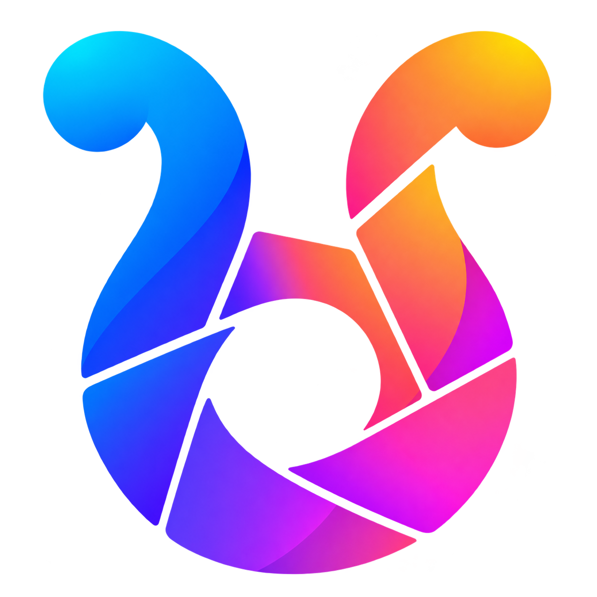
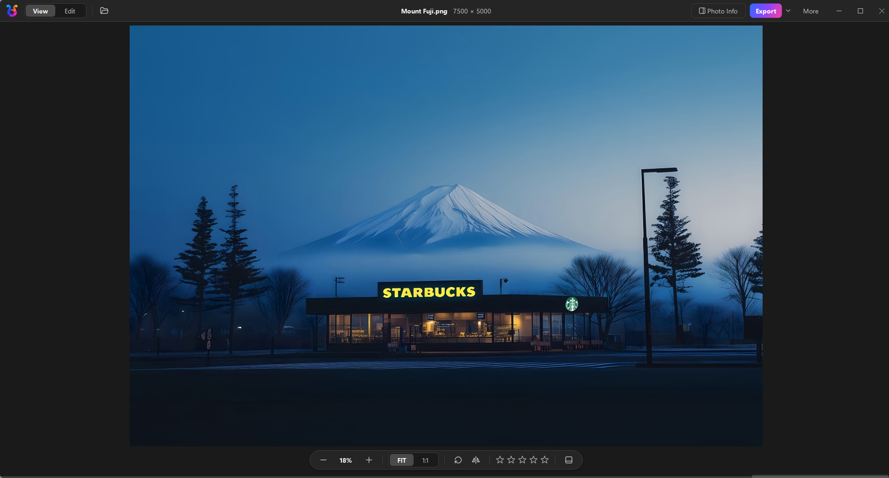
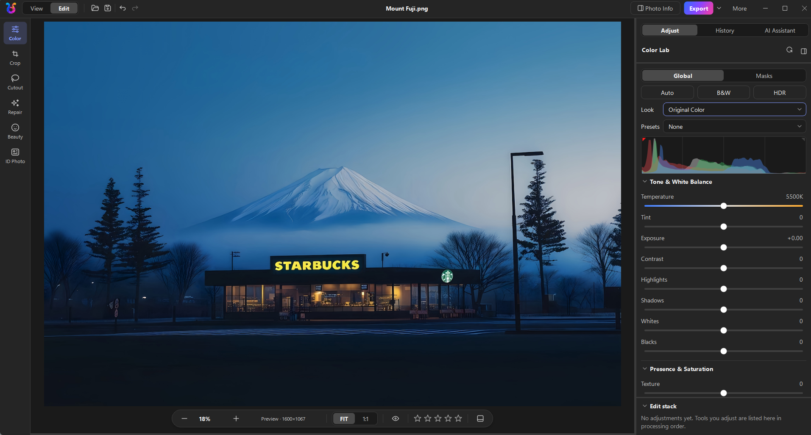
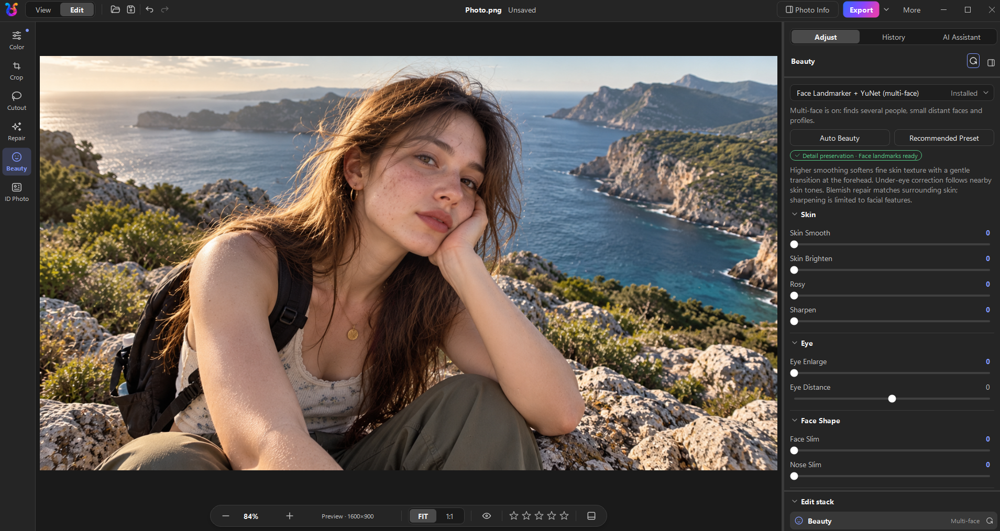
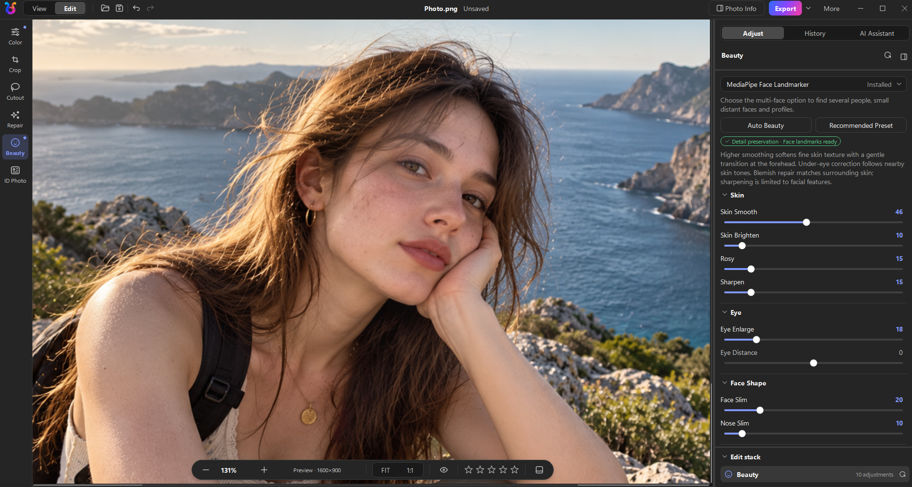
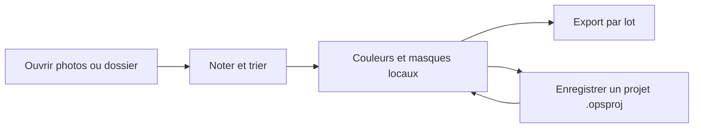
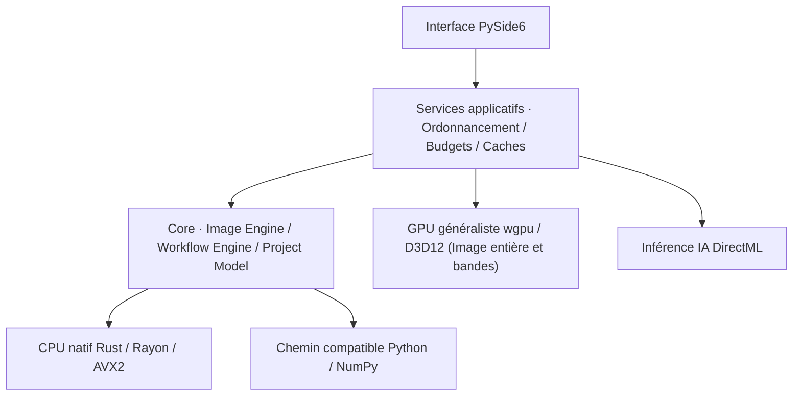

# OpenPictureStudio (OPS)

[简体中文](README.md) | [English](README.en.md) | [Français](README.fr.md)

  

  
  
  
  

**Partir de la lumière et des ombres, pour que chaque inspiration puisse devenir une œuvre.**

OpenPictureStudio (OPS) est une plateforme libre de création d’images avec l’IA, fondée sur un traitement d’image professionnel. Elle relie ce que l’appareil enregistre à l’image voulue par le créateur, en réunissant développement RAW, masques locaux, retouche non destructive, assistant IA et traitement par lots dans un même parcours qui évolue vers la collaboration avec des agents IA, le traitement automatisé de séries, les calques et la composition, la création générative et un écosystème ouvert de plug-ins.

**Pour le grand public, créer commence par une prise en main simple.** De l’exposition quotidienne à l’exploration d’un rendu avec l’assistant IA, OPS aide à transformer une intention en retouches concrètes tout en apprenant à lire la lumière.

**Pour les créateurs professionnels, chaque détail compte.** Exploitez la dynamique des RAW, sculptez la lumière par masques locaux, affinez grâce à l’historique non destructif et synchronisez vos réglages sur toute une série. OPS privilégie la précision, la traçabilité et la cohérence des résultats.

**Pour les développeurs, l’ouverture permet d’étendre la plateforme.** Fidèle à l’orientation « Everything is Plugin », OPS structure les contrats d’extension autour des opérations d’image, des flux de travail et du modèle de projet afin d’accueillir algorithmes, modèles et outils tiers.

**Pour les agents IA, la création exige des outils appelables, composables et vérifiables.** L’assistant intégré pose la base de cette collaboration pour relier appels d’outils, orchestration de flux et contexte projet, permettant à des agents externes d’organiser traitements, aperçus et exports avant validation par le créateur.

**[Télécharger l’installateur Windows](https://github.com/KpTanl/OpenPictureStudio/releases/latest)** · [Aperçu de l’interface](#aperçu-de-linterface) · [Points forts](#points-forts) · [Fonctionnalités](#fonctionnalités-principales) · [Prise en main](#prise-en-main-rapide) · [Architecture technique](#architecture-technique) · [Configuration requise](#configuration-requise) · [Feuille de route](#feuille-de-route) · [Documentation](open-docs/README.fr.md)

> Windows 10/11 (64 bits) · Interface et installateur en chinois simplifié, anglais et français · Visualisation, retouche de base et IA locale utilisables hors ligne.
>
> Nouveautés et installateurs de chaque version dans les [notes de version](https://github.com/KpTanl/OpenPictureStudio/releases/latest).

## Aperçu de l’interface

| Mode visualisation · Parcours, zoom et notation | Espace de retouche · Couleur, masques et historique |
| :---: | :---: |
|  |  |

| Retouche de portrait · Paramètres initiaux (zoom 84 %) | Retouche de portrait · Détails ajustés (zoom 131 %) |
| :---: | :---: |
|  |  |

## Points forts

- **Accélération GPU avec repli CPU automatique :** sous Windows, wgpu/D3D12 accélère couleur, masques, recadrage, retouche de portrait et réduction du bruit classique après réussite de l’autotest GPU. Sans carte compatible ou en cas de VRAM insuffisante, le calcul bascule sur Rust multithread avec AVX2 sur CPU.
- **Retouche fluide même sur très grandes images :** le canevas calcule à la résolution exacte de l’écran, et le zoom à 100 % ne relit que la zone affichée. Au-delà de la VRAM disponible, les flux compatibles (couleur, masques, recadrage et rotation, retouche portrait et débruitage classique) passent automatiquement en calcul par bandes GPU : sur la machine de test, une image de 133 Mpx s’affiche en 0,1–0,3 s et s’exporte en PNG en 3–4 s.
- **Retouche non destructive et traitement par lots :** annulation/rétablissement complets, sauvegarde en projets `.opsproj`, synchronisation entre photos et file d’export par lot.
- **Outils IA locaux et assistant de retouche :** super-résolution, débruitage, suppression du flou, détourage, portrait et photos d’identité fonctionnent hors ligne une fois les modèles téléchargés. Les réglages de l’assistant s’inscrivent dans le même historique ou se comparent via des variantes A/B avant adoption.
- **Installation et mise à jour trilingues :** assistant en chinois simplifié, anglais et français permettant de fermer proprement une session ouverte avant mise à jour.

## Fonctionnalités principales

| Étape | Fonctions |
| --- | --- |
| Visualisation et tri | Formats courants et RAW d’appareil photo, pellicule/grille, étoiles et drapeaux, comparaison synchronisée, mots-clés et collections intelligentes |
| RAW et couleur | Aperçu appareil / Couleurs d’origine / Rendu OPS, exposition et balance des blancs, courbes, mélangeur 8 canaux, 11 préréglages intégrés |
| Retouche locale | Dégradés, pinceau, gomme, masques sujet et visage ; recadrage, rotation, forme et lasso |
| Outils IA | Super-résolution, réduction du bruit et du flou, détourage, portrait, photos d’identité et assistant écrit dans l’historique |
| Traitement groupé | Synchronisation ciblée, décalage d’exposition commun, suggestions de groupes, harmonisation d’exposition et de balance des blancs RAW |
| Projets et export | Brouillons automatiques, projets `.opsproj`, file par lot, conversion formats/tailles, PNG transparent / TIFF 16 bits, PDF multi-images |

Liste complète des fonctionnalités

### Visualisation et sélection

- **Formats courants et RAW :** ouverture directe JPEG, PNG, BMP, GIF, WebP, TIFF, ICO, PPM/PGM/PBM, et prise en charge RAW (CR2, CR3, NEF, NRW, ARW, RAF, DNG, ORF, PEF, RW2 : Canon, Nikon, Sony, Fujifilm, Olympus, Pentax, Panasonic, etc.).
- **Aperçu RAW immédiat et affichage rapide :** les RAW montrent d’abord l’aperçu boîtier puis le décodage complet ; les très grandes images standards affichent d’abord une image ajustée à l’écran avant de compléter la pleine résolution sans scintillement. Choix indépendant pour RAW (Aperçu de l’appareil, Couleurs d’origine, Rendu OPS) et autres formats (Couleurs d’origine, Rendu OPS).
- **Filtres et comparaison :** vues pellicule et grille, étoiles, drapeaux Conserver/Écarter, filtres multiples et comparaison synchronisée 1:1 côte à côte.
- **Photothèque :** mots-clés, collections classiques et collections intelligentes dynamiques.
- **Informations photo :** paramètres de prise de vue, boîtier, détails fichier et histogramme (RAW inclus).
- **Outils pratiques :** rotation/retournement, fond d’écran, association de fichiers, thèmes Sombre/Clair/Beige et interface en chinois simplifié, anglais et français.

### Retouche

- **Panneau de couleur :**
  - Température, teinte, exposition, contraste, hautes lumières, ombres, blancs, noirs.
  - Texture, clarté, correction du voile, vibrance, saturation.
  - Courbes RVB et par canal, mélangeur 8 canaux avec pipette, histogramme temps réel et réglage auto en un clic.
  - 11 préréglages : Monochrome, Rétro, Frais, Chaud, Froid, Lumière douce, Éclatant, Dramatique, HDR, Argentique et Beauté peau.
- **Masques locaux :** dégradé linéaire, dégradé radial, pinceau, gomme, sujet, peau du visage, yeux, lèvres, arrière-plan et photo entière, combinables par ajout/soustraction avec réglages propres.
- **Rendu OPS :** signature colorimétrique définie par OPS pour RAW, JPG, PNG, etc., cumulable avec les réglages et réversible vers Couleurs d’origine.
- **Composition :** recadrage libre et rotation, grille, recadrage en forme et lasso.
- **Historique et projets :** annuler/rétablir multiniveau, pile d’édition, appui prolongé pour comparer à l’original (avec recadrage et rotation actifs) et projets `.opsproj`.

### Traitement groupé

- **Réglages par lot :** copie sélective vers les photos choisies ou filtrées, ajustement commun d’exposition, avec annulation/rétablissement et relance des échecs.
- **Groupes et étalonnage :** regroupement suggéré selon heure, boîtier et objectif, avec prévisualisation de correspondance d’exposition et de balance des blancs RAW.

### Outils IA

- **Amélioration de l’image :** super-résolution Real-ESRGAN (2×, 4×, 4K) et débruitage/suppression du flou NAFNet (restauration à taille réelle incluse, réglages séparés luminance/chrominance).
- **Détourage :** segmentation sujet U2Net, sélection par couleur et au lasso, affinage des bords sur fond transparent ou uni.
- **Retouche de portrait :** basée sur les repères faciaux : peau (lissage, éclaircissement, teint rosé, netteté), morphologie (affinage visage/nez), yeux (agrandissement, écart) et détails (dents, taches, cernes), avec réglage auto et préréglages.
- **Photos d’identité :** formats prédéfinis (1 pouce, 2 pouces, passeport, visa, sécurité sociale) et sur mesure, changement de fond, cadrage auto sur le visage et planche d’impression.
- **Assistant de retouche IA :** multi-sessions avec modes Discussion, Planification, Réglage et Agent ; retouches inscrites dans l’historique, variantes A/B en aperçu jusqu’au clic sur Adopter, images de référence et styles mémorisés.
- **Modèles et calcul GPU :** calcul GPU intégré activé automatiquement après qualification. Gérez **GPU en priorité / CPU uniquement**, le cache VRAM et l’état matériel dans **Paramètres → Performances et mémoire**, les modèles dans **Paramètres → Outils et modèles** et le moteur DirectML dans **Paramètres → Moteurs d’exécution** (actif après redémarrage).

Projets, brouillons et export en détail

- **Projets et brouillons :** brouillons enregistrés automatiquement par photo ; les projets `.opsproj` conservent étapes et historique.
- **Enregistrement sûr :** écrasement ou copie via écriture temporaire vérifiée afin de ne jamais endommager les fichiers existants en cas d’annulation ou d’erreur.
- **File d’export par lot :** les réglages sont figés lors de l’ajout en file ; pause, annulation, relance et journal des exports terminés inclus.
- **Formats et dimensions :** conversion JPG, PNG, WebP, BMP, TIFF, cible de poids JPG (Ko) et quatre modes de redimensionnement.
- **Haute profondeur et PDF :** TIFF 16 bits avec transparence et assemblage ordonné en PDF multi-images.

## Installation et lancement

### Télécharger l’installateur Windows

1. Ouvrez la [dernière version](https://github.com/KpTanl/OpenPictureStudio/releases/latest) et téléchargez `OpenPictureStudio-<version>-setup.exe` ainsi que `.exe.sha256` dans **Assets**.
2. Vérifiez le SHA256, lancez l’exécutable, choisissez **简体中文**, **English** ou **Français**, puis terminez l’assistant.
3. Lancez OPS : aucun Python ni Rust séparé n’est requis ; les modèles IA et le moteur GPU facultatif se téléchargent à la demande dans les paramètres.

L’installateur n’est pas signé numériquement ; en cas d’alerte SmartScreen, vérifiez la source et le SHA256 avant de poursuivre. Consultez le [guide d’installation et de mise à niveau](open-docs/installation.fr.md) pour les commandes de vérification, SmartScreen, le script PowerShell et les mises à jour.

### Mises à niveau et recherche de versions

Lancez le nouvel installateur directement par-dessus votre installation existante. Si OPS est ouvert, l’assistant propose **Fermer le programme et continuer** afin de déclencher les invites d’enregistrement normales tout en conservant paramètres, dossiers, modèles et projets. La différence entre **Mise à jour standard** et **Réparation** est détaillée dans [Installation et mises à niveau](open-docs/installation.fr.md).

La version installée vérifie les mises à jour au maximum toutes les 24 heures (réglable dans **Paramètres → Général** ou **À propos**) et ouvre la page de téléchargement sans installation automatique en arrière-plan.

### Prise en main rapide

1. **Ouvrir et trier :** ouvrez une photo ou un dossier en pellicule ou en grille et filtrez par étoiles et drapeaux.
2. **Retoucher :** basculez vers l’espace de retouche pour ajuster exposition, couleurs, cadrage, masques ou portrait avec historique complet et comparaison à l’original.
3. **Enregistrer et livrer :** exportez vos images, alimentez la file par lot ou enregistrez un projet `.opsproj`.

## Flux de retouche et agents IA

La retouche non destructive, les masques locaux, l’historique et les projets `.opsproj` conservent tout le processus créatif. L’assistant intégré propose les modes Discussion, Planification, Réglage et Agent, en écrivant les ajustements approuvés dans l’historique et en attendant le clic sur Adopter pour les variantes A/B.

L’assistant couvre déjà couleur, portrait, tri, traitement groupé et export ; l’ouverture vers des agents externes, la gestion avancée de flux et la retouche par calques/générative figurent dans la [feuille de route](open-docs/roadmap.fr.md).

### Services IA et confidentialité

L’assistant n’émet aucune requête tant qu’aucune connexion n’est configurée dans **Paramètres → Services IA** ; les clés sont chiffrées localement via Windows DPAPI.

Par défaut, le premier tour joint un aperçu de l’image actuelle, modifiable vers l’image d’origine ou **Ne pas envoyer la photo**. Discussions, pièces jointes et styles restent sur votre ordinateur. Détails complets dans [Services IA et confidentialité](open-docs/ai-services.fr.md).

## Architecture technique

- **Interface et moteurs centraux :** architecture **Python / PySide6** coordonnant Image Engine, Workflow Engine et Project Model avec contrat couleur, alpha et géométrie identique sur CPU et GPU.
- **Calcul GPU (wgpu / D3D12) :** sélection et autotest matériel en arrière-plan au démarrage avec mise en cache locale, partage de budget VRAM avec DirectML et bascule automatique vers le calcul par bandes hors VRAM.
- **Calcul CPU (Rust + Rayon + AVX2) :** exécution multithread pour couleur, transformations, courbes, matrices RAW, filtres, rééchantillonnage et sortie d’affichage, avec activation automatique d’AVX2 ou repli Rust générique.
- **Élimination des calculs redondants :** points de contrôle, aperçus proxy, relecture limitée à la zone visible et cache source sur disque.

Voir [Architecture et accélération native](open-docs/architecture.fr.md) et [Configuration requise et performances](open-docs/performance.fr.md).

## Configuration requise

| Élément | Usage courant | Configuration recommandée | Usage intensif |
| --- | --- | --- | --- |
| Système | Windows 10/11, 64 bits | Windows 10/11, 64 bits | Windows 10/11, 64 bits |
| Processeur | CPU x64 multicœur récent | Intel Core i5 7e gén. / Ryzen 1re gén. ou mieux | Intel 12e gén. / Ryzen 5e gén. ou mieux |
| Mémoire | 8 Go, tri et retouche légère | 16 Go, RAW et multi-outils | 32 Go+, très haute résolution et lots |
| Carte graphique | iGPU DirectX 12 (ou GPU 2 Go) | GPU dédié 4 Go+ (ex. GTX 1650+) | GPU dédié 6–8 Go+ (ex. RTX 2060+) |
| Stockage | 3 Go libres | 6 Go libres (SSD conseillé) | 12 Go libres (SSD conseillé) |

Consultez [Configuration requise et performances](open-docs/performance.fr.md) pour les capacités par VRAM/RAM, l’espace des caches et les mesures comparées GPU contre CPU.

## Feuille de route

Les agents IA de programmation progressent vite parce que le code dispose d’interfaces d’outils ouvertes et d’un historique partagé. La création d’images a besoin du même socle. À partir du traitement photo professionnel, OPS construit une plateforme ouverte partagée par les humains et les agents IA : vous pouvez retoucher directement ou guider l’IA ; l’IA peut proposer des pistes ou appliquer les réglages elle-même.

| Étape | Axes principaux |
| --- | --- |
| 1 · L’agent comme partenaire créatif | Les agents IA comprennent l’image, vos besoins et votre style, proposent des pistes, choisissent les outils et réalisent des retouches plus fines ; les agents externes peuvent aussi appeler directement les outils d’OPS |
| 2 · Un studio IA pour chacun | Définissez votre style et vos consignes, et laissez l’agent IA traiter automatiquement toute une série ; enregistrez une retouche réussie en flux réutilisable exécuté en arrière-plan |
| 3 · Calques, composition et IA générative | Ajouter calques, composition et IA générative au-dessus de la retouche photo, tout en distinguant clairement la prise de vue d’origine du contenu généré par IA |
| 4 · Écosystème d’extensions ouvert | Everything is Plugin : API publique et SDK de plug-ins permettant aux humains comme aux agents IA de créer des outils et d’utiliser ceux partagés par la communauté |

Performance, stabilité et compatibilité accompagnent chaque étape. Voir la [feuille de route complète](open-docs/roadmap.fr.md).

<strong>Questions fréquentes</strong>

<strong>Faut-il installer Python ou Rust séparément ?</strong>

Non. L’installateur Windows inclut toutes les dépendances nécessaires ; les modèles IA et moteurs GPU facultatifs se téléchargent depuis les paramètres.

<strong>Peut-on travailler hors ligne ?</strong>

Oui. Visualisation, couleur, recadrage, sauvegarde de projets et export fonctionnent hors ligne, ainsi que les outils IA locaux une fois leurs modèles téléchargés. Seuls le téléchargement de modèles, les mises à jour et l’assistant IA en ligne nécessitent Internet.

<strong>Une carte graphique dédiée est-elle obligatoire ?</strong>

Non. Toutes les retouches de base fonctionnent intégralement sur CPU. Lorsqu’un GPU DirectX 12 réussit l’autotest, le calcul wgpu/D3D12 s’active automatiquement (réglable sur **CPU uniquement** dans **Paramètres → Performances et mémoire**). Pour accélérer les modèles IA sur GPU, installez DirectML dans **Paramètres → Moteurs d’exécution** puis redémarrez.

<strong>Pourquoi l’aspect d’un RAW change-t-il juste après l’ouverture ?</strong>

OPS affiche d’abord l’aperçu intégré par l’appareil puis bascule sur le décodage complet selon le mode défini dans **Paramètres → Affichage des images** (**Aperçu de l’appareil**, **Couleurs d’origine** ou **Rendu OPS**).

<strong>Qu’est-ce que le Rendu OPS ?</strong>

Le Rendu OPS propose une base esthétique de couleur et de contraste définie par OPS pour RAW, JPG, PNG, etc., cumulable avec vos propres retouches et réversible vers Couleurs d’origine.

| Option | Rôle |
| --- | --- |
| Couleurs d’origine | Part des couleurs décodées du fichier tout en conservant vos réglages |
| Rendu OPS | Applique la signature tonale et colorimétrique définie par OPS |
| Préréglages | Applique des ambiances (Rétro, Argentique, HDR…) en complément du rendu actif |

Sélectionnez-le dans le panneau couleur ou par défaut dans **Paramètres → Affichage des images** (traitement local sans modèle IA).

<strong>La retouche modifie-t-elle mes fichiers originaux ?</strong>

Jamais pendant la navigation, les réglages ni les brouillons automatiques. À l’enregistrement final, vous choisissez d’enregistrer une copie ou d’écrire à l’emplacement d’origine.

<strong>Puis-je reprendre mes retouches après fermeture ?</strong>

Oui. Les brouillons se sauvegardent automatiquement par photo et les projets `.opsproj` conservent étapes et historique complet.

<strong>Pourquoi certains outils IA signalent-ils un modèle manquant ?</strong>

Téléchargez ou importez le modèle requis dans **Paramètres → Outils et modèles** (détourage et changement de fond photo d’identité utilisent U2Net). Par défaut, les modèles sont stockés dans `%APPDATA%\OpenPictureStudio\OpenPictureStudio\models` avec correspondance exacte de version pour les projets.

<strong>Comment configurer l’assistant de retouche IA ?</strong>

Ajoutez une connexion dans **Paramètres → Services IA** avec URL, clé API et identifiant de modèle, puis activez **Réception d’images** ou **Prise en charge des appels d’outils** selon les capacités du modèle. Détails dans [Services IA et confidentialité](open-docs/ai-services.fr.md).

<strong>L’assistant IA envoie-t-il mes photos ?</strong>

Par défaut au premier tour lorsqu’un service est configuré, oui ; vous pouvez basculer à tout moment sur **Ne pas envoyer la photo** sous la zone de saisie. Voir [Services IA et confidentialité](open-docs/ai-services.fr.md).

<strong>Que faire si une très grande image ralentit ou manque de mémoire ?</strong>

Par défaut, l’aperçu suit la résolution écran et les images dépassant la VRAM basculent automatiquement sur les bandes GPU lorsqu’elles sont prises en charge. Pour réduire encore l’empreinte, passez à **Toujours un aperçu de 1600 px**, ajustez les limites VRAM/RAM, réduisez le préchargement ou suspendez les lots dans **Paramètres → Performances et mémoire**. Voir [Configuration requise et performances](open-docs/performance.fr.md).

<strong>Puis-je nettoyer ou déplacer les modèles et caches ?</strong>

Consultez l’occupation, videz les caches et déplacez les données dans **Paramètres → Stockage** (appliqué au prochain redémarrage). Les modèles se désinstallent dans **Paramètres → Outils et modèles**.

<strong>Les mises à jour s’installent-elles automatiquement ?</strong>

Non. Le contrôle signale les nouvelles versions et ouvre la page de téléchargement pour une installation manuelle ; le script PowerShell du [guide d’installation](open-docs/installation.fr.md) ne s’exécute qu’à votre initiative.

## Contribuer, licence et mentions tierces

### Signaler un problème

Ouvrez un ticket sur [GitHub Issues](https://github.com/KpTanl/OpenPictureStudio/issues) en joignant version de l’application, version Windows, étapes de reproduction, captures et journaux — après avoir retiré toute donnée personnelle ou clé API.

Par défaut, les journaux sont écrits dans `%APPDATA%\OpenPictureStudio\OpenPictureStudio\logs\openpicturestudio.log` (dossier, taille ~2 Mo et rétention de 3 fichiers modifiables dans **Paramètres → Stockage**).

### Licence et dépendances tierces

Le code source original d’OPS est sous [licence MIT](LICENSE) ; bibliothèques tierces, modèles et ressources suivent leurs licences respectives. Les distributions incluent PySide6 Essentials, Shiboken, Qt, `THIRD_PARTY_NOTICES.txt`, `licenses/`, `SOURCE.txt` et `components.json`.

Depuis 0.17.0, l’interface a migré vers PySide6 et l’installateur n’est plus distribué dans son ensemble sous GPLv3 (les versions 0.16.1 et antérieures restent régies par leurs fichiers fournis). Voir [Licences et composants tiers](open-docs/licensing.fr.md#migration-de-pyqt6-vers-pyside6) et les [sources des ressources](.github/assets/readme/SOURCES.en.md).

### Index de la documentation

| Document | Contenu |
| --- | --- |
| [Installation et mises à niveau](open-docs/installation.fr.md) | Vérification, SmartScreen, assistant trilingue, mise à niveau et réparation |
| [Services IA et confidentialité](open-docs/ai-services.fr.md) | Connexions, modèles, modes de l’assistant, envoi photo et stockage local |
| [Développement et compilation](open-docs/building.fr.md) | Sources, module natif, installateur Windows et CI |
| [Architecture et accélération native](open-docs/architecture.fr.md) | Couches, routage GPU, traitement par bandes et compatibilité CPU |
| [Plug-ins d’image](open-docs/image-plugins.fr.md) | Enregistrement de confiance, protocole `image/1`, données auxiliaires et exemples |
| [Configuration requise et performances](open-docs/performance.fr.md) | Matériel recommandé, limites VRAM/RAM, mesures et réglages de cache |
| [Feuille de route](open-docs/roadmap.fr.md) | Vision produit, étapes d’évolution et chantiers techniques |
| [Licences et composants tiers](open-docs/licensing.fr.md) | MIT, PySide6/Qt LGPLv3, modèles et sources correspondantes |
