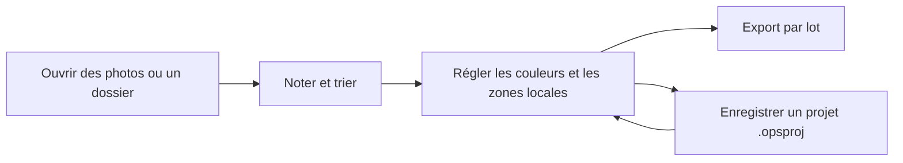

# OpenPictureStudio (OPS)

[简体中文](README.md) | [English](README.en.md) | [Français](README.fr.md)

  

  
  
  
  

**Partir de la lumière et des ombres, pour que chaque inspiration puisse devenir une œuvre.**

OpenPictureStudio (OPS) est une plateforme libre de création d’images avec l’IA, construite sur un traitement d’image professionnel. Elle relie ce que l’appareil photo a enregistré à l’image que le créateur a en tête. Développement RAW, masques locaux, retouche non destructive, assistant de retouche IA et traitement par lots s’y retrouvent dans un même parcours de création. La plateforme continue d’évoluer vers les flux de travail automatisés, la retouche générative et un écosystème de plug-ins ouvert.

**Pour le grand public, créer commence par une prise en main facile.** Régler l’exposition et les couleurs d’une photo de tous les jours, ou explorer un style d’image avec l’assistant IA : OPS veut transformer plus facilement une intention en gestes concrets. Retoucher une photo peut aussi devenir une première façon de comprendre la lumière et de trouver son propre regard.

**Pour les créateurs professionnels, chaque détail mérite toute l’attention.** Retrouver les couleurs et les nuances d’un RAW, sculpter la lumière avec des masques locaux, affiner ses choix grâce à la retouche non destructive et à l’historique, puis appliquer un réglage abouti à toute une série. OPS privilégie des réglages maîtrisables, un processus traçable et des résultats cohérents : la technique porte le jugement, l’outil suit la création.

**Pour les développeurs, l’ouverture permet d’étendre soi-même les limites de l’outil.** Dans la direction à long terme « Everything is Plugin », OPS précisera peu à peu les contrats d’extension pour les opérations d’image, les flux de travail et le modèle de projet. Algorithmes, modèles et outils de création pourront ainsi rejoindre la même plateforme. Répondre à un besoin précis, ou partager une nouvelle méthode de création : chaque extension peut devenir le point de départ d’un autre.

**Pour les agents IA, la création d’images demande des outils appelables, composables et vérifiables.** L’assistant de retouche IA actuel est le point de départ de cette collaboration. OPS le reliera ensuite à l’appel d’outils, à l’exécution des flux de travail et au contexte du projet. Un agent externe pourra alors organiser traitements, aperçus et exports autour d’un objectif de création sans ouvrir l’interface de bureau, puis remettre le résultat au créateur pour relecture. L’intention humaine, les outils professionnels et la capacité d’exécution de l’IA se retrouveront dans une même œuvre.

**[Télécharger l’installateur Windows](https://github.com/KpTanl/OpenPictureStudio/releases/latest)** · [Prise en main](#prise-en-main-rapide) · [Fonctionnalités](#fonctionnalités-principales) · [Performances](#configuration-requise-et-mesures-de-performances) · [Feuille de route](#feuille-de-route) · [Documentation](open-docs/README.fr.md)

> Bêta · Windows 10/11 (64 bits) · Interface en chinois simplifié, anglais et français. La visualisation et la retouche de base fonctionnent hors ligne.
> 
> Les fonctionnalités et les installateurs de chaque version figurent dans les [notes de version](https://github.com/KpTanl/OpenPictureStudio/releases/latest).

## Fonctionnalités principales

| Étape de travail | Fonctionnalités |
| --- | --- |
| Visualisation et sélection | Images courantes et RAW d’appareil photo, pellicule et grille, notes par étoiles et marques, comparaison synchronisée, mots-clés et collections intelligentes |
| RAW et couleur | Aperçu de l’appareil, couleurs d’origine ou rendu OPS, exposition et balance des blancs, courbes, mélangeur de couleurs à 8 canaux, 11 préréglages intégrés |
| Retouche locale | Dégradés, pinceau, gomme, masques du sujet et des zones du visage ; recadrage, rotation et recadrage en forme |
| Outils IA | Super-résolution, réduction du bruit et suppression du flou, détourage, retouche de portrait, photos d’identité, et assistant dont les réglages s’écrivent dans l’historique |
| Traitement par lots | Synchronisation des réglages choisis, hausse ou baisse commune de l’exposition, suggestions de groupes d’après les données de prise de vue, correspondance d’exposition et de balance des blancs RAW |
| Projets et export | Brouillons automatiques, projets `.opsproj`, file d’export par lot, conversion de format et de taille, PNG transparent et TIFF 16 bits, PDF multi-images |

### Visualisation et retouche

**Visualisation** : parcourez les photos, réglez le zoom et attribuez des notes par étoiles.

**Retouche** : passez à l’espace de retouche dans la même fenêtre pour régler l’exposition, la balance des blancs et les couleurs.

### Retouche de portrait

Réglez les paramètres de la peau, des yeux et de la forme du visage, puis zoomez pour vérifier les détails.

**Paramètres initiaux · zoom à 84 %**

**Après réglages · zoom à 131 %**

Liste complète des fonctionnalités

### Visualisation et sélection

- **Formats courants et RAW d’appareil photo** : JPEG, PNG, BMP, GIF, WebP, TIFF, ICO et PPM/PGM/PBM s’ouvrent directement. Les RAW pris en charge sont CR2, CR3, NEF, NRW, ARW, RAF, DNG, ORF, PEF et RW2, ce qui couvre Canon, Nikon, Sony, Fujifilm, Olympus, Pentax, Panasonic et d’autres marques.
- **Aperçu RAW d’abord** : à l’ouverture d’un RAW, l’aperçu intégré par l’appareil s’affiche en premier, puis il est remplacé une fois le décodage terminé. Pour un RAW, vous pouvez afficher l’aperçu de l’appareil, les couleurs d’origine ou le rendu OPS. Pour les autres formats, vous choisissez entre les couleurs d’origine et le rendu OPS. Les deux réglages sont enregistrés séparément.
- **Filtres et comparaison** : deux modes d’affichage, pellicule et grille ; notes par étoiles et marques Conserver/Écarter ; filtres par note, marque, type de fichier, état de retouche et état de livraison. Deux photos peuvent être comparées côte à côte, à leur taille d’origine, avec une navigation synchronisée.
- **Photothèque** : attribuez des mots-clés à vos photos et classez-les dans des collections ordinaires ou dans des collections intelligentes, mises à jour automatiquement selon des critères.
- **Informations sur la photo** : paramètres de prise de vue, appareil, détails du fichier source et histogramme, y compris pour les RAW.
- **Petites fonctions utiles** : rotation et retournement, définition comme fond d’écran, association de fichiers ; trois thèmes (sombre, clair et beige) ; interface en chinois simplifié, anglais et français.

### Retouche

- **Panneau de couleur** :
  - Température, teinte, exposition, contraste, hautes lumières, ombres, blancs et noirs.
  - Texture, clarté, correction du voile, vibrance et saturation.
  - Courbes de tonalité RVB et par canal, mélangeur de couleurs à 8 canaux (la pipette permet de choisir une couleur sur l’image), histogramme en direct et réglage automatique en un clic.
  - 11 préréglages intégrés : monochrome, rétro, frais, chaud, froid, lumière douce, éclatant, dramatique, HDR, argentique et beauté de la peau.
- **Masques locaux** : dégradé linéaire, dégradé radial, pinceau et gomme, sélection du sujet, peau du visage, yeux, lèvres, arrière-plan et photo entière. Un même masque peut combiner plusieurs zones, ajoutées ou soustraites, et chaque masque se règle séparément.
- **Rendu OPS** : une saveur d’image définie par OPS, qui traduit son goût pour la couleur, la lumière et les nuances. Elle offre aux photos RAW, JPG, PNG et autres un point de départ créatif dans le style d’OPS. Vous pouvez revenir aux couleurs d’origine, ou continuer avec l’exposition, les courbes et les masques locaux.
- **Composition** : recadrage libre et rotation, recadrage avec grille, recadrage en forme et lasso.
- **Historique et projets** : annulation et rétablissement sur plusieurs niveaux ; le panneau Historique permet de revenir à n’importe quelle étape, et la pile d’édition liste les traitements en cours. Maintenez la touche pour comparer avec l’original. Les retouches s’enregistrent dans un projet `.opsproj`.

### Photos par lot

- **Réglages par lot** : prenez une photo comme modèle et synchronisez les réglages choisis vers les photos sélectionnées ou vers tous les résultats filtrés. Vous pouvez aussi augmenter ou réduire l’exposition de tout le lot. Chaque lot peut être annulé, rétabli, ou relancé pour les photos qui n’ont pas abouti.
- **Groupes et étalonnage** : suggestions de groupes d’après l’heure de prise de vue, le boîtier et l’objectif ; pour les photos d’un même groupe, propositions de correspondance d’exposition et de balance des blancs RAW, à prévisualiser puis à appliquer ensemble.

### Outils IA

- **Amélioration de l’image** : super-résolution Real-ESRGAN (2×, 4×, 4K), réduction du bruit et suppression du flou avec NAFNet, ou restauration à la taille d’origine. Le bruit de luminance et le bruit de couleur se règlent séparément.
- **Détourage** : U2Net repère le sujet ; il existe aussi un détourage par couleur et un détourage au lasso. Vous pouvez affiner les bords et obtenir un fond transparent ou uni.
- **Retouche de portrait** : à partir des points de repère du visage, quatre groupes de réglages : peau (lissage, éclaircissement, teint rosé, netteté), forme du visage (affinage du visage et du nez), yeux (agrandissement, écart) et retouche des détails (blanchiment des dents, suppression des taches, suppression des cernes).
- **Photos d’identité** : préréglages de formats (1 pouce, 2 pouces, passeport, visa, sécurité sociale) et dimensions personnalisées ; changement de couleur de fond, cadrage automatique d’après la position du visage et mise en page de planche.
- **Assistant de retouche IA** : plusieurs discussions, avec les modes Discussion, Planification, Réglage et Agent. Les réglages de l’assistant s’écrivent directement dans l’historique : comme les réglages manuels, vous pouvez les annuler, les rétablir ou les poursuivre. Pour comparer deux propositions, l’assistant génère des variantes A/B, que vous comparez dans son panneau ; rien n’est écrit avant de cliquer sur « Adopter ». Vous pouvez joindre une image de référence, et enregistrer des styles nommés et des préférences pour plus tard.
- **Modèles et GPU** : les modèles ne sont pas livrés avec l’installateur. Dans « Paramètres → Outils et modèles », vous les téléchargez, les importez, les désinstallez et choisissez celui par défaut. Avec une carte graphique dédiée, installez le moteur GPU (DirectML) dans « Paramètres → Moteurs d’exécution » ; il s’active après un redémarrage.

Projets, brouillons et sorties en détail

- **Projets et brouillons** : vos retouches sont enregistrées automatiquement comme brouillon, et vous les retrouvez en rouvrant la même photo. Un projet `.opsproj` conserve aussi les étapes de traitement et l’historique.
- **Enregistrement du résultat** : vous décidez d’écraser l’original ou d’enregistrer une copie. Le résultat est d’abord écrit dans un fichier temporaire et vérifié, puis il remplace la destination. Un échec ou une annulation n’abîme donc aucun fichier existant.
- **Export par lot** : choisissez des photos et un préréglage de sortie, puis ajoutez-les à la file d’export. Les retouches sont figées à l’ajout : modifier ensuite la photo ne change pas les éléments déjà en file. Vous pouvez mettre la file en pause, l’annuler et relancer les éléments en échec ; les enregistrements terminés restent consultables.
- **Traitement des formats** : conversion entre JPG, PNG, WebP, BMP et TIFF. Pour un JPG, vous pouvez fixer une taille de fichier cible (en Ko). Pour les dimensions : proportions conservées, recadrage pour remplir, ajout de bordures ou étirement direct.
- **Haute profondeur et PDF** : TIFF 16 bits avec transparence conservée ; plusieurs images peuvent être réunies, dans l’ordre, en un seul PDF.

## Installation et lancement

### Télécharger l’installateur Windows

1. Ouvrez la [dernière version](https://github.com/KpTanl/OpenPictureStudio/releases/latest). Dans **Assets**, téléchargez `OpenPictureStudio-<version>-beta-setup.exe` et le fichier `.exe.sha256` du même nom.
2. Vérifiez le SHA256 de l’installateur, double-cliquez sur le fichier EXE et suivez l’assistant d’installation.
3. Lancez OpenPictureStudio, puis ouvrez une photo ou un dossier. La version installée n’exige ni Python ni Rust ; les modèles IA se téléchargent à la demande.

La version installée embarque ses dépendances d’exécution, et les modèles IA se téléchargent à la demande. L’installateur actuel n’est pas signé numériquement. Si SmartScreen affiche un avertissement, vérifiez la source et le SHA256, puis suivez les indications de Windows. Le [guide d’installation et de mise à niveau](open-docs/installation.fr.md) donne les commandes de vérification, le message du premier lancement, l’installation par PowerShell et la procédure de mise à niveau.

### Mises à niveau et recherche de versions

La version installée recherche une version stable automatiquement, au plus une fois toutes les 24 heures. Vous pouvez désactiver cette recherche dans « Paramètres → Général », ou la lancer à la main dans « À propos ». Le programme ouvre la page de téléchargement, et c’est vous qui téléchargez et installez. La requête envoie la version de l’application et les informations HTTP nécessaires ; GitHub voit votre adresse IP et l’heure de la requête.

Avant une mise à niveau, quittez OpenPictureStudio, puis lancez le nouvel installateur pour installer par-dessus. Vos paramètres, vos dossiers de données personnalisés, vos modèles et vos projets sont conservés. En cas de conflit de dossier ou de réparation, suivez les indications de l’installateur ; voir [Installation et mises à niveau](open-docs/installation.fr.md).

### Prise en main rapide

1. **Ouvrir et trier** : ouvrez une photo ou un dossier, parcourez-le en pellicule ou en grille, puis filtrez par note et par marque Conserver/Écarter.
2. **Retoucher** : passez dans l’espace de retouche et réglez l’exposition, les couleurs et la composition ; ajoutez des masques locaux si besoin. Les étapes restent dans l’historique : vous pouvez les annuler, les rétablir et comparer avec l’original.
3. **Enregistrer et livrer** : enregistrez le résultat sous un autre nom, ou ajoutez les photos choisies à la file d’export par lot. Un projet `.opsproj` conserve les étapes et l’historique, pour reprendre la retouche plus tard.

## Flux de retouche et agents IA

La retouche non destructive des couleurs, les masques locaux, l’historique et les projets `.opsproj` conservent ensemble le déroulement de la retouche ; les images finales sont produites par l’enregistrement ou l’export. L’assistant intégré propose les modes Discussion, Planification, Réglage et Agent. Les réglages faits avec les outils concernés entrent dans le même historique, et les variantes A/B n’y sont écrites qu’après avoir cliqué sur « Adopter ».

L’assistant couvre déjà la couleur, la retouche de portrait, la sélection, le traitement par lots et l’export. Pour la prise en charge de davantage d’outils, l’interface pour agents externes et les flux complets hors écran, voir la [feuille de route](open-docs/roadmap.fr.md). Les calques de pixels professionnels, la retouche destructive et la retouche générative sont des directions pour la suite.

### Services IA et confidentialité

L’assistant de retouche IA utilise la connexion et le modèle que vous configurez dans « Paramètres → Services IA » ; tant que rien n’est configuré, il n’envoie aucune requête. Les clés sont chiffrées avec Windows DPAPI puis enregistrées sur votre ordinateur.

Par défaut, le premier message joint un aperçu de la photo en cours ; vous pouvez passer à l’image d’origine ou à « Ne pas envoyer la photo ». Le texte, les paramètres et l’analyse de la photo sont envoyés selon le contexte choisi ; les discussions, les pièces jointes et les styles restent sur votre ordinateur. Le [guide Services IA et confidentialité](open-docs/ai-services.fr.md) décrit la configuration, toutes les règles d’envoi et les problèmes de connexion courants.

## Architecture et accélération native

L’interface de bureau repose sur **Python/PySide6**. Les services d’application coordonnent les outils de base, les projets et les flux de travail ; le calcul d’image est assuré par Python/NumPy et par un **module natif Rust**.

- **Rust + Rayon** : couvre les points chauds comme les réglages de couleur globaux et locaux, les filtres, la conversion matricielle RAW et la sortie d’affichage, et coordonne l’exécution multithread.
- **AVX2 SIMD** : sept groupes de noyaux sont branchés (couleur, conversion colorimétrique, courbes, réglages locaux, RAW, filtres et affichage). Le CPU est détecté automatiquement : l’accélération est activée si AVX2 est pris en charge, sinon le Rust générique est utilisé.
- **Aperçu RAW rapide** : l’aperçu JPEG intégré aux RAW concernés, comme les NEF, est déjà en place ; le décodage complet et le post-traitement continuent d’être optimisés.
- **GPU** : DirectML sert pour l’instant à l’inférence IA facultative. Le calcul d’image générique sur GPU est prévu, avec wgpu comme candidat.

Image Engine, Workflow Engine et Project Model portent respectivement les opérations d’image, l’orchestration des flux et l’état du projet. Le moteur CPU et le futur moteur GPU évolueront autour d’un même contrat d’opérations d’image, et l’extension des outils suit la direction à long terme Everything is Plugin. Détails dans [Architecture et accélération native](open-docs/architecture.fr.md).

## Configuration requise et mesures de performances

| Élément | Usage de base | Configuration recommandée | Pour aller plus loin |
| --- | --- | --- | --- |
| Système | Windows 10/11, 64 bits | Windows 10/11, 64 bits | Windows 10/11, 64 bits |
| CPU | x64, CPU multicœur récent | Intel Core i5 de 7e génération ou AMD Ryzen de 1re génération, ou mieux | Processeur Intel de 12e génération ou AMD Ryzen de 5e génération, ou mieux |
| Mémoire | 8 Go, pour parcourir et retoucher légèrement | 16 Go, pour les RAW et la retouche avec plusieurs outils | 32 Go ou plus, pour les images haute résolution, les masques nombreux et les traitements par lots |
| GPU | Carte graphique intégrée | GTX 950 ou mieux | RTX 2060 ou mieux |
| Stockage | 3 Go d’espace libre | 6 Go d’espace libre, SSD conseillé | 12 Go d’espace libre, SSD conseillé |

Ces configurations servent de repère pour choisir un ordinateur. Consultez [Configuration requise et performances](open-docs/performance.fr.md) pour les recommandations de configuration et les mesures réelles du traitement d’image.

## Feuille de route

À partir du traitement photo professionnel, OPS fusionne peu à peu collaboration avec l’IA, flux de travail automatisés et retouche multimode, pour bâtir une plateforme ouverte de création d’images avec l’IA, maîtrisée par les créateurs et étendue ensemble avec les développeurs.

| Étape | Axes principaux |
| --- | --- |
| 1 · Approfondir la collaboration créative avec l’IA | Étendre les outils de l’assistant, l’analyse des images de référence et la mémoire des styles, pour une retouche plus complète et mieux maîtrisée |
| 2 · Mettre en place des flux de travail automatisés | Enregistrer les étapes de traitement et l’expérience créative sous forme de flux réutilisables, et les relier aux tâches par lot et aux agents IA externes |
| 3 · Élargir à la création d’images complète | Sur la base de la retouche non destructive, introduire progressivement calques, sélections professionnelles, retouche au pixel et retouche générative |
| 4 · Construire un écosystème d’extensions ouvert | Fournir une API publique et un SDK de plug-ins, prendre en charge outils et modèles tiers, et le partage de styles et de flux de travail |

Performance, stabilité et compatibilité accompagnent toutes les étapes. La vision du projet, la planification par étapes et l’évolution technique sont détaillées dans la [feuille de route complète](open-docs/roadmap.fr.md).

<strong>Questions fréquentes</strong>

<strong>Faut-il installer Python ou Rust après l’installation ?</strong>

L’installateur Windows embarque les dépendances nécessaires : le programme est utilisable dès la fin de l’installation. Les modèles IA et le moteur GPU facultatif s’installent à la demande dans les paramètres.

<strong>Peut-on l’utiliser hors ligne ?</strong>

La visualisation, les réglages de couleur, le recadrage, l’enregistrement des projets et l’export fonctionnent hors ligne. Les outils IA locaux fonctionnent aussi hors ligne une fois leurs modèles et leur moteur prêts. Le téléchargement des modèles, la recherche de mises à jour et l’assistant de retouche IA en ligne ont besoin d’un accès réseau.

<strong>Faut-il une carte graphique dédiée ?</strong>

La visualisation et la retouche de base utilisent le CPU. Pour l’inférence sur GPU, installez le moteur DirectML dans « Paramètres → Moteurs d’exécution » ; il s’active après un redémarrage. Les modèles et les moteurs se gèrent séparément.

<strong>Pourquoi les couleurs ou la luminosité d’un RAW changent-elles juste après l’ouverture ?</strong>

À l’ouverture d’un RAW, l’aperçu intégré par l’appareil s’affiche d’abord ; une fois le décodage terminé, l’image est mise à jour selon le mode d’affichage choisi. Dans « Paramètres → Affichage des images », vous pouvez choisir pour les RAW « Aperçu de l’appareil », « Couleurs d’origine » ou « Rendu OPS » ; le mode d’affichage des autres formats se règle séparément.

<strong>Qu’est-ce que le style OPS ?</strong>

Dans l’interface, le style OPS s’appelle « Rendu OPS » : une saveur d’image définie par OPS, avec ses choix de couleur, de luminosité, de contraste et de nuances. En le choisissant, vous partez du style d’ensemble d’OPS, puis vous y ajoutez votre propre jugement créatif.

Le rendu OPS fonctionne avec les RAW, JPG, PNG et autres formats.

| Option | Rôle |
| --- | --- |
| Couleurs d’origine | Part des couleurs du fichier décodé et conserve les réglages de couleur déjà faits |
| Rendu OPS | Applique la saveur de couleur et de tonalité définie par OPS, pour un rendu d’ensemble dans le goût d’OPS |
| Préréglages | Appliquent une combinaison de réglages (rétro, argentique, HDR, etc.), utilisable avec le rendu choisi |

Dans le panneau de couleur de l’espace de retouche, choisissez « Couleurs d’origine » ou « Rendu OPS » avec « Rendu ». Dans « Paramètres → Affichage des images », vous réglez séparément l’affichage des RAW et celui des autres formats. Le rendu choisi pendant la retouche est enregistré avec le projet et s’applique au résultat exporté. Ce traitement se fait sur votre ordinateur et ne demande aucun modèle IA.

<strong>Retoucher une photo écrase-t-il l’original ?</strong>

Parcourir, régler et enregistrer un brouillon de retouche n’écrasent pas l’original. Pour produire le résultat, vous pouvez enregistrer une copie ou enregistrer à l’emplacement d’origine. Pour garder le fichier d’origine, enregistrez sous un nouveau nom ou dans un autre dossier de sortie.

<strong>Peut-on reprendre la retouche après la fermeture ?</strong>

La retouche est enregistrée automatiquement comme brouillon de cette photo : rouvrez la même photo pour continuer. Enregistrer en projet `.opsproj` conserve explicitement les étapes et l’historique. Pour partager ou livrer le résultat, enregistrez ou exportez-le en JPG, PNG, TIFF ou autre format d’image.

<strong>Pourquoi certains outils IA signalent-ils un modèle manquant ?</strong>

Téléchargez ou importez le modèle nécessaire dans « Paramètres → Outils et modèles », puis choisissez-le dans le panneau de l’outil. Le détourage IA et le remplacement de fond IA des photos d’identité utilisent U2Net ; conserver le fond d’origine, recadrer, changer les dimensions et la mise en page des photos d’identité n’exigent aucun modèle. Pour la version installée, les modèles sont enregistrés par défaut dans `%APPDATA%\OpenPictureStudio\OpenPictureStudio\models` ; un projet enregistré retrouve la version exacte des modèles qu’il utilise.

<strong>Comment configurer l’assistant de retouche IA ?</strong>

Dans « Paramètres → Services IA », ajoutez une connexion et renseignez l’adresse du service, la clé d’API nécessaire et le modèle, puis choisissez dans l’assistant un modèle déjà configuré. L’analyse d’une image de référence demande un modèle qui accepte les images, et les outils de l’Agent demandent d’activer l’appel d’outils. Les outils locaux de super-résolution, de réduction du bruit, de détourage et autres utilisent des modèles téléchargés séparément. Les étapes détaillées sont dans le [guide Services IA et confidentialité](open-docs/ai-services.fr.md).

<strong>L’assistant IA envoie-t-il mes photos ?</strong>

Une fois un service configuré, le premier message joint par défaut un aperçu de la photo en cours ; sous le champ de saisie, vous pouvez choisir « Ne pas envoyer la photo ». Toutes les règles d’envoi sont dans [Services IA et confidentialité](open-docs/ai-services.fr.md). Les outils IA locaux utilisent des modèles téléchargés sur votre ordinateur.

<strong>Que faire si la retouche d’une grande image saccade ou si la mémoire manque ?</strong>

Dans « Paramètres → Performances et mémoire », réglez le mode d’aperçu du canevas sur « Toujours un aperçu de 1600 px », réduisez la plage de préchargement et mettez en pause les autres tâches par lot. Le mode d’aperçu agit sur l’image affichée pendant la retouche ; la taille du résultat est fixée par les réglages d’export. Le décodage en taille réelle, le traitement IA et l’export demandent toujours une mémoire adaptée à la taille de l’image ; les recommandations de configuration sont dans [Configuration requise et performances](open-docs/performance.fr.md).

<strong>Les modèles et les caches prennent de la place : peut-on les nettoyer ou les déplacer ?</strong>

Dans « Paramètres → Stockage », vous voyez l’espace occupé, vous videz les caches et vous changez l’emplacement des données ; le nettoyage et le déplacement s’effectuent au prochain démarrage, selon les invites. Les modèles se désinstallent dans « Paramètres → Outils et modèles ». Si un projet utilise de nouveau ce modèle pour un calcul, la version correspondante doit être installée.

<strong>Une nouvelle version s’installe-t-elle automatiquement ?</strong>

La recherche de version affiche un avis et ouvre la page de téléchargement ; c’est vous qui téléchargez et installez. Les commandes PowerShell du [guide d’installation](open-docs/installation.fr.md) ne téléchargent l’installateur que si vous les exécutez vous-même.

## Contribuer, licence et mentions tierces

### Signaler un problème

Dans [GitHub Issues](https://github.com/KpTanl/OpenPictureStudio/issues), indiquez la version de l’application, la version de Windows, les étapes pour reproduire le problème, ainsi que les captures d’écran ou les journaux utiles. Avant de publier, vérifiez que les pièces jointes ne contiennent ni données personnelles ni clés de service.

Par défaut, le journal d’exécution est écrit dans `%APPDATA%\OpenPictureStudio\OpenPictureStudio\logs\openpicturestudio.log`, que l’application soit installée ou lancée depuis les sources. Dans « Paramètres → Stockage », vous pouvez changer l’emplacement des journaux, la taille d’un fichier (environ 2 Mo par défaut) et le nombre d’anciens journaux conservés (3 par défaut) ; vous y ouvrez aussi directement le dossier des journaux. Joindre le journal à votre signalement aide à localiser le problème.

### Licence et dépendances tierces

Le code original est sous [licence MIT](LICENSE). Les dépendances tierces, les modèles et les ressources suivent chacun leur propre licence. L’application utilise actuellement PySide6 Essentials, Shiboken et Qt ; les distributions incluent `THIRD_PARTY_NOTICES.txt`, `licenses/`, `SOURCE.txt`, `components.json` et les textes de licence applicables.

Depuis la version 0.17.0, les composants d’interface sont passés de PyQt6 à PySide6, et l’installateur n’est plus distribué dans son ensemble sous GPLv3. Pour la version 0.16.1 et les versions antérieures, la licence est celle des fichiers fournis avec cette version. Détails dans [Licences et composants tiers](open-docs/licensing.fr.md#migration-de-pyqt6-vers-pyside6). L’origine du logo et des captures du produit est indiquée dans les [sources des ressources](.github/assets/readme/SOURCES.en.md).

### Index de la documentation

| Document | Contenu |
| --- | --- |
| [Installation et mises à niveau](open-docs/installation.fr.md) | Vérification, SmartScreen, installation par-dessus et réparation |
| [Services IA et confidentialité](open-docs/ai-services.fr.md) | Configuration des connexions et des modèles, utilisation de l’assistant, envoi des photos et stockage des données |
| [Développement et compilation](open-docs/building.fr.md) | Exécution depuis les sources, module natif, installateur et CI |
| [Architecture et accélération native](open-docs/architecture.fr.md) | Couches actuelles, compatibilité CPU et évolution du GPU |
| [Configuration requise et performances](open-docs/performance.fr.md) | Recommandations de configuration et performances du traitement d’image |
| [Feuille de route](open-docs/roadmap.fr.md) | Vision du produit, étapes de développement et évolution technique |
| [Licences et composants tiers](open-docs/licensing.fr.md) | MIT, Qt, modèles et sources correspondantes |
