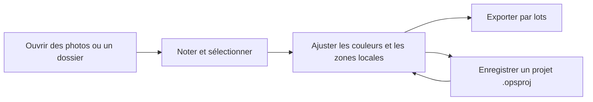

# OpenPictureStudio (OPS)

[简体中文](README.md) | [English](README.en.md) | [Français](README.fr.md)

<p align="center">
  
</p>

<p align="center">
  <a href="https://github.com/KpTanl/OpenPictureStudio/releases/latest"></a>
  
  <a href="https://github.com/KpTanl/OpenPictureStudio/actions/workflows/ci.yml"></a>
  <a href="LICENSE"></a>
</p>

**Triez, développez vos photos RAW et exportez par lots dans une seule fenêtre.**

OpenPictureStudio est un espace de travail photo open source pour Windows qui réunit la navigation et la sélection des photos, les réglages colorimétriques, les retouches locales et l’exportation par lots. Enregistrez vos modifications sous forme de projets et utilisez les outils IA et l’assistant photo selon vos besoins. L’interface est disponible en 简体中文, English et Français.

**[Télécharger pour Windows](https://github.com/KpTanl/OpenPictureStudio/releases/latest)** · [Installation](#installation-et-exécution) · [Prise en main](#prise-en-main) · [Fonctionnalités](#fonctionnalités) · [FAQ](#questions-fréquentes) · [Signaler un problème](https://github.com/KpTanl/OpenPictureStudio/issues)

> Bêta · Windows 10/11 (64 bits) · 8 Go de RAM ou plus recommandés. La visualisation et les fonctions principales de retouche fonctionnent hors ligne.

## Installation et exécution

### Télécharger le programme d’installation Windows

1. Ouvrez la [dernière version](https://github.com/KpTanl/OpenPictureStudio/releases/latest). Dans **Assets**, téléchargez `OpenPictureStudio-<version>-beta-setup.exe` et le fichier `.exe.sha256` correspondant.
2. Vérifiez le SHA256 du programme d’installation, exécutez le fichier EXE et suivez l’assistant d’installation.
3. Lancez OpenPictureStudio et ouvrez une photo ou un dossier. Python et Rust n’ont pas besoin d’être installés séparément ; téléchargez les modèles IA selon vos besoins.

<details>
<summary>Comment vérifier le SHA256 ?</summary>

Ouvrez PowerShell dans le dossier de téléchargement et exécutez ces commandes en remplaçant `<version>` par la version téléchargée :

```powershell
Get-FileHash -LiteralPath '.\OpenPictureStudio-<version>-beta-setup.exe' -Algorithm SHA256
Get-Content -LiteralPath '.\OpenPictureStudio-<version>-beta-setup.exe.sha256'
```

L’empreinte de la première commande doit correspondre à la valeur de 64 caractères au début du résultat de la seconde. Elle permet de vérifier que le téléchargement est intact et correspond au fichier de la version publiée. Téléchargez les deux fichiers depuis la page Release de ce dépôt.

</details>

### « Windows a protégé votre ordinateur » au premier lancement

Le programme d’installation Windows n’est actuellement pas signé. Lors du premier lancement par double-clic, Windows SmartScreen peut afficher « Windows a protégé votre ordinateur » et indiquer un éditeur inconnu.

Vérifiez que le fichier provient de la [page Release de ce dépôt](https://github.com/KpTanl/OpenPictureStudio/releases/latest) et vérifiez son SHA256. Sélectionnez ensuite **Informations complémentaires → Exécuter quand même** pour poursuivre l’installation.

<details>
<summary>Voir un exemple de message Windows (en chinois)</summary>


Cet exemple montre le programme d’installation 0.16.0 après l’ouverture des informations complémentaires. Le nom du fichier change à chaque version. Si l’option permettant de continuer n’est pas disponible, suivez les consignes de sécurité de votre appareil ou la politique de votre organisation.

</details>

### Télécharger et installer avec PowerShell

Ouvrez une fenêtre PowerShell ordinaire, dépliez les commandes ci-dessous, puis **copiez et exécutez tout le bloc**. Compatible avec Windows PowerShell 5.1 et PowerShell 7, il télécharge la dernière version stable de ce dépôt, vérifie son SHA256 et ouvre directement l’assistant d’installation.

Quittez OPS normalement avant une mise à niveau. Les téléchargements restent dans le dossier temporaire indiqué par la commande ; l’installation ne redémarre pas automatiquement l’ordinateur. Les protections Windows et les politiques de l’organisation restent actives.

<details>
<summary>Afficher les commandes d’installation PowerShell</summary>

```powershell
& {
    $ErrorActionPreference = 'Stop'
    $releasePage = 'https://github.com/KpTanl/OpenPictureStudio/releases/latest'
    try {
        $release = Invoke-RestMethod -Uri 'https://api.github.com/repos/KpTanl/OpenPictureStudio/releases/latest' -Headers @{ 'User-Agent' = 'OpenPictureStudio-Install' } -TimeoutSec 30
        $name = 'OpenPictureStudio-{0}-beta-setup.exe' -f ($release.tag_name -replace '^v', '')
        $installer = @($release.assets | Where-Object { $_.name -ceq $name })
        $checksum = @($release.assets | Where-Object { $_.name -ceq "$name.sha256" })
        if ($installer.Count -ne 1 -or $checksum.Count -ne 1) { throw 'La version ne contient pas exactement un programme de configuration et son fichier de contrôle.' }

        $folder = Join-Path ([IO.Path]::GetTempPath()) ('OpenPictureStudio-' + [Guid]::NewGuid().ToString('N'))
        New-Item -ItemType Directory -Path $folder | Out-Null
        Write-Host ('Dossier de téléchargement : ' + $folder)
        $exe = Join-Path $folder $name
        $sha = Join-Path $folder "$name.sha256"
        Invoke-WebRequest -UseBasicParsing -Uri $installer[0].browser_download_url -OutFile $exe -TimeoutSec 600
        Invoke-WebRequest -UseBasicParsing -Uri $checksum[0].browser_download_url -OutFile $sha -TimeoutSec 30

        $line = (Get-Content -LiteralPath $sha -Raw).Trim()
        if ($line -notmatch '^(?<hash>[a-fA-F0-9]{64})[ \t]+\*?(?<file>[^\r\n]+)$') { throw 'Le fichier de contrôle est invalide ou désigne un autre programme de configuration.' }
        $expected = $Matches['hash']
        if ($Matches['file'] -cne $name) { throw 'Le fichier de contrôle est invalide ou désigne un autre programme de configuration.' }
        if ((Get-FileHash -LiteralPath $exe -Algorithm SHA256).Hash -ine $expected) { throw 'SHA256 différent. Le programme de configuration reste fermé.' }

        Write-Host 'SHA256 vérifié. Ouverture du programme de configuration…'
        $start = New-Object System.Diagnostics.ProcessStartInfo
        $start.FileName = $exe
        $start.WorkingDirectory = $folder
        $start.UseShellExecute = $false
        $start.Arguments = '/NORESTART'
        $process = [System.Diagnostics.Process]::Start($start)
        $process.WaitForExit()
        switch ($process.ExitCode) {
            0 { Write-Host 'Installation terminée.' }
            { $_ -in 2, 5 } { Write-Host 'Installation annulée ou interrompue.' }
            default { throw ('Installation inachevée. Code de sortie : ' + $process.ExitCode) }
        }
    } catch {
        throw ("Impossible de terminer la configuration. Versions : $releasePage`n" + $_.Exception.Message)
    }
}
```

</details>

### Mises à niveau et recherche de versions

Par défaut, l’application installée recherche sur GitHub la dernière version stable, avec un intervalle d’au moins 24 heures entre les recherches automatiques pour chaque utilisateur. Désactivez cette recherche dans Paramètres → Général ou lancez-la manuellement depuis la page À propos. La requête comprend la version de l’application et les informations HTTP nécessaires ; GitHub peut voir l’adresse IP et l’heure de la requête. L’application ouvre une page de téléchargement fixe depuis laquelle vous téléchargez et exécutez le programme d’installation. L’exécution depuis les sources ne lance pas de recherche automatique ; mettez les sources à jour avec git.

<details>
<summary>Mises à niveau, réparations et anciennes versions de test</summary>

Quittez normalement toutes les instances avant une mise à niveau, puis fermez le programme d’installation avant de lancer l’application. Le programme d’installation vérifie les fichiers du programme à l’aide de son manifeste et conserve les paramètres, dossiers de données personnalisés, modèles et projets. En cas de fichiers inconnus, de composants remplacés par l’utilisateur ou de conflits de dossiers, suivez les indications pour sauvegarder et déplacer les éléments concernés. Après une installation interrompue, relancez le programme d’installation complet de la même version. Sauvegardez et traitez les fichiers tronqués ou modifiés avant de poursuivre la réparation.

Les premières versions de test peuvent ne pas avoir de manifeste d’installation. Si leurs fichiers sont encore présents, sauvegardez vos données et désinstallez d’abord l’ancienne version. Si le dossier d’installation d’origine a été supprimé ou est entièrement vide, relancez directement le programme d’installation. Si le remplacement est bloqué, le programme d’installation indique le dossier d’origine.

</details>

## Prise en main

1. **Ouvrir et sélectionner** : ouvrez une photo ou un dossier, parcourez la pellicule ou la grille et filtrez à l’aide des notes et des marqueurs Conserver/Écarter.
2. **Retoucher** : ouvrez l’espace de retouche pour ajuster l’exposition, les couleurs et la composition. Ajoutez des masques locaux si nécessaire. L’historique permet d’annuler, de rétablir et de comparer avec l’original.
3. **Enregistrer et livrer** : enregistrez une copie ou ajoutez les photos sélectionnées à la file d’exportation par lots. Enregistrez un projet `.opsproj` pour conserver les étapes et l’historique en vue de retouches ultérieures.



## Fonctionnalités

| Étape | Fonctionnalités |
| --- | --- |
| Parcourir et sélectionner | Images courantes et RAW d’appareil photo, pellicule et grille, notes et marqueurs, comparaison synchronisée, mots-clés et collections intelligentes |
| RAW et couleur | Aperçu de l’appareil, couleurs d’origine et rendu OPS ; exposition et balance des blancs, courbes, mélangeur de huit couleurs et 11 préréglages intégrés |
| Retouches locales | Dégradés, pinceau, gomme, masques du sujet et des zones du visage ; recadrage, rotation et découpe par forme |
| Outils IA | Super-résolution, réduction du bruit et du flou, détourage, retouche de portrait, photos d’identité et assistant dont les réglages sont ajoutés à l’historique |
| Traitement groupé | Synchronisation des réglages, correction de l’exposition d’un groupe, suggestions de regroupement, harmonisation de l’exposition et de la balance des blancs RAW |
| Projets et exportation | Brouillons automatiques, projets `.opsproj`, files d’exportation, conversion de format et de taille, PNG transparent, TIFF 16 bits et PDF multi-images |

### Visualisation et retouche

Les captures présentent l’interface en anglais.

**Visualiser** : parcourez les photos, ajustez le zoom et attribuez des notes par étoiles.

[](.github/assets/readme/viewer.png)

**Retoucher** : passez à l’espace de retouche dans la même fenêtre pour ajuster l’exposition, la balance des blancs et les couleurs.

[](.github/assets/readme/workspace.png)

### Retouche de portrait

Ajustez les paramètres de peau, des yeux et de la forme du visage, puis zoomez pour examiner les détails. Les captures présentent l’interface en anglais.

**Paramètres initiaux · zoom à 84 %**

[](.github/assets/readme/beauty-default.png)

**Après réglages · zoom à 131 %**

[](.github/assets/readme/beauty-adjusted.png)

<details>
<summary>Liste complète des fonctionnalités</summary>

### Navigation et sélection

- **Formats courants et RAW d’appareil photo** : ouvrez directement JPEG, PNG, BMP, GIF, WebP, TIFF, ICO et PPM/PGM/PBM. Les formats RAW pris en charge comprennent CR2, CR3, NEF, NRW, ARW, RAF, DNG, ORF, PEF et RW2, notamment pour Canon, Nikon, Sony, Fujifilm, Olympus, Pentax et Panasonic.
- **Aperçu RAW prioritaire** : à l’ouverture d’un fichier RAW, l’aperçu intégré de l’appareil s’affiche avant d’être remplacé par l’image décodée. Les modes RAW proposent l’aperçu de l’appareil, les couleurs d’origine et le rendu OPS. Les autres formats proposent les couleurs d’origine et le rendu OPS ; les préférences des deux catégories sont enregistrées séparément.
- **Filtres et comparaison** : parcourez les photos dans une pellicule ou une grille. Attribuez des étoiles et les marqueurs Conserver/Écarter ; filtrez par note, marqueur, type de fichier, état de retouche et état de livraison. Comparez deux photos côte à côte à leur résolution d’origine avec une navigation synchronisée.
- **Photothèque** : ajoutez des mots-clés et organisez vos photos dans des collections ordinaires ou des collections intelligentes mises à jour automatiquement selon des règles.
- **Informations photo** : consultez les paramètres de prise de vue, les détails de l’appareil et de l’objectif, les informations du fichier source et les histogrammes, y compris pour les fichiers RAW.
- **Outils courants** : rotation, retournement, définition comme fond d’écran et association de types de fichiers. Choisissez un thème sombre, clair ou beige et une interface en 简体中文, English ou Français.

### Retouche

- **Réglages colorimétriques** :
  - Température, teinte, exposition, contraste, hautes lumières, ombres, blancs et noirs.
  - Texture, clarté, correction du voile, vibrance et saturation.
  - Courbes RVB et par canal, mélangeur de huit couleurs avec pipette sur l’image, histogramme en direct et réglage automatique en un clic.
  - 11 préréglages intégrés : monochrome, rétro, frais, chaud, froid, lumière douce, vif, dramatique, HDR, film et beauté de la peau.
- **Masques locaux** : dégradés linéaire et radial, pinceau et gomme, sélection du sujet, peau du visage, yeux, lèvres, arrière-plan et photo entière. Combinez plusieurs zones par ajout ou soustraction dans un masque et ajustez chaque masque séparément.
- **Rendu OPS** : choisissez les couleurs d’origine ou le rendu OPS pour les fichiers RAW, JPG, PNG et autres formats.
- **Composition** : recadrage et rotation libres, recadrage avec grille, découpe par forme et sélection au lasso.
- **Historique et projets** : annulation et rétablissement sur plusieurs étapes, retour à une étape dans l’historique et pile des traitements en cours. Maintenez la commande enfoncée pour comparer avec l’original. Enregistrez les retouches dans un projet `.opsproj`.

### Groupes de photos

- **Réglages groupés** : utilisez une photo comme référence et synchronisez les réglages choisis avec les photos sélectionnées ou tous les résultats filtrés, ou augmentez ou réduisez l’exposition du groupe. Annulez ou rétablissez chaque lot et relancez les photos dont le traitement a échoué.
- **Groupes et calibration** : recevez des suggestions de regroupement selon l’heure de prise de vue, l’appareil et l’objectif, ainsi que des suggestions d’harmonisation de l’exposition et de la balance des blancs RAW. Prévisualisez les changements avant de les appliquer ensemble.

### Outils IA

- **Amélioration de l’image** : super-résolution Real-ESRGAN (2×, 4× et 4K), réduction du bruit et du flou NAFNet et restauration aux dimensions d’origine. Réglez séparément le bruit de luminance et le bruit de couleur.
- **Détourage** : détection du sujet avec U2Net, détourage par couleur et découpe au lasso. Affinez les contours et exportez sur fond transparent ou uni.
- **Retouche de portrait** : les points de repère du visage permettent quatre groupes de réglages : peau (lissage, éclaircissement, teint rosé et netteté), forme du visage (affinement du visage et du nez), yeux (agrandissement et espacement) et retouches de détail (blanchiment des dents, correction des imperfections et réduction des poches sous les yeux).
- **Photos d’identité** : préréglages pour les photos d’identité chinoises d’un et deux pouces, les passeports, visas et documents de sécurité sociale, ainsi que dimensions personnalisées. Modifiez la couleur du fond, cadrez automatiquement selon la position du visage et disposez les photos sur une planche d’impression.
- **Assistant photo IA** : plusieurs conversations avec les modes Discussion, Planification, Réglage et Agent. Les réglages rejoignent le même historique que les retouches manuelles et peuvent être annulés, rétablis ou affinés. Demandez deux variantes A/B, comparez-les dans le panneau de l’assistant et ajoutez-en une à l’historique avec Appliquer. Ajoutez une image de référence ou enregistrez des styles nommés et des préférences pour plus tard.
- **Modèles et GPU** : les modèles sont téléchargés séparément du programme d’installation. Téléchargez-les, importez-les, désinstallez-les et définissez les valeurs par défaut dans Paramètres → Outils et modèles. Si vous disposez d’un GPU dédié, installez le moteur GPU (DirectML) dans Paramètres → Moteurs d’exécution, puis redémarrez l’application pour l’activer.

</details>

<details>
<summary>Détails des projets, brouillons et sorties</summary>

- **Projets et brouillons** : les retouches sont automatiquement enregistrées comme brouillons pour pouvoir reprendre à l’ouverture de la même photo. Un projet `.opsproj` conserve les étapes de traitement et l’historique.
- **Enregistrement** : choisissez d’écraser l’original ou d’enregistrer une copie. Le résultat est écrit dans un fichier temporaire et vérifié avant de remplacer la destination, ce qui préserve les fichiers existants en cas d’échec ou d’annulation.
- **Exportation par lots** : sélectionnez les photos et un préréglage de sortie, puis ajoutez-les à la file d’exportation. Les retouches sont figées à l’ajout ; les modifications ultérieures de la photo ne changent pas les éléments en attente. Mettez la file en pause ou annulez-la, relancez les éléments en échec et consultez les résultats.
- **Formats** : convertissez entre JPG, PNG, WebP, BMP et TIFF. Définissez une taille cible en Ko pour les JPG. Redimensionnez en conservant les proportions, en recadrant pour remplir, en ajoutant des bordures ou en étirant l’image.
- **Profondeur élevée et PDF** : exportez en TIFF 16 bits avec transparence ou réunissez plusieurs images dans un PDF en conservant leur ordre.

</details>

## Questions fréquentes

### Faut-il un GPU dédié ?

La visualisation et les retouches de base fonctionnent sur le processeur. Pour l’inférence sur GPU, installez le moteur DirectML dans Paramètres → Moteurs d’exécution et redémarrez l’application. Les modèles et les moteurs sont gérés séparément.

### Pourquoi certains outils IA demandent-ils un modèle ?

Téléchargez ou importez les modèles nécessaires dans Paramètres → Outils et modèles, puis sélectionnez-les dans le panneau de l’outil concerné. Le détourage IA et le remplacement de fond IA des photos d’identité utilisent U2Net. Conserver le fond d’origine, recadrer, redimensionner et disposer les photos d’identité ne nécessitent pas de modèle. Par défaut, l’application installée stocke les modèles dans `%APPDATA%\OpenPictureStudio\OpenPictureStudio\models`. Les projets enregistrés rétablissent les versions exactes des modèles auxquels ils font référence.

### Puis-je reprendre les retouches après avoir fermé l’application ?

Les retouches sont automatiquement enregistrées comme brouillons pour chaque photo. Rouvrez la même photo pour continuer. Enregistrez un projet `.opsproj` pour conserver explicitement les étapes et l’historique ; créez les images finales avec Enregistrer ou Exporter.

### L’assistant IA envoie-t-il mes photos ?

Après configuration d’un service, le premier message inclut par défaut un aperçu. Sélectionnez Sans photo sous le champ de saisie pour désactiver l’envoi de photos. La section Services IA et confidentialité ci-dessous détaille les règles. Les outils IA locaux utilisent des modèles téléchargés sur votre ordinateur.

### La recherche de versions installe-t-elle automatiquement les mises à jour ?

La recherche de versions propose un lien vers la page de téléchargement. Vous téléchargez et installez la mise à jour. Les commandes PowerShell ci-dessus ne s’exécutent que lorsque vous choisissez de les lancer.

## Services IA et confidentialité

L’assistant photo IA utilise les services que vous configurez. Ajoutez des connexions et des modèles dans Paramètres → Services IA. L’assistant n’envoie aucune requête tant qu’un service n’est pas configuré. Les clés API sont chiffrées avec Windows DPAPI et stockées localement.

Contenu envoyé au service :

- **Texte et paramètres** : vos messages, les paramètres de réglage actuels et une analyse photo calculée localement, décrivant sous forme de texte la luminosité, les dominantes de couleur et les visages, sans pixels de l’image.
- **Photos** : par défaut, le premier message inclut un aperçu de l’image actuelle avec les retouches appliquées, dont le grand côté mesure au maximum 1536 pixels. Le sélecteur sous le champ de saisie permet de choisir l’image d’origine sans retouches, avec un grand côté de 2048 pixels au maximum, ou Sans photo. Les photos plus petites sont envoyées à leur taille d’origine sans agrandissement. Lorsque le partage est activé, l’assistant peut aussi demander des aperçus de l’image d’origine, de l’image au début de la tâche et de l’image actuelle, ainsi que des recadrages haute résolution autorisés par les paramètres du modèle. Toutes les images sont des JPEG sans métadonnées de prise de vue. Sans photo empêche l’envoi de photos dans toutes les requêtes ; aucune photo n’est envoyée si l’entrée image est désactivée pour le modèle.
- **Images de référence** : envoyées uniquement lorsque vous en ajoutez une.

Le haut du panneau de l’assistant indique ce qui sera envoyé pour la requête en cours. Les conversations, pièces jointes et styles sont stockés localement.

## Signaler un problème

Dans [GitHub Issues](https://github.com/KpTanl/OpenPictureStudio/issues), indiquez la version de l’application, la version de Windows, les étapes pour reproduire le problème et les captures ou journaux utiles. Vérifiez que les pièces jointes ne contiennent pas de données personnelles ou de clés de service avant leur publication.

Par défaut, l’application installée et l’application lancée depuis les sources écrivent leurs journaux dans `%APPDATA%\OpenPictureStudio\OpenPictureStudio\logs\openpicturestudio.log`. Modifiez l’emplacement, la taille par fichier (environ 2 Mo par défaut) et le nombre d’anciens fichiers conservés (3 par défaut) dans Paramètres → Stockage. Vous pouvez également y ouvrir le dossier des journaux. Joignez le journal au signalement pour faciliter le diagnostic.

## Documentation

| Document | Liens |
| --- | --- |
| Guide d’utilisation | [简体中文](README.md) · [English](README.en.md) · [Français](README.fr.md) |
| Installation | [简体中文](README.md#安装与运行) · [English](README.en.md#installation-and-running) · [Français](#installation-et-exécution) |
| Exécution depuis les sources | [简体中文](README.md#源码运行) · [English](README.en.md#run-from-source) · [Français](#exécution-depuis-les-sources) |
| Création du programme d’installation | [简体中文](README.md#构建) · [English](README.en.md#building) · [Français](#compilation) |
| Tests | [简体中文](tests/README.md) · [English](tests/README.en.md) |
| Flux CI et publication | [CI](.github/workflows/ci.yml) · [Release](.github/workflows/release.yml) · [Environnement partagé](.github/actions/setup-build/action.yml) |
| Licence du projet | [MIT License](LICENSE) |

<details>
<summary>Ressources, dépendances et licences tierces</summary>

- Catalogue des modèles : [catalog.json](resources/models/catalog.json).
- Catalogue des moteurs d’exécution : [catalog.json](resources/runtimes/catalog.json).
- Compléments de licence et code source correspondant : [manifest.json](packaging/licenses/manifest.json).
- Mentions incluses : [FlatBuffers](packaging/licenses/flatbuffers/LICENSE) · [MediaPipe](packaging/licenses/mediapipe/MEDIAPIPE_THIRD_PARTY_NOTICES.txt) · [Qt](packaging/licenses/qt/QT_THIRD_PARTY_NOTICES.txt) · [moteur MSVC](packaging/licenses/msvc-runtime/NOTICE.txt).
- Licences des modèles : [MediaPipe](resources/models/licenses/MEDIAPIPE.txt) · [NAFNet](resources/models/licenses/NAFNET.txt) · [Real-ESRGAN](resources/models/licenses/REAL_ESRGAN.txt) · [U2Net](resources/models/licenses/U2NET.txt) · [YuNet](resources/models/licenses/YUNET.txt).
- Icônes de l’interface : [Source](resources/icons/ui/SOURCE.txt) · [Licence](resources/icons/ui/LICENSE.txt).
- Listes des dépendances : [requirements.txt](requirements.txt) · [requirements-ai.txt](requirements-ai.txt) · [requirements-beauty.txt](requirements-beauty.txt) · [requirements-dev.txt](requirements-dev.txt) · [requirements-build.txt](requirements-build.txt) · [requirements-build.lock.txt](requirements-build.lock.txt).

</details>

### Exécution depuis les sources

<details>
<summary>Environnement Python, dépendances facultatives et accélération Rust</summary>

Python 3.12 ou une version ultérieure est nécessaire ; le développement et les versions distribuées utilisent Python 3.13. Les dépendances sont regroupées par fonction afin de n’installer que celles dont vous avez besoin.

```powershell
# 1. Récupérer les sources
git clone https://github.com/KpTanl/OpenPictureStudio.git
cd OpenPictureStudio
python -m venv .venv
.\.venv\Scripts\activate

# 2. Installer les dépendances de base (visualisation, couleur, formats et sortie)
pip install -r requirements.txt

# 3. (Facultatif) Installer les dépendances IA et de retouche de portrait
pip install -r requirements-ai.txt
pip install -r requirements-beauty.txt

# 4. Lancer l’application
python main.py
```

Le module d’accélération Rust est facultatif. Pour l’utiliser, installez la chaîne d’outils Rust, compilez le module et copiez le résultat à la racine du dépôt :

```powershell
cd native\ops_accel
cargo build --release
copy target\release\ops_accel.dll ..\..\ops_accel.pyd
cd ..\..
```

</details>

## Compilation

<details>
<summary>Programme d’installation, CI et publications, tests et structure du code</summary>

### Créer le programme d’installation

Inno Setup, la chaîne d’outils Rust et toutes les dépendances de l’application, de l’IA, de la retouche de portrait et de l’empaquetage sont nécessaires. `requirements-build.lock.txt` fixe les versions testées pour les versions distribuées ; `requirements-build.txt` en est la source. Avant la compilation, le script vérifie la version de Python, les dépendances nécessaires et la présence d’une seule distribution OpenCV.

```powershell
pip install -r requirements-build.lock.txt
powershell -ExecutionPolicy Bypass -File build.ps1
```

### CI et publications

La CI exécute les vérifications du code et la compilation Python, compile le module natif, lance les tests et crée le programme d’installation dans des jobs distincts. Les pull requests vont jusqu’aux tests ; les pushs vers `dev`/`main` et les exécutions manuelles créent également le programme d’installation.

Les tags de version exécutent les mêmes étapes, vérifient que le commit appartient à `main` et que le tag correspond à `APP_VERSION`, puis créent un brouillon de Release. Une personne chargée de la maintenance publie ensuite la Release manuellement.

La compilation native envoie `ops_accel.pyd`. Les tests et l’empaquetage téléchargent le même artefact ; l’empaquetage utilise `build.ps1 -SkipNativeBuild` et prépare les sources des dépendances Cargo pour la collecte des licences. Chaque job en aval sélectionne l’identifiant de l’artefact produit.

### Exécuter les tests

Consultez les [instructions de test](tests/README.en.md) en anglais.

### Structure du code

Les dépendances suivent une seule direction : interface → application → cœur → accélération native. Chaque couche dépend uniquement des contrats publics de la couche inférieure.

- **`src/ui`** : interface et interactions, notamment espaces de visualisation et de retouche, panneaux d’outils, thèmes et traductions.
- **`src/application`** : coordination des traitements, notamment planification des tâches, caches, gestion des modèles et moteurs, sorties et persistance.
- **`src/core`** : algorithmes et modèles de données, notamment moteur d’image, contrats des outils, flux de travail et projets `.opsproj`.
- **`native/ops_accel`** : module d’accélération native écrit en Rust.
- **`resources`** : thèmes, traductions et catalogues des modèles et moteurs.

</details>

## Licence et dépendances tierces

Le code original d’OpenPictureStudio est publié sous [licence MIT](LICENSE). Les dépendances, modèles et ressources tiers suivent leurs propres licences. Les icônes de l’interface proviennent de [Tabler Icons](https://github.com/tabler/tabler-icons), sous licence MIT ; le texte de la licence est disponible avec les icônes dans [resources/icons/ui/LICENSE.txt](resources/icons/ui/LICENSE.txt).

Les distributions installables et portables contiennent les éléments suivants dans le dossier du programme, générés à partir du contenu effectivement empaqueté par [tools/collect_licenses.py](tools/collect_licenses.py) lors de la compilation :

- `THIRD_PARTY_NOTICES.txt` : noms, versions, licences et sites des composants, y compris les modèles et moteurs téléchargeables ;
- `licenses/` : textes de licence et mentions de copyright de chaque composant ;
- `SOURCE.txt` : commit et adresse des sources de l’application, ainsi qu’adresses et sommes de contrôle des sources correspondantes des composants GPL, LGPL et MPL ;
- `components.json` : correspondance entre les composants et les fichiers distribués ;
- `LICENSE` (MIT) et `GPL-3.0.txt`.

Les textes de licence absents des paquets d’origine et les composants nécessitant la fourniture des sources correspondantes sont enregistrés dans [packaging/licenses](packaging/licenses). La compilation s’arrête si un fichier distribué ne peut pas être associé à un composant, si le texte de licence d’un composant manque ou si les sources correspondantes d’un composant GPL, LGPL ou MPL ne sont pas enregistrées.

Ce projet utilise PyQt6, dont l’édition open source est sous licence GPLv3 ; une licence commerciale est également disponible. Une application combinée compilée et distribuée avec PyQt6 sous GPL doit être distribuée sous GPLv3. La licence MIT du code original du projet reste applicable : MIT s’applique à la réutilisation de ce code seul ; la réutilisation et la distribution de l’application combinée avec PyQt6 sous GPL doivent aussi respecter la GPLv3.

Lors de la distribution de tels programmes d’installation ou paquets portables, conservez les mentions de copyright et les textes de licence applicables et fournissez les sources correspondantes complètes de la version, notamment celles des dépendances couvertes par la GPL et les scripts de compilation nécessaires. L’accès aux sources correspondantes doit être proposé avec le téléchargement des binaires.

Pour les conditions détaillées, consultez les [informations officielles sur les licences PyQt](https://www.riverbankcomputing.com/software/pyqt/intro), la [FAQ sur les licences PyQt](https://www.riverbankcomputing.com/commercial/license-faq) et les [termes de la GPLv3](https://www.gnu.org/licenses/gpl-3.0.html). Les distributions utilisant une licence commerciale PyQt suivent ses conditions commerciales et les licences des autres dépendances.

Pour les crédits du logo, des captures, du diagramme et des icônes utilisés dans ce README, consultez les [sources des ressources](.github/assets/readme/SOURCES.en.md) en anglais.
