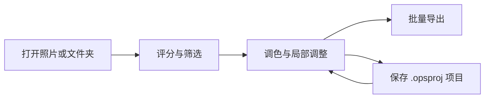

# OpenPictureStudio (OPS)

[简体中文](README.md) | [English](README.en.md) | [Français](README.fr.md)

<p align="center">
  
</p>

<p align="center">
  <a href="https://github.com/KpTanl/OpenPictureStudio/releases/latest"></a>
  
  <a href="https://github.com/KpTanl/OpenPictureStudio/actions/workflows/ci.yml"></a>
  <a href="LICENSE"></a>
</p>

**从选片、RAW 调色到批量导出，在一个窗口里完成。**

OpenPictureStudio 是一款面向 Windows 的开源影像工作台，集照片浏览与筛选、调色、局部调整和批量导出于一体。编辑可保存为项目，AI 工具与修图助手按需使用。界面支持简体中文、English 和 Français。

**[下载 Windows 安装包](https://github.com/KpTanl/OpenPictureStudio/releases/latest)** · [安装说明](#安装与运行) · [快速上手](#快速上手) · [主要能力](#主要能力) · [常见问题](#常见问题) · [反馈问题](https://github.com/KpTanl/OpenPictureStudio/issues)

> Beta · Windows 10/11（64 位）· 建议内存 8 GB 及以上。核心看图与编辑可离线使用。

## 安装与运行

### 下载 Windows 安装包

1. 打开 [最新版本](https://github.com/KpTanl/OpenPictureStudio/releases/latest)，在 **Assets** 中下载 `OpenPictureStudio-<版本>-beta-setup.exe` 和同名 `.exe.sha256` 文件。
2. 核对安装包的 SHA256，双击 EXE，按安装向导完成安装。
3. 启动 OpenPictureStudio，打开照片或文件夹。安装版无需另装 Python 或 Rust；AI 模型按需下载。

<details>
<summary>如何核对 SHA256？</summary>

在下载目录打开 PowerShell，运行下面的命令，将文件名中的 `<版本>` 换成实际版本：

```powershell
Get-FileHash -LiteralPath '.\OpenPictureStudio-<版本>-beta-setup.exe' -Algorithm SHA256
Get-Content -LiteralPath '.\OpenPictureStudio-<版本>-beta-setup.exe.sha256'
```

第一条命令显示的哈希应与第二条输出开头的 64 位值一致。校验值用于核对下载文件是否完整，并对应同一份发行资产。请从本仓库的 Release 获取安装包与校验文件。

</details>

### 首次运行出现“Windows 已保护你的电脑”

当前 Windows 安装包未作代码签名。首次双击时，Windows SmartScreen 可能显示“Windows 已保护你的电脑”及“发布者未知”。

确认文件来自 [本仓库的 Release](https://github.com/KpTanl/OpenPictureStudio/releases/latest)，并核对同版本 SHA256 后，点击 **“更多信息” → “仍要运行”**，继续安装。下面的示例截图已展开“更多信息”：

<details>
<summary>查看 Windows 首次运行提示</summary>


示例安装包版本为 0.16.0；文件名随发行版本变化。设备没有提供“仍要运行”时，请按系统提示或组织策略处理。

</details>

### 使用 PowerShell 下载安装

打开普通 PowerShell，展开下方命令并**整段复制执行**。命令兼容 Windows PowerShell 5.1 与 PowerShell 7，从本仓库下载最新正式发行包，校验 SHA256 后直接打开安装向导。

升级前请正常退出 OPS。下载文件保留在命令显示的临时目录，安装过程不会自动重启电脑。Windows 防护和组织策略照常生效。

<details>
<summary>展开 PowerShell 安装命令</summary>

```powershell
& {
    $ErrorActionPreference = 'Stop'
    $releasePage = 'https://github.com/KpTanl/OpenPictureStudio/releases/latest'
    try {
        $release = Invoke-RestMethod -Uri 'https://api.github.com/repos/KpTanl/OpenPictureStudio/releases/latest' -Headers @{ 'User-Agent' = 'OpenPictureStudio-Install' } -TimeoutSec 30
        $name = 'OpenPictureStudio-{0}-beta-setup.exe' -f ($release.tag_name -replace '^v', '')
        $installer = @($release.assets | Where-Object { $_.name -ceq $name })
        $checksum = @($release.assets | Where-Object { $_.name -ceq "$name.sha256" })
        if ($installer.Count -ne 1 -or $checksum.Count -ne 1) { throw '发行版本缺少唯一匹配的安装包或校验文件。' }

        $folder = Join-Path ([IO.Path]::GetTempPath()) ('OpenPictureStudio-' + [Guid]::NewGuid().ToString('N'))
        New-Item -ItemType Directory -Path $folder | Out-Null
        Write-Host ('下载目录：' + $folder)
        $exe = Join-Path $folder $name
        $sha = Join-Path $folder "$name.sha256"
        Invoke-WebRequest -UseBasicParsing -Uri $installer[0].browser_download_url -OutFile $exe -TimeoutSec 600
        Invoke-WebRequest -UseBasicParsing -Uri $checksum[0].browser_download_url -OutFile $sha -TimeoutSec 30

        $line = (Get-Content -LiteralPath $sha -Raw).Trim()
        if ($line -notmatch '^(?<hash>[a-fA-F0-9]{64})[ \t]+\*?(?<file>[^\r\n]+)$') { throw '校验文件格式不正确，或对应另一个安装包。' }
        $expected = $Matches['hash']
        if ($Matches['file'] -cne $name) { throw '校验文件格式不正确，或对应另一个安装包。' }
        if ((Get-FileHash -LiteralPath $exe -Algorithm SHA256).Hash -ine $expected) { throw 'SHA256 不匹配，未启动安装器。' }

        Write-Host 'SHA256 已核对，正在打开安装向导……'
        $start = New-Object System.Diagnostics.ProcessStartInfo
        $start.FileName = $exe
        $start.WorkingDirectory = $folder
        $start.UseShellExecute = $false
        $start.Arguments = '/NORESTART'
        $process = [System.Diagnostics.Process]::Start($start)
        $process.WaitForExit()
        switch ($process.ExitCode) {
            0 { Write-Host '安装完成。' }
            { $_ -in 2, 5 } { Write-Host '安装已取消或中止。' }
            default { throw ('安装未完成，退出码：' + $process.ExitCode) }
        }
    } catch {
        throw ("未能完成安装，发行页面：$releasePage`n" + $_.Exception.Message)
    }
}
```

</details>

### 升级与版本检查

安装版默认检查 GitHub 上的最新正式版，每个用户的自动查询间隔至少 24 小时；可在“设置 → 常规”关闭，也可在“关于”页手动检查。查询包含应用版本及必要 HTTP 信息，GitHub 可见网络 IP 和请求时间。程序只打开固定下载页，安装包由你下载并运行。源码运行不自动查询，使用 git 更新源码。

<details>
<summary>覆盖升级、修复与早期测试版</summary>

覆盖升级前正常退出所有实例，安装完成后关闭安装器再启动。安装器按文件清单核对程序文件，设置、自定义资料目录、模型和项目保留。遇到未知文件、用户替换的组件或目录冲突时，先按提示备份并迁出冲突内容。安装中断后重新运行同一版本的完整安装包；被截断或修改的文件须先备份处理，再继续修复。

早期测试版可能没有安装清单。原程序仍在时，先备份资料并卸载旧版；原安装目录已删除或完全为空时，可直接重新安装。安装器阻止覆盖时会显示原安装目录。

</details>

## 快速上手

1. **打开与筛选**：打开一张照片或一个文件夹，用胶片条／网格浏览，按星级和“保留／排除”筛选。
2. **编辑**：进入编辑工作区，调整曝光、色彩和构图；需要时添加局部蒙版。处理步骤保留在历史中，可以撤销、重做和对比原图。
3. **保存与交付**：另存成品，或把选定照片加入批量导出队列；保存 `.opsproj` 项目可保留处理步骤和历史，便于继续编辑。



## 主要能力

| 工作环节 | 功能 |
| --- | --- |
| 看图与选片 | 常见图片与相机 RAW、胶片条／网格、星级与标记、联动比较、关键词与智能集合 |
| RAW 与调色 | 相机预览／原彩／OPS 观感、曝光与白平衡、曲线、8 通道色彩混合、11 个内置预设 |
| 局部编辑 | 渐变、画笔、擦除、主体与人脸区域蒙版；裁切、旋转及形状裁切 |
| AI 工具 | 超分辨率、降噪与去模糊、抠图、人像美颜、证件照，以及可将调整写入历史的修图助手 |
| 成组处理 | 同步选定调整、统一增减曝光、按拍摄信息建议分组、曝光匹配与 RAW 白平衡对齐 |
| 项目与导出 | 自动草稿、`.opsproj` 项目、批量队列、格式与尺寸转换、透明 PNG／16 位 TIFF、多图 PDF |

### 看图与编辑

**看图**：浏览照片，调整缩放并进行星级评分。

[](.github/assets/readme/viewer.png)

**编辑**：在同一个窗口切换到编辑工作区，调整曝光、白平衡与色彩。

[](.github/assets/readme/workspace.png)

### 人像美颜

调整皮肤、眼部和脸型参数，放大查看细节。

**初始参数 · 84% 缩放**

[](.github/assets/readme/beauty-default.png)

**参数调整后 · 131% 缩放**

[](.github/assets/readme/beauty-adjusted.png)

<details>
<summary>完整功能列表</summary>

### 看图与选片

- **常见格式与相机 RAW**：JPEG、PNG、BMP、GIF、WebP、TIFF、ICO、PPM/PGM/PBM 直接打开；相机 RAW 支持 CR2、CR3、NEF、NRW、ARW、RAF、DNG、ORF、PEF、RW2，涵盖佳能、尼康、索尼、富士、奥林巴斯、宾得、松下等品牌。
- **RAW 先看预览**：打开 RAW 时先显示相机内嵌预览，解码完成后替换。RAW 可选择相机预览、原彩或 OPS 观感显示，其他格式可选择原彩或 OPS 观感，两类设置分别保存。
- **筛选与比较**：胶片条与网格两种浏览方式；星级评分和“保留／排除”标记；按星级、标记、文件类型、编辑状态和交付状态筛选；两张照片可并排按原尺寸联动比较。
- **图库**：为照片添加关键词，用普通集合和按条件自动更新的智能集合整理照片。
- **照片信息**：拍摄参数、设备、源文件详情和直方图，RAW 同样适用。
- **常用小功能**：旋转翻转、设为壁纸、文件关联；深色、浅色、米色三套主题；界面支持简体中文、English 和 Français。

### 编辑

- **调色台**：
  - 色温、色调、曝光、对比度、高光、阴影、白色、黑色。
  - 纹理、清晰度、去朦胧、自然饱和度、饱和度。
  - RGB 与单通道色调曲线、8 通道色彩混合（可用吸管在画面上点选颜色）、实时直方图和一键自动调整。
  - 11 个内置预设：单色、复古、清新、暖调、冷调、柔光、鲜艳、戏剧、HDR、胶片、美肤。
- **局部蒙版**：线性渐变、径向渐变、画笔与擦除、选择主体、面部皮肤、眼睛、嘴唇、背景和整张照片；同一蒙版可由多个区域添加或减去组合，每个蒙版单独调整。
- **OPS 观感**：RAW、JPG、PNG 等格式都可选择原彩或 OPS 观感。
- **构图**：自由裁切与旋转、网格裁切、形状裁切和套索。
- **历史与项目**：多级撤销重做，历史面板可回到任意一步，编辑栈列出当前各步处理；按住即可对比原图；编辑可保存为 `.opsproj` 项目。

### 成组照片

- **成组调整**：以一张照片为样板，把选定的调整同步到所选照片或全部筛选结果，也可以统一增减曝光；每一批都可以撤销、重做或重试未成功的照片。
- **照片组与校准**：按拍摄时间、机型和镜头建议分组；对同组照片给出曝光匹配和 RAW 白平衡对齐建议，预览后统一应用。

### AI 工具

- **画质增强**：Real-ESRGAN 超分辨率（2×、4×、4K）与 NAFNet 降噪、去模糊，也可按原尺寸修复；亮度噪点与颜色噪点分别调节。
- **抠图**：U2Net 识别主体，另有按颜色抠图与套索抠图；可优化边缘，输出透明或纯色背景。
- **人像美颜**：基于人脸关键点，提供皮肤（磨皮、提亮、红润、锐化）、脸型（瘦脸、瘦鼻）、眼部（大眼、眼距）和精修（美白牙齿、祛痘祛斑、去眼袋）四组调节。
- **证件照**：一寸、二寸、护照、签证、社保等尺寸预设与自定义尺寸；可更换背景色、按人脸位置自动构图，并支持排版。
- **AI 修图助手**：多会话，支持对话、规划、调整和 Agent 模式。助手的调整直接写进编辑历史，和手动调整一样可以撤销、重做或接着改；需要两个方案时生成 A／B 候选，在助手面板里对比，点“采用”后才写入。可以附一张参考图，也可以保存命名风格和偏好供以后使用。
- **模型与 GPU**：模型不随安装包分发，在“设置 → 工具与模型”中按需下载、导入、卸载并设置默认。有独立显卡时可在“设置 → 运行环境”安装 GPU 运行环境（DirectML），重启后生效。

</details>

<details>
<summary>项目、草稿与输出细节</summary>

- **项目与草稿**：编辑自动保存为草稿，下次打开同一张照片继续；保存为 `.opsproj` 项目时一并保存处理步骤和历史。
- **保存结果**：由你决定覆盖原图还是另存副本；输出先写入临时文件并校验，再替换目标，失败或取消都不会损坏已有文件。
- **批量导出**：选好照片和输出预设后加入导出队列；入队时固定当时的编辑，之后再改照片不影响已入队的项目。队列可暂停、取消和重试失败项，完成记录可查询。
- **格式处理**：JPG、PNG、WebP、BMP、TIFF 互转；JPG 可指定目标文件大小（KB）；尺寸支持保持比例、裁切填满、补边适配和直接拉伸。
- **高位深与 PDF**：支持 16 位 TIFF 并保留透明度；多张图片可按顺序合并为一个 PDF。

</details>

## 常见问题

### 必须有独立显卡吗？

看图和基础编辑可使用 CPU。需要 GPU 推理时，可在“设置 → 运行环境”安装 DirectML 运行环境，重启后生效。模型与运行环境分开管理。

### 为什么有些 AI 工具提示缺少模型？

在“设置 → 工具与模型”中下载或导入所需模型，再在工具面板中选择。AI 抠图和证件照的 AI 换背景使用 U2Net；证件照的保留原背景、裁切、尺寸调整和排版不需要模型。安装版的模型默认保存到 `%APPDATA%\OpenPictureStudio\OpenPictureStudio\models`；已保存的项目按准确的模型版本恢复。

### 关闭后还能继续编辑吗？

编辑会自动保存为本图草稿，重新打开同一张照片可继续。需要明确保存处理步骤和历史时，另存为 `.opsproj` 项目；成品图片通过保存或导出生成。

### AI 助手会发送照片吗？

配置服务后，默认首轮会发送当前照片的预览；可以在输入框下方选择“不发送照片”。完整发送规则见下方“AI 服务与隐私”。本地 AI 工具使用下载到本机的模型。

### 发现新版本会自动安装吗？

版本检查会提示并打开下载页，由你下载和安装。上面的 PowerShell 命令也只有在你主动执行时才会下载安装包。

## AI 服务与隐私

AI 修图助手使用你自己配置的服务：在“设置 → AI 服务”添加连接和模型，未配置时助手不会发出任何请求。密钥经 Windows DPAPI 加密后保存在本机。

向服务发送的内容：

- **文字与参数**：你输入的文字、当前的调整参数，以及本机算出的照片分析（明暗、偏色和人脸情况，以文字描述，不含像素）。
- **照片**：默认在首轮附带当前画面的预览（含已做的调整，长边最多 1536 像素）。输入框下方的照片选项可改为原始画面（不含调整，长边最多 2048 像素）或不发送照片；照片比这小时按原尺寸发送，不会放大。开启时，助手还可以按需查看原始、开始前和当前画面的预览，以及模型设置允许的高清局部；所有图片都是不含拍摄信息的 JPEG。选择“不发送照片”后，所有请求都不发送照片；模型未开启图片输入时同样不发送。
- **参考图**：只有你添加参考图后才会发送。

助手面板顶部写明本次会发送的内容。会话、附件和风格保存在本机。

## 问题反馈

请在 [GitHub Issues](https://github.com/KpTanl/OpenPictureStudio/issues) 中附上应用版本、Windows 版本、复现步骤，以及相关截图或日志。公开提交前请检查附件中的个人信息和服务密钥。

运行日志默认写在 `%APPDATA%\OpenPictureStudio\OpenPictureStudio\logs\openpicturestudio.log`，安装版和源码运行相同。日志位置、单份大小（默认约 2 MB）和保留的旧日志份数（默认 3 份）可在“设置 → 存储空间”修改，那里也能直接打开日志所在的文件夹。反馈问题时附上日志，便于定位。

## 文档导航

| 文档 | 入口 |
| --- | --- |
| 使用说明 | [简体中文](README.md) · [English](README.en.md) · [Français](README.fr.md) |
| 安装说明 | [简体中文](#安装与运行) · [English](README.en.md#installation-and-running) · [Français](README.fr.md#installation-et-exécution) |
| 源码运行 | [简体中文](#源码运行) · [English](README.en.md#run-from-source) · [Français](README.fr.md#exécution-depuis-les-sources) |
| 安装包构建 | [简体中文](#构建) · [English](README.en.md#building) · [Français](README.fr.md#compilation) |
| 测试说明 | [简体中文](tests/README.md) · [English](tests/README.en.md) |
| CI 与发布工作流 | [CI](.github/workflows/ci.yml) · [Release](.github/workflows/release.yml) · [共用构建环境](.github/actions/setup-build/action.yml) |
| 项目许可证 | [MIT License](LICENSE) |

<details>
<summary>资源目录、依赖与第三方许可材料</summary>

- 模型目录：[catalog.json](resources/models/catalog.json)。
- 运行环境目录：[catalog.json](resources/runtimes/catalog.json)。
- 补充许可与对应源码登记：[manifest.json](packaging/licenses/manifest.json)。
- 随附声明：[FlatBuffers](packaging/licenses/flatbuffers/LICENSE) · [MediaPipe](packaging/licenses/mediapipe/MEDIAPIPE_THIRD_PARTY_NOTICES.txt) · [Qt](packaging/licenses/qt/QT_THIRD_PARTY_NOTICES.txt) · [MSVC 运行库](packaging/licenses/msvc-runtime/NOTICE.txt)。
- 模型许可：[MediaPipe](resources/models/licenses/MEDIAPIPE.txt) · [NAFNet](resources/models/licenses/NAFNET.txt) · [Real-ESRGAN](resources/models/licenses/REAL_ESRGAN.txt) · [U2Net](resources/models/licenses/U2NET.txt) · [YuNet](resources/models/licenses/YUNET.txt)。
- 界面图标：[来源](resources/icons/ui/SOURCE.txt) · [许可](resources/icons/ui/LICENSE.txt)。
- 依赖清单：[requirements.txt](requirements.txt) · [requirements-ai.txt](requirements-ai.txt) · [requirements-beauty.txt](requirements-beauty.txt) · [requirements-dev.txt](requirements-dev.txt) · [requirements-build.txt](requirements-build.txt) · [requirements-build.lock.txt](requirements-build.lock.txt)。

</details>

### 源码运行

<details>
<summary>Python 环境、可选依赖与 Rust 加速模块</summary>

需要 Python 3.12 及以上（开发与发行构建使用 3.13）。依赖按功能分层，可以只装需要的部分。

```powershell
# 1. 获取源码
git clone https://github.com/KpTanl/OpenPictureStudio.git
cd OpenPictureStudio
python -m venv .venv
.\.venv\Scripts\activate

# 2. 安装基础依赖（看图、调色、格式处理与输出）
pip install -r requirements.txt

# 3.（可选）安装 AI 与美颜依赖
pip install -r requirements-ai.txt
pip install -r requirements-beauty.txt

# 4. 启动应用
python main.py
```

Rust 加速模块是可选的。需要时安装 Rust 工具链后构建，并把产物复制到仓库根目录：

```powershell
cd native\ops_accel
cargo build --release
copy target\release\ops_accel.dll ..\..\ops_accel.pyd
cd ..\..
```

</details>

## 构建

<details>
<summary>安装包构建、CI／发布、测试和代码结构</summary>

### 构建安装包

需要 Inno Setup、Rust 工具链，以及完整依赖（程序、AI、美颜与打包）。`requirements-build.lock.txt` 锁定了经过测试的版本，发行构建用它安装；`requirements-build.txt` 是它的来源。构建前会检查 Python 版本、依赖是否齐全，以及环境中只有一个 OpenCV 分发。

```powershell
pip install -r requirements-build.lock.txt
powershell -ExecutionPolicy Bypass -File build.ps1
```

### CI 与发布

CI 以独立 job 依次执行代码检查与 Python 预编译、原生模块构建、测试、安装包构建。PR 执行到测试；`dev`／`main` 推送和手动运行继续打包。

版本标签执行相同阶段，核对提交已进入 `main`、标签与 `APP_VERSION` 一致，再创建 Release 草稿。维护者手动完成最终发布。

原生构建上传 `ops_accel.pyd`，测试和打包下载同一份产物；打包通过 `build.ps1 -SkipNativeBuild` 复用该模块，并准备 Cargo 依赖源码供许可收集。下游 job 按 producer 的 artifact ID 选择产物。

### 运行测试

测试说明见 [tests/README.md](tests/README.md)。

### 代码结构

界面 → 应用 → 核心 → 原生加速单向分层，每一层只依赖下一层的公开契约。

- **`src/ui`**：界面与交互，包括看图与编辑工作区、工具面板、主题和多语言。
- **`src/application`**：流程编排，包括任务调度、缓存、模型与运行环境管理、输出和持久化协调。
- **`src/core`**：算法与数据模型，包括成像引擎、工具契约、工作流和 `.opsproj` 项目。
- **`native/ops_accel`**：Rust 编写的原生加速模块。
- **`resources`**：主题、翻译以及模型和运行环境目录。

</details>

## 许可证与第三方依赖

OpenPictureStudio 的原创代码采用 [MIT License](LICENSE) 开源。第三方依赖、模型及资源遵循各自的许可证。界面图标取自 [Tabler Icons](https://github.com/tabler/tabler-icons)，采用 MIT 许可，许可文本随图标存放于 [resources/icons/ui/LICENSE.txt](resources/icons/ui/LICENSE.txt)。

安装包和便携版的程序目录附带以下材料，由构建时运行的 [tools/collect_licenses.py](tools/collect_licenses.py) 按实际打包内容生成：

- `THIRD_PARTY_NOTICES.txt`：每个组件的名称、版本、许可和主页，以及按需下载的模型与运行环境；
- `licenses/`：各组件的许可文本和版权声明；
- `SOURCE.txt`：本程序对应的提交与源码地址，以及 GPL、LGPL、MPL 组件对应源码的地址和校验值；
- `components.json`：组件与交付文件的对应关系；
- `LICENSE`（MIT）与 `GPL-3.0.txt`。

上游包缺少的许可文本和需要提供源码的组件登记在 [packaging/licenses](packaging/licenses)。任一交付文件找不到所属组件、组件缺少许可文本，或 GPL、LGPL、MPL 组件没有登记对应源码时，构建会停止。

本项目使用 PyQt6，其开源版本采用 GPLv3，另提供商业授权。使用 GPL 版 PyQt6 构建并分发的组合应用须按 GPLv3 分发。项目原创代码的 MIT 授权保持有效；单独复用这些代码时适用 MIT，复用和分发包含 GPL 版 PyQt6 的组合应用时还须遵守 GPLv3。

分发此类安装包或便携版时，须保留适用的版权声明和许可证文本，并提供与发行版本对应的完整源码，包括 GPL 覆盖的依赖源码及必要的构建脚本。对应源码的获取入口应与二进制下载入口一同提供。

详细条款见 [PyQt 官方许可说明](https://www.riverbankcomputing.com/software/pyqt/intro)、[PyQt 许可问答](https://www.riverbankcomputing.com/commercial/license-faq)及 [GPLv3 条款](https://www.gnu.org/licenses/gpl-3.0.html)。使用 PyQt 商业授权分发时，遵循相应商业条款及其他依赖的许可证。

README 中的标志、截图、流程图与图标来源见 [素材来源](.github/assets/readme/SOURCES.md)。
