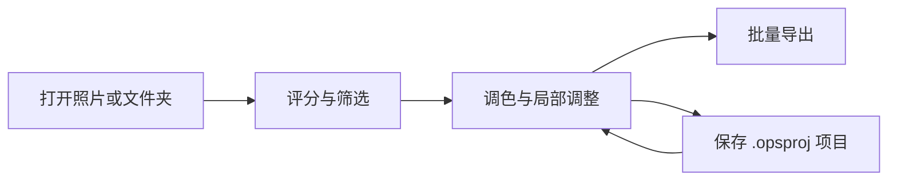

# OpenPictureStudio (OPS)

[简体中文](README.md) | [English](README.en.md) | [Français](README.fr.md)

  

  
  
  
  

**从光影出发，让每一种灵感都有成为作品的可能。**

OpenPictureStudio（OPS）是一个以专业图像处理为基础的开源 AI 图像创作平台。它连接相机记录的真实与创作者心中的画面，将 RAW 调色、局部蒙版、非破坏式编辑、AI 修图助手与批量处理融入同一套创作流程，并向自动化工作流、生成式编辑与开放插件生态持续发展。

**对普通用户，创作从轻松上手开始。** 从日常照片的曝光与色彩调整，到借助 AI 助手探索画面风格，OPS 希望让创作意图更容易化为具体操作。修好一张照片，也可以成为认识光影、发现个人表达的起点。

**对专业创作者，细节始终值得认真对待。** 从 RAW 中发掘色彩与层次，以局部蒙版雕琢光影，通过非破坏式编辑与历史记录反复推敲，再将成熟的调整用于整组作品。OPS 重视参数的可控、过程的可追溯与结果的一致，让技术承载判断，让工具跟随创作。

**对开发者，开放意味着能够亲手拓展工具的边界。** 围绕“Everything is Plugin”的长期方向，OPS 将逐步完善图像操作、工作流与项目模型的扩展契约，让算法、模型和创作工具能够接入同一个平台。从解决自己的一个具体需求，到分享一种新的创作方法，每一次扩展都可以成为他人的起点。

**对 AI Agent，图像创作需要可调用、可编排、可检查的工具。** OPS 已有的 AI 修图助手是协作的起点，未来将进一步连接工具调用、工作流执行与项目上下文，让外部 Agent 无需打开桌面界面，也能围绕创作目标组织处理、预览与导出，并把结果交回创作者审阅。人的意图、专业工具与 AI 的执行能力，将在同一份作品中相遇。

**[下载 Windows 安装包](https://github.com/KpTanl/OpenPictureStudio/releases/latest)** · [快速上手](#快速上手) · [主要能力](#主要能力) · [性能基准](#系统要求与性能基准) · [Roadmap](#roadmap) · [文档目录](open-docs/README.md)

> Beta · Windows 10/11（64 位）· 界面支持简体中文、English 和 Français。核心看图与编辑可离线使用。
> 
> 各版本的功能与安装包见 [Release 说明](https://github.com/KpTanl/OpenPictureStudio/releases/latest)。

## 主要能力

| 工作环节    | 功能                                                      |
| ------- | ------------------------------------------------------- |
| 看图与选片   | 常见图片与相机 RAW、胶片条／网格、星级与标记、联动比较、关键词与智能集合                  |
| RAW 与调色 | 相机预览／原彩／OPS 观感、曝光与白平衡、曲线、8 通道色彩混合、11 个内置预设              |
| 局部编辑    | 渐变、画笔、擦除、主体与人脸区域蒙版；裁切、旋转及形状裁切                           |
| AI 工具   | 超分辨率、降噪与去模糊、抠图、人像美颜、证件照，以及可将调整写入历史的修图助手                 |
| 成组处理    | 同步选定调整、统一增减曝光、按拍摄信息建议分组、曝光匹配与 RAW 白平衡对齐                 |
| 项目与导出   | 自动草稿、`.opsproj` 项目、批量队列、格式与尺寸转换、透明 PNG／16 位 TIFF、多图 PDF |

### 看图与编辑

**看图**：浏览照片，调整缩放并进行星级评分。

**编辑**：在同一个窗口切换到编辑工作区，调整曝光、白平衡与色彩。

### 人像美颜

调整皮肤、眼部和脸型参数，放大查看细节。

**初始参数 · 84% 缩放**

**参数调整后 · 131% 缩放**

完整功能列表

### 看图与选片

- **常见格式与相机 RAW**：JPEG、PNG、BMP、GIF、WebP、TIFF、ICO、PPM/PGM/PBM 直接打开；相机 RAW 支持 CR2、CR3、NEF、NRW、ARW、RAF、DNG、ORF、PEF、RW2，涵盖佳能、尼康、索尼、富士、奥林巴斯、宾得、松下等品牌。
- **RAW 先看预览**：打开 RAW 时先显示相机内嵌预览，解码完成后替换。RAW 可选择相机预览、原彩或 OPS 观感显示，其他格式可选择原彩或 OPS 观感，两类设置分别保存。
- **筛选与比较**：胶片条与网格两种浏览方式；星级评分和“保留／排除”标记；按星级、标记、文件类型、编辑状态和交付状态筛选；两张照片可并排按原尺寸联动比较。
- **图库**：为照片添加关键词，用普通集合和按条件自动更新的智能集合整理照片。
- **照片信息**：拍摄参数、设备、源文件详情和直方图，RAW 同样适用。
- **常用小功能**：旋转翻转、设为壁纸、文件关联；深色、浅色、米色三套主题；界面支持简体中文、English 和 Français。

### 编辑

- **调色台**：
  - 色温、色调、曝光、对比度、高光、阴影、白色、黑色。
  - 纹理、清晰度、去朦胧、自然饱和度、饱和度。
  - RGB 与单通道色调曲线、8 通道色彩混合（可用吸管在画面上点选颜色）、实时直方图和一键自动调整。
  - 11 个内置预设：单色、复古、清新、暖调、冷调、柔光、鲜艳、戏剧、HDR、胶片、美肤。
- **局部蒙版**：线性渐变、径向渐变、画笔与擦除、选择主体、面部皮肤、眼睛、嘴唇、背景和整张照片；同一蒙版可由多个区域添加或减去组合，每个蒙版单独调整。
- **OPS 观感**：OPS 自行定义的影像风味，体现对色彩、明暗和层次的审美取向，为 RAW、JPG、PNG 等照片提供具有 OPS 风格的创作起点；可切回原彩，或继续调整曝光、曲线与局部蒙版。
- **构图**：自由裁切与旋转、网格裁切、形状裁切和套索。
- **历史与项目**：多级撤销重做，历史面板可回到任意一步，编辑栈列出当前各步处理；按住即可对比原图；编辑可保存为 `.opsproj` 项目。

### 成组照片

- **成组调整**：以一张照片为样板，把选定的调整同步到所选照片或全部筛选结果，也可以统一增减曝光；每一批都可以撤销、重做或重试未成功的照片。
- **照片组与校准**：按拍摄时间、机型和镜头建议分组；对同组照片给出曝光匹配和 RAW 白平衡对齐建议，预览后统一应用。

### AI 工具

- **画质增强**：Real-ESRGAN 超分辨率（2×、4×、4K）与 NAFNet 降噪、去模糊，也可按原尺寸修复；亮度噪点与颜色噪点分别调节。
- **抠图**：U2Net 识别主体，另有按颜色抠图与套索抠图；可优化边缘，输出透明或纯色背景。
- **人像美颜**：基于人脸关键点，提供皮肤（磨皮、提亮、红润、锐化）、脸型（瘦脸、瘦鼻）、眼部（大眼、眼距）和精修（美白牙齿、祛痘祛斑、去眼袋）四组调节。
- **证件照**：一寸、二寸、护照、签证、社保等尺寸预设与自定义尺寸；可更换背景色、按人脸位置自动构图，并支持排版。
- **AI 修图助手**：多会话，支持对话、规划、调整和 Agent 模式。助手的调整直接写进编辑历史，和手动调整一样可以撤销、重做或接着改；需要两个方案时生成 A／B 候选，在助手面板里对比，点“采用”后才写入。可以附一张参考图，也可以保存命名风格和偏好供以后使用。
- **模型与 GPU**：模型不随安装包分发，在“设置 → 工具与模型”中按需下载、导入、卸载并设置默认。有独立显卡时可在“设置 → 运行环境”安装 GPU 运行环境（DirectML），重启后生效。

项目、草稿与输出细节

- **项目与草稿**：编辑自动保存为草稿，下次打开同一张照片继续；保存为 `.opsproj` 项目时一并保存处理步骤和历史。
- **保存结果**：由你决定覆盖原图还是另存副本；输出先写入临时文件并校验，再替换目标，失败或取消都不会损坏已有文件。
- **批量导出**：选好照片和输出预设后加入导出队列；入队时固定当时的编辑，之后再改照片不影响已入队的项目。队列可暂停、取消和重试失败项，完成记录可查询。
- **格式处理**：JPG、PNG、WebP、BMP、TIFF 互转；JPG 可指定目标文件大小（KB）；尺寸支持保持比例、裁切填满、补边适配和直接拉伸。
- **高位深与 PDF**：支持 16 位 TIFF 并保留透明度；多张图片可按顺序合并为一个 PDF。

## 安装与运行

### 下载 Windows 安装包

1. 打开 [最新版本](https://github.com/KpTanl/OpenPictureStudio/releases/latest)，在 **Assets** 中下载 `OpenPictureStudio-<版本>-beta-setup.exe` 和同名 `.exe.sha256` 文件。
2. 核对安装包的 SHA256，双击 EXE，按安装向导完成安装。
3. 启动 OpenPictureStudio，打开照片或文件夹。安装版无需另装 Python 或 Rust；AI 模型按需下载。

安装版自带运行依赖，AI 模型按需下载。当前安装包未作代码签名；SmartScreen 出现提示时，核对来源和 SHA256 后按系统提示操作。[安装与升级指南](open-docs/installation.md)包含校验命令、首次运行提示、PowerShell 下载安装方式与升级说明。

### 升级与版本检查

安装版默认最多每 24 小时自动检查一次正式版，可在“设置 → 常规”关闭，或在“关于”手动检查。程序打开下载页，由你下载安装。查询发送应用版本及必要 HTTP 信息，GitHub 可见 IP 与请求时间。

升级前，请先退出 OpenPictureStudio，再运行新版安装包覆盖升级。现有设置、自定义资料目录、模型和项目会保留。遇到目录冲突或需要修复时，请按安装器提示操作，详见[安装与升级](open-docs/installation.md)。

### 快速上手

1. **打开与筛选**：打开一张照片或一个文件夹，用胶片条／网格浏览，按星级和“保留／排除”筛选。
2. **编辑**：进入编辑工作区，调整曝光、色彩和构图；需要时添加局部蒙版。处理步骤保留在历史中，可以撤销、重做和对比原图。
3. **保存与交付**：另存成品，或把选定照片加入批量导出队列；保存 `.opsproj` 项目可保留处理步骤和历史，便于继续编辑。

## 编辑工作流与 AI Agent

非破坏式调色、局部蒙版、历史记录与 `.opsproj` 项目共同保留编辑过程；成品通过保存或导出生成。内置助手支持对话、规划、调整与 Agent 模式，适用工具的调整进入同一份编辑历史，A／B 候选经“采用”后写入。

当前助手已覆盖调色、美颜、选片、成组和导出等能力；更多工具覆盖、外部 Agent 接口与完整离屏工作流见[路线图](open-docs/roadmap.md)。专业像素图层、破坏式编辑与生成式编辑属于后续发展方向。

### AI 服务与隐私

AI 修图助手使用你在“设置 → AI 服务”中配置的连接和模型，未配置时不会发出请求。密钥通过 Windows DPAPI 加密后保存在本机。

默认首轮附带当前照片的预览，可改为原始画面或“不发送照片”。文字、参数和照片分析按所选上下文发送；会话、附件和风格保存在本机。配置步骤、完整发送规则与常见连接问题见[AI 服务与隐私指南](open-docs/ai-services.md)。

## 技术架构与原生加速

桌面界面采用 **Python／PySide6**，应用服务协调核心工具、项目与工作流；图像计算由 Python／NumPy 与 **Rust 原生模块**协作完成。

- **Rust + Rayon**：覆盖全局与局部调色、滤波、RAW 矩阵转换和显示输出等热点，并协调多线程执行。
- **AVX2 SIMD**：已接入调色、色彩转换、曲线、局部调整、RAW、滤波和显示七组内核。自动检测 CPU，支持 AVX2 即启用加速，否则使用通用 Rust。
- **RAW 快速预览**：NEF 等适用 RAW 的内嵌 JPEG 预览已实现，完整解码与后处理继续优化。
- **GPU**：DirectML 当前用于可选 AI 推理；通用 GPU 图像计算列入规划，wgpu 为候选方案。

Image Engine、Workflow Engine 与 Project Model 分别承载图像操作、流程编排和项目状态。CPU 与规划中的 GPU 后端沿统一图像操作契约发展，工具扩展遵循 Everything is Plugin 的长期方向。详见[架构与原生加速](open-docs/architecture.md)。

## 系统要求与性能基准

| 项目  | 基础使用建议             | 推荐配置                | 更优建议                     |
| --- | ------------------ | ------------------- | ------------------------ |
| 系统  | Windows 10/11，64 位 | Windows 10/11，64 位  | Windows 10/11，64 位       |
| CPU | x64，现代多核 CPU       | 7代英特尔i5或1代锐龙及更强处理器  | 12代英特尔处理器或5代锐龙处理器及更强处理器  |
| 内存  | 8 GB，面向浏览和轻量编辑     | 16 GB，面向 RAW 与多工具编辑 | 32 GB 及以上，面向高像素、多蒙版和批量任务 |
| GPU | 核心显卡               | GTX950及更强GPU        | RTX2060及更强GPU            |
| 存储  | 可用空间 3 GB          | 可用空间 6 GB，建议使用 SSD  | 可用空间 12 GB，建议使用 SSD      |

以上配置可作为选择电脑的参考。查看[系统要求与性能](open-docs/performance.md)，了解配置建议和图像处理的实测结果。

## Roadmap

从专业照片处理出发，逐步融合 AI 协作、自动化工作流与多模式图像编辑，打造一个由创作者掌控、由开发者共同扩展的开放式 AI 图像创作平台。

| 发展阶段           | 主要方向                                    |
| -------------- | --------------------------------------- |
| 一 · 深化 AI 创作协作 | 扩展助手的工具能力、参考图分析与风格记忆，支持更完整、可控的编辑过程      |
| 二 · 建立自动化工作流   | 将处理步骤与创作经验保存为可复用流程，连接批量任务和外部 AI Agent   |
| 三 · 拓展综合图像创作   | 在非破坏式编辑基础上，逐步引入图层、专业选区、像素级编辑与生成式编辑      |
| 四 · 建设开放扩展生态   | 提供公共 API 与插件 SDK，支持第三方工具、模型，以及风格和工作流的分享 |

性能、稳定性与兼容性持续贯穿各阶段。项目愿景、分阶段规划与技术演进见[完整发展路线图](open-docs/roadmap.md)。

<strong>常见问题</strong>

<strong>安装后还需要安装 Python 或 Rust 吗？</strong>

Windows 安装包自带运行所需的依赖，安装完成后即可使用。AI 模型和可选的 GPU 运行环境在设置中按需安装。

<strong>可以离线使用吗？</strong>

照片浏览、调色、裁切、项目保存和导出可离线使用；本地 AI 工具准备好模型与运行环境后，也可离线处理。下载模型、检查更新和调用在线 AI 修图助手需要网络。

<strong>必须有独立显卡吗？</strong>

看图和基础编辑可使用 CPU。需要 GPU 推理时，可在“设置 → 运行环境”安装 DirectML 运行环境，重启后生效。模型与运行环境分开管理。

<strong>为什么 RAW 刚打开时，颜色或亮度会发生变化？</strong>

打开 RAW 时会先显示相机内嵌预览，完整解码后再按所选显示方式更新画面。在“设置 → 图片显示”中，可为 RAW 选择“相机预览”“原彩”或“OPS 观感”；其他格式的显示方式单独设置。

<strong>什么是 OPS 风格？</strong>

OPS 风格在界面中称为“OPS 观感”，是 OPS 自行设定的一种影像风味，包含对色彩、明暗、对比和层次的审美取向。选择它，就能以 OPS 的整体风格为起点，再融入自己的创作判断。

OPS 观感支持 RAW、JPG、PNG 等格式。

| 选项     | 作用                                     |
| ------ | -------------------------------------- |
| 原彩     | 以文件解码后的色彩为起点，保留用户已有的调色参数               |
| OPS 观感 | 采用 OPS 自行设定的色彩与影调风味，形成具有 OPS 审美取向的整体呈现 |
| 调色预设   | 应用复古、胶片、HDR 等参数组合，可与所选观感共同使用           |

在编辑工作区的调色台中，通过“观感”选择“原彩”或“OPS 观感”；在“设置 → 图片显示”中，可分别设置 RAW 和其他格式的显示方式。编辑中选择的观感会随项目保存，并应用于导出结果。这项处理在本机完成，无需下载 AI 模型。

<strong>调整照片会直接覆盖原图吗？</strong>

浏览、调参和保存编辑草稿不会覆盖原图。生成成品时，可选择另存副本或保存到原路径；需要保留原始文件时，请另存到新的文件名或输出目录。

<strong>关闭后还能继续编辑吗？</strong>

编辑会自动保存为本图草稿，重新打开同一张照片可继续。另存为 `.opsproj` 项目可明确保存处理步骤和历史；需要分享或交付成品时，保存或导出为 JPG、PNG、TIFF 等图片格式。

<strong>为什么有些 AI 工具提示缺少模型？</strong>

在“设置 → 工具与模型”中下载或导入所需模型，再在工具面板中选择。AI 抠图和证件照的 AI 换背景使用 U2Net；证件照的保留原背景、裁切、尺寸调整和排版不需要模型。安装版的模型默认保存到 `%APPDATA%\OpenPictureStudio\OpenPictureStudio\models`；已保存的项目按准确的模型版本恢复。

<strong>AI 修图助手需要怎样配置？</strong>

在“设置 → AI 服务”中添加连接，填写服务地址、所需的 API 密钥和模型，再在助手中选择已配置的模型。参考图分析需要模型支持图片输入，Agent 工具需要开启工具调用能力。本地超分辨率、降噪、抠图等工具使用单独下载的模型。详细步骤见[AI 服务与隐私指南](open-docs/ai-services.md)。

<strong>AI 助手会发送照片吗？</strong>

配置服务后，默认首轮会发送当前照片的预览；可以在输入框下方选择“不发送照片”。完整发送规则见[AI 服务与隐私](open-docs/ai-services.md)。本地 AI 工具使用下载到本机的模型。

<strong>大图编辑卡顿或提示内存不足怎么办？</strong>

可在“设置 → 性能与内存”中将画布预览模式改为“始终 1600 预览”，并减少预加载范围、暂停其他批量任务。预览模式影响编辑时的画面，成品尺寸由导出设置决定。完整尺寸解码、AI 处理和导出仍需要与图片大小相应的内存，配置建议见[系统要求与性能](open-docs/performance.md)。

<strong>模型和缓存占用空间，可以清理或更换位置吗？</strong>

在“设置 → 存储空间”中可查看占用、清理缓存和更改资料位置；清理与迁移按提示在下次启动时执行。模型通过“设置 → 工具与模型”卸载；项目重新使用该模型计算时，需要安装对应版本。

<strong>发现新版本会自动安装吗？</strong>

版本检查会提示并打开下载页，由你下载和安装。[安装指南](open-docs/installation.md)中的 PowerShell 命令也只有在你主动执行时才会下载安装包。

## 贡献、许可证与第三方声明

### 问题反馈

请在 [GitHub Issues](https://github.com/KpTanl/OpenPictureStudio/issues) 中附上应用版本、Windows 版本、复现步骤，以及相关截图或日志。公开提交前请检查附件中的个人信息和服务密钥。

运行日志默认写在 `%APPDATA%\OpenPictureStudio\OpenPictureStudio\logs\openpicturestudio.log`，安装版和源码运行相同。日志位置、单份大小（默认约 2 MB）和保留的旧日志份数（默认 3 份）可在“设置 → 存储空间”修改，那里也能直接打开日志所在的文件夹。反馈问题时附上日志，便于定位。

### 许可证与第三方依赖

原创代码采用 [MIT License](LICENSE)，第三方依赖、模型和资源分别遵循各自许可。当前使用 PySide6 Essentials、Shiboken 与 Qt；发行物附带 `THIRD_PARTY_NOTICES.txt`、`licenses/`、`SOURCE.txt`、`components.json` 及适用许可文本。

自 0.17.0 起，界面组件由 PyQt6 改为 PySide6，安装包不再整体按 GPLv3 分发。0.16.1 及更早版本的许可以该版本随附文件为准。详见[许可证与第三方组件](open-docs/licensing.md#从-pyqt6-迁移到-pyside6)。标志与真实产品截图的来源见[素材来源](.github/assets/readme/SOURCES.md)。

### 文档导航

| 文档                                   | 内容                     |
| ------------------------------------ | ---------------------- |
| [安装与升级](open-docs/installation.md)   | 校验、SmartScreen、覆盖升级与修复 |
| [AI 服务与隐私](open-docs/ai-services.md) | 连接与模型配置、助手使用、照片发送与资料保存 |
| [开发与构建](open-docs/building.md)       | 源码运行、原生模块、安装包与 CI      |
| [架构与原生加速](open-docs/architecture.md) | 当前分层、CPU 兼容与 GPU 演进    |
| [系统要求与性能](open-docs/performance.md)  | 配置建议与图像处理性能            |
| [路线图](open-docs/roadmap.md)          | 产品愿景、发展阶段与技术演进         |
| [许可证与第三方组件](open-docs/licensing.md)  | MIT、Qt、模型与对应源码         |
