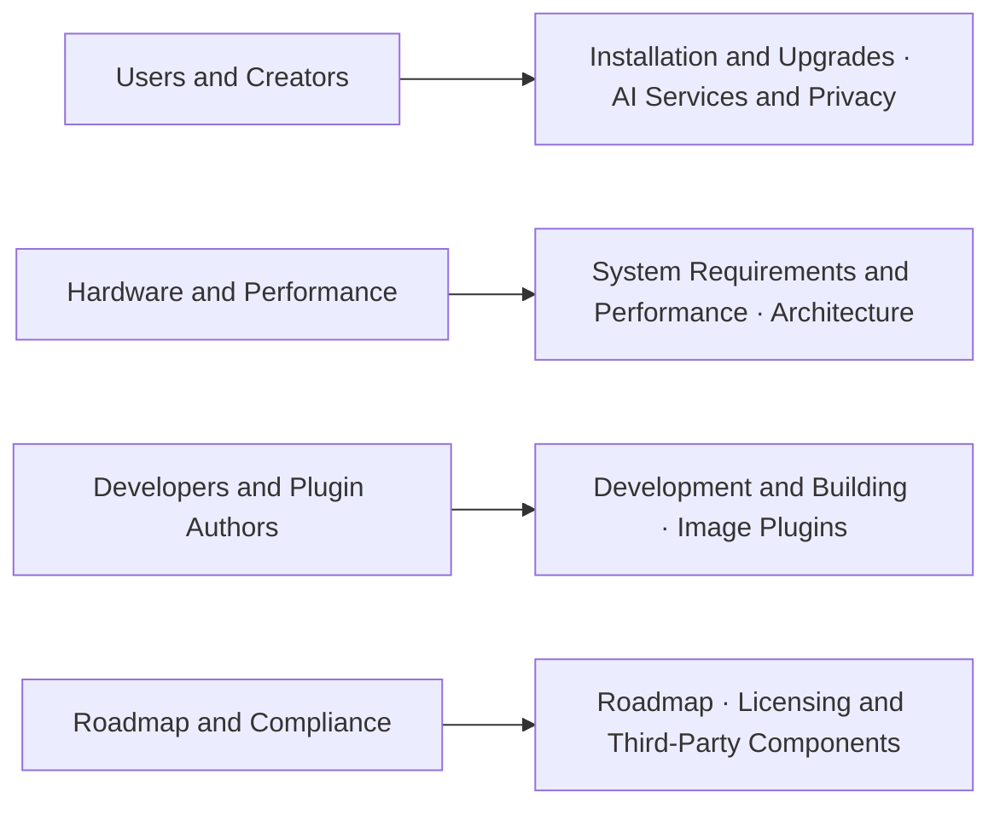

# OpenPictureStudio Documentation

[简体中文](README.md) | [English](README.en.md) | [Français](README.fr.md)

[Back to Project Home](../README.en.md)

Open-source technical and product documentation for OpenPictureStudio (OPS), covering installation and upgrades, AI privacy boundaries, compute architecture, performance benchmarks, plugin contracts, and engineering builds.

## Reading Paths

## Getting Started

| Document | Audience & Use Case | Key Topics |
| --- | --- | --- |
| [Installation and Upgrades](installation.en.md) | Installing, upgrading in place, and repairing | Trilingual setup wizard, SHA256 verification, SmartScreen, PowerShell installer, and upgrade modes |
| [AI Services and Privacy](ai-services.en.md) | Setting up the AI assistant and checking privacy | Service connections, model capabilities, photo sending rules, DPAPI local storage, and troubleshooting |

## Architecture & Performance

| Document | Audience & Use Case | Key Topics |
| --- | --- | --- |
| [Architecture and Native Acceleration](architecture.en.md) | Understanding the pipeline, GPU routing, and budgets | System layers, execution routing, GPU capability matrix, strip rendering, and CPU AVX2 compatibility |
| [System Requirements and Performance](performance.en.md) | Choosing hardware and reviewing benchmarks | Recommended specs, VRAM/RAM scaling limits, measured benchmarks, and cache storage limits |

## Developers & Extensions

| Document | Audience & Use Case | Key Topics |
| --- | --- | --- |
| [Development and Building](building.en.md) | Running from source, compiling Rust, and packaging | Layered dependencies, native extension builds, Inno Setup packaging, and CI/release workflows |
| [Image Plugins](image-plugins.en.md) | Integrating custom algorithms via trusted plugins | `image/1` protocol, float32 NPY transport, read-only auxiliaries, regional evaluation, and examples |

## Roadmap & Compliance

| Document | Audience & Use Case | Key Topics |
| --- | --- | --- |
| [Roadmap](roadmap.en.md) | Reviewing long-term product and technical direction | Product vision, current baseline, four-stage roadmap, and engineering tracks |
| [Licensing and Third-Party Components](licensing.en.md) | Auditing licenses, Qt obligations, and notices | MIT original source, PySide6/Qt LGPLv3 distribution, dependency manifests, and model catalogs |
