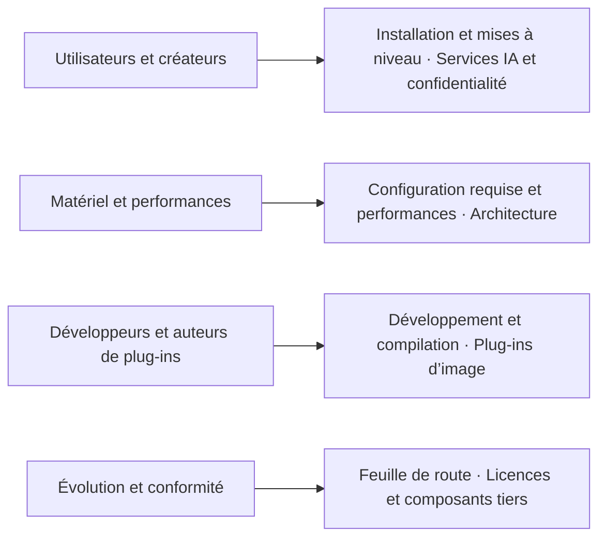

# Documentation OpenPictureStudio

[简体中文](README.md) | [English](README.en.md) | [Français](README.fr.md)

[Retour à l’accueil du projet](../README.fr.md)

Documentation technique et produit open source d’OpenPictureStudio (OPS) : installation et mises à niveau, confidentialité IA, architecture de calcul, performances mesurées, protocole de plug-ins et compilation.

## Parcours de lecture

## Prise en main

| Document | Public et cas d’usage | Contenu principal |
| --- | --- | --- |
| [Installation et mises à niveau](installation.fr.md) | Installer, mettre à jour par-dessus ou réparer | Assistant trilingue, vérification SHA256, SmartScreen, script PowerShell et modes de mise à jour |
| [Services IA et confidentialité](ai-services.fr.md) | Configurer l’assistant IA et évaluer la confidentialité | Connexions, capacités des modèles, règles d’envoi des photos, stockage local DPAPI et dépannage |

## Architecture et performances

| Document | Public et cas d’usage | Contenu principal |
| --- | --- | --- |
| [Architecture et accélération native](architecture.fr.md) | Comprendre le pipeline, le routage GPU et les budgets | Couches logicielles, routage d’exécution, matrice des capacités GPU, traitement par bandes et compatibilité AVX2 |
| [Configuration requise et performances](performance.fr.md) | Choisir sa configuration et consulter les mesures | Matériel recommandé, limites VRAM/RAM, graphiques de mesures réelles et gestion des caches |

## Développement et extensions

| Document | Public et cas d’usage | Contenu principal |
| --- | --- | --- |
| [Développement et compilation](building.fr.md) | Exécuter depuis les sources, compiler Rust et empaqueter | Dépendances par couche, compilation du module natif, empaquetage Inno Setup et flux CI/publication |
| [Plug-ins d’image](image-plugins.fr.md) | Intégrer des algorithmes externes par plug-ins de confiance | Protocole `image/1`, transfert NPY float32, données auxiliaires en lecture seule, zones et exemples |

## Feuille de route et licences

| Document | Public et cas d’usage | Contenu principal |
| --- | --- | --- |
| [Feuille de route](roadmap.fr.md) | Consulter l’orientation produit et technique à long terme | Vision du produit, socle actuel, feuille de route en quatre étapes et chantiers techniques |
| [Licences et composants tiers](licensing.fr.md) | Vérifier les licences, obligations Qt et mentions | Code original MIT, distribution PySide6/Qt LGPLv3, inventaires de dépendances et catalogues de modèles |
