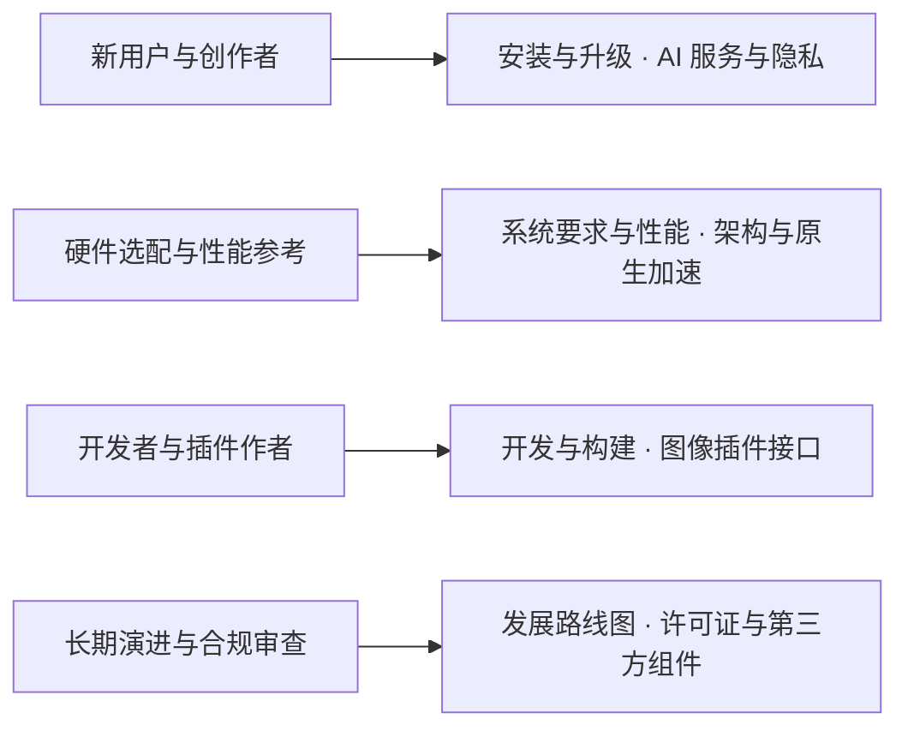

# OpenPictureStudio 文档中心

[简体中文](README.md) | [English](README.en.md) | [Français](README.fr.md)

[返回项目首页](../README.md)

OpenPictureStudio（OPS）开源技术与产品文档，涵盖安装升级、AI 隐私边界、计算架构、性能参考、插件协议与工程构建。

## 阅读路径

## 入门与使用

| 文档 | 适用场景 | 核心内容 |
| --- | --- | --- |
| [安装与升级](installation.md) | 下载安装、跨版本覆盖升级与修复 | 三语安装向导、SHA256 校验、SmartScreen、PowerShell 脚本与升级机制 |
| [AI 服务与隐私](ai-services.md) | 配置在线修图助手、评估本地与云端隐私边界 | 服务连接、模型能力开关、照片发送策略、DPAPI 本机存储与常见排错 |

## 架构与性能

| 文档 | 适用场景 | 核心内容 |
| --- | --- | --- |
| [架构与原生加速](architecture.md) | 了解渲染流水线、GPU 调度与内存/显存模型 | 系统分层、执行路由、GPU 双路线能力矩阵、分条带计算与 CPU AVX2 兼容性 |
| [系统要求与性能](performance.md) | 评估硬件配置、显存容量与大图处理耗时 | 推荐配置、显存与内存适用规模、典型实测对比与缓存空间管理 |

## 开发者与扩展

| 文档 | 适用场景 | 核心内容 |
| --- | --- | --- |
| [开发与构建](building.md) | 从源码运行、编译 Rust 扩展或制作安装包 | 依赖分层、原生加速构建、Inno Setup 打包、CI/发布流程与发版核对 |
| [图像插件接口](image-plugins.md) | 接入外部图像算法、构建受信子进程插件 | `image/1` 协议、float32 NPY 传输、只读辅助产物、区域计算与样例 |

## 规划与合规

| 文档 | 适用场景 | 核心内容 |
| --- | --- | --- |
| [发展路线图](roadmap.md) | 了解长期演进方向与阶段规划 | 产品愿景、当前能力基线、四阶段产品路线与持续工程主线 |
| [许可证与第三方组件](licensing.md) | 核查开源许可、Qt 分发义务与第三方组件来源 | MIT 原创代码、PySide6/Qt LGPLv3 分发、依赖与模型清单 |
