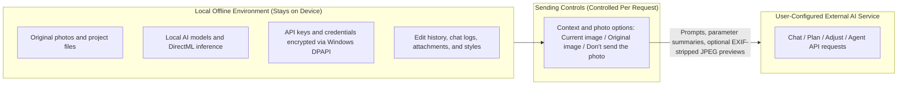

# AI Services and Privacy

[简体中文](ai-services.md) | [English](ai-services.en.md) | [Français](ai-services.fr.md)

[Back to Home](../README.en.md) · [Documentation](README.en.md)

OpenPictureStudio keeps local AI image tools strictly separate from the online AI retouching assistant. No photos or data leave your computer until you explicitly configure a service and choose what to share.

> **Note:** Local AI tools—including super resolution, AI denoise, deblur, cutout, and portrait retouching—run completely offline once their models are downloaded. Only the online **AI Assistant** sends requests to external services you configure.

## Data Boundaries and Privacy

- **Local encrypted storage:** API keys, custom headers, and proxy credentials are encrypted with Windows DPAPI on your machine. Conversations, named styles, and photo preview attachments stay local and are never uploaded automatically.
- **Metadata-stripped previews:** Whenever photo sharing is enabled, OPS sends freshly re-encoded JPEG previews containing no original EXIF shooting details, camera serial numbers, or location tags.
- **Independent service billing:** Model tests, chats, and multi-step Agent tasks count toward the usage, quota, and billing rules of your chosen provider. No network calls occur when no service is configured.

## Setup and Connections

### Local AI Tools

| Capability | Where to Configure | Acceleration Notes |
| --- | --- | --- |
| Download, import, uninstall, and default models | **Settings → Tools and Models** | Works offline once models are imported or downloaded |
| General GPU image processing | **Settings → Performance & memory** | Defaults to Prefer GPU once the startup self-check passes |
| Optional DirectML AI runtime | **Settings → Runtimes** | Takes effect after restart to accelerate compatible GPU model inference |

### Online AI Assistant

1. Open **Settings → AI Services**, click **Add connection**, and enter a name, base URL (service root or full Chat Completions / Responses endpoint), and API key.
2. Adjust the API protocol, authentication scheme, and any proxy or custom headers under **Connection options**.
3. Click **Verify & fetch models** (or **Add model manually** if the endpoint returns no list), then enable **Image input**, **Supports tool calling**, streaming, and token/output limits to match the model's real capabilities.
4. Run a model test to verify connectivity, set a default model, and start using the assistant panel.

| Use Case | Required Model Capability |
| --- | --- |
| Text-only photography advice | Any text model (select **Don't send the photo** below the input box) |
| Visual analysis of photos, references, or A/B candidates | Vision-capable model with **Image input** enabled |
| Agent-driven edits and workflow tool calls | Function-calling model with **Supports tool calling** enabled |
| High-resolution region inspection | **Image input** enabled with an appropriate single-image long-edge setting |

## Assistant Modes and Sending Rules

### Four Collaboration Modes

| Mode | Purpose | Effect on Photo |
| --- | --- | --- |
| **Chat** | Discuss composition, lighting, and editing ideas | Read-only conversation |
| **Plan** | Inspect current state and propose a multi-step plan | Leaves photo unchanged |
| **Adjust** | Generate and apply color or beauty parameters | Writes directly to edit history (undoable/redoable) |
| **Agent** | Run multi-step tool workflows and inspect results | Writes applied steps to history; **A/B candidates** apply only when you click **Adopt** |

You can attach reference images or confirm named styles and long-term preferences via confirmation cards.

### Photo and Context Controls

Before sending a prompt, choose a photo source below the input box. The panel header always summarizes what is permitted for the next request:

| Option | Sent Image Content | Max Resolution |
| --- | --- | --- |
| **Current image** (default first turn) | Preview of the photo with current adjustments | Up to 1536 px on long edge (never upscaled) |
| **Original image** | Unadjusted preview from the original image | Up to 2048 px on long edge (never upscaled) |
| **Don't send the photo** | Omits the current photo, reference images, and tool observation images | — |

When photo sharing is active on an image-capable model, the assistant can also inspect before/after previews and allowed high-detail regions as needed. Text context options let you toggle chat history, current parameters, workflow summaries, locally computed luminance/face descriptions, and saved style preferences; choosing **Don't send the photo** still allows selected text context to be sent.

## Local Data Management and Troubleshooting

### Managing Attachments and Provider Policies

You can delete old chats or clear conversation image attachments at any time without affecting your original photo files, message text, or edit history. Once requests leave your machine, data retention on the server side follows your provider's terms and privacy policy.

### Common Connection Issues

| Symptom | Resolution |
| --- | --- |
| Connection verification or auth fails | Check base URL format, API protocol, auth method, API key permissions, and proxy config |
| Provider returns an empty model list | Use **Add model manually** with the exact model ID from your provider |
| Model does not support images | Pick a multimodal model and enable **Image input**, or switch to **Don't send the photo** |
| Agent replies only with text | Choose a tool-capable model and enable **Supports tool calling** in model settings |
| Request timeout or streaming drops | Check network/provider status, increase the timeout limit, or disable streaming |
| Context exceeds budget | Click **Compact context**, trim included history, or raise the model context budget |
| Local attachment storage full | Delete unused chats or clear photo attachments, then re-attach needed images |

> **Tip:** When reporting AI service issues on [GitHub Issues](https://github.com/KpTanl/OpenPictureStudio/issues), include the app version, exact error message, and reproduction steps—and remove all API keys, proxy credentials, and personal photos before posting.

## Related Documentation

- [Installation and Upgrades](installation.en.md)
- [System Requirements and Performance](performance.en.md)
- [Architecture and Native Acceleration](architecture.en.md)
