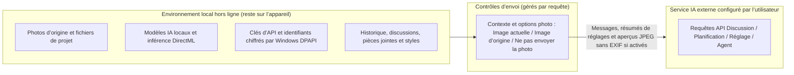

# Services IA et confidentialité

[简体中文](ai-services.md) | [English](ai-services.en.md) | [Français](ai-services.fr.md)

[Retour à l’accueil](../README.fr.md) · [Documentation](README.fr.md)

OpenPictureStudio sépare strictement les outils IA locaux de l’assistant de retouche IA en ligne. Aucune photo ni donnée ne quitte votre ordinateur tant que vous ne configurez pas explicitement un service et n’autorisez pas le partage.

> **Remarque :** Les outils IA locaux (super-résolution, réduction du bruit IA, suppression du flou, détourage et retouche de portrait) fonctionnent entièrement hors ligne une fois leurs modèles téléchargés. Seul l’**Assistant IA** en ligne envoie des requêtes vers les services externes configurés.

## Frontières de données et confidentialité

- **Stockage local chiffré :** les clés d’API, en-têtes personnalisés et identifiants proxy sont chiffrés localement avec Windows DPAPI. Les discussions, styles nommés et aperçus joints restent stockés sur votre ordinateur.
- **Aperçus sans métadonnées :** lorsque l’envoi d’images est activé, OPS génère des aperçus JPEG réencodés ne contenant aucune donnée EXIF d’origine (paramètres de prise de vue, numéro de série ou géolocalisation).
- **Facturation indépendante :** les tests de modèle, échanges et tâches Agent en plusieurs étapes sont décomptés selon la tarification et le quota de votre fournisseur. Aucune requête réseau n’est émise sans configuration.

## Configuration et connexions

### Outils IA locaux

| Capacité | Emplacement | Accélération |
| --- | --- | --- |
| Télécharger, importer, désinstaller et définir les modèles par défaut | **Paramètres → Outils et modèles** | Fonctionne hors ligne après téléchargement ou import local |
| Calcul d’image GPU général | **Paramètres → Performances et mémoire** | Option **GPU en priorité** active après réussite de l’autotest |
| Environnement DirectML facultatif | **Paramètres → Moteurs d’exécution** | Actif après redémarrage pour accélérer les modèles compatibles |

### Assistant IA en ligne

1. Ouvrez **Paramètres → Services IA**, cliquez sur **Ajouter une connexion**, puis indiquez un nom, l’URL de base (racine du service ou point d’accès Chat Completions / Responses) et votre clé d’API.
2. Ajustez le protocole d’API, la méthode d’authentification ainsi que le proxy ou les en-têtes personnalisés dans les **options de connexion**.
3. Cliquez sur **Vérifier et charger les modèles** (ou utilisez **Ajouter un modèle manuellement** si aucune liste n’est renvoyée), puis cochez **Réception d’images**, **Prise en charge des appels d’outils**, le streaming et les limites de sortie selon les capacités réelles du modèle.
4. Lancez un test de modèle, définissez-le par défaut et utilisez le panneau de l’assistant.

| Usage | Capacité de modèle requise |
| --- | --- |
| Conseils photo uniquement textuels | Tout modèle texte (sélectionnez **Ne pas envoyer la photo** sous le champ de saisie) |
| Analyse visuelle de la photo, de références ou de variantes A/B | Modèle multimodal avec **Réception d’images** activée |
| Retouche guidée par Agent et appels d’outils | Modèle compatible avec **Prise en charge des appels d’outils** activée |
| Inspection locale haute résolution | **Réception d’images** activée avec une limite de grand côté adaptée |

## Modes de l’assistant et règles d’envoi

### Quatre modes de collaboration

| Mode | Rôle | Effet sur la photo |
| --- | --- | --- |
| **Discussion** | Échanger sur le cadrage, la lumière et les idées de retouche | Lecture seule, aucune modification |
| **Planification** | Examiner l’état actuel et proposer un plan par étapes | Conserve la photo inchangée |
| **Réglage** | Générer et appliquer des paramètres de couleur ou de beauté | S’écrit directement dans l’historique (annulable/rétablissable) |
| **Agent** | Enchaîner plusieurs appels d’outils et contrôler le rendu | Écrit les étapes appliquées dans l’historique ; les **variantes A/B** attendent le clic sur **Adopter** |

Vous pouvez joindre une image de référence ou enregistrer des styles nommés et préférences durables après validation par carte de confirmation.

### Options de photo et de contexte

Avant chaque envoi, choisissez la source d’image sous la zone de texte ; l’en-tête du panneau affiche toujours ce qui est autorisé pour la requête :

| Option | Contenu envoyé | Taille maximale |
| --- | --- | --- |
| **Image actuelle** (par défaut au premier tour) | Aperçu de la photo avec les retouches en cours | Grand côté jusqu’à 1536 px (jamais agrandi) |
| **Image d’origine** | Aperçu brut sans les retouches appliquées | Grand côté jusqu’à 2048 px (jamais agrandi) |
| **Ne pas envoyer la photo** | N’envoie ni la photo, ni les références, ni les captures d’outils | — |

Lorsque l’envoi de photos et **Réception d’images** sont actifs, l’assistant peut aussi consulter des comparaisons avant/après ou des zones détaillées autorisées. Les options de contexte permettent d’inclure ou d’exclure l’historique de conversation, les paramètres courants, le résumé du flux et les analyses locales de luminance ou de visage ; même avec **Ne pas envoyer la photo**, le contexte textuel sélectionné reste utilisable.

## Gestion locale et dépannage

### Pièces jointes et politiques fournisseur

Vous pouvez supprimer d’anciennes discussions ou effacer les pièces jointes photo à tout moment sans affecter les fichiers originaux, les messages ni l’historique de retouche. Une fois envoyées, les données sont régies par les conditions d’utilisation et de confidentialité de votre fournisseur.

### Problèmes de connexion courants

| Symptôme | Solution |
| --- | --- |
| Échec de vérification ou d’authentification | Vérifiez l’URL de base, le protocole API, la méthode d’authentification, les droits de la clé et le proxy |
| Aucune liste de modèles renvoyée | Utilisez **Ajouter un modèle manuellement** avec l’identifiant exact du modèle |
| Le modèle ne prend pas en charge les images | Choisissez un modèle multimodal avec **Réception d’images** activée ou passez à **Ne pas envoyer la photo** |
| L’Agent répond uniquement par texte | Vérifiez que le modèle gère les appels d’outils et activez **Prise en charge des appels d’outils** |
| Délai dépassé ou coupure du streaming | Vérifiez le réseau et l’état du service, augmentez le délai ou désactivez le streaming |
| Contexte au-delà du budget | Utilisez **Réduire le contexte**, limitez l’historique inclus ou ajustez la fenêtre du modèle |
| Espace local des pièces jointes saturé | Supprimez d’anciennes discussions ou effacez les pièces jointes photo avant de renvoyer |

> **Conseil :** Lors d’un signalement sur [GitHub Issues](https://github.com/KpTanl/OpenPictureStudio/issues), précisez la version de l’application, le message d’erreur et les étapes de reproduction, après avoir retiré vos clés d’API, identifiants proxy et photos personnelles.

## Documentation associée

- [Installation et mises à niveau](installation.fr.md)
- [Configuration requise et performances](performance.fr.md)
- [Architecture et accélération native](architecture.fr.md)
