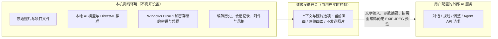

# AI 服务与隐私

[简体中文](ai-services.md) | [English](ai-services.en.md) | [Français](ai-services.fr.md)

[返回首页](../README.md) · [文档目录](README.md)

OpenPictureStudio 将本地 AI 图像处理与在线 AI 修图助手完全隔离管理，用户在明确配置服务与授权范围前不会向外部网络发出任何照片或数据。

> **说明**：超分辨率、AI 降噪、去模糊、抠图与人像美颜等本地工具在下载模型后均于本机离线运行；仅在线 **AI 修图助手** 会向用户配置的外部服务发送请求。

## 数据边界与隐私保护

- **本机加密存储**：API 密钥、附加请求头与代理凭据均通过 Windows DPAPI 加密保存于本地；会话记录、命名风格与预览附件全部存放本机，不会自动上传。
- **照片剥离元数据**：允许发送照片时，请求附带的均为重新编码的 JPEG 预览图，不含原文件的拍摄参数、位置等 EXIF 信息。
- **本地与云端独立计费**：在线助手的测试消息、日常对话及 Agent 多轮调用产生的用量与费用按所选服务商账户规则计算；未配置服务时不会产生任何网络请求。

## 配置与连接方式

### 本地 AI 工具

| 能力项 | 管理位置 | 加速说明 |
| --- | --- | --- |
| 模型下载、导入、卸载与默认选择 | **设置 → 工具与模型** | 支持离线执行；无网络环境下导入本地模型即可使用 |
| 通用图像 GPU 计算 | **设置 → 性能与内存** | 默认优先 GPU，自检通过后自动启用 |
| 可选 DirectML AI 推理环境 | **设置 → 运行环境** | 安装后重启生效，用于加速兼容显卡上的模型推理 |

### 在线 AI 修图助手

1. 打开 **“设置 → AI 服务”** 并点击 **“添加连接”**，填写连接名称、基础地址（支持服务根地址或完整 Chat Completions / Responses 接口地址）与 API 密钥。
2. 在 **“连接选项”** 中匹配 API 协议、认证方式及所需的代理或自定义请求头。
3. 点击 **“验证并获取模型”** 拉取列表（服务未返回列表时可手动输入模型 ID），在 **“模型设置”** 中按模型实际支持情况勾选 **图片输入**、**工具调用**、流式回复和输出上限。
4. 执行模型测试确认回复正常后，设为默认模型即可在助手面板使用。

| 使用场景 | 必需模型能力 |
| --- | --- |
| 纯文字摄影建议 | 任意文字模型（建议在输入框下方选 **“不发送照片”**） |
| 画面、参考图或 A/B 方案分析 | 模型支持视觉输入，且开启 **“图片输入”** |
| Agent 自动调色与工作流任务 | 模型支持函数调用，且开启 **“工具调用”** |
| 高清局部细节观察 | 已开启 **“图片输入”**，并配置单图有效长边上限 |

## 助手模式与发送规则

### 四种协作模式

| 模式 | 功能定位 | 对照片的影响 |
| --- | --- | --- |
| **对话** | 讨论构图、光影与修复思路 | 只读交流，不改动编辑状态 |
| **规划** | 结合当前编辑状态制定分步方案 | 保持画面不变 |
| **调整** | 生成并应用适用的调色或美颜参数 | 直接写入照片编辑历史，支持撤销重做 |
| **Agent** | 围绕目标多轮调用编辑工具并观察结果 | 适用修改写入历史；可要求生成 **A/B 候选**，点击 **“采用”** 后才生效 |

用户可添加参考图辅助表达目标，或在确认卡片批准后将常用风格与偏好保存为长期规则。

### 照片与上下文选项

发送消息前可在输入框下方切换照片权限，助手面板顶部始终显示当前允许发送的上下文范围：

| 选项 | 发送内容 | 尺寸上限 |
| --- | --- | --- |
| **当前画面**（默认首轮） | 包含当前调整的预览画面 | 长边不超过 1536 像素（不放大原小图） |
| **原始画面** | 不含当前编辑调整的原图预览 | 长边不超过 2048 像素（不放大原小图） |
| **不发送照片** | 不附带任何当前照片、参考图及工具观察图像 | — |

开启照片发送且模型支持图片输入时，助手还可根据任务需要查看调整前后对比及允许的高清局部区域。除图像外，可在上下文选项中自主控制是否附带对话历史、当前参数摘要、工作流描述、本机计算的光影/人脸文字分析以及已选风格偏好；选择 **“不发送照片”** 后，上述文本信息仍可独立发送。

## 本机资料管理与常见问题

### 附件清理与服务端规则

可在软件内随时删除历史会话或清除会话照片附件；清除附件不会影响原照片文件、对话文本或照片本身的编辑历史。请求一旦发出，外部服务商对数据的保留和审计规则遵循各自服务条款与隐私政策。

### 常见连接问题排查

| 现象 | 排查要点 |
| --- | --- |
| 无法验证连接或提示认证失败 | 核对基础地址格式、API 协议类型、认证方式、API 密钥权限及代理设置 |
| 服务未返回可用模型列表 | 使用 **“手动添加模型”** 填入服务商文档指定的精确模型 ID |
| 提示模型不支持图片 | 改选多模态模型并在 **“模型设置”** 勾选 **“图片输入”**，或切换为 **“不发送照片”** |
| Agent 模式仅回复文字不执行操作 | 确认模型本身支持工具调用，并在 **“模型设置”** 中开启 **“工具调用”** |
| 请求超时或流式回复中断 | 检查网络与服务可用性，适当调大超时限制或临时关闭流式输出重试 |
| 提示上下文超出预算 | 触发 **“压缩上下文”**、精简历史消息范围或按实际限制调小窗口设置 |
| 提示本机附件空间不足 | 清理冗余旧会话或清除历史照片附件后重新发送 |

> **提示**：在 [GitHub Issues](https://github.com/KpTanl/OpenPictureStudio/issues) 反馈 AI 服务异常时，请附带应用版本、报错原文及复现步骤，并务必提前剔除 API 密钥、代理凭据和个人照片。

## 相关文档

- [安装与升级](installation.md)
- [系统要求与性能](performance.md)
- [架构与原生加速](architecture.md)
