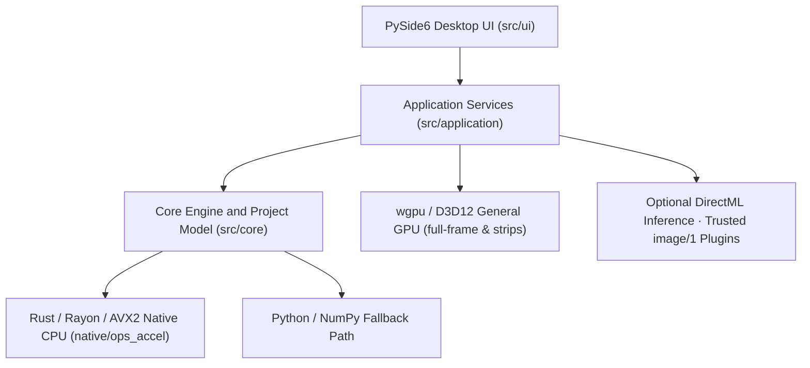
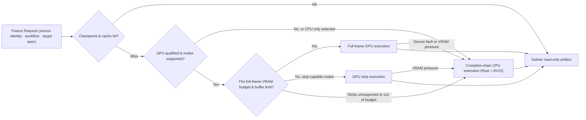

# Architecture and Native Acceleration

[简体中文](architecture.md) | [English](architecture.en.md) | [Français](architecture.fr.md)

[Back to Home](../README.en.md) · [Documentation](README.en.md)

OpenPictureStudio pairs a Python desktop host and non-destructive workflow engine with Rust multithreaded/AVX2 native kernels, a Windows wgpu/D3D12 general-purpose GPU pipeline, and optional DirectML AI model inference.

## Layered Architecture

| Directory | Responsibilities |
| --- | --- |
| `src/ui` | Windows, viewer and editing workspaces, tool panels, settings dialogs, and interactions |
| `src/application` | Service wiring, task scheduling, caches, VRAM budgets, model/runtime management, and export coordination |
| `src/core` | Image algorithms, unified tool contracts, non-destructive workflow execution, and `.opsproj` project persistence |
| `native/ops_accel` | Rust native CPU kernels, wgpu/D3D12 GPU compute backend, and ONNX tensor bridge |
| `resources` | Translations, UI themes, built-in looks, model/runtime catalogs, and sample plugins |

## Image Execution Pipeline and Routing

Viewer preheating, canvas interaction, 100% region inspection, assistant observations, and batch export share one execution entry that freezes request specifications, traces checkpoints backward, and computes only missing stages.

- **Batched GPU recording and cross-frame retention:** Compute passes within a frame record into a single command encoder and flush only at readbacks, frame end, or buffer thresholds. Cross-frame slots retain node outputs, face regions, skin filter fields, and warp displacement so slider drags avoid redundant upstream work.
- **On-demand readback and seamless handoff:** Full-resolution previews read back only the screen-sized display frame or visible viewport tile while dragging, then backfill the complete frame on release. Matching viewer frames hand off directly into the edit session, and hold-to-compare preserves active crop and rotation.
- **Default tool order:** New edits default to **Beauty → Color → Denoise → Crop** while existing projects keep their saved node order. Because face analysis derives from the source image and pre-beauty geometry, color adjustments never re-trigger face detection.

## Dual GPU Paths and Capability Matrix

GPU acceleration spans two coordinated paths: **built-in wgpu / D3D12 image compute** (qualified in the background at startup for everyday grading, geometry, beauty, and denoise kernels) and **optional DirectML AI inference** (running neural models on the same physical adapter via the Rust ONNX Runtime C API under a shared VRAM budget).

| Stage or Tool | Full-Frame GPU | GPU Strips | Default Execution Path |
| --- | --- | --- | --- |
| Source decode & upload (JPEG / 8·16-bit PNG / RAW) | Supported | Supported | GPU decode/conversion once qualified |
| Color grading & local masks (incl. shadows/highlights/texture/clarity/dehaze) | Supported | Supported | GPU; strip mode builds low-res detail coefficients over full frame |
| Crop, rotation, shape crop & lasso | Supported | Supported | GPU; rotated crops share upstream row blocks per output band |
| Portrait beauty (grouped patches by influence bounds) | Supported | Supported | GPU; disjoint face groups compose independently |
| Classic denoise (process version 3) | Supported | Supported | GPU if startup self-check matches CPU; otherwise logs, notifies once, and falls back to CPU |
| AI denoise, AI enhancement, cutout & ID photo | Implemented, pending qualification | Not supported | CPU chain (optionally accelerated with DirectML runtime) |
| Trusted `image/1` image plugins | — | — | Executed in CPU subprocesses per contract |

> **Note:** At startup, only core source, color, and display shaders compile eagerly; remaining shaders compile sequentially on a background thread or on demand. Qualification results are cached by adapter, driver, shader compiler, app version, and native revision to speed up subsequent launches. CPU renders initial frames until the GPU is ready, then upgrades idle views automatically.

## VRAM Budgeting, Strip Execution, and Recovery

- **Adaptive VRAM budgets:** Discrete GPUs cap at the lesser of 4/5 dedicated VRAM or 3/4 of the process budget granted by Windows at startup. Integrated GPUs base their cap on 3/4 of the lesser of 1/4 physical RAM or the app memory policy (further capped at 3/4 process budget) with per-submission duration limits. Runtime checks target 9/10 of the live DXGI process budget minus unaccounted usage, counting unreturned native allocator blocks as available headroom. Users can toggle **Prefer GPU / CPU only** and configure the **GPU memory cache** in **Settings → Performance & memory**.
- **Out-of-VRAM GPU strip rendering:** When full-resolution requests exceed single-buffer limits or full-frame VRAM budgets, eligible workflows switch to strip execution. Compact integer source data stays resident on the GPU, converts strip-by-strip to float32, and stitches display tiles or reads back strips for export using multithreaded 8-bit conversion and 64-row parallel PNG compression (hardware limit 32768 px per side).
- **Fault recovery and diagnostics:** Under memory pressure, OPS evicts optional retained buffers first; if execution still cannot fit or a device is lost, the request automatically restarts end-to-end on the CPU from the shared source and disables a lost device for the session. If any beauty kernel exceeds two seconds under FXC compilation, OPS falls back to static DXC compilation; the active shader compiler and any DXC fallback reasons are recorded in logs and diagnostics.

## CPU Computation and Compatibility

Release builds target portable x86_64 so processors without AVX2 remain fully supported. The native module detects CPU features on load, and `OPS_CPU_KERNEL` can override selection before launch:

| `OPS_CPU_KERNEL` Value | Behavior |
| --- | --- |
| Unset / empty / `auto` | Uses AVX2 kernels when supported; otherwise uses portable Rust |
| `portable` | Forces portable Rust kernels for diagnostics and baseline comparison |
| `avx2` | Requires AVX2 support; fails module initialization if unavailable |

| Native Kernel Groups | Operations Covered |
| --- | --- |
| `tone` / `color_space` / `curves` | White balance, exposure v2, vibrance & saturation, color LUTs, gamut compression, tone curves |
| `local` / `filter` | Local parameter fields and key guided-filter stages |
| `raw` / `display` / `remap` | RAW matrix conversion, linear-to-RGBA8 display & area-weighted downscale, Rayon cubic beauty remap |

## Core Subsystems and Plugin Architecture

| Subsystem | Core Responsibility |
| --- | --- |
| **Image Engine** | Shared pixel, color, alpha, and coordinate-space contracts with dual CPU/GPU backends |
| **Workflow Engine** | Non-destructive graph scheduling, checkpoints, priority queues, cancellation, and region evaluation |
| **Project Model** | Edit state, undo/redo history, pinned tool/resource versions, and `.opsproj` persistence |

Built-in tools and trusted plugins share one runtime contract. Zoomed-in auto previews request only visible viewport regions, letting region-aware tools compute locally while nonlocal operators evaluate full reference domains before slicing the requested region.

Key contracts: [Tools](../src/core/contracts/tools.py) · [Workflow](../src/core/contracts/workflow.py) · [Executor](../src/core/workflow/executor.py) · [Project Model](../src/core/project) · [Built-in Tool Modules](../src/application/tool_modules.py)

## Related Documentation

- [System Requirements and Performance](performance.en.md)
- [Image Plugins](image-plugins.en.md)
- [Development and Building](building.en.md)
