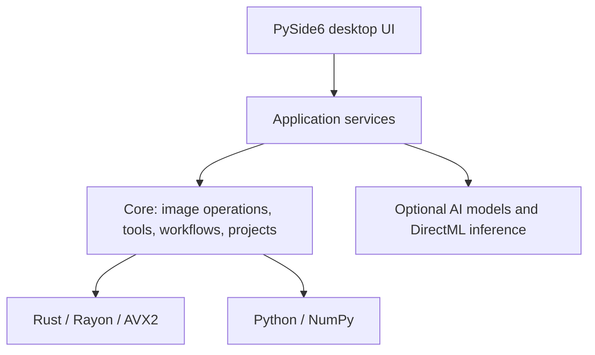

# Architecture and Native Acceleration

[简体中文](architecture.md) | [English](architecture.en.md) | [Français](architecture.fr.md)

[Back to README](../README.en.md)

## Current Layers

The desktop host uses Python and PySide6. The UI works through application services to reach the core editing and project capabilities. Suitable hotspots connect to the Rust native module through PyO3/NumPy.

| Directory | Responsibility |
| --- | --- |
| `src/ui` | Windows, workspaces, tool panels, user interaction |
| `src/application` | Service assembly, task scheduling, caches, models and runtimes, output coordination |
| `src/core` | Image algorithms, tool contracts, workflow execution, projects and history |
| `native/ops_accel` | Rust native computation, exchanging arrays with NumPy through PyO3 |
| `resources` | Translations, themes, model and runtime catalogs |

## CPU Computation and Compatibility

Rayon handles multithreaded tasks, and AVX2 SIMD speeds up operations that vectorize well. The thread count is still coordinated by the execution budget. AVX2 support is detected when the native module initializes. Set `OPS_CPU_KERNEL` before starting the process:

| Value | Behavior |
| --- | --- |
| Unset, empty, `auto` | Use the wired-in AVX2 kernels if the CPU supports AVX2, otherwise use the portable Rust path |
| `portable` | Use the portable Rust path, for compatibility diagnosis and performance comparison |
| `avx2` | Require AVX2. If it is not supported, native module initialization fails with an error |

Release builds keep a portable CPU target, and AVX2 is an optional acceleration. The kernels currently use separate multiply and add, and FMA is not yet enabled.

| Kernel group | Hotspots covered |
| --- | --- |
| `tone` | Per-pixel operations such as white balance, exposure v2, vibrance, and saturation |
| `color_space` | Color conversion lookups, gamut compression |
| `curves` | Applying curve LUTs |
| `local` | The per-pixel stages of local adjustments where they apply, combined with constant-parameter precomputation, weight reuse, and buffer reuse |
| `raw` | Normalization of decoded RAW data and f64 color matrix conversion |
| `filter` | The independent product, coefficient, output, and scaling stages of the guided filter |
| `display` | Linear RGB to RGBA8 display output |

Coverage includes the applicable stages of the operations above. Exponential, power, and trigonometric functions, and scans that depend on order, keep their own portable implementations. RAW matrix conversion sits in the processing chain after decoding. The embedded JPEG fast preview already exists for NEF and other RAW formats, while full RAW decoding is still handled by the current RAW loading chain.

## Two GPU Paths

The optional DirectML runtime is currently used for AI model inference. A GPU backend for general image operators is planned, with [wgpu](https://github.com/gfx-rs/wgpu) as the candidate, whose native backends include D3D12, Vulkan, and Metal. OPS currently ships on Windows, and later GPU technology choices will be based on this project's own validation results.

## How the Three Core Systems Evolve

| System | Target responsibility | Existing foundation |
| --- | --- | --- |
| Image Engine | Image operations, color and pixel contracts, CPU/GPU backend execution | `photo_engine`, the Rust pipeline, tool and image capability contracts |
| Workflow Engine | Orchestrating dependencies, task scheduling, cancellation, and result delivery | `WorkflowGraph`, `WorkflowExecutor`, the single-image processing chain |
| Project Model | Edit state, versions, history, resource references, and persistence | `.opsproj`, project documents, resource and recovery storage |

The CPU backend and the planned GPU backend share the contract for image-operation parameters, versions, color space, alpha, and bit depth. Each backend manages its own memory layout, uploads and downloads, and execution resources. The plan is to stabilize a small set of common operations first, then expand according to real workloads, and keep a CPU path that does not need AVX2.

## Everything is Plugin

The long-term goal is for built-in and third-party tools to plug in through one declaration, so that the UI, the assistant, workflows, and external agents can discover and call them. There is already a base of tool registration, version and resource declarations, single-image workflows, and execution of trusted plugins in a subprocess. An installable third-party plugin SDK, a complete external agent entry point, node-based workflows, and system-level plugin isolation follow the [roadmap](roadmap.en.md).

Key contracts: [tools](../src/core/contracts/tools.py), [workflows](../src/core/contracts/workflow.py), [executor](../src/core/workflow/executor.py), [projects](../src/core/project), [built-in tool modules](../src/application/tool_modules.py).
