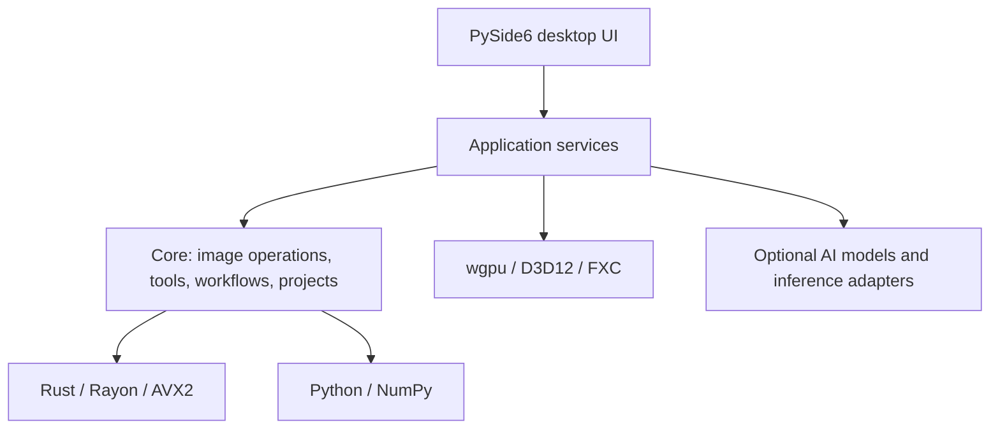

# Architecture and Native Acceleration

[简体中文](architecture.md) | [English](architecture.en.md) | [Français](architecture.fr.md)

[Back to README](../README.en.md)

## Current Layers

The desktop host uses Python and PySide6. The UI works through application services to reach the core editing and project capabilities. Suitable hotspots connect to the Rust native module through PyO3/NumPy.

| Directory | Responsibility |
| --- | --- |
| `src/ui` | Windows, workspaces, tool panels, user interaction |
| `src/application` | Service assembly, task scheduling, caches, models and runtimes, output coordination |
| `src/core` | Image algorithms, tool contracts, workflow execution, projects and history |
| `native/ops_accel` | Rust native computation, exchanging arrays with NumPy through PyO3 |
| `resources` | Translations, themes, model and runtime catalogs |

## CPU Computation and Compatibility

Rayon handles multithreaded tasks, and AVX2 SIMD speeds up operations that vectorize well. The thread count is still coordinated by the execution budget. AVX2 support is detected when the native module initializes. Set `OPS_CPU_KERNEL` before starting the process:

| Value | Behavior |
| --- | --- |
| Unset, empty, `auto` | Use the wired-in AVX2 kernels if the CPU supports AVX2, otherwise use the portable Rust path |
| `portable` | Use the portable Rust path, for compatibility diagnosis and performance comparison |
| `avx2` | Require AVX2. If it is not supported, native module initialization fails with an error |

Release builds keep a portable CPU target, and AVX2 is an optional acceleration. The kernels currently use separate multiply and add, and FMA is not yet enabled.

| Kernel group | Hotspots covered |
| --- | --- |
| `tone` | Per-pixel operations such as white balance, exposure v2, vibrance, and saturation |
| `color_space` | Color conversion lookups, gamut compression |
| `curves` | Applying curve LUTs |
| `local` | The per-pixel stages of local adjustments where they apply, combined with constant-parameter precomputation, weight reuse, and buffer reuse |
| `raw` | Normalization of decoded RAW data and f64 color matrix conversion |
| `filter` | The independent product, coefficient, output, and scaling stages of the guided filter |
| `display` | Linear RGB to RGBA8 display output, area-weighted downscaling in display space, and alpha compositing |
| `remap` | Rayon-parallel beauty warping with cubic sampling, neighborhood clamping, and premultiplied alpha |

Coverage includes the applicable stages of the operations above. Exponential, power, and trigonometric functions, and scans that depend on order, keep their own portable implementations. RAW matrix conversion sits in the processing chain after decoding. The embedded JPEG fast preview already exists for NEF and other RAW formats, while full RAW decoding is still handled by the current RAW loading chain.

## Two GPU Paths

The unified execution entry fixes each request's tool chain, target specification, engine, and cancellation context. Windows image devices use wgpu, D3D12, and FXC. Background qualification checks hardware, compiles kernels, validates small images, and benchmarks a short chain including transfers. Qualified discrete GPUs are tier A, qualified integrated GPUs are tier B, and other devices use tier C CPU processing. Requests use CPU while qualification is pending. Each request also checks complete tool capabilities, color specifications, and target budgets. Source display, independently qualified color processing, and floating-point crop/rotation, shape, and lasso versions can form GPU preview chains. Color processing covers the existing process versions, sequential masks, local parameter fields, brushes, and asset sampling. Fully qualified beauty, AI denoising, deblurring, and super-resolution can also form GPU preview chains. Nested preparation inherits the parent engine, with explicit CPU model sessions for CPU chains.

Workflows query the target checkpoint first; a hit skips upstream decoding and computation. Checkpoints, face preparation, and operator memoization share an in-flight table and image resource budget. Subscribers cancel independently, and shared work follows the highest priority among active subscribers. Beauty processing reuses regions, displacement fields, filters, and independent contributions; color processing reuses the image before detail adjustments and multiscale filters; cropping reuses rotation results. Automatic previews use the canvas size in physical pixels, while the 1600 and full modes carry explicit specifications through the same path. Matching loading frames transfer directly to the editing session.

Beauty results consist of a read-only base and rectangular patches containing RGB, optional Alpha, and the full reference size. Color composition and displacement accumulation stay within face bounds; bicubic sampling retains global coordinates and neighborhood boundaries. Display conversion reuses the base frame for the requested specification and updates affected display regions. Other tools compose temporary inputs at their execution boundary. Commits, 16-bit output, sampling, and grid tiles read the effective patched pixels, while the resource pool counts shared root buffers once.

GPU images use read-only carriers, leases, and completion markers. Result identities include the device and kernel revision. Input uploads and target viewport readbacks share the in-flight table. The content window covers the current, previous, and next two images, with priority and budget governing eviction. In-process DXGI queries supply the dynamic budget for active buffers, cached content, idle allocations, staging, and model reservations; shared allocations count once. Image submissions and existing DirectML inference share admission for the selected physical adapter, releasing CPU capacity while waiting and executing device work. Integrated GPUs also account for shared system memory and estimated submission time.

Device operators cover RGB/Alpha bicubic remapping, self-guided and independent guided filtering, separable Lanczos resizing, integer shape and polygon rasterization, feathering, and alpha composition. Rotation results reuse the upstream identity and angle; crop rectangles use read-only views of shared allocations. GPU bases and patches remain on the device. Sampling and masks read current pixels from the requested region, and CPU materialization retains its readback lease. GPU checkpoints share in-flight work; the device cache budget governs retention across requests.

Memory pressure first evicts optional content. Execution failures restart the complete chain on CPU from the common source; device loss disables GPU processing for the session. Settings provide automatic or CPU-only image computation and automatic, disabled, or custom GPU caching. The runtime page shows the device, tier, backend, and budget usage. The Rust ONNX Runtime C API image adapter uses the same D3D12 device and queue, FLOAT32 NCHW/NHWC tensors with three or four channels, and device-side layout conversion. CPU operator fallback is disabled. It supports four-dimensional image models with one input and one output. Model capabilities are registered against weights, runtime, and device identities after complete numerical comparisons. Missing capabilities or insufficient target budgets select the entire CPU chain. Image adapters explicitly carry linear or encoded input and output color identities. General image computation uses [wgpu](https://github.com/gfx-rs/wgpu), and OPS currently ships on Windows.

The device tensor bridge also supports one input with multiple FLOAT32 outputs of different ranks. The original face task and YuNet weights are preserved in ONNX conversions with fixed identities. Detection, landmarks, the three preparation specifications, face regions, and support masks use device interfaces. Face qualification is registered per model, runtime, specification, and device; eight manual comparison categories must pass before the preparation interface becomes available. Complete beauty capabilities additionally require individual strengths, combinations, multiple faces, Alpha, crop, and no-face comparisons. Images and model tensors remain resident, scheduling reads small control descriptors, and callers explicitly request final analysis delivery.

Beauty performs Lab conversion, skin distributions, medians and covariance, spot donor searches, eye-bag statistics, contribution composition, and regional warping on the device. Results preserve read-only patches and global sampling boundaries. Rust CPU kernels provide Lab conversion and skin contribution composition. AI enhancement preserves denoise, deblur, and super-resolution order, the original tile and row-band boundaries, encoded-color mixing, linear output, Lanczos Alpha, and target layouts. Transparent-region propagation uses bounded submissions. Candidate, statistical, or resource limits restart the entire chain on CPU through the shared execution entry.

Classic denoising preserves the versioned sRGB8 stage, luminance/chroma filters, and sharpening. Legacy AI denoising preserves tiled inference, reflection padding, and overlap blending. U2Net preprocessing, mask normalization, 8-bit Lanczos resizing, edge blur, and alpha composition run on the same device. ID photos retain the original crop, segmentation, background composition, linear resizing, and sheet layout order. Each tool joins a complete GPU chain after numerical qualification for its implementation, model, and device.

Commits, exports, and grid output select the complete chain engine using the full output specification. Fixed-size resizing and padding stay on the device; float32 linear pixels are read back at the final encoding boundary. Readback or output adaptation failures restart the complete CPU chain from the common source, preserving target protection and publication transactions. Kernels report cold compilation and first submission times. If an FXC beauty kernel takes more than two seconds to compile, the device tries static DXC before numerical qualification. Runtime status shows the selected compiler, with diagnostics retaining the reason when DXC cannot be used.

## How the Three Core Systems Evolve

| System | Target responsibility | Existing foundation |
| --- | --- | --- |
| Image Engine | Image operations, color and pixel contracts, CPU/GPU backend execution | `photo_engine`, the Rust pipeline, tool and image capability contracts |
| Workflow Engine | Orchestrating dependencies, task scheduling, cancellation, and result delivery | `WorkflowGraph`, `WorkflowExecutor`, the single-image processing chain |
| Project Model | Edit state, versions, history, resource references, and persistence | `.opsproj`, project documents, resource and recovery storage |

The CPU and GPU backends share the contract for image-operation parameters, versions, color space, alpha, and bit depth. Each backend manages its own memory layout, uploads and downloads, and execution resources. The plan is to stabilize a small set of common operations first, then expand according to real workloads, and keep a CPU path that does not need AVX2.

## Everything is Plugin

Built-in and trusted third-party tools share declarations for parameters, images, space, resources, cancellation, and caching. The `image/1` plugin interface carries linear float32 RGB, separate alpha, reference dimensions, and named read-only auxiliary artifacts. An sRGB8 adapter supports the legacy PNG protocol. Project schema 4 pins plugin package digests, implementations, and interface versions. Deterministic and seeded plugins reuse complete dependencies; other plugins deliver an independent result per request. See [Image Plugins](image-plugins.en.md). Installation management, complete external agent access, node-based workflows, and system-level isolation follow the [roadmap](roadmap.en.md).

The automatic canvas requests its visible region when enlarged. Basic point color adjustments, unrotated crops, shape crops, lassos, and the vignette extension support regional computation. Global statistics, filters, faces, and models retain their full reference domain and preparation before delivering the requested region. Region, proxy, and complete-output identities are separate, and panning updates the region. AI enhancement, background removal, legacy denoise, and ID photos reuse intermediates according to model inputs and parameter dependencies.

Key contracts: [tools](../src/core/contracts/tools.py), [workflows](../src/core/contracts/workflow.py), [executor](../src/core/workflow/executor.py), [projects](../src/core/project), [built-in tool modules](../src/application/tool_modules.py).
