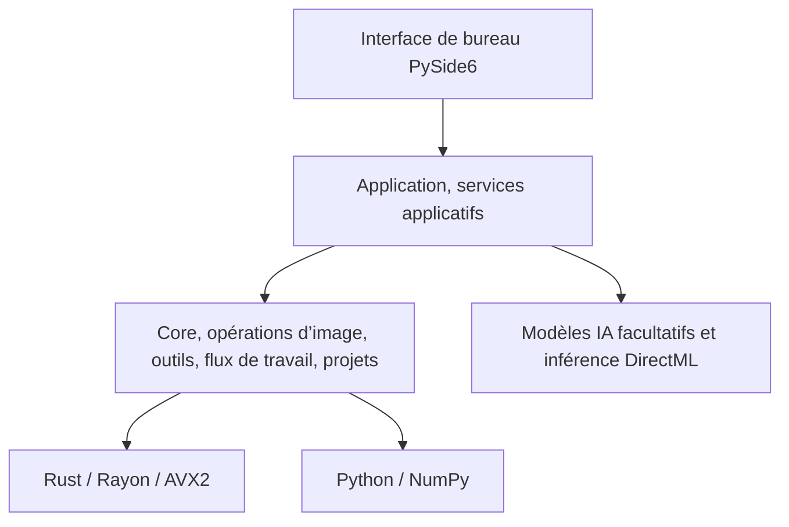

# Architecture et accélération native

[简体中文](architecture.md) | [English](architecture.en.md) | [Français](architecture.fr.md)

[Retour à l’accueil](../README.fr.md)

## Couches actuelles

L’hôte de bureau repose sur Python et PySide6. L’interface passe par les services d’application pour coordonner les fonctions de retouche et de projet du cœur ; les points chauds concernés sont reliés au module natif Rust par PyO3 et NumPy.

| Dossier | Rôle |
| --- | --- |
| `src/ui` | Fenêtres, espaces de travail, panneaux d’outils, interactions avec l’utilisateur |
| `src/application` | Assemblage des services, planification des tâches, caches, modèles et moteurs d’exécution, coordination des sorties |
| `src/core` | Algorithmes d’image, contrats d’outils, exécution des flux de travail, projets et historique |
| `native/ops_accel` | Calcul natif en Rust, qui échange des tableaux avec NumPy par PyO3 |
| `resources` | Traductions, thèmes, catalogues de modèles et de moteurs d’exécution |

## Calcul CPU et compatibilité

Rayon exécute les tâches en multithread, et l’accélération AVX2 SIMD sert les opérations qui se vectorisent ; le nombre de threads reste coordonné par le budget d’exécution. La prise en charge d’AVX2 est détectée à l’initialisation du module natif. `OPS_CPU_KERNEL` se définit avant le lancement du processus :

| Valeur | Comportement |
| --- | --- |
| Non définie, vide, `auto` | Si le CPU prend en charge AVX2, les noyaux AVX2 déjà branchés sont utilisés ; sinon, le chemin Rust générique |
| `portable` | Utilise le chemin Rust générique, pour diagnostiquer la compatibilité et comparer les performances |
| `avx2` | Exige AVX2 ; si le CPU ne le prend pas en charge, l’initialisation du module natif signale une erreur |

Les versions de distribution gardent une cible CPU générique, et AVX2 est une accélération facultative. Les multiplications-additions sont actuellement séparées ; FMA n’est pas encore activé.

| Groupe de noyaux | Points chauds couverts |
| --- | --- |
| `tone` | Opérations pixel par pixel : balance des blancs, exposition v2, vibrance, saturation, etc. |
| `color_space` | Tables de conversion colorimétrique, compression de gamut |
| `curves` | Application des LUT de courbes |
| `local` | Étapes pixel par pixel concernées des réglages locaux, avec calculs préalables à paramètres constants, réutilisation des poids et réutilisation des tampons |
| `raw` | Normalisation des données RAW décodées et conversion par matrice de couleur en f64 |
| `filter` | Étapes de produit indépendant, de coefficients, de sortie et de mise à l’échelle du filtre guidé |
| `display` | Sortie d’affichage, du RGB linéaire vers RGBA8 |

La couverture comprend les étapes concernées des opérations ci-dessus. Les exponentielles, les puissances, les fonctions trigonométriques et les parcours à dépendance d’ordre gardent leur implémentation générique. La conversion matricielle RAW se place dans la chaîne de traitement après le décodage. L’aperçu rapide par le JPEG intégré existe déjà pour les RAW comme les NEF ; le décodage RAW complet reste assuré par la chaîne de chargement RAW actuelle.

## Deux pistes pour le GPU

Le moteur DirectML facultatif sert aujourd’hui à l’inférence des modèles IA. Un moteur GPU pour les opérateurs d’image généraux est prévu ; le candidat est [wgpu](https://github.com/gfx-rs/wgpu), dont les moteurs natifs couvrent D3D12, Vulkan, Metal, etc. OPS est aujourd’hui livré pour Windows, et le choix technique pour le GPU sera arrêté d’après les validations menées dans ce projet.

## L’évolution des trois systèmes centraux

| Système | Rôle visé | Bases existantes |
| --- | --- | --- |
| Image Engine | Opérations d’image, contrats de couleur et de pixels, exécution sur moteurs CPU/GPU | `photo_engine`, chaîne Rust, contrats d’outils et de capacités d’image |
| Workflow Engine | Orchestration des dépendances, planification des tâches, annulation et remise des résultats | `WorkflowGraph`, `WorkflowExecutor`, chaîne de traitement d’une seule image |
| Project Model | État de retouche, versions, historique, références de ressources et persistance | `.opsproj`, documents de projet, stockage des ressources et de reprise |

Le moteur CPU et le futur moteur GPU partagent le contrat des opérations d’image sur les paramètres, la version, l’espace colorimétrique, l’alpha et la profondeur de bits ; la disposition en mémoire, les transferts vers et depuis le GPU et les ressources d’exécution relèvent de chaque moteur. Le principe est de stabiliser d’abord un petit nombre d’opérations communes, puis d’étendre selon les charges réelles, en gardant un chemin CPU sans AVX2.

## Everything is Plugin

L’objectif à long terme est que les outils intégrés et tiers se branchent par une déclaration commune, que l’interface, l’assistant, les flux de travail et les agents externes peuvent découvrir et appeler. Les bases actuelles sont l’enregistrement des outils, les déclarations de version et de ressources, le flux de travail d’une seule image et l’exécution de plug-ins de confiance dans un sous-processus. Le SDK de plug-ins tiers installables, l’accès complet pour agents externes, le flux de travail à nœuds et l’isolation des plug-ins au niveau du système avancent selon la [feuille de route](roadmap.fr.md).

Contrats clés : [outils](../src/core/contracts/tools.py), [flux de travail](../src/core/contracts/workflow.py), [exécuteur](../src/core/workflow/executor.py), [projet](../src/core/project), [modules d’outils intégrés](../src/application/tool_modules.py).
