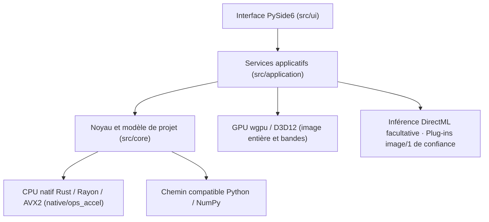
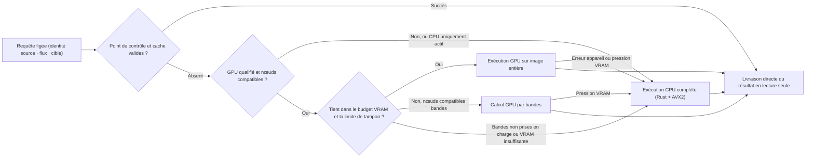

# Architecture et accélération native

[简体中文](architecture.md) | [English](architecture.en.md) | [Français](architecture.fr.md)

[Retour à l’accueil](../README.fr.md) · [Documentation](README.fr.md)

OpenPictureStudio associe un hôte de bureau Python et un moteur de flux non destructif à des noyaux natifs Rust multithread/AVX2, un pipeline GPU généraliste Windows wgpu/D3D12 et une inférence IA facultative via DirectML.

## Architecture en couches

| Répertoire | Responsabilités |
| --- | --- |
| `src/ui` | Fenêtres, espaces de visualisation et de retouche, panneaux d’outils, paramètres et interactions |
| `src/application` | Orchestration des services, ordonnancement, caches, budgets VRAM, gestion des modèles/moteurs et exports |
| `src/core` | Algorithmes d’image, contrats d’outils unifiés, exécution non destructive et persistance `.opsproj` |
| `native/ops_accel` | Noyaux CPU Rust, backend de calcul GPU wgpu/D3D12 et pont de tenseurs ONNX |
| `resources` | Traductions, thèmes d’interface, rendus intégrés, catalogues de modèles/moteurs et plug-ins d’exemple |

## Pipeline d’exécution et routage des moteurs

Préchargement en visualisation, interaction sur le canevas, vue à 100 %, observations de l’assistant et export par lot passent par une entrée unique qui fige les spécifications, remonte aux points de contrôle valides et ne recalcule que les étapes manquantes.

- **Enregistrement groupé et rétention inter-images :** les passes GPU d’une même image sont enregistrées dans un encodeur unique et soumises uniquement lors des relectures, en fin d’image ou au franchissement des seuils de tampons. Des emplacements conservent résultats de nœuds, régions faciales, filtres peau et champs de déformation afin d’éviter tout recalcul amont pendant le glissement des curseurs.
- **Relecture à la demande et transition sans scintillement :** l’aperçu pleine résolution ne relit pendant le glissement que l’image à la taille écran ou la zone visible du canevas, puis complète la vue entière au relâchement. Les trames compatibles de la visionneuse sont transmises directement à la session d’édition, et la comparaison à l’original conserve le recadrage et la rotation actifs.
- **Ordre par défaut des outils :** toute nouvelle retouche suit l’ordre **Beauté → Couleur → Réduction du bruit → Recadrage**, tandis que les projets existants gardent leur ordre enregistré. L’analyse du visage dérivant de l’image source et de la géométrie préalable, les réglages couleur ne relancent pas la détection faciale.

## Deux voies GPU et matrice de capacités

L’accélération GPU repose sur deux voies coordonnées : le **calcul d’image wgpu / D3D12 intégré** (qualifié numériquement en arrière-plan au démarrage) et l’**inférence IA DirectML facultative** (exécutée sur le même adaptateur physique via l’API C d’ONNX Runtime en Rust sous un budget VRAM partagé).

| Étape ou outil | GPU image entière | Bandes GPU | Exécution par défaut actuelle |
| --- | --- | --- | --- |
| Décodage et envoi source (JPEG / PNG 8·16 bits / RAW) | Pris en charge | Pris en charge | GPU après réussite de l’autotest |
| Couleur et masques locaux (ombres/hautes lumières/texture/clarté/voile inclus) | Pris en charge | Pris en charge | GPU ; en bandes, coefficients calculés en basse résolution |
| Recadrage, rotation, forme et lasso | Pris en charge | Pris en charge | GPU ; la rotation partage les blocs de lignes en amont par bande |
| Retouche de portrait (correctifs groupés par zone d’influence) | Pris en charge | Pris en charge | GPU ; les groupes disjoints s’appliquent indépendamment |
| Réduction du bruit classique (version de traitement 3) | Pris en charge | Pris en charge | GPU si l’autotest correspond au CPU ; sinon journalise, avertit une fois et bascule sur CPU |
| Débruitage IA, amélioration IA, détourage et photo d’identité | Implémenté, qualification en attente | Non pris en charge | Chaîne CPU (avec accélération DirectML facultative) |
| Plug-ins d’image de confiance `image/1` | — | — | Sous-processus CPU selon le contrat |

> **Remarque :** Au démarrage, seuls les shaders essentiels (source, couleur, affichage) sont compilés immédiatement ; les autres sont compilés en arrière-plan ou à la demande. Les résultats de qualification sont enregistrés par carte, pilote, compilateur de shaders, version de l’application et révision native. Le CPU assure l’affichage initial jusqu’à ce que le GPU soit prêt, puis met automatiquement à jour la vue au repos.

## Budgets VRAM, traitement par bandes et reprise sur erreur

- **Budgets VRAM adaptatifs :** un GPU dédié est plafonné au minimum entre 4/5 de sa VRAM dédiée et 3/4 du budget alloué au processus au démarrage. Un GPU intégré utilise 3/4 du minimum entre 1/4 de la RAM physique et la limite mémoire logicielle (sans dépasser 3/4 du budget processus), avec contrôle du temps par soumission. À l’exécution, le budget vise 9/10 du budget DXGI courant moins l’usage non comptabilisé, en incluant les blocs libres retenus dans l’allocateur natif. Le mode **GPU en priorité / CPU uniquement** et le **Cache de mémoire GPU** se règlent dans **Paramètres → Performances et mémoire**.
- **Bandes GPU au-delà de la VRAM :** lorsque la pleine résolution dépasse la limite d’un tampon ou le budget global, les flux compatibles passent en calcul par bandes. La source entière compacte reste en VRAM, est convertie par bandes en float32 puis assemblée pour l’écran ou relue pour l’export avec conversion 8 bits multithread et compression PNG parallèle par bandes de 64 lignes (limite matérielle de 32768 px par côté).
- **Reprise sur erreur et diagnostics :** sous pression mémoire, OPS libère d’abord les caches conservés facultatifs ; si le calcul ne tient toujours pas ou si l’appareil est perdu, la requête repart de bout en bout sur le CPU depuis la source partagée et désactive l’appareil défaillant pour la session. Si un noyau beauté dépasse deux secondes sous FXC, OPS bascule sur une compilation DXC statique ; le compilateur actif et les motifs de repli sont consignés dans les journaux et diagnostics.

## Calcul CPU et compatibilité

Les builds publiés ciblent le jeu d’instructions x86_64 générique afin de fonctionner sur les processeurs dépourvus d’AVX2. Le module natif détecte automatiquement les capacités au chargement, et `OPS_CPU_KERNEL` permet de forcer le mode avant le lancement :

| Valeur de `OPS_CPU_KERNEL` | Comportement |
| --- | --- |
| Non défini / vide / `auto` | Utilise les noyaux AVX2 si pris en charge, sinon le chemin Rust générique |
| `portable` | Force les noyaux Rust génériques pour diagnostic et comparaison |
| `avx2` | Exige AVX2 ; échoue au chargement du module en cas d’absence |

| Groupes de noyaux natifs | Traitements couverts |
| --- | --- |
| `tone` / `color_space` / `curves` | Balance des blancs, exposition v2, vibrance et saturation, LUT couleur, compression de gamut, courbes |
| `local` / `filter` | Champs de paramètres locaux et étapes clés du filtre guidé |
| `raw` / `display` / `remap` | Conversion matricielle RAW, affichage linéaire vers RGBA8 avec réduction pondérée, rééchantillonnage beauté cubique Rayon |

## Sous-systèmes et architecture par plug-ins

| Sous-système | Responsabilité principale |
| --- | --- |
| **Image Engine** | Contrats partagés de pixels, couleur, alpha et espace de référence sur CPU et GPU |
| **Workflow Engine** | Ordonnancement non destructif du graphe, points de contrôle, priorités, annulation et calcul par zones |
| **Project Model** | État des retouches, historique annuler/rétablir, versions figées et persistance `.opsproj` |

Les outils intégrés et les plug-ins de confiance partagent le même moteur d’exécution. En zoom, l’aperçu automatique ne demande que la zone visible du canevas : les outils locaux calculent la zone seule, tandis que les opérateurs globaux conservent leur domaine de référence avant découpe.

Contrats clés : [Outils](../src/core/contracts/tools.py) · [Flux](../src/core/contracts/workflow.py) · [Exécuteur](../src/core/workflow/executor.py) · [Modèle de projet](../src/core/project) · [Modules intégrés](../src/application/tool_modules.py)

## Documentation associée

- [Configuration requise et performances](performance.fr.md)
- [Plug-ins d’image](image-plugins.fr.md)
- [Développement et compilation](building.fr.md)
