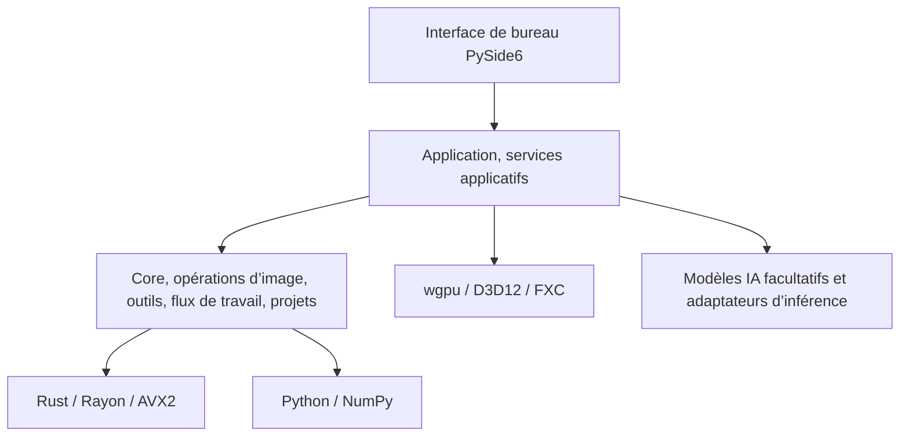

# Architecture et accélération native

[简体中文](architecture.md) | [English](architecture.en.md) | [Français](architecture.fr.md)

[Retour à l’accueil](../README.fr.md)

## Couches actuelles

L’hôte de bureau repose sur Python et PySide6. L’interface passe par les services d’application pour coordonner les fonctions de retouche et de projet du cœur ; les points chauds concernés sont reliés au module natif Rust par PyO3 et NumPy.

| Dossier | Rôle |
| --- | --- |
| `src/ui` | Fenêtres, espaces de travail, panneaux d’outils, interactions avec l’utilisateur |
| `src/application` | Assemblage des services, planification des tâches, caches, modèles et moteurs d’exécution, coordination des sorties |
| `src/core` | Algorithmes d’image, contrats d’outils, exécution des flux de travail, projets et historique |
| `native/ops_accel` | Calcul natif en Rust, qui échange des tableaux avec NumPy par PyO3 |
| `resources` | Traductions, thèmes, catalogues de modèles et de moteurs d’exécution |

## Calcul CPU et compatibilité

Rayon exécute les tâches en multithread, et l’accélération AVX2 SIMD sert les opérations qui se vectorisent ; le nombre de threads reste coordonné par le budget d’exécution. La prise en charge d’AVX2 est détectée à l’initialisation du module natif. `OPS_CPU_KERNEL` se définit avant le lancement du processus :

| Valeur | Comportement |
| --- | --- |
| Non définie, vide, `auto` | Si le CPU prend en charge AVX2, les noyaux AVX2 déjà branchés sont utilisés ; sinon, le chemin Rust générique |
| `portable` | Utilise le chemin Rust générique, pour diagnostiquer la compatibilité et comparer les performances |
| `avx2` | Exige AVX2 ; si le CPU ne le prend pas en charge, l’initialisation du module natif signale une erreur |

Les versions de distribution gardent une cible CPU générique, et AVX2 est une accélération facultative. Les multiplications-additions sont actuellement séparées ; FMA n’est pas encore activé.

| Groupe de noyaux | Points chauds couverts |
| --- | --- |
| `tone` | Opérations pixel par pixel : balance des blancs, exposition v2, vibrance, saturation, etc. |
| `color_space` | Tables de conversion colorimétrique, compression de gamut |
| `curves` | Application des LUT de courbes |
| `local` | Étapes pixel par pixel concernées des réglages locaux, avec calculs préalables à paramètres constants, réutilisation des poids et réutilisation des tampons |
| `raw` | Normalisation des données RAW décodées et conversion par matrice de couleur en f64 |
| `filter` | Étapes de produit indépendant, de coefficients, de sortie et de mise à l’échelle du filtre guidé |
| `display` | Sortie d’affichage du RGB linéaire vers RGBA8, réduction pondérée par aire dans l’espace d’affichage et composition alpha |
| `remap` | Déformation beauté parallèle avec Rayon, échantillonnage cubique, bornage au voisinage et alpha prémultiplié |

La couverture comprend les étapes concernées des opérations ci-dessus. Les exponentielles, les puissances, les fonctions trigonométriques et les parcours à dépendance d’ordre gardent leur implémentation générique. La conversion matricielle RAW se place dans la chaîne de traitement après le décodage. L’aperçu rapide par le JPEG intégré existe déjà pour les RAW comme les NEF ; le décodage RAW complet reste assuré par la chaîne de chargement RAW actuelle.

## Deux pistes pour le GPU

L’entrée d’exécution commune fixe la chaîne d’outils, la spécification cible, le moteur et le contexte d’annulation de chaque requête. Sous Windows, le calcul d’image utilise wgpu, D3D12 et FXC. La qualification en arrière-plan vérifie le matériel, compile les noyaux, contrôle de petites images et mesure une chaîne courte avec ses transferts. Les GPU dédiés qualifiés appartiennent à la catégorie A, les GPU intégrés qualifiés à la catégorie B ; les autres configurations utilisent le CPU en catégorie C. Le CPU reste actif pendant la détection. Chaque requête vérifie aussi les capacités de toute la chaîne, la spécification colorimétrique et le budget cible. L’affichage de la source, la couleur qualifiée séparément et les versions flottantes du recadrage/rotation, des formes et du lasso peuvent former des chaînes d’aperçu GPU. La couleur couvre les versions de traitement existantes, les masques séquentiels, les champs de paramètres locaux, les pinceaux et les ressources de masque. La beauté, le débruitage IA, le défloutage et la super-résolution entièrement qualifiés peuvent aussi former des chaînes d’aperçu GPU. La préparation imbriquée hérite du moteur parent ; les chaînes CPU créent des sessions CPU explicites.

Le workflow consulte d’abord le point de contrôle cible ; un résultat disponible évite le décodage et les calculs en amont. Les points de contrôle, la préparation des visages et la mémorisation des opérateurs partagent une table des tâches en cours et le budget des ressources d’image. Chaque abonné peut annuler indépendamment ; le calcul partagé suit la priorité la plus élevée parmi les abonnés actifs. La beauté réutilise les régions, déplacements, filtres et contributions indépendantes ; la couleur réutilise l’image précédant les réglages de détail et les filtres multiéchelles ; le recadrage réutilise la rotation. L’aperçu automatique utilise les dimensions physiques du canevas. Les modes 1600 et complet transmettent leurs spécifications par la même chaîne. Les images de chargement compatibles sont transférées directement à la session de retouche.

Les résultats de beauté associent une image de base en lecture seule à des régions rectangulaires contenant RGB, Alpha facultatif et les dimensions de référence complètes. La composition des couleurs et l’accumulation des déplacements restent limitées aux visages ; l’échantillonnage bicubique conserve les coordonnées globales et les limites du voisinage. L’affichage réutilise l’image de base correspondant à la spécification demandée et actualise les régions affectées. Les autres outils composent une entrée temporaire à leur frontière d’exécution. Les validations, les sorties 16 bits, l’échantillonnage et les tuiles lisent les pixels corrigés ; le pool compte une seule fois les tampons racines partagés.

Les images GPU disposent de supports en lecture seule, de prêts et de marqueurs de fin. Leur identité inclut l’appareil et la révision des noyaux. Les transferts d’entrée et la lecture de la zone d’affichage partagent la table des tâches en cours. La fenêtre de contenu couvre l’image courante, la précédente et les deux suivantes ; les priorités et le budget règlent l’éviction. Les requêtes DXGI du processus fournissent le budget dynamique des tampons actifs, du cache, des allocations libres, du transfert et des réservations des modèles ; les allocations partagées ne sont comptées qu’une fois. Les soumissions d’image et l’inférence DirectML existante partagent l’admission pour l’adaptateur physique choisi et libèrent la capacité CPU pendant l’attente et le travail sur l’appareil. Les GPU intégrés comptabilisent aussi la mémoire système partagée et la durée estimée des soumissions.

Les opérateurs sur l’appareil comprennent le rééchantillonnage bicubique RGB/Alpha, les filtres autoguidés et à guide indépendant, le redimensionnement Lanczos séparable, la rastérisation entière des formes et polygones, le contour progressif et la composition alpha. Les rotations se réutilisent selon l’identité amont et l’angle ; les rectangles de recadrage deviennent des vues en lecture seule d’allocations partagées. Les bases et corrections GPU restent sur l’appareil. L’échantillonnage et les masques lisent les pixels actuels de la région demandée, et la matérialisation CPU conserve son prêt de lecture. Les points de contrôle GPU partagent le travail en cours ; le budget du cache de l’appareil règle la conservation entre requêtes.

Une pression mémoire libère d’abord le contenu facultatif. Un échec relance toute la chaîne sur CPU depuis la source commune ; la perte de l’appareil désactive le GPU pour la session. Les réglages proposent le calcul automatique ou CPU uniquement, et un cache GPU automatique, désactivé ou personnalisé. La page des environnements affiche l’appareil, la catégorie, le moteur et le budget utilisé. L’adaptateur d’image Rust de l’API C ONNX Runtime utilise le même appareil et la même file D3D12, des tenseurs FLOAT32 NCHW/NHWC à trois ou quatre canaux et une conversion de disposition sur GPU. Le repli des opérateurs sur CPU est désactivé. Il prend en charge les modèles d’image à quatre dimensions avec une entrée et une sortie. Les capacités des modèles sont enregistrées selon les poids, l’environnement et l’appareil après comparaison numérique complète. Une capacité absente ou un budget cible insuffisant sélectionne toute la chaîne CPU. Les adaptateurs indiquent explicitement les espaces linéaires ou encodés des entrées et sorties. Le calcul d’image général utilise [wgpu](https://github.com/gfx-rs/wgpu) ; OPS est actuellement livré pour Windows.

Le pont de tenseurs accepte aussi une entrée et plusieurs sorties FLOAT32 de rangs différents. Les conversions ONNX à identité fixe conservent les poids du modèle de visage et de YuNet d’origine. La détection, les points clés, les trois spécifications de préparation, les régions et les domaines de support utilisent les interfaces GPU. La qualification des visages dépend du modèle, de l’environnement, de la spécification et de l’appareil ; huit catégories de comparaison manuelle doivent réussir avant l’ouverture de l’interface de préparation. La qualification complète de la beauté couvre aussi chaque intensité, les combinaisons, plusieurs visages, l’Alpha, le recadrage et l’absence de visage. Les images et tenseurs restent sur l’appareil, l’ordonnancement lit de petits descripteurs de contrôle et l’appelant demande explicitement la remise de l’analyse finale.

La beauté effectue sur l’appareil la conversion Lab, les distributions de peau, les médianes et covariances, la recherche de donneurs pour les taches, les statistiques des cernes, la composition des contributions et les déformations régionales. Les résultats conservent les corrections en lecture seule et les limites d’échantillonnage globales. Les noyaux Rust CPU assurent la conversion Lab et la composition des contributions de peau. L’amélioration IA conserve l’ordre débruitage, défloutage, super-résolution, les limites d’origine des tuiles et bandes, le mélange en couleur encodée, la sortie linéaire, l’Alpha Lanczos et la disposition cible. La propagation dans les régions transparentes utilise des soumissions bornées. Les limites de recherche, de statistiques ou de ressources relancent toute la chaîne CPU par l’entrée commune.

Le débruitage classique conserve l’étape sRGB8 versionnée, les filtres de luminance/chrominance et l’accentuation. Le débruitage IA historique conserve les tuiles, le remplissage par réflexion et le mélange des recouvrements. Le prétraitement U2Net, la normalisation du masque, le redimensionnement Lanczos 8 bits, le flou des contours et la composition alpha restent sur le même appareil. Les photos d’identité conservent l’ordre recadrage, segmentation, fond, redimensionnement linéaire et disposition sur papier. Chaque outil rejoint la chaîne GPU complète après qualification numérique de son implémentation, de son modèle et de l’appareil.

Les validations, exports et sorties en grille choisissent le moteur de toute la chaîne selon la spécification complète de sortie. Le redimensionnement fixe et les marges restent sur l’appareil ; les pixels linéaires float32 sont lus à la frontière finale d’encodage. Un échec de lecture ou d’adaptation de sortie relance toute la chaîne CPU depuis la source commune, avec les protections de cible et transactions de publication existantes. Les noyaux indiquent leurs durées de compilation à froid et de première soumission. Si un noyau de beauté dépasse deux secondes avec FXC, l’appareil essaie DXC statique avant la qualification numérique. L’état d’exécution indique le compilateur choisi ; le diagnostic conserve la raison lorsqu’il ne peut pas utiliser DXC.

## L’évolution des trois systèmes centraux

| Système | Rôle visé | Bases existantes |
| --- | --- | --- |
| Image Engine | Opérations d’image, contrats de couleur et de pixels, exécution sur moteurs CPU/GPU | `photo_engine`, chaîne Rust, contrats d’outils et de capacités d’image |
| Workflow Engine | Orchestration des dépendances, planification des tâches, annulation et remise des résultats | `WorkflowGraph`, `WorkflowExecutor`, chaîne de traitement d’une seule image |
| Project Model | État de retouche, versions, historique, références de ressources et persistance | `.opsproj`, documents de projet, stockage des ressources et de reprise |

Les moteurs CPU et GPU partagent le contrat des opérations d’image sur les paramètres, la version, l’espace colorimétrique, l’alpha et la profondeur de bits ; la disposition en mémoire, les transferts vers et depuis le GPU et les ressources d’exécution relèvent de chaque moteur. Le principe est de stabiliser d’abord un petit nombre d’opérations communes, puis d’étendre selon les charges réelles, en gardant un chemin CPU sans AVX2.

## Everything is Plugin

Les outils intégrés et tiers de confiance partagent les déclarations de paramètres, d’image, d’espace, de ressources, d’annulation et de cache. L’interface `image/1` transmet du RGB linéaire float32, un alpha séparé, les dimensions de référence et des données auxiliaires nommées en lecture seule. Un adaptateur sRGB8 prend en charge l’ancien protocole PNG. Le schéma de projet 4 fixe les empreintes des paquets, les implémentations et les versions d’interface. Les plug-ins déterministes et à graine réutilisent leurs dépendances complètes ; les autres livrent un résultat indépendant par requête. Voir [Plug-ins d’image](image-plugins.fr.md). La gestion d’installation, l’accès complet des agents externes, les flux à nœuds et l’isolation système suivent la [feuille de route](roadmap.fr.md).

Le canevas automatique demande la zone visible lors de l’agrandissement. Les réglages de couleur ponctuels, le recadrage sans rotation, les formes, le lasso et l’extension de vignettage acceptent le calcul régional. Les statistiques globales, filtres, visages et modèles conservent leur domaine complet de référence et leur préparation avant de livrer la zone demandée. Les identités de région, de proxy et de sortie complète sont distinctes ; le déplacement actualise la zone. L’amélioration IA, le détourage, le débruitage classique et les photos d’identité réutilisent les résultats intermédiaires selon leurs entrées de modèle et paramètres.

Contrats clés : [outils](../src/core/contracts/tools.py), [flux de travail](../src/core/contracts/workflow.py), [exécuteur](../src/core/workflow/executor.py), [projet](../src/core/project), [modules d’outils intégrés](../src/application/tool_modules.py).
