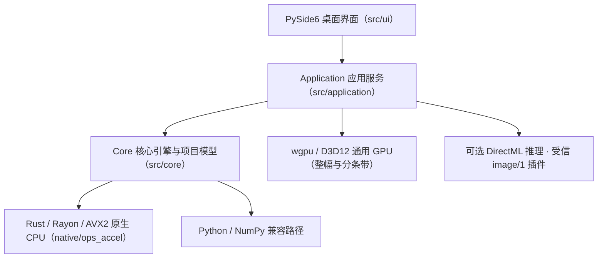
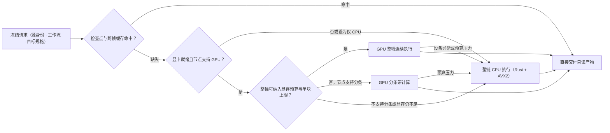

# 架构与原生加速

[简体中文](architecture.md) | [English](architecture.en.md) | [Français](architecture.fr.md)

[返回首页](../README.md) · [文档目录](README.md)

OpenPictureStudio 以非破坏式工作流与统一图像契约为核心，协调 Python 桌面宿主、Rust 多线程／AVX2 原生算子、Windows wgpu／D3D12 通用 GPU 管线及可选的 DirectML AI 模型推理。

## 整体分层

| 目录 | 核心职责 |
| --- | --- |
| `src/ui` | 窗口、看图与编辑工作区、工具面板、设置页与交互控制 |
| `src/application` | 服务装配、任务调度、缓存与显存预算、模型与运行环境管理、导出协调 |
| `src/core` | 图像算法、统一工具契约、非破坏式工作流执行与 `.opsproj` 项目模型 |
| `native/ops_accel` | Rust 原生 CPU 内核、wgpu/D3D12 通用 GPU 后端与 ONNX 张量桥 |
| `resources` | 多语言文案、界面主题、内置样式、模型／运行环境目录与样例插件 |

## 图像执行流水线与引擎路由

看图预热、画布交互、局部区域查看、助手观察与批量导出均通过同一执行入口冻结请求规格，从目标终点回溯可用缓存，仅补齐缺失阶段。

- **帧内批量录制与跨帧缓存**：一帧内的 GPU 操作连续录制到当前命令编码器，仅在回读、帧结束或达到缓冲阈值时提交；跨帧缓存按槽位和显存上限保留节点结果、人脸区域、皮肤滤波与形变位移等中间状态，避免拖动滑块时重复计算上游。
- **按需读回与无闪烁交接**：完整分辨率预览在拖动期间仅读回屏幕显示尺寸或视口可见区域，松手后自动补齐整幅显示帧；看图模式下符合规格的预备帧直接交接至编辑会话，按住对比原图沿用当前裁切与旋转。
- **默认处理顺序**：新建编辑默认采用 **美颜 → 调色 → 降噪 → 裁切** 顺序，既有项目保持保存时的节点顺序。由于人脸分析由源图与美颜前置几何生成，连续调色不会重新触发人脸检测。

## GPU 双路线与工具能力矩阵

显卡计算包含两条相互协同的路线：**内置 wgpu / D3D12 通用图像计算**（启动时后台选卡并执行数值自检，覆盖日常调色与几何/美颜算子）与 **可选 DirectML AI 推理**（通过 Rust ONNX Runtime C API 在同一物理适配器上运行本地神经网络模型并共享显存预算）。

| 环节或工具 | GPU 整幅计算 | GPU 分条带 | 当前默认执行方式 |
| --- | --- | --- | --- |
| 源图读入与解压（JPEG / 8·16 位 PNG / RAW） | 支持 | 支持 | 自检通过后由 GPU 解码与转换 |
| 调色与局部蒙版（含阴影/高光/纹理/清晰度/去雾） | 支持 | 支持 | GPU 执行；分条时在低分辨率整幅图上计算细节系数 |
| 裁切、旋转、形状裁切与套索 | 支持 | 支持 | GPU 执行；旋转按输出带共享上游行块 |
| 人像美颜（按有效影响范围分组补丁） | 支持 | 支持 | GPU 执行；各组补丁互不干扰，避免无谓整图合成 |
| 传统降噪（处理版本 3） | 支持 | 支持 | 启动自检与 CPU 一致时走 GPU；不一致则记录、提示一次并长期转用 CPU |
| AI 降噪、AI 增强、抠图与证件照 | 已实现待接入自检 | 暂不支持 | 当前在 CPU 链执行，可按需搭配 DirectML 运行环境加速模型推理 |
| 受信 `image/1` 图像插件 | — | — | 按协议由 CPU 子进程执行 |

> **说明**：启动阶段仅预编译源输入、调色与显示等核心着色器，其余着色器在后台线程依次编译或按需即时编译；自检结果按显卡、驱动、编译后端、应用版本与原生修订存盘复用，显著缩短冷启动后显卡就绪时间。显卡就绪前先用 CPU 呈现画面，就绪且画布空闲时自动切换为 GPU 结果。

## 显存预算、分条带与容错恢复

- **自适应显存预算**：独立显卡以专用显存的 4/5 与启动时系统分配给本进程的显存预算的 3/4 两者较小值为上限；集成显卡以物理内存的 1/4 与软件内存上限较小值的 3/4 为基础，并附加单次提交时长预估。运行时根据系统进程显存动态余量控制占用，判断峰值时将原生池内尚未归还的空闲块视作可用空间，在 **“设置 → 性能与内存”** 中可切换“优先 GPU / 仅 CPU”及显存缓存上限。
- **超显存 GPU 分条带**：完整尺寸请求超出单块缓冲上限或整幅显存预算时，满足条件的工作流切换为分条带执行。显卡常驻紧凑的整数源图，逐条转为浮点计算后拼接显示帧或逐条读回；导出阶段结合多线程 8 位转换与 64 行分带并行 PNG 压缩，单边硬件支持上限为 32768 像素。
- **失败恢复与诊断**：显存吃紧时优先回收可重建留存；确定无法容纳或设备丢失时自动从共同源头发起整链 CPU 恢复，并在本次会话内停用异常设备。如任一复杂美颜内核在 FXC 下编译超时，系统将尝试静态 DXC 编译；实际选用的着色器编译器与回退原因记录在运行日志与诊断信息中。

## CPU 计算与兼容性

发行构建保持通用 x86_64 目标，兼容不具备 AVX2 的处理器。原生模块在加载时自动检测 CPU 指令集，也可在启动前通过环境变量 `OPS_CPU_KERNEL` 显式指定执行路径：

| `OPS_CPU_KERNEL` 取值 | 运行行为 |
| --- | --- |
| 未设置 / 空值 / `auto` | 支持 AVX2 时启用 AVX2 加速内核，否则使用通用 Rust 路径 |
| `portable` | 强制使用通用 Rust 路径，适合兼容性排查与性能对照 |
| `avx2` | 强制要求 AVX2；不支持时原生模块初始化报错 |

| 原生内核组 | 覆盖处理阶段 |
| --- | --- |
| `tone` / `color_space` / `curves` | 白平衡、曝光 v2、饱和度与自然饱和度、色彩空间查表、色域压缩、曲线 LUT |
| `local` / `filter` | 局部参数场与引导滤波关键阶段 |
| `raw` / `display` / `remap` | RAW 矩阵转换、线性到 RGBA8 显示输出与面积加权缩小、Rayon 并行美颜三次重采样 |

## 核心子系统与插件化架构

| 子系统 | 核心责任 |
| --- | --- |
| **Image Engine** | 统一图像、色彩、Alpha、参考空间契约及 CPU/GPU 双后端实现 |
| **Workflow Engine** | 非破坏式节点图编排、依赖检查点、任务优先级、取消与区域求值 |
| **Project Model** | 非破坏式编辑状态、历史撤销栈、资源版本固定与 `.opsproj` 持久化 |

内置工具与受信第三方插件均接入同一工具描述与执行运行时。自动画布在放大查看时按物理像素请求可见区域，具备局部能力声明的工具按区域按需计算，需要完整域的算子则保持完整参考尺寸计算后再交付目标裁片。

关键契约源码：[工具契约](../src/core/contracts/tools.py) · [工作流契约](../src/core/contracts/workflow.py) · [执行器](../src/core/workflow/executor.py) · [项目模型](../src/core/project) · [内置工具模块](../src/application/tool_modules.py)

## 相关文档

- [系统要求与性能](performance.md)
- [图像插件接口](image-plugins.md)
- [开发与构建](building.md)
