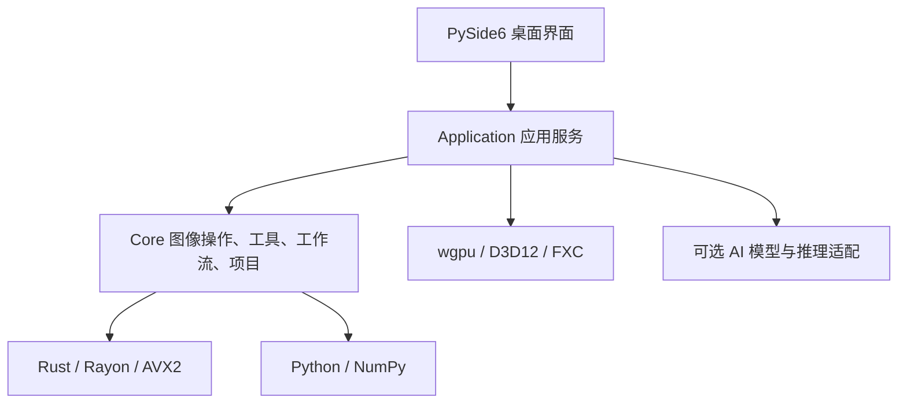

# 架构与原生加速

[简体中文](architecture.md) | [English](architecture.en.md) | [Français](architecture.fr.md)

[返回首页](../README.md)

## 当前分层

桌面宿主采用 Python 与 PySide6。UI 通过应用服务协调核心编辑与项目能力，适用热点由 PyO3／NumPy 接入 Rust 原生模块。

| 目录 | 职责 |
| --- | --- |
| `src/ui` | 窗口、工作区、工具面板、用户交互 |
| `src/application` | 服务装配、任务调度、缓存、模型与运行环境、输出协调 |
| `src/core` | 图像算法、工具契约、工作流执行、项目与历史 |
| `native/ops_accel` | Rust 原生计算，通过 PyO3 与 NumPy 交换数组 |
| `resources` | 翻译、主题、模型和运行环境目录 |

## CPU 计算与兼容性

Rayon 承担多线程任务，AVX2 SIMD 加速适合向量化的运算；线程数仍由执行预算协调。AVX2 能力在原生模块初始化时检测，`OPS_CPU_KERNEL` 在启动进程前设置：

| 值 | 行为 |
| --- | --- |
| 未设置、空值、`auto` | CPU 支持 AVX2 时使用已接入的 AVX2 内核，否则使用通用 Rust 路径 |
| `portable` | 使用通用 Rust 路径，便于兼容性诊断与性能对照 |
| `avx2` | 要求 AVX2；不支持时原生模块初始化报错 |

发行构建保持通用 CPU 目标，AVX2 是可选加速。当前使用分离乘加，FMA 尚未启用。

| 内核组 | 已覆盖的热点 |
| --- | --- |
| `tone` | 白平衡、曝光 v2、自然饱和度与饱和度等逐像素运算 |
| `color_space` | 色彩转换查表、色域压缩 |
| `curves` | 曲线 LUT 应用 |
| `local` | 局部调整中的适用逐像素阶段，结合恒参预计算、权重复用和缓冲复用 |
| `raw` | 解码后 RAW 数据归一化与 f64 色彩矩阵转换 |
| `filter` | 引导滤波中的独立乘积、系数、输出与缩放阶段 |
| `display` | 线性 RGB 到 RGBA8 显示输出，显示空间的面积加权缩小与 Alpha 合成 |
| `remap` | Rayon 并行的美颜三次采样、邻域钳制和预乘 Alpha 处理 |

覆盖范围包含上述操作的适用阶段。指数、幂、三角函数及有顺序依赖的扫描继续采用各自通用实现。RAW 矩阵转换位于解码后的处理链；NEF 等 RAW 的内嵌 JPEG 快速预览已经存在，完整 RAW 解码仍由当前 RAW 加载链处理。

## GPU 的两条路线

统一执行入口固定每次请求的工具链、目标规格、引擎与取消上下文。Windows 图像设备采用 wgpu、D3D12 和 FXC，后台完成硬件筛选、内核编译、小图数值检查及含传输的小链基准。通过资格检查的独显为 A 档、核显为 B 档，其余为 C 档 CPU。探测完成前使用 CPU。每次请求还需通过完整工具能力、颜色规格和目标预算检查。源图显示、通过独立资格的调色及裁切／旋转、形状和套索浮点版本可以组成 GPU 预览链。调色涵盖各处理版本、顺序蒙版、局部参数场、画笔与资产采样；通过完整资格的美颜及 AI 去噪、去模糊、超分可以组成 GPU 预览链。嵌套准备继承父请求引擎，CPU 链显式创建 CPU 模型会话。

工作流先查询目标检查点，命中后跳过上游解码与计算。节点检查点、人脸准备和算子记忆共用在途表与图像资源预算；订阅者独立取消，共享任务采用有效订阅中的最高优先级。美颜复用区域、位移、滤波与独立贡献，调色复用细节前图像和多尺度滤波，裁切复用旋转结果。自动预览按画布物理像素请求，1600 和完整模式沿相同规格传递；加载帧与会话请求匹配时直接交接。

美颜结果由只读底图与矩形补丁组成，补丁携带 RGB、可选 Alpha 和完整参考尺寸。颜色合成与位移累计限制在人脸范围，三次采样保留整图坐标和邻域边界。显示复用对应规格的底图帧，仅重算受补丁影响的显示区域；其他工具在调用边界按需合成输入，临时合成图独立于检查点留存。提交、16 位输出、取色和网格切片读取补丁后的有效像素，资源池按共享根缓冲去重计量。

GPU 图像以只读载体、租约和完成标记交付，结果身份包含设备与内核修订。输入上传和目标视口读回共用在途表；内容窗口保留当前、上一张及下两张，按优先级和预算回收。应用进程查询 DXGI 动态预算，计量活动缓冲、缓存、空闲池、暂存及模型预约；共享分配计量一次。图像提交与现有 DirectML 推理使用同一准入队列协调选定物理适配器，等待和设备执行期间归还 CPU 算力。核显另计共享系统内存和单次提交预估。

设备算子包括 RGB／Alpha 三次变形、自导引与独立导引滤波、分离 Lanczos 缩放、整数形状与多边形栅格、羽化和 Alpha 合成。旋转结果按上游及角度复用，裁框采用共享分配的只读视图。GPU 底图与补丁保留设备内表示，取色和蒙版按实际区域读取当前像素；CPU 物化保留读回租约。GPU 检查点只用于在途共享，跨请求留存由设备缓存预算统一管理。

显存压力先回收可选留存，执行失败后从共同源发起整链 CPU 请求；设备丢失后本次会话停用 GPU。图像计算可选优先 GPU 或仅 CPU，显存缓存可选自动、关闭或自定义；“设置 → 性能与内存”显示 GPU、CPU 的状态和显存占用。Rust 侧的 ONNX Runtime C API 图像适配器使用同一 D3D12 设备与队列、FLOAT32 的 NCHW／NHWC 三或四通道张量，关闭 CPU 算子回退并在设备内完成布局转换；支持单输入、单输出的四维图像模型。模型能力按权重、运行库和设备身份登记，完整数值对照通过后启用；能力、目标或预算不足时整链选择 CPU。图像适配器明确输入与输出的线性或编码颜色身份。通用图像计算基于 [wgpu](https://github.com/gfx-rs/wgpu)，OPS 当前交付平台为 Windows。

设备张量桥还支持单输入、多输出及不同秩的 FLOAT32 张量。原人脸任务包和 YuNet 保留权重转换为固定身份的 ONNX，检测、关键点、三种准备规格、区域和支持域沿设备接口执行。模型、运行库、规格和设备分别登记人脸资格，八类手动对照通过后开放准备接口；美颜另按各项强度、组合、多人、Alpha、裁切和无脸场景登记完整能力。图像和模型张量持续驻留，调度只读取小型控制描述符，最终分析由调用方显式交付。

美颜的 Lab 转换、肤色分布、中位数与协方差、祛斑供体搜索、眼袋统计、贡献合成及区域变形在设备内执行，输出保留只读补丁和全图采样边界。Rust CPU 提供 Lab 与肤色贡献组合。AI 增强保持去噪、去模糊、超分的模型顺序，按原分块与分带边界处理，保留编码颜色混合、线性输出、Lanczos Alpha 和目标布局。透明区域的邻域传播分段提交；候选搜索、统计和资源超限由统一入口恢复整链 CPU。

传统降噪按处理版本保留 sRGB8 中间阶段、亮度／色度滤波和锐化；传统 AI 降噪保留原分块、反射补齐与重叠混合。背景移除的 U2Net 预处理、蒙版归一化、8 位 Lanczos 缩放、边缘模糊和 Alpha 合成在同一设备执行。证件照沿原顺序裁切、分割、合成背景、线性缩放并排版。各工具按实现、模型和设备独立通过数值资格后参与完整 GPU 链。

正式提交、导出和网格输出按完整目标规格选择整链引擎，固定尺寸缩放及补边留在设备内，编码输入在最终边界读回 float32 线性图像。读回或输出适配失败时，从共同源整链恢复 CPU，沿用原有目标保护和发布事务。内核记录冷编译与首次提交耗时；任一美颜内核的 FXC 编译超过 2 秒时尝试静态 DXC，再执行所选设备的数值资格。运行环境显示实际编译器，无法采用 DXC 时诊断保留原因。

## 三个核心系统的演进

| 系统 | 目标职责 | 已有基础 |
| --- | --- | --- |
| Image Engine | 图像操作、色彩与像素契约、CPU／GPU 后端执行 | `photo_engine`、Rust 管线、工具与图像能力契约 |
| Workflow Engine | 编排依赖、任务调度、取消与结果交付 | `WorkflowGraph`、`WorkflowExecutor`、单图处理链 |
| Project Model | 编辑状态、版本、历史、资源引用与持久化 | `.opsproj`、项目文档、资源与恢复存储 |

CPU 与 GPU 后端共享图像操作的参数、版本、色彩空间、Alpha 和位深契约；内存布局、上传下载与执行资源由各后端管理。先稳定少量公共操作，再按真实负载扩展，保留无 AVX2 的 CPU 路径。

## Everything is Plugin

内置与受信第三方工具通过同一工具描述接入，包含参数、图像与空间、资源、取消和缓存策略。图像插件接口 `image/1` 传递线性 float32 RGB、独立 Alpha、参考尺寸和具名只读辅助产物；旧 PNG 文件协议通过 sRGB8 适配器接入。项目文档版本 4 固定插件包摘要、实现与接口版本。确定性与种子插件按完整依赖复用，其余插件在一次请求内交付独立结果。接口和样例见[图像插件](image-plugins.md)。安装管理、完整外部 Agent 入口、节点工作流与系统级插件隔离按[路线图](roadmap.md)推进。

自动画布在放大时请求当前可见区域。基础点调色、无旋转裁切、形状裁切、套索和暗角扩展支持区域计算；局部统计、滤波、人脸及模型等完整域计算保留原参考尺寸与准备结果，再交付所需区域。区域身份与代理、完整输出分别管理，平移后更新对应区域。AI 增强、背景移除、传统降噪和证件照按模型输入及参数依赖复用中间结果。

关键契约：[工具](../src/core/contracts/tools.py)、[工作流](../src/core/contracts/workflow.py)、[执行器](../src/core/workflow/executor.py)、[项目](../src/core/project)、[内置工具模块](../src/application/tool_modules.py)。
