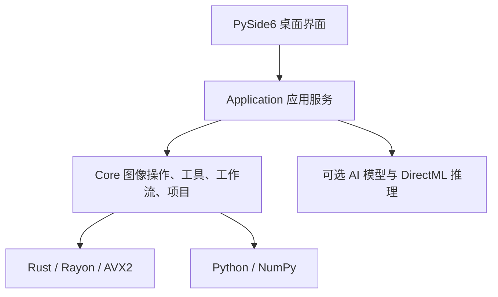

# 架构与原生加速

[简体中文](architecture.md) | [English](architecture.en.md) | [Français](architecture.fr.md)

[返回首页](../README.md)

## 当前分层

桌面宿主采用 Python 与 PySide6。UI 通过应用服务协调核心编辑与项目能力，适用热点由 PyO3／NumPy 接入 Rust 原生模块。

| 目录 | 职责 |
| --- | --- |
| `src/ui` | 窗口、工作区、工具面板、用户交互 |
| `src/application` | 服务装配、任务调度、缓存、模型与运行环境、输出协调 |
| `src/core` | 图像算法、工具契约、工作流执行、项目与历史 |
| `native/ops_accel` | Rust 原生计算，通过 PyO3 与 NumPy 交换数组 |
| `resources` | 翻译、主题、模型和运行环境目录 |

## CPU 计算与兼容性

Rayon 承担多线程任务，AVX2 SIMD 加速适合向量化的运算；线程数仍由执行预算协调。AVX2 能力在原生模块初始化时检测，`OPS_CPU_KERNEL` 在启动进程前设置：

| 值 | 行为 |
| --- | --- |
| 未设置、空值、`auto` | CPU 支持 AVX2 时使用已接入的 AVX2 内核，否则使用通用 Rust 路径 |
| `portable` | 使用通用 Rust 路径，便于兼容性诊断与性能对照 |
| `avx2` | 要求 AVX2；不支持时原生模块初始化报错 |

发行构建保持通用 CPU 目标，AVX2 是可选加速。当前使用分离乘加，FMA 尚未启用。

| 内核组 | 已覆盖的热点 |
| --- | --- |
| `tone` | 白平衡、曝光 v2、自然饱和度与饱和度等逐像素运算 |
| `color_space` | 色彩转换查表、色域压缩 |
| `curves` | 曲线 LUT 应用 |
| `local` | 局部调整中的适用逐像素阶段，结合恒参预计算、权重复用和缓冲复用 |
| `raw` | 解码后 RAW 数据归一化与 f64 色彩矩阵转换 |
| `filter` | 引导滤波中的独立乘积、系数、输出与缩放阶段 |
| `display` | 线性 RGB 到 RGBA8 显示输出 |

覆盖范围包含上述操作的适用阶段。指数、幂、三角函数及有顺序依赖的扫描继续采用各自通用实现。RAW 矩阵转换位于解码后的处理链；NEF 等 RAW 的内嵌 JPEG 快速预览已经存在，完整 RAW 解码仍由当前 RAW 加载链处理。

## GPU 的两条路线

当前可选 DirectML 运行环境服务于 AI 模型推理。通用图像算子的 GPU 后端属于规划，候选方案为 [wgpu](https://github.com/gfx-rs/wgpu)，其原生后端覆盖 D3D12、Vulkan 和 Metal 等。OPS 的交付平台目前为 Windows，后续 GPU 技术选型以本项目验证结果确定。

## 三个核心系统的演进

| 系统 | 目标职责 | 已有基础 |
| --- | --- | --- |
| Image Engine | 图像操作、色彩与像素契约、CPU／GPU 后端执行 | `photo_engine`、Rust 管线、工具与图像能力契约 |
| Workflow Engine | 编排依赖、任务调度、取消与结果交付 | `WorkflowGraph`、`WorkflowExecutor`、单图处理链 |
| Project Model | 编辑状态、版本、历史、资源引用与持久化 | `.opsproj`、项目文档、资源与恢复存储 |

CPU 与规划中的 GPU 后端共享图像操作的参数、版本、色彩空间、Alpha 和位深契约；内存布局、上传下载与执行资源由各后端管理。先稳定少量公共操作，再按真实负载扩展，保留无 AVX2 的 CPU 路径。

## Everything is Plugin

长期目标是让内置与第三方工具沿统一声明接入，供界面、助手、工作流与外部 Agent 发现和调用。当前已有工具注册、版本及资源声明、单图工作流和受信插件子进程执行基础。可安装的第三方插件 SDK、完整外部 Agent 入口、节点工作流与系统级插件隔离按[路线图](roadmap.md)推进。

关键契约：[工具](../src/core/contracts/tools.py)、[工作流](../src/core/contracts/workflow.py)、[执行器](../src/core/workflow/executor.py)、[项目](../src/core/project)、[内置工具模块](../src/application/tool_modules.py)。
