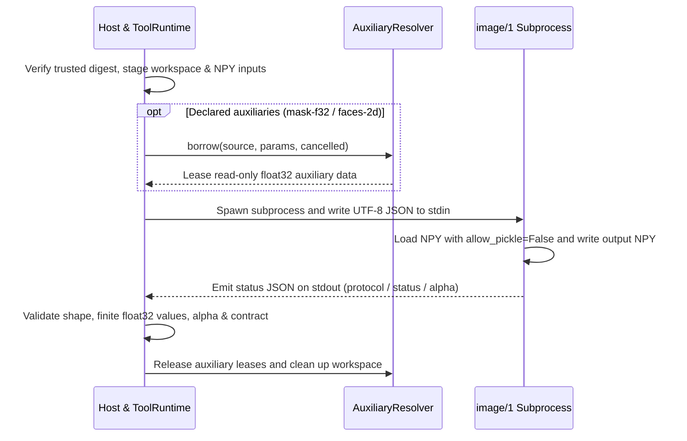

# Image Plugins

[简体中文](image-plugins.md) | [English](image-plugins.en.md) | [Français](image-plugins.fr.md)

[Back to Home](../README.en.md) · [Documentation](README.en.md)

OpenPictureStudio integrates trusted Python image plugins through the versioned `image/1` subprocess protocol, letting external algorithms participate in workflow scheduling, linear color management, caching, and `.opsproj` project dependency tracking.

## Registration and Versioning

After auditing a package's source and SHA-256 digest, register it with `ToolRuntime.register_image_plugin(directory, trusted_hash=...)`. The runtime isolates a snapshot of the package and exposes standard `ToolReference` entries:

```python
from pathlib import Path
from src.application.plugin_service import PluginService
from src.application.tool_runtime import ToolRuntime
from src.core.contracts import WorkflowGraph, WorkflowNode

directory = Path("resources/image_plugins/org.openpicturestudio.examples")
manifest, entrypoint, digest = PluginService.inspect(directory)
# Review files and digest, then pass the approved digest:
runtime = ToolRuntime()
references = runtime.register_image_plugin(directory, trusted_hash=digest)
reference = next(item for item in references if item.tool_id.endswith(".exposure"))
workflow = WorkflowGraph(nodes=(WorkflowNode("exposure", "tool", reference.to_params({"stops": 0.5})),))
```

- **Version pinning and project files:** Parameters, implementation versions, and package digests are saved with workflows in `.opsproj` schema 4. If a plugin is later removed, saved parameters and existing renders remain readable while recomputation accurately reports the missing package; restoring the exact version resumes matching execution.
- **Unloading:** Call `unregister_image_plugin(digest)` to remove active registrations and cancel in-flight requests from prior generations.

## Protocol Sequence



## Package Manifest and Image Contract

### Manifest Declaration (`plugin.json`)

Packages declare `manifest_version: "2.0"`, `runtime: "subprocess_python"`, and a publisher-scoped `plugin_id`. Each entry under `declared_nodes` specifies:

| Field | Description |
| --- | --- |
| `node_id`, `contract_version` | Node identifier and contract (`"image/1"`) |
| `params_version`, `parameters` | Parameter schema version and typed fields (`integer`, `number`, `boolean`, `string`, `array`) |
| `image` | Color/pixel rules (`linear_srgb`, `float32`), alpha preservation/transform, and geometry sizing |
| `supports_proxy` | Whether the algorithm and coordinate space support proxy scaling |
| `is_deterministic`, `cache` | Determinism flag and reuse policy (`deterministic`, `seeded`, or `never`) |
| `seed_parameter` | Integer parameter name used when `cache` is `seeded` |
| `external_state` | Pinned external state version included in cache identity |
| `auxiliary` | Required named auxiliary data (`name`, `capability`, `type`, `version`) |
| `timeout_sec` | Execution timeout limit (`1–300` seconds) |
| `resources` | Relative paths and SHA-256 digests of bundled weights or assets |

> **Warning:** Packages declaring network permission are rejected by the current host. Compute threads and working memory are governed by the host budget, while subprocesses inherit the active OS user permissions.

### Runtime Input and Output

Version 1 passes one primary image input and output. Standard input receives UTF-8 JSON containing `protocol: "image/1"`, `api_version: 1`, `node_id`, `params`, `input`, `output`, and `auxiliary`:

- **Pixel transport:** Primary RGB data uses `H×W×3` `float32` NPY arrays, with optional straight alpha in a separate `H×W` `float32` NPY file. `input` describes actual and full reference sizes, proxy flags, D65 white point, linear `sRGB` primaries, and alpha mode. Always load NPY files with `allow_pickle=False`.
- **Output status and validation:** After writing `output.pixels` and optional `output.alpha`, write the status JSON line to standard output:

```json
{"protocol":"image/1","status":"ok","alpha":true}
```

The host validates dimensions, `float32` dtype, finite values, alpha bounds, and declared alpha/geometry rules before accepting results. Cancellation and timeout terminate the subprocess and reclaim temporary files.

## Auxiliaries, Caching, and Regional Evaluation

### Read-Only Auxiliary Data

Hosts supply `AuxiliaryResolver` instances via the `auxiliaries` registration argument, exposing read-only `float32` arrays with explicit type, capability, semantic version, stable identity, and reference size:

| Auxiliary Type | Array Shape & Semantics |
| --- | --- |
| `mask-f32` | `H×W` weights in `0–1` matching input dimensions |
| `faces-2d` | Normalized `faces × landmarks × 2` coordinates |

Resolvers manage buffer leases and memory budgets, feeding model or asset identities into upstream dependencies. Use `cache: "never"` if auxiliary data depends on continuously changing external state.

### Caching Policies and Regional Tools

- **Cache policies:** `deterministic` and `seeded` reuse outputs across requests when inputs, parameters, package digests, resources, auxiliaries, and external state match; `never` disables cross-request reuse for the node and downstream nodes and enforces full input (auto canvas retains the displayed result during pan/zoom).
- **Regional evaluation:** `ToolDefinition` exposes `output_size`, `region_input`, `execute_region`, and optional `region_memory` for visible-viewport evaluation when zoomed in (demonstrated by `src.core.tools.vignette.definition()`). Nonlocal operators continue computing over the full domain before slicing the requested region.

> **Compatibility:** Legacy `manifest_version: "1.0"`, `contract_version: "3.4.0"` file plugins continue running via the legacy sRGB8 PNG adapter with full auditing, output validation, and process cleanup.

Complete working examples are provided in [resources/image_plugins/org.openpicturestudio.examples](../resources/image_plugins/org.openpicturestudio.examples), covering deterministic exposure, fixed-seed film grain, and uncached random grain.

## Related Documentation

- [Architecture and Native Acceleration](architecture.en.md)
- [Development and Building](building.en.md)
- [Roadmap](roadmap.en.md)
