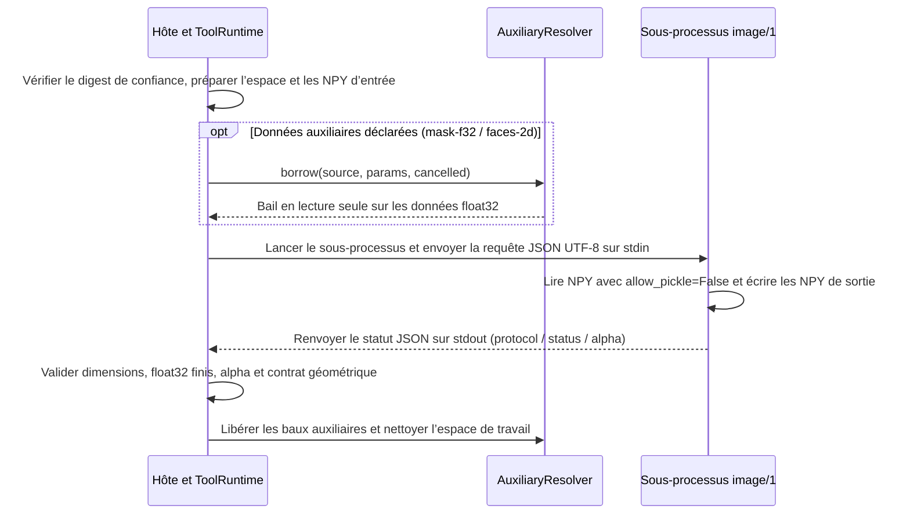

# Plug-ins d’image

[简体中文](image-plugins.md) | [English](image-plugins.en.md) | [Français](image-plugins.fr.md)

[Retour à l’accueil](../README.fr.md) · [Documentation](README.fr.md)

OpenPictureStudio intègre des plug-ins d’image Python de confiance via le protocole versionné en sous-processus `image/1`, permettant à des algorithmes tiers de profiter de l’ordonnancement du flux, de la colorimétrie linéaire, du cache et du suivi des dépendances `.opsproj`.

## Enregistrement et versions

Après audit du paquet et de son empreinte SHA-256, enregistrez-le avec `ToolRuntime.register_image_plugin(directory, trusted_hash=...)`. Le moteur conserve un instantané isolé du paquet et expose des références standard `ToolReference` :

```python
from pathlib import Path
from src.application.plugin_service import PluginService
from src.application.tool_runtime import ToolRuntime
from src.core.contracts import WorkflowGraph, WorkflowNode

directory = Path("resources/image_plugins/org.openpicturestudio.examples")
manifest, entrypoint, digest = PluginService.inspect(directory)
# Vérifiez les fichiers et le digest, puis passez l'empreinte approuvée :
runtime = ToolRuntime()
references = runtime.register_image_plugin(directory, trusted_hash=digest)
reference = next(item for item in references if item.tool_id.endswith(".exposure"))
workflow = WorkflowGraph(nodes=(WorkflowNode("exposure", "tool", reference.to_params({"stops": 0.5})),))
```

- **Figement des versions et projets :** paramètres, versions d’implémentation et empreintes de paquets sont enregistrés dans le schéma 4 de `.opsproj`. Si le plug-in est retiré ensuite, les paramètres et rendus déjà stockés restent lisibles tandis qu’un recalcul signale l’absence ; réinstaller la même version rétablit l’exécution exacte.
- **Désenregistrement :** appelez `unregister_image_plugin(digest)` pour retirer le plug-in actif et annuler les requêtes en vol des générations précédentes.

## Séquence du protocole



## Manifeste et contrat d’image

### Déclaration du paquet (`plugin.json`)

Le manifeste déclare `manifest_version: "2.0"`, `runtime: "subprocess_python"` et un `plugin_id` préfixé par l’éditeur. Chaque entrée de `declared_nodes` précise :

| Champ | Description |
| --- | --- |
| `node_id`, `contract_version` | Identifiant du nœud et contrat (`"image/1"`) |
| `params_version`, `parameters` | Version et schéma typé des paramètres (`integer`, `number`, `boolean`, `string`, `array`) |
| `image` | Contrat couleur/pixels (`linear_srgb`, `float32`), préservation ou transformation alpha et géométrie |
| `supports_proxy` | Indique si l’algorithme et ses coordonnées gèrent l’aperçu proxy |
| `is_deterministic`, `cache` | Déterminisme et stratégie de cache (`deterministic`, `seeded` ou `never`) |
| `seed_parameter` | Nom du paramètre entier utilisé avec la stratégie `seeded` |
| `external_state` | Version d’état externe stable incluse dans l’identité de cache |
| `auxiliary` | Données auxiliaires nommées requises (`name`, `capability`, `type`, `version`) |
| `timeout_sec` | Délai d’exécution maximal autorisé (`1–300` secondes) |
| `resources` | Chemins relatifs et empreintes SHA-256 des poids ou ressources embarqués |

> **Attention :** L’hôte actuel refuse d’enregistrer tout paquet déclarant une permission réseau. Les threads de calcul et la mémoire de travail sont régis par le budget de l’hôte, et le sous-processus hérite des permissions utilisateur du système.

### Entrées et sorties d’exécution

La version 1 transmet une image principale en entrée et en sortie. L’entrée standard reçoit un JSON UTF-8 contenant `protocol: "image/1"`, `api_version: 1`, `node_id`, `params`, `input`, `output` et `auxiliary` :

- **Transport des pixels :** l’image RVB principale utilise un fichier NPY `float32` `H×W×3`, avec canal alpha droit séparé en NPY `float32` `H×W`. `input` fournit dimensions réelles et de référence, état proxy, point blanc D65, primaires `sRGB` linéaires et mode alpha. Chargez toujours les tableaux avec `allow_pickle=False`.
- **Statut de retour et validation :** après avoir écrit `output.pixels` et l’éventuel `output.alpha`, imprimez sur la sortie standard :

```json
{"protocol":"image/1","status":"ok","alpha":true}
```

L’hôte contrôle dimensions, type `float32`, valeurs finies, bornes alpha ainsi que le comportement alpha/géométrique déclaré avant d’accepter le résultat. Annulation et délai dépassé arrêtent le sous-processus et nettoient les fichiers temporaires.

## Données auxiliaires, cache et évaluation par zones

### Données auxiliaires en lecture seule

L’hôte fournit des résolveurs `AuxiliaryResolver` via le paramètre `auxiliaries` à l’enregistrement, délivrant des tableaux `float32` en lecture seule dotés de type, capacité, version sémantique, identité stable et dimensions de référence :

| Type auxiliaire | Forme et sémantique |
| --- | --- |
| `mask-f32` | Poids `H×W` dans `0–1` aux dimensions de l’entrée |
| `faces-2d` | Coordonnées normalisées `visages × points × 2` |

Les résolveurs gèrent les baux et la comptabilité mémoire, et inscrivent les identités de modèles ou ressources dans les dépendances d’exécution. Utilisez `cache: "never"` lorsque les données auxiliaires dépendent d’un état externe mouvant.

### Stratégies de cache et outils régionaux

- **Stratégies de réutilisation :** `deterministic` et `seeded` réutilisent les résultats entre requêtes tant que l’entrée, les paramètres, les empreintes, les ressources, les données auxiliaires et l’état externe coïncident ; `never` désactive la réutilisation inter-requêtes pour le nœud et ses descendants en imposant l’entrée complète (le canevas auto conserve l’image affichée lors du zoom et du déplacement).
- **Évaluation par zones :** `ToolDefinition` expose `output_size`, `region_input`, `execute_region` et l’optionnel `region_memory` pour ne calculer que la zone visible du canevas au zoom (illustré par `src.core.tools.vignette.definition()`). Les opérateurs non locaux continuent d’évaluer le domaine complet avant découpe.

> **Compatibilité :** Les anciens plug-ins de manifeste `1.0` et contrat `3.4.0` restent pris en charge via l’adaptateur PNG sRGB8 existant avec audit, validation des sorties et nettoyage des processus.

Des exemples complets figurent dans [resources/image_plugins/org.openpicturestudio.examples](../resources/image_plugins/org.openpicturestudio.examples) (exposition déterministe, grain à graine fixe et grain aléatoire non mis en cache).

## Documentation associée

- [Architecture et accélération native](architecture.fr.md)
- [Développement et compilation](building.fr.md)
- [Feuille de route](roadmap.fr.md)
