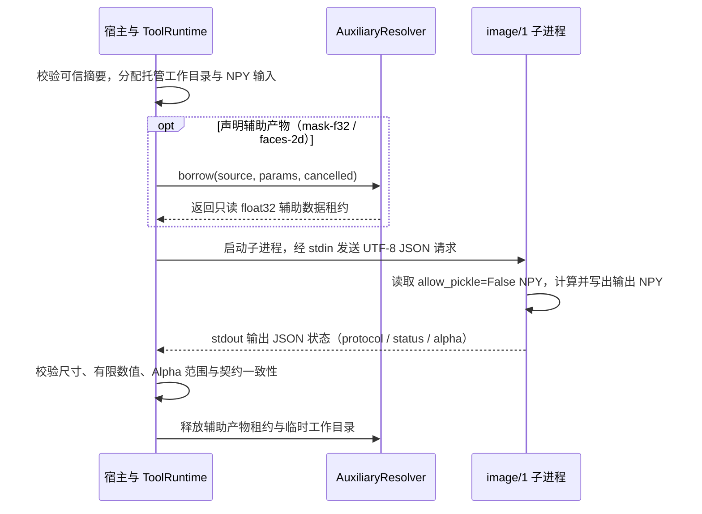

# 图像插件接口

[简体中文](image-plugins.md) | [English](image-plugins.en.md) | [Français](image-plugins.fr.md)

[返回首页](../README.md) · [文档目录](README.md)

OpenPictureStudio 通过版本化的 `image/1` 子进程协议接入受信 Python 图像插件，让第三方算法共享宿主的工作流调度、线性色彩空间、缓存复用与 `.opsproj` 项目依赖管理。

## 注册与版本

受信 Python 插件经审核包内容与 SHA-256 摘要后，通过 `ToolRuntime.register_image_plugin(directory, trusted_hash=...)` 注册。运行时保存插件包的独立快照，并以标准 `ToolReference` 接入工作流：

```python
from pathlib import Path
from src.application.plugin_service import PluginService
from src.application.tool_runtime import ToolRuntime
from src.core.contracts import WorkflowGraph, WorkflowNode

directory = Path("resources/image_plugins/org.openpicturestudio.examples")
manifest, entrypoint, digest = PluginService.inspect(directory)
# 审核文件及 digest 后，传入已认可的摘要。
runtime = ToolRuntime()
references = runtime.register_image_plugin(directory, trusted_hash=digest)
reference = next(item for item in references if item.tool_id.endswith(".exposure"))
workflow = WorkflowGraph(nodes=(WorkflowNode("exposure", "tool", reference.to_params({"stops": 0.5})),))
```

- **版本固定与项目兼容**：参数、实现版本及包摘要随工作流写入项目文件（`.opsproj` schema 4 同时登记插件依赖清单）。卸载或移除插件后，项目参数与已有导出记录仍可读取，重新计算时准确提示缺失实现；恢复同版本包即可按原语义继续计算。
- **动态卸载**：调用 `unregister_image_plugin(digest)` 移除注册状态并自动取消旧代在途请求。

## 协议交互时序



## 包清单与图像契约

### 清单声明（`plugin.json`）

清单须声明 `manifest_version: "2.0"`、`runtime: "subprocess_python"` 与带发布者命名空间的 `plugin_id`。每个 `declared_nodes` 条目支持以下字段：

| 字段 | 说明 |
| --- | --- |
| `node_id`、`contract_version` | 节点标识及协议版本（固定 `"image/1"`） |
| `params_version`、`parameters` | 参数版本号及字段定义（支持 `integer`、`number`、`boolean`、`string`、`array`） |
| `image` | 规定 `linear_srgb`、`float32`、Alpha 保留或变换规则、几何保留或目标尺寸 |
| `supports_proxy` | 节点算法与坐标语义是否支持代理尺寸预览 |
| `is_deterministic`、`cache` | 确定性标记及复用策略（`deterministic`、`seeded` 或 `never`） |
| `seed_parameter` | 配合 `seeded` 策略使用的整数种子参数名 |
| `external_state` | 参与缓存键计算的外部依赖状态版本 |
| `auxiliary` | 所需的具名辅助数据（名称、能力、类型与版本） |
| `timeout_sec` | 单次执行超时限制（1–300 秒） |
| `resources` | 包内权重或数据文件的相对路径与 SHA-256 列表 |

> **注意**：声明了网络权限的插件包将被当前宿主拒绝注册。宿主通过统一预算调度 CPU 线程与内存，子进程运行期间继承当前用户操作系统权限。

### 运行时输入输出规范

第一版协议采用单主图像输入与输出。标准输入为 UTF-8 JSON，包含 `protocol: "image/1"`、`api_version: 1`、`node_id`、`params`、`input`、`output` 及 `auxiliary`：

- **像素数据格式**：主图像为 `H×W×3` 的 `float32` NPY，Alpha 通道为独立 `H×W` `float32` NPY；`input` 同步携带实际尺寸、完整参考尺寸、代理标记、D65 白点、线性 `sRGB` 色域及直通 Alpha 说明（读取 NPY 时强制启用 `allow_pickle=False`）。
- **状态回传与契约校验**：结果写入指定的 `output.pixels` 与可选 `output.alpha` 后，向标准输出打印：

```json
{"protocol":"image/1","status":"ok","alpha":true}
```

宿主在接收结果前严格校验输出尺寸、数据类型、非 NaN／有限数值、Alpha 边界及声明的几何与透明度契约；执行全程响应宿主取消与超时指令并在结束后回收进程资源。

## 辅助产物、缓存与区域扩展

### 只读辅助产物

宿主通过注册参数 `auxiliaries` 提供 `AuxiliaryResolver`，按能力名称向插件借出只读 `float32` 数组（包含类型、能力、版本、稳定身份与参考尺寸）：

| 辅助数据类型 | 数组形态与语义 |
| --- | --- |
| `mask-f32` | 与当前输入同尺寸的 `H×W` 权重图，值域 `0–1` |
| `faces-2d` | `人脸数 × 关键点数 × 2` 的归一化人脸坐标 |

辅助解析器负责产物租约及内存预算，并将模型或资源版本纳入上游执行依赖。若辅助数据依赖持续变化的外部状态，节点应配置 `cache: "never"`。

### 缓存策略与区域扩展

- **三种复用策略**：`deterministic` 与 `seeded` 在输入、参数、包摘要、资源及外部状态全部一致时跨请求复用；`never` 禁用该节点及下游跨请求复用并强制使用完整输入（自动画布保留当前已显示结果用于平移缩放）。
- **区域扩展与演练工具**：`ToolDefinition` 通过 `output_size`、`region_input`、`execute_region` 与可选 `region_memory` 支持画布放大时的按需可见区域求值（如 `src.core.tools.vignette.definition()`）；非局部算子维持完整参考域计算后再按区域交付结果。

> **兼容说明**：旧版 `manifest_version: "1.0"`、`contract_version: "3.4.0"` 文件插件仍通过既有适配器运行，在宿主持有的 sRGB8 PNG 转换边界上保持原有审计、校验与进程回收机制。

完整样例插件见 [resources/image_plugins/org.openpicturestudio.examples](../resources/image_plugins/org.openpicturestudio.examples)，涵盖确定性曝光、固定种子颗粒与每次随机生成颗粒三种典型模式。

## 相关文档

- [架构与原生加速](architecture.md)
- [开发与构建](building.md)
- [发展路线图](roadmap.md)
