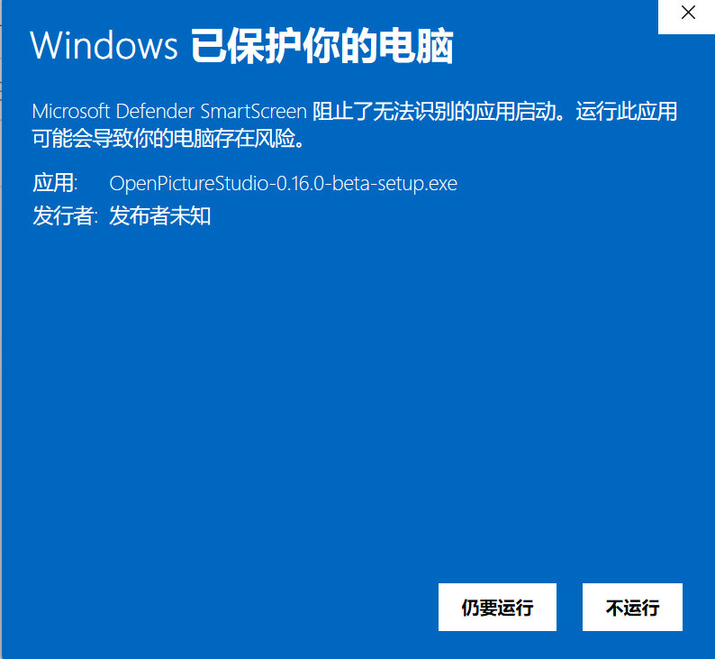
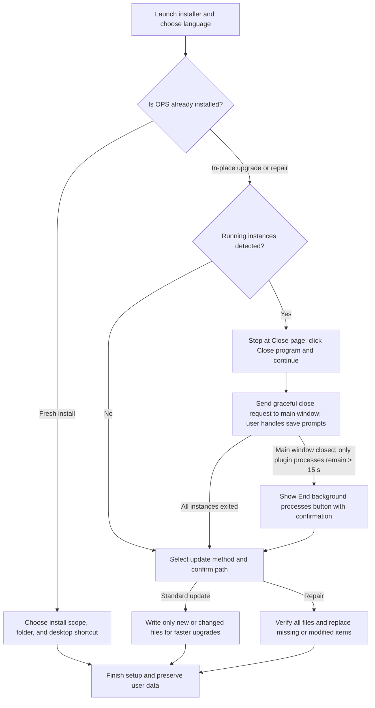

# Installation and Upgrades

[简体中文](installation.md) | [English](installation.en.md) | [Français](installation.fr.md)

[Back to Home](../README.en.md) · [Documentation](README.en.md)

OpenPictureStudio ships a standalone installer for Windows 10/11 (64-bit) with the desktop host and native compute runtime included. No separate Python or Rust installation is required.

## Download and Standard Install

1. Open the [latest release](https://github.com/KpTanl/OpenPictureStudio/releases/latest) and download `OpenPictureStudio-<version>-setup.exe` along with its matching `.exe.sha256` file under **Assets**.
2. Verify the installer's SHA256, double-click the EXE, and choose **简体中文**, **English**, or **Français** in the setup wizard.
   - **Fresh installation:** Defaults to your Windows display language; lets you choose install scope (current user or all users), installation folder, and desktop shortcut.
   - **In-place upgrade:** Defaults to your previous setup language and installation directory, while still letting you switch languages; Start menu uninstall shortcuts follow the chosen language.
3. Launch the app to browse and edit photos right away. Local AI models and the optional DirectML inference runtime can be downloaded on demand in Settings.

<details>
<summary>How to verify the SHA256 checksum</summary>

Open PowerShell in the download directory and run the commands below, replacing `<version>` with the actual version string:

```powershell
Get-FileHash -LiteralPath '.\OpenPictureStudio-<version>-setup.exe' -Algorithm SHA256
Get-Content -LiteralPath '.\OpenPictureStudio-<version>-setup.exe.sha256'
```

The 64-character hexadecimal hash printed by the first command should match the value at the start of the second command's output. Only download installers and checksums from this repository's Releases page.

</details>

## Handling the Windows SmartScreen Prompt

> **Note:** The current Windows installer is not code-signed, so the first run may trigger Windows SmartScreen ("Windows protected your PC").

Once you have verified that the file comes from [this repository's Releases](https://github.com/KpTanl/OpenPictureStudio/releases/latest) and matches its SHA256 checksum, click **"More info" → "Run anyway"** to proceed.

<details>
<summary>View an example Windows SmartScreen prompt</summary>



The example screenshot shows version 0.16.0; the filename updates with each release. If "Run anyway" is unavailable on your device, follow your system or organization policy.

</details>

## Automated Download and Install via PowerShell

Run the script below in a regular PowerShell window to fetch the latest release from GitHub Releases, verify its SHA256, and open the setup wizard. It works even if OPS is still running, as the wizard prompts to close running instances before updating files.

<details>
<summary>Expand PowerShell install command (compatible with Windows PowerShell 5.1 and PowerShell 7)</summary>

```powershell
& {
    $ErrorActionPreference = 'Stop'
    $releasePage = 'https://github.com/KpTanl/OpenPictureStudio/releases/latest'
    try {
        $release = Invoke-RestMethod -Uri 'https://api.github.com/repos/KpTanl/OpenPictureStudio/releases/latest' -Headers @{ 'User-Agent' = 'OpenPictureStudio-Install' } -TimeoutSec 30
        $name = 'OpenPictureStudio-{0}-setup.exe' -f ($release.tag_name -replace '^v', '')
        $installer = @($release.assets | Where-Object { $_.name -ceq $name })
        $checksum = @($release.assets | Where-Object { $_.name -ceq "$name.sha256" })
        if ($installer.Count -ne 1 -or $checksum.Count -ne 1) { throw 'The release does not contain exactly one matching installer and checksum file.' }

        $folder = Join-Path ([IO.Path]::GetTempPath()) ('OpenPictureStudio-' + [Guid]::NewGuid().ToString('N'))
        New-Item -ItemType Directory -Path $folder | Out-Null
        Write-Host ('Download folder: ' + $folder)
        $exe = Join-Path $folder $name
        $sha = Join-Path $folder "$name.sha256"
        Invoke-WebRequest -UseBasicParsing -Uri $installer[0].browser_download_url -OutFile $exe -TimeoutSec 600
        Invoke-WebRequest -UseBasicParsing -Uri $checksum[0].browser_download_url -OutFile $sha -TimeoutSec 30

        $line = (Get-Content -LiteralPath $sha -Raw).Trim()
        if ($line -notmatch '^(?<hash>[a-fA-F0-9]{64})[ \t]+\*?(?<file>[^\r\n]+)$') { throw 'The checksum file is malformed, or it belongs to a different installer.' }
        $expected = $Matches['hash']
        if ($Matches['file'] -cne $name) { throw 'The checksum file is malformed, or it belongs to a different installer.' }
        if ((Get-FileHash -LiteralPath $exe -Algorithm SHA256).Hash -ine $expected) { throw 'SHA256 does not match. The installer was not started.' }

        Write-Host 'SHA256 verified. Opening the setup wizard...'
        $start = New-Object System.Diagnostics.ProcessStartInfo
        $start.FileName = $exe
        $start.WorkingDirectory = $folder
        $start.UseShellExecute = $false
        $start.Arguments = '/NORESTART'
        $process = [System.Diagnostics.Process]::Start($start)
        $process.WaitForExit()
        switch ($process.ExitCode) {
            0 { Write-Host 'Installation complete.' }
            { $_ -in 2, 5 } { Write-Host 'Installation was canceled or aborted.' }
            default { throw ('Installation did not finish. Exit code: ' + $process.ExitCode) }
        }
    } catch {
        throw ("Could not complete the installation. Release page: $releasePage`n" + $_.Exception.Message)
    }
}
```

</details>

## Upgrading in Place and Repairing

New releases install directly over an existing installation without uninstalling first. All settings, custom data directories, AI models, and `.opsproj` projects are preserved.



### Closing Running Instances Gracefully

When an instance from the target directory is running, the wizard stops on the close page. Clicking **"Close program and continue"** sends a graceful close request to each main window so unsaved edits follow normal save prompts; the installer never force-terminates the main application. Only if the main window has exited and plugin background processes linger for more than 15 seconds does the wizard show an **"End background processes"** button with a confirmation step.

### Update Modes and Folder Conflicts

| Mode | When to Use | Verification & Write Behavior |
| --- | --- | --- |
| **Standard update** | Routine upgrades | Skips unchanged files and writes only modified or missing files; prompts if a program file was manually altered |
| **Repair** | Same-version repairs, interrupted installs, or damaged files | Verifies every file listed in the install manifest and replaces missing, corrupted, or altered files |

> **Early beta builds:** Older beta builds without an install manifest require backing up your data and manually uninstalling first if the original program files are still present. If the old install folder has been deleted or is completely empty, you can install directly. Follow the wizard prompts if a directory conflict is reported.

## Version Update Checks

Installed builds check for new releases automatically at most once every 24 hours. You can disable this in **Settings → General** or check manually in **About**. When an update is found, OPS opens the download page for you to download and install manually. The request sends only the app version and standard HTTP headers to GitHub.

## UI Components and Licensing

Starting with 0.17.0, the UI layer migrated from PyQt6 to PySide6. All required runtime components are bundled inside the full installer, so upgrading in place works directly without installing PySide6, Shiboken, or Qt separately.

PyQt6 is offered under GPLv3 and a commercial license, whereas PySide6 provides open-source options such as LGPLv3 alongside commercial licensing. Original OPS source code remains under the MIT License, while third-party UI libraries, dependencies, and models follow their respective licenses with notices and source information included in the distribution.

## Related Documentation

- [Licensing and Third-Party Components](licensing.en.md#migrating-from-pyqt6-to-pyside6)
- [AI Services and Privacy](ai-services.en.md)
- [System Requirements and Performance](performance.en.md)
