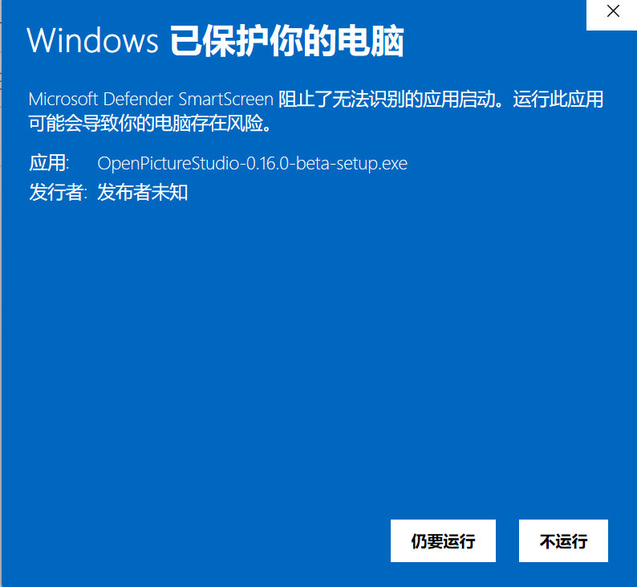
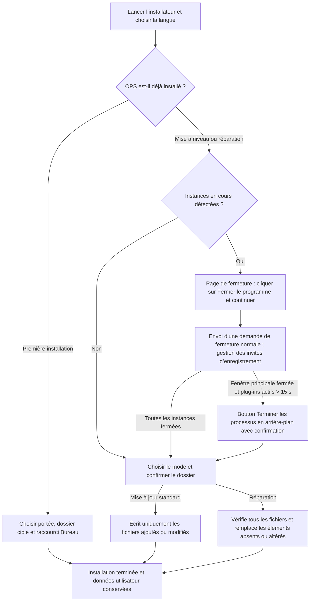

# Installation et mises à niveau

[简体中文](installation.md) | [English](installation.en.md) | [Français](installation.fr.md)

[Retour à l’accueil](../README.fr.md) · [Documentation](README.fr.md)

OpenPictureStudio fournit un installateur autonome pour Windows 10/11 (64 bits) incluant l’application de bureau et l’environnement de calcul natif, sans nécessiter d’installation séparée de Python ou Rust.

## Téléchargement et installation standard

1. Ouvrez la [dernière version](https://github.com/KpTanl/OpenPictureStudio/releases/latest) et téléchargez `OpenPictureStudio-<version>-setup.exe` ainsi que le fichier `.exe.sha256` portant le même nom dans **Assets**.
2. Vérifiez l’empreinte SHA256, double-cliquez sur l’exécutable puis choisissez **简体中文**, **English** ou **Français** dans l’assistant.
   - **Première installation :** sélectionne par défaut la langue d’affichage de Windows ; permet de choisir la portée (utilisateur courant ou tous les utilisateurs), le dossier d’installation et le raccourci sur le Bureau.
   - **Mise à niveau par-dessus :** reprend par défaut la langue et le dossier d’installation précédents tout en permettant de changer de langue ; le raccourci de désinstallation du menu Démarrer suit la langue choisie.
3. Lancez le programme pour parcourir et retoucher vos photos. Les modèles IA locaux et le moteur d’inférence DirectML facultatif se téléchargent à la demande depuis les paramètres.

<details>
<summary>Comment vérifier l’empreinte SHA256</summary>

Ouvrez PowerShell dans le dossier de téléchargement et exécutez les commandes ci-dessous en remplaçant `<version>` par la version réelle :

```powershell
Get-FileHash -LiteralPath '.\OpenPictureStudio-<version>-setup.exe' -Algorithm SHA256
Get-Content -LiteralPath '.\OpenPictureStudio-<version>-setup.exe.sha256'
```

L’empreinte hexadécimale de 64 caractères renvoyée par la première commande doit correspondre exactement à la valeur en début de sortie de la seconde. Téléchargez toujours l’installateur et le fichier de contrôle depuis les Releases de ce dépôt.

</details>

## Avertissement Windows SmartScreen

> **Remarque :** L’installateur Windows actuel n’est pas signé numériquement ; au premier lancement, Windows SmartScreen peut afficher « Windows a protégé votre ordinateur ».

Après avoir vérifié que le fichier provient bien des [Releases de ce dépôt](https://github.com/KpTanl/OpenPictureStudio/releases/latest) et que son SHA256 correspond, cliquez sur **« Informations complémentaires » → « Exécuter quand même »** pour continuer.

<details>
<summary>Exemple de fenêtre Windows SmartScreen</summary>



La capture d’exemple montre la version 0.16.0 ; le nom du fichier change à chaque version. Si votre appareil ne propose pas « Exécuter quand même », suivez les instructions du système ou la politique de votre organisation.

</details>

## Télécharger et installer avec PowerShell

Exécutez le script ci-dessous dans une console PowerShell standard pour récupérer la dernière version depuis GitHub Releases, vérifier son SHA256 et lancer l’assistant d’installation. Vous pouvez aussi le lancer pendant qu’OPS est ouvert : l’assistant demandera sa fermeture avant la mise à jour des fichiers.

<details>
<summary>Afficher la commande PowerShell (compatible Windows PowerShell 5.1 et PowerShell 7)</summary>

```powershell
& {
    $ErrorActionPreference = 'Stop'
    $releasePage = 'https://github.com/KpTanl/OpenPictureStudio/releases/latest'
    try {
        $release = Invoke-RestMethod -Uri 'https://api.github.com/repos/KpTanl/OpenPictureStudio/releases/latest' -Headers @{ 'User-Agent' = 'OpenPictureStudio-Install' } -TimeoutSec 30
        $name = 'OpenPictureStudio-{0}-setup.exe' -f ($release.tag_name -replace '^v', '')
        $installer = @($release.assets | Where-Object { $_.name -ceq $name })
        $checksum = @($release.assets | Where-Object { $_.name -ceq "$name.sha256" })
        if ($installer.Count -ne 1 -or $checksum.Count -ne 1) { throw 'La version publiée ne contient pas exactement un installateur et un fichier de contrôle correspondants.' }

        $folder = Join-Path ([IO.Path]::GetTempPath()) ('OpenPictureStudio-' + [Guid]::NewGuid().ToString('N'))
        New-Item -ItemType Directory -Path $folder | Out-Null
        Write-Host ('Dossier de téléchargement : ' + $folder)
        $exe = Join-Path $folder $name
        $sha = Join-Path $folder "$name.sha256"
        Invoke-WebRequest -UseBasicParsing -Uri $installer[0].browser_download_url -OutFile $exe -TimeoutSec 600
        Invoke-WebRequest -UseBasicParsing -Uri $checksum[0].browser_download_url -OutFile $sha -TimeoutSec 30

        $line = (Get-Content -LiteralPath $sha -Raw).Trim()
        if ($line -notmatch '^(?<hash>[a-fA-F0-9]{64})[ \t]+\*?(?<file>[^\r\n]+)$') { throw 'Fichier de contrôle invalide, ou correspondant à un autre installateur.' }
        $expected = $Matches['hash']
        if ($Matches['file'] -cne $name) { throw 'Fichier de contrôle invalide, ou correspondant à un autre installateur.' }
        if ((Get-FileHash -LiteralPath $exe -Algorithm SHA256).Hash -ine $expected) { throw 'SHA256 différent : installateur non lancé.' }

        Write-Host 'SHA256 vérifié. Installateur en cours de lancement...'
        $start = New-Object System.Diagnostics.ProcessStartInfo
        $start.FileName = $exe
        $start.WorkingDirectory = $folder
        $start.UseShellExecute = $false
        $start.Arguments = '/NORESTART'
        $process = [System.Diagnostics.Process]::Start($start)
        $process.WaitForExit()
        switch ($process.ExitCode) {
            0 { Write-Host 'Installation terminée.' }
            { $_ -in 2, 5 } { Write-Host 'Installation annulée ou interrompue.' }
            default { throw ('Installation non terminée, code de sortie : ' + $process.ExitCode) }
        }
    } catch {
        throw ("Installation impossible. Page de la version : $releasePage`n" + $_.Exception.Message)
    }
}
```

</details>

## Mise à niveau par-dessus et réparation

Les nouvelles versions s’installent directement par-dessus l’installation existante sans désinstallation préalable. Vos paramètres, dossiers de données personnalisés, modèles IA et projets `.opsproj` sont conservés.



### Fermeture des instances en cours

Si une instance issue du dossier cible est active, l’assistant s’arrête sur la page de fermeture. Cliquer sur **« Fermer le programme et continuer »** envoie une demande de fermeture normale à chaque fenêtre principale afin que les retouches non enregistrées suivent les invites habituelles ; l’installateur ne tue jamais de force le programme principal. Ce n’est que si la fenêtre principale est fermée et que des sous-processus de plug-in persistent plus de 15 secondes que le bouton **« Terminer les processus en arrière-plan »** apparaît avec une demande de confirmation.

### Modes de mise à jour et conflits de dossier

| Mode | Cas d’usage | Vérification et écriture |
| --- | --- | --- |
| **Mise à jour standard** | Mise à niveau courante | Ignore les fichiers inchangés pour accélérer la mise à jour ; demande confirmation si un fichier du programme a été modifié à la main |
| **Réparation** | Réparation de même version, installation interrompue ou fichier endommagé | Vérifie chaque fichier du manifeste d’installation et remplace les fichiers manquants, corrompus ou modifiés |

> **Premières versions de test :** Les anciennes versions bêta dépourvues de manifeste d’installation nécessitent de sauvegarder vos données puis de désinstaller manuellement l’ancienne version si le programme est encore présent. Si l’ancien dossier d’installation a été supprimé ou est totalement vide, vous pouvez réinstaller directement. En cas de conflit de dossier, suivez les indications de l’assistant.

## Recherche de mises à jour

La version installée recherche automatiquement les nouvelles versions au plus une fois toutes les 24 heures. Vous pouvez désactiver cette option dans **Paramètres → Général**, ou la lancer manuellement depuis **À propos**. Lorsqu’une version est trouvée, OPS ouvre la page de téléchargement sans jamais installer en arrière-plan. La requête n’envoie à GitHub que la version de l’application et les en-têtes HTTP standards.

## Composants d’interface et licence

Depuis la version 0.17.0, l’interface a migré de PyQt6 vers PySide6. Tous les composants d’exécution nécessaires sont fournis dans l’installateur complet : il suffit de mettre à niveau par-dessus sans installer séparément PySide6, Shiboken ni Qt.

PyQt6 est proposé sous licence GPLv3 ou commerciale, tandis que PySide6 propose notamment la licence libre LGPLv3 ainsi qu’une licence commerciale. Le code original d’OPS reste sous licence MIT, tandis que l’interface, les dépendances et les modèles suivent chacun leurs propres termes avec mentions et sources fournies dans la distribution.

## Documentation associée

- [Licences et composants tiers](licensing.fr.md#migration-de-pyqt6-vers-pyside6)
- [Services IA et confidentialité](ai-services.fr.md)
- [Configuration requise et performances](performance.fr.md)
