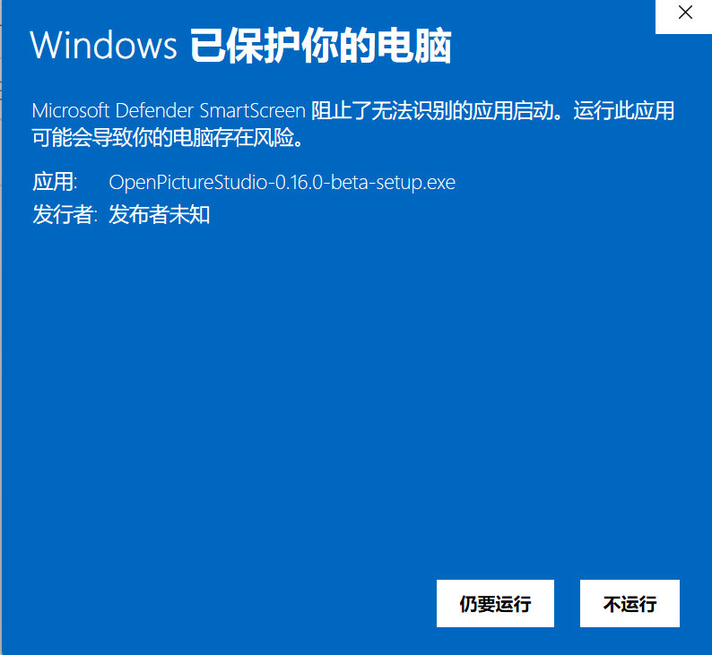
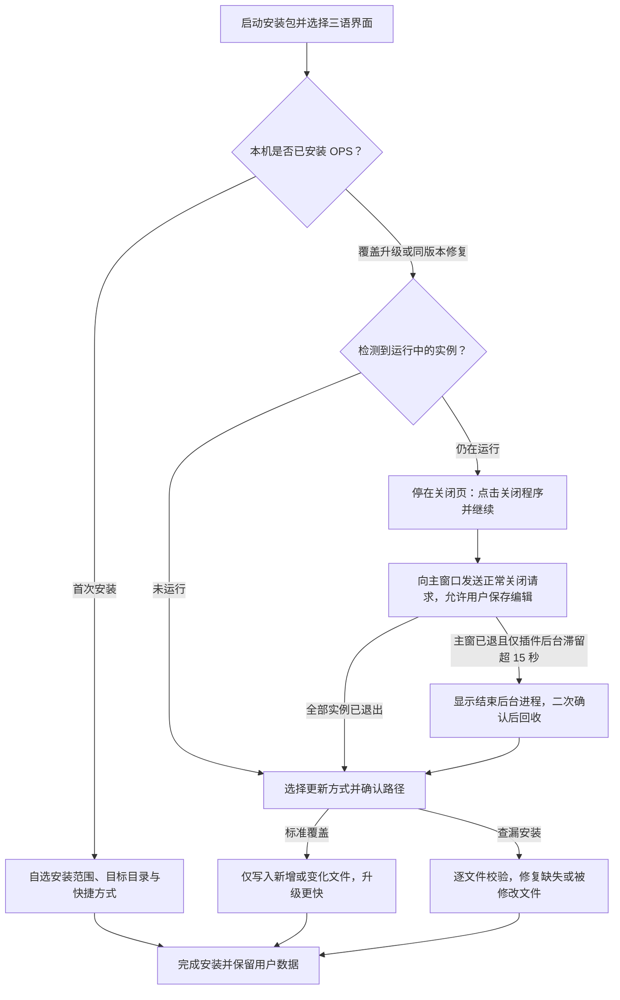

# 安装与升级

[简体中文](installation.md) | [English](installation.en.md) | [Français](installation.fr.md)

[返回首页](../README.md) · [文档目录](README.md)

OpenPictureStudio 提供适用于 Windows 10/11（64 位）的独立安装包，内置桌面端与原生计算运行环境，无需另行配置 Python 或 Rust。

## 下载与常规安装

1. 前往 [最新发布页](https://github.com/KpTanl/OpenPictureStudio/releases/latest)，在 **Assets** 中下载 `OpenPictureStudio-<版本>-setup.exe` 与同名 `.exe.sha256` 文件。
2. 核对安装包 SHA256 后双击运行，在安装向导中选择 **简体中文**、**English** 或 **Français**。
   - **首次安装**：默认匹配 Windows 显示语言；可选择安装范围（当前用户或所有用户）、安装目录及是否创建桌面快捷方式。
   - **覆盖升级**：默认沿用上次安装语言与安装目录，每次均可重新切换语言；开始菜单卸载快捷方式随所选语言命名。
3. 启动后即可直接浏览和编辑照片；本地 AI 模型与可选 DirectML 推理运行环境可在软件设置中按需下载。

<details>
<summary>如何核对安装包 SHA256</summary>

在安装包所在目录打开 PowerShell，将 `<版本>` 替换为实际版本号后执行：

```powershell
Get-FileHash -LiteralPath '.\OpenPictureStudio-<版本>-setup.exe' -Algorithm SHA256
Get-Content -LiteralPath '.\OpenPictureStudio-<版本>-setup.exe.sha256'
```

两条命令输出的 64 位十六进制哈希应完全一致，用于验证安装包完整性并确认来自本仓库发布资产。

</details>

## 处理 Windows SmartScreen 提示

> **说明**：当前 Windows 安装包未作代码签名，首次双击可能触发 Windows SmartScreen 提示“Windows 已保护你的电脑”。

确认安装包来自[本仓库 Release 页面](https://github.com/KpTanl/OpenPictureStudio/releases/latest)并核对 SHA256 无误后，点击 **“更多信息” → “仍要运行”** 即可继续安装。

<details>
<summary>查看 Windows SmartScreen 操作示例</summary>



示例截图对应 0.16.0 安装包，实际文件名随版本号更新。若设备受组织策略限制未提供“仍要运行”按钮，请按系统或管理员策略处理。

</details>

## 使用 PowerShell 自动下载与安装

打开普通 PowerShell 执行下方脚本，自动从 GitHub Releases 获取最新正式包、校验 SHA256 后启动安装向导。软件仍在运行时也可直接执行，向导会在安装前提示退出程序。

<details>
<summary>展开 PowerShell 一键安装命令（兼容 PowerShell 5.1 与 PowerShell 7）</summary>

```powershell
& {
    $ErrorActionPreference = 'Stop'
    $releasePage = 'https://github.com/KpTanl/OpenPictureStudio/releases/latest'
    try {
        $release = Invoke-RestMethod -Uri 'https://api.github.com/repos/KpTanl/OpenPictureStudio/releases/latest' -Headers @{ 'User-Agent' = 'OpenPictureStudio-Install' } -TimeoutSec 30
        $name = 'OpenPictureStudio-{0}-setup.exe' -f ($release.tag_name -replace '^v', '')
        $installer = @($release.assets | Where-Object { $_.name -ceq $name })
        $checksum = @($release.assets | Where-Object { $_.name -ceq "$name.sha256" })
        if ($installer.Count -ne 1 -or $checksum.Count -ne 1) { throw '发行版本缺少唯一匹配的安装包或校验文件。' }

        $folder = Join-Path ([IO.Path]::GetTempPath()) ('OpenPictureStudio-' + [Guid]::NewGuid().ToString('N'))
        New-Item -ItemType Directory -Path $folder | Out-Null
        Write-Host ('下载目录：' + $folder)
        $exe = Join-Path $folder $name
        $sha = Join-Path $folder "$name.sha256"
        Invoke-WebRequest -UseBasicParsing -Uri $installer[0].browser_download_url -OutFile $exe -TimeoutSec 600
        Invoke-WebRequest -UseBasicParsing -Uri $checksum[0].browser_download_url -OutFile $sha -TimeoutSec 30

        $line = (Get-Content -LiteralPath $sha -Raw).Trim()
        if ($line -notmatch '^(?<hash>[a-fA-F0-9]{64})[ \t]+\*?(?<file>[^\r\n]+)$') { throw '校验文件格式不正确，或对应另一个安装包。' }
        $expected = $Matches['hash']
        if ($Matches['file'] -cne $name) { throw '校验文件格式不正确，或对应另一个安装包。' }
        if ((Get-FileHash -LiteralPath $exe -Algorithm SHA256).Hash -ine $expected) { throw 'SHA256 不匹配，未启动安装器。' }

        Write-Host 'SHA256 已核对，正在打开安装向导……'
        $start = New-Object System.Diagnostics.ProcessStartInfo
        $start.FileName = $exe
        $start.WorkingDirectory = $folder
        $start.UseShellExecute = $false
        $start.Arguments = '/NORESTART'
        $process = [System.Diagnostics.Process]::Start($start)
        $process.WaitForExit()
        switch ($process.ExitCode) {
            0 { Write-Host '安装完成。' }
            { $_ -in 2, 5 } { Write-Host '安装已取消或中止。' }
            default { throw ('安装未完成，退出码：' + $process.ExitCode) }
        }
    } catch {
        throw ("未能完成安装，发行页面：$releasePage`n" + $_.Exception.Message)
    }
}
```

</details>

## 覆盖升级与安装修复

新版本可直接覆盖旧版本，无需预先卸载。已有用户设置、自定义资料目录、AI 模型与 `.opsproj` 项目均会保留。



### 运行中实例的退出机制

检测到安装目录中有程序正在运行时，向导会停在关闭页面，点击 **“关闭程序并继续”** 后向主窗口发送正常退出请求。未保存的编辑按程序原有提示处理保存；安装器不会强制终止主程序。仅当主窗口已关闭、插件后台进程滞留超过 15 秒时，界面才提供可二次确认的 **“结束后台进程”** 按钮。

### 升级模式与目录冲突

| 模式 | 适用场景 | 校验与写入行为 |
| --- | --- | --- |
| **标准覆盖** | 日常版本升级 | 跳过未变化文件，仅写入变化或缺失文件；发现程序文件被手动修改时先弹窗询问 |
| **查漏安装** | 同版本修复、上次安装中断或文件受损 | 逐个校验安装清单中的程序文件，替换缺失、损坏或不一致文件 |

> **早期版本说明**：缺乏安装清单的早期测试版在原程序仍在时，需先备份资料并手动卸载旧版；若原安装目录已删除或完全为空，可直接重新安装。遇到目录冲突时按向导提示处理。

## 版本更新检查

安装版默认最多每 24 小时自动检查一次新版本，可在 **“设置 → 常规”** 关闭，或在 **“关于”** 页手动触发检查。检测到新版本后仅打开下载页面由用户自主下载安装，不会后台静默更新。检查请求仅向 GitHub 发送应用版本及必要的 HTTP 头信息。

## 界面组件与许可

自 0.17.0 起，界面组件由 PyQt6 迁移到 PySide6，所需运行库均由完整安装包随附提供，直接覆盖升级即可，无需单独安装 PySide6、Shiboken 或 Qt。

PyQt6 提供 GPLv3 和商业许可；PySide6 提供 LGPLv3 等开源许可及商业许可选项。项目原创代码继续采用 MIT 许可，第三方界面组件、依赖库与模型分别遵循各自条款，相关声明与源码信息随程序交付。

## 相关文档

- [许可证与第三方组件](licensing.md#从-pyqt6-迁移到-pyside6)
- [AI 服务与隐私](ai-services.md)
- [系统要求与性能](performance.md)
