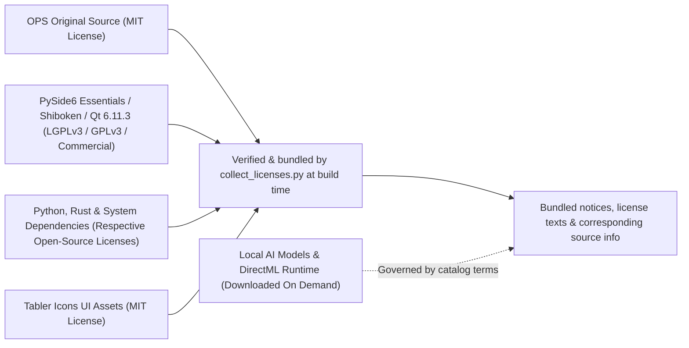

# Licensing and Third-Party Components

[简体中文](licensing.md) | [English](licensing.en.md) | [Français](licensing.fr.md)

[Back to Home](../README.en.md) · [Documentation](README.en.md)

OpenPictureStudio's original source code is licensed under the [MIT License](../LICENSE). UI frameworks, third-party dependencies, AI models, and icon assets follow their own respective licenses.

## License Structure and Distribution Notices

Every installer and staged program directory includes compliance files generated and verified by [tools/collect_licenses.py](../tools/collect_licenses.py) (builds fail automatically if any shipped file lacks an owner, license text, or GPL/LGPL/MPL source record):

| Bundled File or Folder | Purpose |
| --- | --- |
| `THIRD_PARTY_NOTICES.txt` | Lists names, versions, licenses, and homepages for all bundled packages plus on-demand models/runtimes |
| `licenses/` | Contains original license texts and copyright notices for third-party components |
| `SOURCE.txt` | Records the build commit, repository URL, and source locations/hashes for GPL, LGPL, and MPL components |
| `components.json` | Maps each shipped file to its corresponding software component |
| `LICENSE`, `GPL-3.0.txt`, `LGPL-3.0.txt` | Top-level license texts for OPS original code and Qt components |

> **Note:** Interface icons come from [Tabler Icons](https://github.com/tabler/tabler-icons) (MIT License). Sources for the logo, screenshots, and README diagrams are listed in [Asset Sources](../.github/assets/readme/SOURCES.en.md).

## Migrating from PyQt6 to PySide6

Starting with 0.17.0, UI components migrated from PyQt6 to PySide6, and the installer is no longer distributed as a whole under GPLv3. Releases 0.16.1 and earlier remain governed by the license files shipped with those releases.

- **License change:** [PyQt6 is offered under GPLv3 and a commercial license](https://www.riverbankcomputing.com/software/pyqt/intro), whereas [Qt for Python (PySide6) offers LGPLv3/GPL and commercial license options](https://doc.qt.io/qtforpython-6/).
- **Original source:** Original OPS code stays under the MIT License; PySide6, Shiboken, Qt, and all other dependencies retain their own terms.
- **Upgrades:** Full installers for 0.17.0 and later include all required PySide6/Qt components; upgrade in place directly following [Installation and Upgrades](installation.en.md).

## Qt Components and LGPL Obligations

Current builds use **PySide6 Essentials**, **Shiboken**, and **Qt 6.11.3** (adding new Qt modules requires re-auditing their licenses and third-party notices).

When distributing builds under LGPL terms, OPS preserves all copyright notices, license texts, and corresponding source references, and packages PySide6/Shiboken modules and Qt shared libraries as separate files so users retain the right to replace compatible libraries and debug modifications. Refer to [Qt Licensing](https://doc.qt.io/qt-6/licensing.html), [Qt LGPL Obligations](https://www.qt.io/development/open-source-lgpl-obligations), and [Qt for Python Third-Party Licenses](https://doc.qt.io/qtforpython-6/licenses.html) for full details.

## Dependency, Model, and Asset Catalogs

- [Component Source & Attribution Manifest (manifest.json)](../packaging/licenses/manifest.json)
- [Qt Third-Party Notices](../packaging/licenses/qt/QT_THIRD_PARTY_NOTICES.txt)
- [AI Models Catalog and Licenses](../resources/models/catalog.json)
- [Optional Runtimes Catalog](../resources/runtimes/catalog.json)
- [UI Icon Source](../resources/icons/ui/SOURCE.txt) and [MIT License](../resources/icons/ui/LICENSE.txt)

## Related Documentation

- [Installation and Upgrades](installation.en.md)
- [Development and Building](building.en.md)
- [Architecture and Native Acceleration](architecture.en.md)
