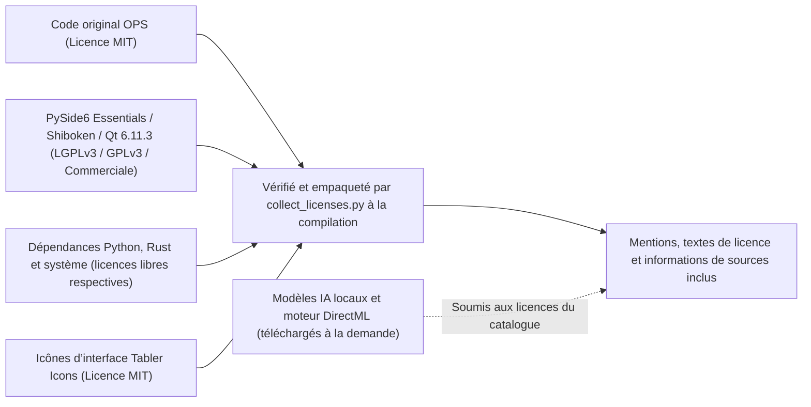

# Licences et composants tiers

[简体中文](licensing.md) | [English](licensing.en.md) | [Français](licensing.fr.md)

[Retour à l’accueil](../README.fr.md) · [Documentation](README.fr.md)

Le code source original d’OpenPictureStudio est publié sous [licence MIT](../LICENSE). Les composants d’interface, bibliothèques tierces, modèles IA et icônes suivent chacun leurs propres licences.

## Structure des licences et conformité

Chaque installateur et dossier d’application préparé contient les documents de conformité générés et contrôlés par [tools/collect_licenses.py](../tools/collect_licenses.py) (la compilation échoue si un fichier distribué n’est rattaché à aucun composant, texte de licence ou source GPL/LGPL/MPL) :

| Fichier ou dossier fourni | Rôle |
| --- | --- |
| `THIRD_PARTY_NOTICES.txt` | Liste noms, versions, licences et pages d’accueil des composants inclus et des modèles/moteurs à la demande |
| `licenses/` | Rassemble les textes de licence complets et mentions de copyright des composants tiers |
| `SOURCE.txt` | Consigne le commit, le dépôt du programme ainsi que les sources et empreintes des composants GPL, LGPL et MPL |
| `components.json` | Associe chaque fichier livré au composant logiciel correspondant |
| `LICENSE`, `GPL-3.0.txt`, `LGPL-3.0.txt` | Textes principaux de licence du code OPS et des composants Qt |

> **Remarque :** Les icônes d’interface proviennent de [Tabler Icons](https://github.com/tabler/tabler-icons) (licence MIT). L’origine du logo, des captures et des diagrammes du README figure dans les [sources des ressources](../.github/assets/readme/SOURCES.en.md).

## Migration de PyQt6 vers PySide6

Depuis la version 0.17.0, l’interface a migré de PyQt6 vers PySide6, et l’installateur n’est plus distribué dans son ensemble sous GPLv3. Les versions 0.16.1 et antérieures restent régies par les fichiers de licence livrés avec ces versions.

- **Changement de licence :** [PyQt6 est proposé sous GPLv3 ou licence commerciale](https://www.riverbankcomputing.com/software/pyqt/intro), tandis que [Qt for Python (PySide6) propose les options LGPLv3/GPL et commerciale](https://doc.qt.io/qtforpython-6/).
- **Code original :** le code original d’OPS conserve la licence MIT ; PySide6, Shiboken, Qt et les autres dépendances suivent chacun leurs propres conditions.
- **Mises à niveau :** les installateurs complets dès 0.17.0 incluent tous les composants PySide6/Qt requis ; mettez directement à jour par-dessus selon [Installation et mises à niveau](installation.fr.md).

## Composants Qt et obligations LGPL

Les builds actuels utilisent **PySide6 Essentials**, **Shiboken** et **Qt 6.11.3** (tout ajout ultérieur de module Qt implique de revérifier ses licences et dépendances tierces).

Pour respecter la licence LGPL lors de la distribution, OPS conserve l’ensemble des mentions de copyright, textes de licence et références aux sources correspondantes, et distribue les modules PySide6/Shiboken ainsi que les bibliothèques dynamiques Qt en fichiers séparés afin de préserver la faculté de remplacement et de débogage. Les exigences complètes figurent dans [Qt Licensing](https://doc.qt.io/qt-6/licensing.html), [Qt LGPL Obligations](https://www.qt.io/development/open-source-lgpl-obligations) et [Qt for Python Third-Party Licenses](https://doc.qt.io/qtforpython-6/licenses.html).

## Catalogues des dépendances, modèles et ressources

- [Inventaire des composants et sources correspondantes (manifest.json)](../packaging/licenses/manifest.json)
- [Mentions tierces Qt](../packaging/licenses/qt/QT_THIRD_PARTY_NOTICES.txt)
- [Catalogue et licences des modèles IA](../resources/models/catalog.json)
- [Catalogue des moteurs d’exécution facultatifs](../resources/runtimes/catalog.json)
- [Origine des icônes UI](../resources/icons/ui/SOURCE.txt) et [licence MIT](../resources/icons/ui/LICENSE.txt)

## Documentation associée

- [Installation et mises à niveau](installation.fr.md)
- [Développement et compilation](building.fr.md)
- [Architecture et accélération native](architecture.fr.md)
