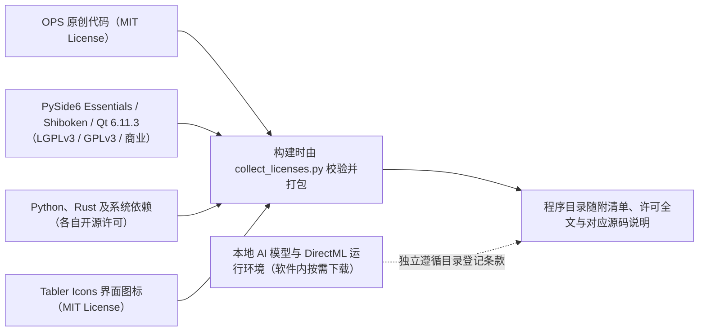

# 许可证与第三方组件

[简体中文](licensing.md) | [English](licensing.en.md) | [Français](licensing.fr.md)

[返回首页](../README.md) · [文档目录](README.md)

OpenPictureStudio 原创代码采用 [MIT License](../LICENSE) 开源；界面框架、第三方库、AI 模型与图标资源各自遵循对应开源或分发许可。

## 许可构成与交付物

安装包与程序目录随附以下合规材料（构建时由 [tools/collect_licenses.py](../tools/collect_licenses.py) 自动校验；若任一文件缺失归属、许可文本或 GPL／LGPL／MPL 源码登记，构建将直接中止）：

| 随附文件或目录 | 用途说明 |
| --- | --- |
| `THIRD_PARTY_NOTICES.txt` | 列出所有内置组件与按需下载模型／运行环境的名称、版本、许可与主页 |
| `licenses/` | 收录各第三方组件的原始许可全文与版权声明 |
| `SOURCE.txt` | 记录本程序对应提交与源码地址，以及 GPL／LGPL／MPL 组件的对应源码链接与校验摘要 |
| `components.json` | 交付文件与所属组件之间的精确映射清单 |
| `LICENSE`、`GPL-3.0.txt`、`LGPL-3.0.txt` | 项目原创及 Qt 相关主许可文本 |

> **说明**：界面图标取自 [Tabler Icons](https://github.com/tabler/tabler-icons)（MIT License）；README 中的标志、截图与流程图来源见[素材来源](../.github/assets/readme/SOURCES.md)。

## 从 PyQt6 迁移到 PySide6

自 0.17.0 起，界面组件由 PyQt6 迁移至 PySide6，安装包不再整体按 GPLv3 分发；0.16.1 及更早版本的许可条款以该版本随附文件为准。

- **许可变化**：[PyQt6 提供 GPLv3 与商业许可](https://www.riverbankcomputing.com/software/pyqt/intro)；[PySide6 所属的 Qt for Python 提供 LGPLv3／GPL 与商业许可选项](https://doc.qt.io/qtforpython-6/)。
- **原创代码**：项目原创源码继续采用 MIT 许可；PySide6、Shiboken、Qt 及其他依赖各自遵循对应条款。
- **升级兼容性**：0.17.0 及后续完整安装包已内置全部界面组件，按[安装与升级](installation.md)直接覆盖安装即可，无需额外配置运行库。

## Qt 组件与 LGPL 分发义务

当前发行配置使用 **PySide6 Essentials**、**Shiboken** 与 **Qt 6.11.3**（如后续引入新 Qt 模块，需重新核查对应模块及其上游依赖的许可条款）。

按 LGPL 条件分发安装包或程序目录时，项目保留版权声明、许可全文及对应源码获取信息，并将 PySide6／Shiboken 模块与 Qt 动态库作为独立文件放置，以保障用户自行替换兼容库和调试修改的权利。完整要求以 [Qt 官方开源许可](https://doc.qt.io/qt-6/licensing.html)、[Qt LGPL 分发义务](https://www.qt.io/development/open-source-lgpl-obligations)及 [Qt for Python 第三方许可清单](https://doc.qt.io/qtforpython-6/licenses.html)为准。

## 依赖、模型与清单入口

- [组件来源与对应源码登记（manifest.json）](../packaging/licenses/manifest.json)
- [Qt 第三方声明](../packaging/licenses/qt/QT_THIRD_PARTY_NOTICES.txt)
- [AI 模型目录与许可](../resources/models/catalog.json)
- [可选运行环境目录](../resources/runtimes/catalog.json)
- [界面图标来源](../resources/icons/ui/SOURCE.txt) 与 [MIT 许可](../resources/icons/ui/LICENSE.txt)

## 相关文档

- [安装与升级](installation.md)
- [开发与构建](building.md)
- [架构与原生加速](architecture.md)
