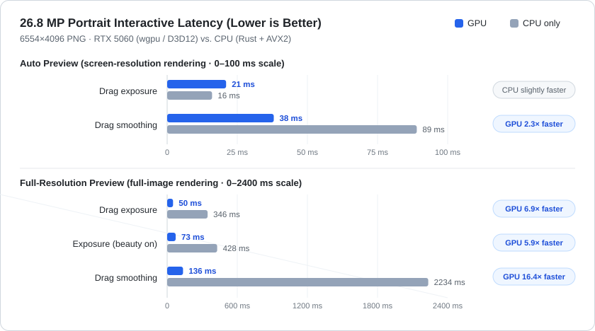
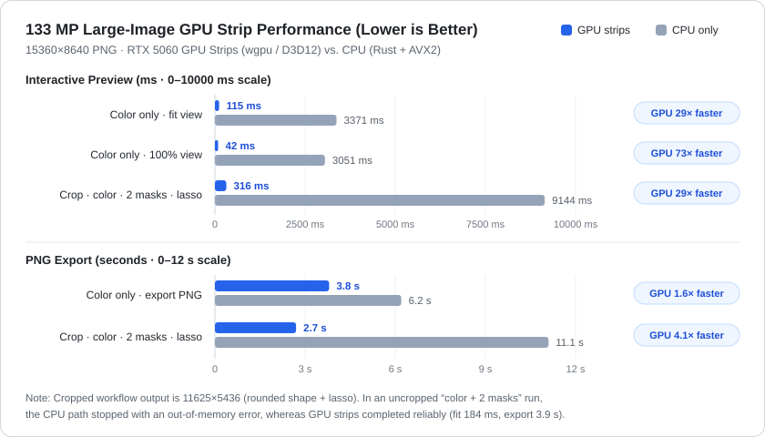

# System Requirements and Performance

[简体中文](performance.md) | [English](performance.en.md) | [Français](performance.fr.md)

[Back to Home](../README.en.md) · [Documentation](README.en.md)

OpenPictureStudio renders canvas previews at your screen resolution by default, keeping everyday editing responsive on modest hardware. For full-resolution inspection and exporting high-megapixel RAW or 100 MP+ files, GPU VRAM and system RAM determine overall throughput and limits.

## Hardware Recommendations

| Component | Basic Use | Recommended | Enthusiast / Heavy |
| --- | --- | --- | --- |
| **OS** | Windows 10/11 (64-bit) | Windows 10/11 (64-bit) | Windows 10/11 (64-bit) |
| **CPU** | Modern multicore x64 CPU | Intel Core i5 7th-gen / Ryzen 1000 or newer | Intel 12th-gen / Ryzen 5000 or newer |
| **RAM** | 8 GB | 16 GB | 32 GB or more |
| **GPU** | DirectX 12 iGPU or 2 GB dGPU | 4 GB+ VRAM dGPU (GTX 1650 or better) | 6–8 GB+ VRAM dGPU (RTX 2060 or better) |
| **Storage** | 3 GB free space | 6 GB free space (SSD recommended) | 12 GB free space (SSD recommended) |
| **Typical Workload** | 12–24 MP browsing & light retouching | 24–45 MP camera RAW with local masks | 45–100+ MP imagery & batch queues |

## VRAM and RAM Scaling Limits

In **Automatic** preview mode, canvas rendering scales to physical display pixels and is not constrained by full-image VRAM size. The estimates below apply to **full-resolution previews and exports** (8-bit baseline under default budgets):

### GPU VRAM and Strip Execution Limits

| GPU Tier | Approx. VRAM Budget | Full-Frame GPU Color | Full-Frame w/ Detail & Denoise | GPU Strips (8-bit Standard Images) |
| --- | ---: | ---: | ---: | --- |
| Integrated GPU (8 GB RAM) | ~1.5 GiB | ~16 MP | ~8–9 MP | RAM-bound; recommended ≤ 45 MP |
| 4 GB Dedicated GPU | 2.9–3.2 GiB | ~32 MP | ~16–17 MP | Supports 100–133 MP |
| 8 GB Dedicated GPU | 5.8–6.4 GiB | ~65 MP | ~32–35 MP | Supports 133 MP+ |
| 12 GB+ Dedicated GPU | ≥ 8.6 GiB | ≥ 96 MP | ≥ 48–51 MP | Supports 133 MP+ |

- 16-bit PNGs and camera RAW files require roughly twice the per-pixel memory of 8-bit images, halving full-frame limits accordingly; the per-side hardware limit is 32768 px.
- When full-size processing exceeds single-card full-frame limits, workflows composed of strip-capable tools (color grading, shadows/highlights/texture/clarity/dehaze, local masks, crop & rotation, shapes/lasso, portrait beauty, and qualified classic denoise) automatically switch to GPU strips.
- Workflows containing non-strip nodes (AI denoise, AI enhancement, cutout, ID photo, or plugins) fall back seamlessly to the complete CPU path when full-frame VRAM is exceeded.

### System Memory Policy

By default, OPS caps memory usage at **90%** of physical RAM while always reserving at least **10%** (and no less than 0.8 GiB) for the operating system:

| System RAM | Guidance |
| --- | --- |
| **8 GB** | Suited to 12–24 MP editing; keep **Automatic** or **Always 1600 preview** for larger photos |
| **16 GB** | Suited to 24–61 MP full-frame RAW editing with multiple local masks |
| **32 GB+** | Suited to 61–133 MP images, complex mask stacks, and sustained batch exports |

## Measured Benchmarks

Test system: Intel Core i5-12600KF, 32 GB RAM, NVIDIA GeForce RTX 5060 (8 GB), Windows 11, worker threads pinned to 6 P-cores (12 threads), measured in November 2026 comparing GPU (`wgpu / D3D12`) against CPU (`Rust + AVX2`). Actual timings vary by hardware, system load, and image contents.

### 26.8 MP Portrait Interactive Responsiveness

- **Automatic preview:** Basic color sliders stay around 20–35 ms on both GPU and CPU (CPU slightly faster); with portrait beauty active, GPU skin smoothing runs **2–3.5× faster** than CPU.
- **Full-resolution preview:** Dragging sliders at full resolution is **6–16× faster** on the GPU, and single edits complete **3–3.5× faster**. Startup GPU qualification takes ~2.1 s on first launch and ~1.4 s thereafter using cached results.

### 133 MP Large-Image GPU Strips & Export

- **Ultra-high-resolution workflows:** Exceeding single-frame 8 GB VRAM triggers GPU strips on the 15360×8640 PNG, accelerating screen-fit and 100% region previews by **29–73×** and PNG export by **1.6–4.1×**.
- **Complex mask reliability:** When combining color grading with two local masks on 133 MP images, the CPU path hits an out-of-memory error, whereas GPU strips complete reliably (184 ms fit preview, 3.9 s PNG export).

### Native CPU Acceleration

On systems without a dedicated GPU or when set to **CPU only**, white balance, exposure, curves, local masks, guided filters, RAW matrix conversions, cubic beauty resampling, and display downscaling run multithreaded in Rust with automatic AVX2 SIMD acceleration (or portable Rust on CPUs without AVX2).

## Caches and Disk Footprint

| Item | Defaults & Limits | Where to Adjust |
| --- | --- | --- |
| **Thumbnail & edit/source disk caches** | Thumbnails: 512 MiB default; edit/source cache: 2 GiB default (each adjustable up to 32 GiB) | **Settings → Storage** |
| **Preview memory & GPU VRAM cache** | Preview RAM cache: 64 MiB default (up to 1024 MiB); VRAM cache: Automatic, Off, or Custom MiB | **Settings → Performance & memory** |
| **Install size & optional assets** | App bundle ~0.55 GiB; all 6 optional local AI models ~435 MiB installed; DirectML runtime ~67 MiB | **Settings → Tools and Models / Runtimes** |

With default disk caches completely full, total disk usage is roughly **3.6 GiB**. Group adjustments and batch export queues process one photo at a time and release temporary buffers immediately after each item.

## Related Documentation

- [Architecture and Native Acceleration](architecture.en.md)
- [Installation and Upgrades](installation.en.md)
- [AI Services and Privacy](ai-services.en.md)
