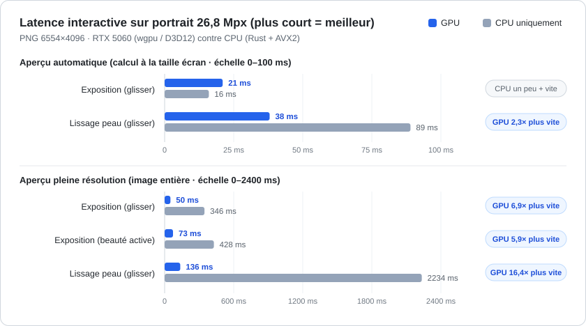
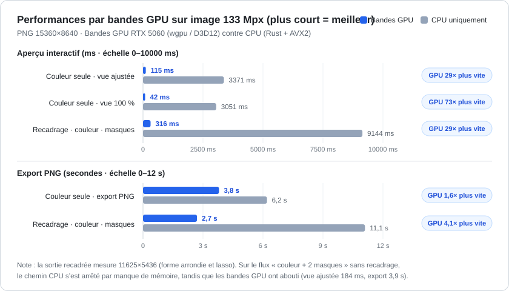

# Configuration requise et performances

[简体中文](performance.md) | [English](performance.en.md) | [Français](performance.fr.md)

[Retour à l’accueil](../README.fr.md) · [Documentation](README.fr.md)

OpenPictureStudio calcule par défaut les aperçus à la taille de l’affichage à l’écran, garantissant une retouche fluide sur des machines modestes. Pour l’inspection à 100 % et l’export de fichiers RAW haute définition ou d’images dépassant 100 Mpx, la VRAM et la RAM système déterminent la capacité maximale et la vitesse.

## Matériel recommandé

| Élément | Usage courant | Configuration recommandée | Usage intensif |
| --- | --- | --- | --- |
| **Système** | Windows 10/11 (64 bits) | Windows 10/11 (64 bits) | Windows 10/11 (64 bits) |
| **Processeur** | CPU x64 multicœur récent | Intel Core i5 7e gén. / Ryzen 1000 ou mieux | Intel 12e gén. / Ryzen 5000 ou mieux |
| **Mémoire vive** | 8 Go | 16 Go | 32 Go ou plus |
| **Carte graphique** | iGPU DirectX 12 ou GPU dédié 2 Go | GPU dédié 4 Go+ (GTX 1650 ou mieux) | GPU dédié 6–8 Go+ (RTX 2060 ou mieux) |
| **Stockage** | 3 Go libres | 6 Go libres (SSD conseillé) | 12 Go libres (SSD conseillé) |
| **Usage type** | Tri et retouche légère 12–24 Mpx | RAW 24–45 Mpx avec masques locaux | Images 45–100+ Mpx et exports par lots |

## Limites selon la VRAM et la RAM

En mode d’aperçu **Automatique**, le canevas s’adapte aux pixels physiques de l’écran sans subir la limite de VRAM d’une image entière. Les repères ci-dessous concernent l’**aperçu pleine résolution et l’export** (images 8 bits standards sous budgets par défaut) :

### Capacité VRAM et traitement par bandes

| Catégorie GPU | Budget VRAM approx. | Couleur GPU image entière | Image entière avec détails et débruitage | Bandes GPU (images 8 bits standards) |
| --- | ---: | ---: | ---: | --- |
| GPU intégré (8 Go RAM) | ~1,5 GiB | ~16 Mpx | ~8–9 Mpx | Limité par la RAM ; conseillé ≤ 45 Mpx |
| GPU dédié 4 Go | 2,9–3,2 GiB | ~32 Mpx | ~16–17 Mpx | Prend en charge 100–133 Mpx |
| GPU dédié 8 Go | 5,8–6,4 GiB | ~65 Mpx | ~32–35 Mpx | Prend en charge 133 Mpx et plus |
| GPU dédié 12 Go et plus | ≥ 8,6 GiB | ≥ 96 Mpx | ≥ 48–51 Mpx | Prend en charge 133 Mpx et plus |

- Les PNG 16 bits et les RAW d’appareil photo occupent environ le double par pixel par rapport au 8 bits, divisant de moitié les limites sur image entière ; la limite matérielle par côté est de 32768 px.
- Au-delà du budget sur image entière, les flux composés d’outils compatibles avec le découpage (couleur, ombres/hautes lumières/texture/clarté/voile, masques locaux, recadrage et rotation, formes/lasso, beauté et débruitage classique qualifié) basculent automatiquement sur les bandes GPU.
- En présence de nœuds non pris en charge par bandes (débruitage IA, amélioration IA, détourage, photo d’identité ou plug-in), l’exécution complète bascule automatiquement sur le chemin CPU.

### Mémoire système et protection

Par défaut, OPS plafonne l’usage mémoire à **90 %** de la RAM physique tout en réservant au minimum **10 %** (et au moins 0,8 GiB) au système :

| Mémoire système | Recommandation |
| --- | --- |
| **8 Go** | Adapté aux retouches 12–24 Mpx ; conservez l’aperçu **Automatique** ou **Toujours un aperçu de 1600 px** pour les grands formats |
| **16 Go** | Adapté aux RAW plein format 24–61 Mpx avec masques locaux multiples |
| **32 Go et plus** | Adapté aux images 61–133 Mpx, piles de masques complexes et exports en série soutenus |

## Mesures de performances réelles

Plateforme de test : Intel Core i5-12600KF, 32 Go RAM, NVIDIA GeForce RTX 5060 (8 Go), Windows 11, threads limités à 6 cœurs P (12 threads), mesures de novembre 2026 comparant le GPU (`wgpu / D3D12`) au CPU (`Rust + AVX2`). Les durées réelles varient selon le matériel, la charge système et le contenu de l’image.

### Réactivité interactive sur un portrait de 26,8 Mpx

- **Aperçu automatique :** les curseurs de couleur simples restent autour de 20–35 ms sur GPU comme sur CPU (CPU légèrement plus rapide) ; avec la retouche de portrait active, le lissage sur GPU est **2 à 3,5× plus rapide** que sur CPU.
- **Aperçu pleine résolution :** le glissement des curseurs est **6 à 16× plus rapide** sur GPU et une modification isolée est **3 à 3,5× plus rapide**. La qualification GPU au démarrage prend environ 2,1 s la première fois puis 1,4 s ensuite grâce aux résultats mis en cache.

### Grandes images de 133 Mpx par bandes et export

- **Très haute définition et export :** au-delà du budget global des 8 Go de VRAM sur le PNG 15360×8640, les bandes GPU accélèrent l’aperçu ajusté à l’écran et la vue à 100 % d’un facteur **29 à 73×**, et l’export PNG d’un facteur **1,6 à 4,1×**.
- **Fiabilité avec masques complexes :** en associant réglage couleur et deux masques locaux à 133 Mpx, le chemin CPU échoue par manque de mémoire alors que le traitement par bandes GPU aboutit sans incident (184 ms en vue ajustée, 3,9 s à l’export PNG).

### Accélération CPU native

Sans GPU dédié ou en mode **CPU uniquement**, balance des blancs, exposition, courbes, masques locaux, filtres guidés, conversion matricielle RAW, rééchantillonnage beauté et réduction d’affichage s’exécutent en parallèle en Rust avec détection automatique d’AVX2 (ou chemin Rust générique sans AVX2).

## Caches et espace disque

| Élément | Valeurs par défaut et limites | Où modifier |
| --- | --- | --- |
| **Caches disque miniatures et retouche/source** | Miniatures : 512 MiB par défaut ; cache retouche/source : 2 GiB par défaut (jusqu’à 32 GiB chacun) | **Paramètres → Stockage** |
| **Mémoire d’aperçu et cache VRAM GPU** | Cache RAM aperçu : 64 MiB par défaut (jusqu’à 1024 MiB) ; cache VRAM : Automatique, Désactivé ou MiB personnalisés | **Paramètres → Performances et mémoire** |
| **Espace programme et ressources facultatives** | Programme ~0,55 GiB ; 6 modèles IA locaux ~435 MiB installés ; moteur DirectML ~67 MiB | **Paramètres → Outils et modèles / Moteurs d’exécution** |

Avec les caches disque par défaut remplis, l’occupation totale avoisine **3,6 GiB**. Les traitements groupés et files d’export traitent les photos séquentiellement et libèrent les tampons temporaires après chaque image.

## Documentation associée

- [Architecture et accélération native](architecture.fr.md)
- [Installation et mises à niveau](installation.fr.md)
- [Services IA et confidentialité](ai-services.fr.md)
