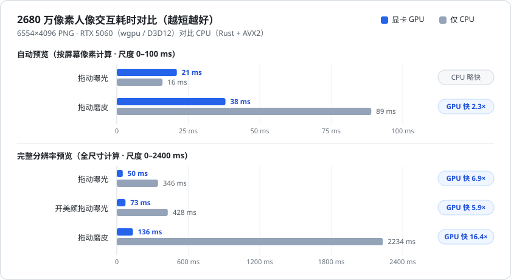
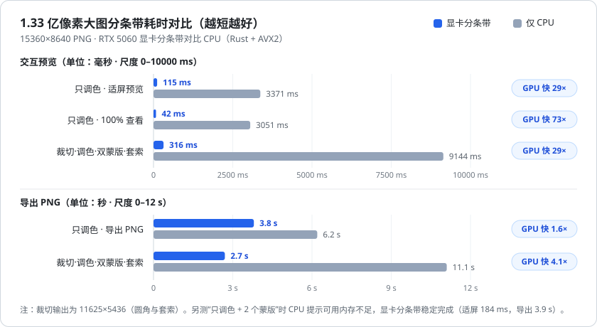

# 系统要求与性能

[简体中文](performance.md) | [English](performance.en.md) | [Français](performance.fr.md)

[返回首页](../README.md) · [文档目录](README.md)

OpenPictureStudio 默认采用自适应屏幕尺寸的画布渲染策略，轻中度硬件即可流畅日常修图；处理高像素 RAW 或亿级像素大图时，显卡与内存容量主要决定完整分辨率预览与导出上限。

## 硬件配置建议

| 项目 | 基础使用 | 推荐配置 | 进阶创作 |
| --- | --- | --- | --- |
| **系统** | Windows 10/11（64 位） | Windows 10/11（64 位） | Windows 10/11（64 位） |
| **处理器** | 现代多核 x64 CPU | 第 7 代 Intel i5 / Ryzen 1000 及以上 | 第 12 代 Intel / Ryzen 5000 及以上 |
| **内存** | 8 GB | 16 GB | 32 GB 及以上 |
| **显卡** | 支持 DirectX 12 的核显或 2 GB 独显 | 4 GB 显存及以上独显（如 GTX 1650+） | 6–8 GB 显存及以上独显（如 RTX 2060+） |
| **存储** | 3 GB 可用空间 | 6 GB 可用空间（建议 SSD） | 12 GB 可用空间（建议 SSD） |
| **典型负载** | 1200–2400 万像素照片浏览与轻量精修 | 2400–4500 万像素相机 RAW 与局部蒙版 | 4500 万至 1 亿像素以上大图与批量任务 |

## 显存与内存的适用规模

默认“自动”预览模式下，画布按屏幕实际像素渲染，一般编辑不受整幅显存上限约束。下表主要反映**完整分辨率预览与正式导出**时的硬件边界（按默认预算推算，8 位常规图片基准）：

### 显卡与分条带适用规模

| 显卡档位 | 显存预算参考 | 整幅 GPU 调色 | 整幅含细节滤波与降噪 | 超显存 GPU 分条带（8 位常规图） |
| --- | ---: | ---: | ---: | --- |
| 集成显卡（8 GB 系统内存） | ~1.5 GiB | ~16 MP | ~8–9 MP | 受系统内存约束，建议 ≤ 45 MP |
| 4 GB 独立显卡 | 2.9–3.2 GiB | ~32 MP | ~16–17 MP | 支持 1–1.33 亿像素 |
| 8 GB 独立显卡 | 5.8–6.4 GiB | ~65 MP | ~32–35 MP | 支持 1.33 亿像素以上 |
| 12 GB 及以上独立显卡 | ≥ 8.6 GiB | ≥ 96 MP | ≥ 48–51 MP | 支持 1.33 亿像素以上 |

- 16 位 PNG 与相机 RAW 每像素数据量约为 8 位图片的两倍，整幅上限相应减半；单边上限为 32768 像素。
- 当完整尺寸超出单卡整幅预算时，只要工作流包含的是支持分条带的节点（调色、阴影／高光／纹理／清晰度／去雾、局部蒙版、裁切与旋转、形状／套索、人像美颜及通过自检的传统降噪），系统自动改由 GPU 分条带计算。
- 包含 AI 降噪、AI 增强、抠图、证件照或插件等暂不支持分条带的节点时，对应请求自动由 CPU 完整路径处理。

### 内存容量与保护策略

软件默认最多占用系统物理内存的 **90%**，并始终至少为系统保留 **10%**（且不少于 0.8 GiB）：

| 内存配置 | 适用建议 |
| --- | --- |
| **8 GB** | 适合 1200–2400 万像素日常编辑；处理高像素图建议保持“自动”预览或使用“始终 1600 预览” |
| **16 GB** | 适合 2400–6100 万像素全画幅 RAW、多蒙版及复杂调色 |
| **32 GB 及以上** | 适合 6100 万至 1.33 亿像素超大图像、多蒙版叠加与高频批量导出 |

## 典型实测表现

测试平台：Intel Core i5-12600KF、32 GB 内存、NVIDIA GeForce RTX 5060（8 GB）、Windows 11，工作线程限定在 6 个性能核（12 线程），于 2026 年 11 月在 0.17.0 上实测；显卡使用 wgpu／D3D12，CPU 使用 Rust + AVX2。实际耗时因具体硬件、系统负载与照片分辨率而异。

### 2680 万像素人像交互响应

- **日常自动预览**：普通调色滑块在 GPU 与 CPU 上均在 20–35 毫秒级（CPU 略快）；开启人像美颜并拖动磨皮时，显卡比 CPU 快 **2–3.5 倍**。
- **完整分辨率预览**：切换到完整分辨率拖动滑块时，显卡耗时领先 CPU **6–16 倍**，单次参数修改快 **3–3.5 倍**；首次启动显卡自检约 2.1 秒，后续启动复用自检结果约 1.4 秒就绪。

### 1.33 亿像素大图分条带与导出

- **超高像素交互与导出**：15360×8640 大图超出 8 GB 显卡整幅预算后自动切换 GPU 分条带，适屏预览与 100% 局部查看提速约 **29–73 倍**，PNG 导出提速约 **1.6–4.1 倍**。
- **大内存复杂蒙版稳定性**：在纯调色叠加 2 个局部蒙版的测试中，CPU 路径会因可用内存不足而中止，GPU 分条带可稳定完成适屏（184 毫秒）与导出（3.9 秒）。

### CPU 原生加速

在无独立显卡、选择 **“仅 CPU”** 或回退 CPU 路径时，白平衡、曝光、曲线、局部蒙版、引导滤波、RAW 转换、美颜三次重采样与显示缩小均由 Rust 多线程并行执行，并在支持 AVX2 的处理器上自动启用 SIMD 向量化加速；不具备 AVX2 的处理器自动运行通用 Rust 路径。

## 缓存与存储占用

| 项目 | 默认配置与上限 | 调整位置 |
| --- | --- | --- |
| **缩略图与编辑／源图磁盘缓存** | 缩略图默认 512 MiB，编辑／源图共用默认 2 GiB；两者均最高可调至 32 GiB | **设置 → 存储空间** |
| **编辑预览内存缓存与显存缓存** | 预览内存默认 64 MiB（最高 1024 MiB）；显存缓存支持自动、关闭或自定义 MiB | **设置 → 性能与内存** |
| **安装与可选资源空间** | 安装程序约 0.55 GiB；6 个可选本地 AI 模型安装后合计约 435 MiB；DirectML 环境约 67 MiB | **设置 → 工具与模型 / 运行环境** |

包含默认磁盘缓存装满时，整体磁盘占用合计约 **3.6 GiB**。成组照片调整与批量导出均按队列逐张执行并在单张完成后释放临时内存，不会同时将整批图片载入内存。软件启动时会关闭 Windows 后台降速，窗口最小化或切到后台时批量导出仍保持全速运行。

## 相关文档

- [架构与原生加速](architecture.md)
- [安装与升级](installation.md)
- [AI 服务与隐私](ai-services.md)
