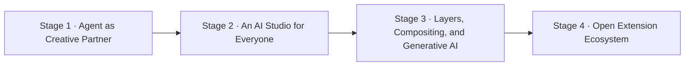

# Roadmap

[简体中文](roadmap.md) | [English](roadmap.en.md) | [Français](roadmap.fr.md)

[Back to Home](../README.en.md) · [Documentation](README.en.md)

OpenPictureStudio aims to be an open image creation platform shared by humans and AI agents.

## Product Vision

Coding AI agents have advanced quickly because software development provides structured code environments, open tool interfaces, and shared operation history, so agents can call tools directly to get work done. Image creation needs the same foundation shared by humans and agents.

OPS is building that foundation. Both humans and AI participate in creation: you can edit manually or direct AI, and AI can suggest improvements or apply edits directly. Both use the same professional tools, recording changes into a single unified history. Professional creators get controllable color, tonal precision, and consistent delivery; everyday users can turn ideas into concrete images; developers and AI agents get clear, composable, inspectable tool interfaces. All of this is built on the same image and project model.

Every step on the roadmap expands what humans and agents can create together.

## Current Baseline

OPS delivers a complete Windows desktop application (see individual [Release Notes](https://github.com/KpTanl/OpenPictureStudio/releases) for version-specific changes):

- **Viewing and non-destructive editing:** Standard formats and camera RAW decoding, rating/culling, linked comparison, non-destructive color grading and local masks, portrait retouching, edit history, group sync, and batch export.
- **GPU & native acceleration:** General-purpose wgpu/D3D12 image compute with out-of-VRAM GPU strip rendering (color grading, local masks, crop/rotation, portrait beauty, and qualified classic denoise), Rust/Rayon/AVX2 CPU acceleration, and optional DirectML model inference.
- **AI collaboration:** Multi-mode AI assistant with reference-image analysis, A/B candidate comparison, named style memory, and undoable history integration.
- **Extensibility:** Unified tool descriptors, workflow engine, `.opsproj` schema 4 project model, and trusted `image/1` subprocess image plugins.

## Four-Stage Product Evolution

### Stage 1: Agent as Creative Partner

AI agents become a deeper part of OPS. They understand the image, your goals, and your style, suggest improvements, pick the right tools, and make finer edits. External AI agents can also call OPS's professional tools directly.

- **External agent interface:** Expose invocation contracts for photo loading, processing, previewing, project saving, and export. External agents can execute tasks headlessly in the background or connect to a running OPS instance to edit alongside you on screen.
- **Cross-tool collaboration:** Expand the tools available to the assistant across culling, global grading, local masks, portrait retouching, and export.
- **Style memory:** Improve color and tone analysis for reference images and build reusable named styles and long-term preferences.
- **Controllable edits:** Multi-step planning, local refinement, and A/B candidate comparison. Every edit can be reviewed, applied, or undone.

### Stage 2: An AI Studio for Everyone

Set the look and guidelines you want, and AI agents edit an entire shoot for you.

- **Full-shoot processing:** Automatically cull by shoot group, unify the baseline look, and refine photo by photo. Shots the agent is unsure about are left for you to decide.
- **Workflow orchestration:** Save a satisfying retouch as a reusable flow with configurable nodes, parameter reuse, conditional branching, multi-input steps, and reusable subflows.
- **Background jobs:** Run large batch jobs in the background with progress tracking, pause, cancel, and retry controls.
- **Embeddable processing core:** A standalone image processing core decoupled from the desktop UI, ready to embed directly into other applications, scripts, or automation pipelines.

### Stage 3: Layers, Compositing, and Generative AI

Add layers, compositing, and generative AI on top of today's photo editing, so more complex work fits in one project. Original captures stay clearly separate from AI-generated content.

| New Capability | Direction |
| --- | --- |
| **Layers & pixel-level editing** | Layers, advanced selections, multi-image compositing, and direct pixel brushwork integrated into unified history and `.opsproj` |
| **Generative AI editing** | Image generation, inpainting, and content rewriting limited to chosen layers and regions, and used together with color grading and mask tools |
| **Creation provenance** | Record whether each step came from capture, adjustment, or generation and who approved it. A finished work can show which parts were actually photographed |

### Stage 4: Open Extension Ecosystem

Built around **Everything is Plugin**. People can build their own tools, and AI agents can help create new ones. You can use your own tools and tools others share, and the ecosystem keeps growing.

- **Public API & plugin SDK:** Stabilize tool contracts, parameter declarations, resource management, and runtime interfaces with complete documentation and examples.
- **Isolation & permissions:** Run plugins in isolated environments with clear permission boundaries, resource quotas, and cross-version compatibility policies.
- **On-demand tool creation:** When existing tools fall short, agents can write new plugins against the tool contract, execute them in isolation, and record results into history for your review. Useful tools can be shared.
- **Tool & workflow sharing:** Share third-party algorithms, model adapters, personal styles, and workflow templates.

## Continuous Engineering Tracks

| Engineering Track | Focus Areas |
| --- | --- |
| **Native CPU Engine** | Expand Rust + Rayon parallelism and buffer reuse, broaden AVX2 coverage, and evaluate FMA where precision permits while keeping portable x64 support |
| **Cross-Hardware GPU** | Qualify Intel, AMD, and NVIDIA hardware across more AI and image tools, refining shared wgpu/D3D12 and DirectML memory scheduling |
| **RAW & Color Management** | Improve full RAW decode throughput, preview responsiveness, and wide-gamut / high-bit-depth color fidelity |
| **Architecture & Quality** | Evolve modular PySide6 architecture, fault recovery, long-session stability, and backward-compatible project loading |

## Open Collaboration and License

Original OPS source code is licensed under the [MIT License](../LICENSE), with third-party libraries and models governed by their own licenses. Priorities adapt with technical readiness and community feedback—share ideas or feature requests via [GitHub Issues](https://github.com/KpTanl/OpenPictureStudio/issues).

## Related Documentation

- [Architecture and Native Acceleration](architecture.en.md)
- [Image Plugins](image-plugins.en.md)
- [Licensing and Third-Party Components](licensing.en.md)
