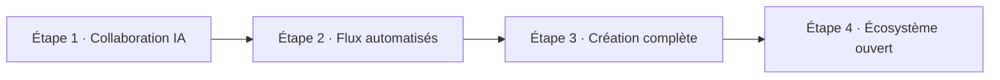

# Feuille de route | Roadmap

[简体中文](roadmap.md) | [English](roadmap.en.md) | [Français](roadmap.fr.md)

[Retour à l’accueil](../README.fr.md) · [Documentation](README.fr.md)

OpenPictureStudio réunit traitement d’image professionnel et collaboration IA au sein d’une plateforme ouverte, maîtrisée par les créateurs et extensible par les développeurs.

## Vision du produit

Les créateurs professionnels exigent des couleurs prévisibles, une précision tonale, un historique non destructif et des livrables cohérents ; le grand public cherche un passage simple de l’idée initiale à l’image aboutie ; les développeurs et agents IA demandent des contrats d’outils clairs, composables et vérifiables. OPS évolue autour d’un modèle d’image et de projet unifié où le jugement créatif humain, les algorithmes natifs et l’exécution IA collaborent sur la même œuvre.

## Socle actuel

OPS fournit une application de bureau Windows complète (le détail par version figure dans les [notes de version](https://github.com/KpTanl/OpenPictureStudio/releases)) :

- **Visualisation et retouche non destructive :** formats courants et décodage RAW, notation et tri, comparaison synchronisée, colorimétrie et masques locaux non destructifs, retouche de portrait, historique, synchronisation par lots et export multi-format.
- **Accélération GPU et native :** calcul d’image généraliste wgpu/D3D12 avec découpage en bandes hors VRAM (couleur, masques locaux, recadrage/rotation, retouche portrait et réduction du bruit classique qualifiée), accélération CPU Rust/Rayon/AVX2 et inférence DirectML facultative.
- **Collaboration IA :** assistant IA multimode avec analyse d’image de référence, comparaison de variantes A/B, mémoire de styles nommés et écriture annulable dans l’historique.
- **Extensibilité :** descripteurs d’outils unifiés, moteur de flux, schéma de projet `.opsproj` v4 et plug-ins d’image `image/1` en sous-processus de confiance.

## Évolution du produit en quatre étapes

### Étape 1 : Approfondir la collaboration créative avec l’IA

Relier plus étroitement l’assistant au contenu de l’image, à l’état d’édition et à l’intention du créateur :

- **Couverture transversale :** étendre l’assistant au tri, à la colorimétrie globale, aux masques locaux, au portrait et à l’export.
- **Contexte et style personnel :** enrichir l’analyse de couleur et de contraste d’images de référence et mémoriser styles nommés et préférences.
- **Exécution maîtrisée :** affiner la planification en plusieurs étapes, les retouches ciblées et la comparaison A/B entièrement annulable.

### Étape 2 : Mettre en place des flux de travail automatisés

Transformer une méthode de retouche réussie en un enchaînement composable, réutilisable et planifiable :

- **Orchestration de flux :** graphes de nœuds configurables, réutilisation de paramètres, exécution conditionnelle, entrées multiples et sous-flux réutilisables.
- **Traitement par lots et tâches de fond :** application intelligente par groupes de photos avec mise en pause, annulation et relance.
- **Interface pour agents externes :** ouvrir chargement, traitement, aperçu, enregistrement de projet et export afin que des agents IA externes orchestrent des tâches sans interface graphique.

### Étape 3 : Élargir à la création d’images complète

Unifier retouche paramétrique, composition de pixels et création générative au sein d’un même projet :

| Mode de retouche | Orientation |
| --- | --- |
| **Retouche non destructive** | Poursuivre l’amélioration de la science couleur RAW, des masques locaux et de la précision paramétrique |
| **Calques et pixels** | Introduire calques, sélections avancées, composition et édition directe au pixel reliés à l’historique `.opsproj` |
| **Retouche générative** | Intégrer génération d’images, retouche localisée et synthèse en continuité avec les outils couleur |

### Étape 4 : Construire un écosystème d’extensions ouvert

Déployer l’architecture **Everything is Plugin** pour une extensibilité durable :

- **API publique et SDK :** stabiliser contrats d’outils, schémas de paramètres, gestion des ressources et documentation développeur.
- **Isolation et permissions :** renforcer le cloisonnement des plug-ins, les limites d’accès, les quotas et la compatibilité inter-versions.
- **Partage communautaire :** faciliter la diffusion d’algorithmes tiers, d’adaptateurs de modèles, de styles et de modèles de flux.

## Chantiers d’ingénierie continus

| Chantier | Axes prioritaires |
| --- | --- |
| **Moteur CPU natif** | Étendre le parallélisme Rust + Rayon et la réutilisation des tampons, élargir AVX2 et évaluer FMA selon la précision tout en conservant le chemin x64 générique |
| **GPU multi-matériel** | Qualifier les GPU Intel, AMD et NVIDIA sur davantage d’outils IA et d’image, et affiner le partage mémoire wgpu/D3D12 et DirectML |
| **RAW et colorimétrie** | Accélérer le décodage RAW complet, la fluidité des aperçus et la fidélité en espace large / haute profondeur |
| **Architecture et qualité** | Poursuivre la modularisation PySide6, la reprise sur erreur, la stabilité en sessions longues et la compatibilité ascendante des projets |

## Collaboration ouverte et licence

Le code original d’OPS est sous [licence MIT](../LICENSE), tandis que les bibliothèques tierces et les modèles restent soumis à leurs licences respectives. Les priorités évoluent selon la maturité technique et les retours de la communauté via [GitHub Issues](https://github.com/KpTanl/OpenPictureStudio/issues).

## Documentation associée

- [Architecture et accélération native](architecture.fr.md)
- [Plug-ins d’image](image-plugins.fr.md)
- [Licences et composants tiers](licensing.fr.md)
