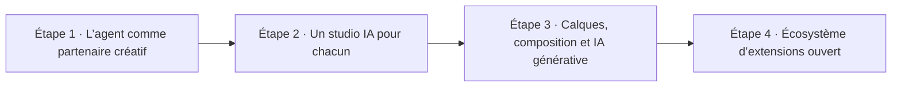

# Feuille de route | Roadmap

[简体中文](roadmap.md) | [English](roadmap.en.md) | [Français](roadmap.fr.md)

[Retour à l’accueil](../README.fr.md) · [Documentation](README.fr.md)

OpenPictureStudio ambitionne de devenir une plateforme ouverte de création d’images partagée par les humains et les agents IA.

## Vision du produit

Les agents IA de programmation progressent vite parce que le développement dispose d’environnements structurés, d’interfaces d’outils ouvertes et d’un historique partagé permettant aux agents d’appeler directement des outils pour mener leurs tâches à bien. La création d’images a besoin du même socle partagé entre humains et agents.

OPS construit ce socle. Humains et IA participent ensemble à la création : vous pouvez retoucher manuellement ou guider l’IA ; l’IA peut proposer des améliorations ou appliquer directement les réglages. Tous deux utilisent les mêmes outils professionnels et inscrivent leurs modifications dans un historique unique. Les créateurs professionnels obtiennent couleurs maîtrisées, précision tonale et livrables cohérents ; le grand public transforme ses idées en images concrètes ; les développeurs et agents IA disposent d’interfaces claires, composables et vérifiables. Tout cela repose sur un même modèle d’image et de projet.

Chaque étape de la feuille de route élargit ce que les humains et les agents peuvent accomplir ensemble.

## Socle actuel

OPS fournit une application de bureau Windows complète (le détail par version figure dans les [notes de version](https://github.com/KpTanl/OpenPictureStudio/releases)) :

- **Visualisation et retouche non destructive :** formats courants et décodage RAW, notation et tri, comparaison synchronisée, colorimétrie et masques locaux non destructifs, retouche de portrait, historique, synchronisation par lots et export multi-format.
- **Accélération GPU et native :** calcul d’image généraliste wgpu/D3D12 avec découpage en bandes hors VRAM (couleur, masques locaux, recadrage/rotation, retouche portrait et réduction du bruit classique qualifiée), accélération CPU Rust/Rayon/AVX2 et inférence DirectML facultative.
- **Collaboration IA :** assistant IA multimode avec analyse d’image de référence, comparaison de variantes A/B, mémoire de styles nommés et écriture annulable dans l’historique.
- **Extensibilité :** descripteurs d’outils unifiés, moteur de flux, schéma de projet `.opsproj` v4 et plug-ins d’image `image/1` en sous-processus de confiance.

## Évolution du produit en quatre étapes

### Étape 1 : L’agent comme partenaire créatif

Les agents IA s’intègrent plus profondément à OPS : ils comprennent l’image, vos besoins et votre style, proposent des pistes, choisissent les outils adaptés et réalisent des retouches plus fines. Les agents IA externes peuvent aussi appeler directement les outils professionnels d’OPS.

- **Interface pour agents externes :** ouvrir les interfaces d’appel pour le chargement, le traitement, l’aperçu, l’enregistrement de projet et l’export. Les agents externes peuvent exécuter leurs tâches en arrière-plan sans interface graphique ou se connecter à une instance OPS en cours d’exécution pour retoucher avec vous à l’écran.
- **Collaboration transversale :** élargir les outils accessibles à l’assistant sur le tri, la colorimétrie globale, les masques locaux, le portrait et l’export.
- **Mémoire de style :** analyser plus finement la couleur et les contrastes d’images de référence, et capitaliser sur des styles nommés et préférences durables.
- **Modifications maîtrisées :** planification en plusieurs étapes, retouches ciblées et comparaison de variantes A/B ; chaque modification peut être examinée, adoptée ou annulée.

### Étape 2 : Un studio IA pour chacun

Il vous suffit de définir le style souhaité et vos consignes : l’agent IA traite automatiquement toute une série de photos.

- **Traitement de séries complètes :** trier automatiquement par groupe de prise de vue, harmoniser le rendu de base et affiner image par image, tout en vous soumettant les clichés incertains.
- **Orchestration de flux :** enregistrer une retouche réussie en flux réutilisable avec nœuds configurables, réutilisation de paramètres, branchements conditionnels, entrées multiples et sous-flux réutilisables.
- **Tâches en arrière-plan :** exécuter les traitements de masse en arrière-plan avec suivi d’avancement, mise en pause, annulation et relance.
- **Cœur de traitement intégrable :** cœur de traitement d’image autonome découplé de l’interface de bureau, prêt à être intégré directement dans d’autres applications, scripts ou pipelines automatisés.

### Étape 3 : Calques, composition et IA générative

Ajouter calques, composition et IA générative au-dessus des outils de retouche existants, pour réaliser des créations plus complexes dans un même projet. La prise de vue d’origine reste clairement distincte du contenu généré par IA.

| Nouvelle capacité | Orientation |
| --- | --- |
| **Calques et retouche au pixel** | Calques, sélections avancées, composition multi-images et retouche directe au pixel intégrés à l’historique unifié et au format `.opsproj` |
| **Retouche générative IA** | Génération d’images, remplissage localisé et réécriture de contenu cantonnés aux calques et zones désignés, utilisables avec les outils couleur et masques |
| **Traçabilité de création** | Enregistrer pour chaque étape s’il s’agit de prise de vue, de réglage ou de génération et qui l’a validée, afin d’attester les éléments réellement photographiés |

### Étape 4 : Écosystème d’extensions ouvert

Autour du principe **Everything is Plugin**, chacun peut développer ses propres outils et les agents IA peuvent aider à en créer de nouveaux. Vous utilisez vos propres outils comme ceux partagés par d’autres, et l’écosystème continue de s’étendre.

- **API publique et SDK de plug-ins :** stabiliser contrats d’outils, déclarations de paramètres, gestion des ressources et interfaces d’exécution avec documentation complète et exemples.
- **Isolation et gouvernance des permissions :** exécuter les plug-ins dans un environnement isolé doté de limites de droits claires, de quotas de ressources et de règles de compatibilité inter-versions.
- **Création d’outils à la demande :** lorsque les outils existants ne suffisent plus, l’agent peut écrire un nouveau plug-in conforme au contrat, l’exécuter en environnement isolé et inscrire le résultat dans l’historique pour validation ; les outils utiles peuvent être partagés.
- **Partage d’outils et de savoir-faire :** diffuser algorithmes tiers, adaptateurs de modèles, styles personnels et modèles de flux.

## Chantiers d’ingénierie continus

| Chantier | Axes prioritaires |
| --- | --- |
| **Moteur CPU natif** | Étendre le parallélisme Rust + Rayon et la réutilisation des tampons, élargir AVX2 et évaluer FMA selon la précision tout en conservant le chemin x64 générique |
| **GPU multi-matériel** | Qualifier les GPU Intel, AMD et NVIDIA sur davantage d’outils IA et d’image, et affiner le partage mémoire wgpu/D3D12 et DirectML |
| **RAW et colorimétrie** | Accélérer le décodage RAW complet, la fluidité des aperçus et la fidélité en espace large / haute profondeur |
| **Architecture et qualité** | Poursuivre la modularisation PySide6, la reprise sur erreur, la stabilité en sessions longues et la compatibilité ascendante des projets |

## Collaboration ouverte et licence

Le code original d’OPS est sous [licence MIT](../LICENSE), tandis que les bibliothèques tierces et les modèles restent soumis à leurs licences respectives. Les priorités évoluent selon la maturité technique et les retours de la communauté via [GitHub Issues](https://github.com/KpTanl/OpenPictureStudio/issues).

## Documentation associée

- [Architecture et accélération native](architecture.fr.md)
- [Plug-ins d’image](image-plugins.fr.md)
- [Licences et composants tiers](licensing.fr.md)
