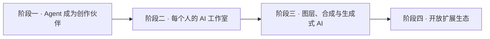

# 发展路线图 | Roadmap

[简体中文](roadmap.md) | [English](roadmap.en.md) | [Français](roadmap.fr.md)

[返回首页](../README.md) · [文档目录](README.md)

OpenPictureStudio 要做人和 AI Agent 共用的开放图像创作平台。

## 产品愿景

写代码的 AI Agent 发展得快，是因为编程有规范的代码环境、开放的工具接口和共享的操作历史，Agent 能直接调用工具完成任务。图像创作也需要这样一套人和 Agent 共用的基础。

OPS 想做这块基础。人和 AI 都是创作的参与者：人可以手动编辑，也可以指挥 AI；AI 可以提出建议，也可以直接执行修改。双方用同一套专业工具，修改写进同一条历史。专业创作者需要可控的色彩、光影和一致的交付；普通用户希望把想法变成具体的画面；开发者和 AI Agent 需要清楚、可组合、可检查的工具接口。这些都建立在同一套图像与项目模型上。

路线图的每一步，都让人和 Agent 能一起做得更多。

## 当前能力基线

OPS 已在 Windows 平台提供完整桌面体验，具备以下基础能力（各版本新增与变更以对应 [Release 说明](https://github.com/KpTanl/OpenPictureStudio/releases)为准）：

- **专业看图与编辑**：常见格式与相机 RAW 解码、筛选与联动比较、非破坏式调色与局部蒙版、人像美颜、历史撤销、成组调整与多格式批量导出。
- **GPU 与原生加速**：wgpu／D3D12 通用图像计算与超显存大图分条带计算（覆盖调色、局部蒙版、裁切旋转、美颜及通过自检的传统降噪）、Rust／Rayon／AVX2 CPU 加速与可选 DirectML 模型推理。
- **AI 协作**：内置多模式 AI 修图助手，支持参考图分析、A/B 方案对比、命名风格记忆，以及可撤销的编辑历史写入。
- **开放扩展**：具备统一工具描述、工作流引擎、`.opsproj` schema 4 项目模型及受信 `image/1` 子进程图像插件接口。

## 四阶段产品演进

### 阶段一：Agent 成为创作伙伴

AI Agent 更深入地融入 OPS：理解画面，理解你的需求和创作风格，提出建议，选择合适的工具，完成更精细的编辑。外部 AI Agent 也能直接调用 OPS 的专业工具。

- **外部 Agent 接口**：开放照片加载、处理、预览、项目保存与导出调用接口。外部 Agent 既可在后台无界面执行任务，也可以连上正在运行的 OPS，和你同屏修改。
- **跨工具协作**：扩大助手能调用的范围，覆盖选片、全局调色、局部蒙版、人像处理与导出。
- **风格沉淀**：更准确地分析参考图的色彩和影调，积累和复用命名风格与长期偏好。
- **可控修改**：多步骤计划、局部精修和 A/B 方案对比。所有调整都可以审阅、采用或撤销。

### 阶段二：每个人的 AI 工作室

你只需要定下喜欢的风格和处理要求，AI Agent 按你的要求自动完成整组照片的编辑。

- **整组处理**：按拍摄分组自动选片、统一基调、逐张精修。拿不准的照片交给你决定。
- **流程编排**：把一次满意的修图存成流程，支持可配置节点、参数复用、条件分支、多输入和可复用的流程片段。
- **后台任务**：大批量处理在后台运行，可以查看进度、暂停、取消和重试。
- **可嵌入的处理核心**：剥离桌面界面的独立图像处理核心，可直接嵌入其他应用、脚本或自动化流水线。

### 阶段三：图层、合成与生成式 AI

在现有的修图能力之上，加入图层、合成和生成式 AI，在同一个工程里完成更复杂的创作，同时清楚地区分原始拍摄内容和 AI 生成的内容。

| 新增能力 | 演进目标 |
| --- | --- |
| **图层与像素级编辑** | 图层、专业选区、多图合成和直接像素修饰，接入统一历史与 `.opsproj` 保存 |
| **生成式 AI 编辑** | 图像生成、局部重绘和内容改写，限定在指定的图层和区域里，和调色、蒙版工具一起使用 |
| **创作记录** | 记录每一步来自拍摄、调整还是生成，由谁确认。成品能说清楚哪些部分是真实拍到的 |

### 阶段四：开放扩展生态

围绕 **Everything is Plugin**：人可以开发自己的工具，AI Agent 也能帮助创造新工具；既能用自己做的工具，也能用别人分享的工具，整个生态持续扩展。

- **公共 API 与插件 SDK**：稳定工具契约、参数声明、资源管理与运行接口，配完整的文档和示例。
- **隔离与权限治理**：插件在隔离环境里运行，有明确的权限边界、资源配额和跨版本兼容策略。
- **按需造工具**：现有工具做不到时，Agent 可以按工具契约写出新插件，在隔离环境里运行，结果写进历史给你审阅。好用的工具可以分享出去。
- **工具与经验分享**：分享第三方算法、模型适配器、个人风格和工作流模板。

## 持续工程主线

| 工程主线 | 持续演进重点 |
| --- | --- |
| **原生 CPU 引擎** | 深化 Rust + Rayon 多线程与缓冲复用，扩展 AVX2 覆盖并在高精度要求下探索 FMA 等指令优化，保留通用兼容路径 |
| **跨硬件 GPU 加速** | 持续验证 Intel、AMD、NVIDIA 显卡资格并扩展至更多 AI 与图像节点，完善 wgpu／D3D12 与 DirectML 的显存及调度协同 |
| **RAW 与色彩管理** | 优化完整 RAW 解码效率、预览切换流畅度与宽色域／高位深色彩管理质量 |
| **架构与工程质量** | 基于 PySide6 推进模块化拆分、异常恢复强化、长时间编辑稳定性及跨版本项目兼容 |

## 开源协作与许可

项目原创源码采用 [MIT License](../LICENSE)，第三方组件与模型遵循各自许可。功能优先次序将结合技术成熟度与社区实际反馈持续调整，欢迎通过 [GitHub Issues](https://github.com/KpTanl/OpenPictureStudio/issues) 提出使用场景或扩展建议。

## 相关文档

- [架构与原生加速](architecture.md)
- [图像插件接口](image-plugins.md)
- [许可证与第三方组件](licensing.md)
